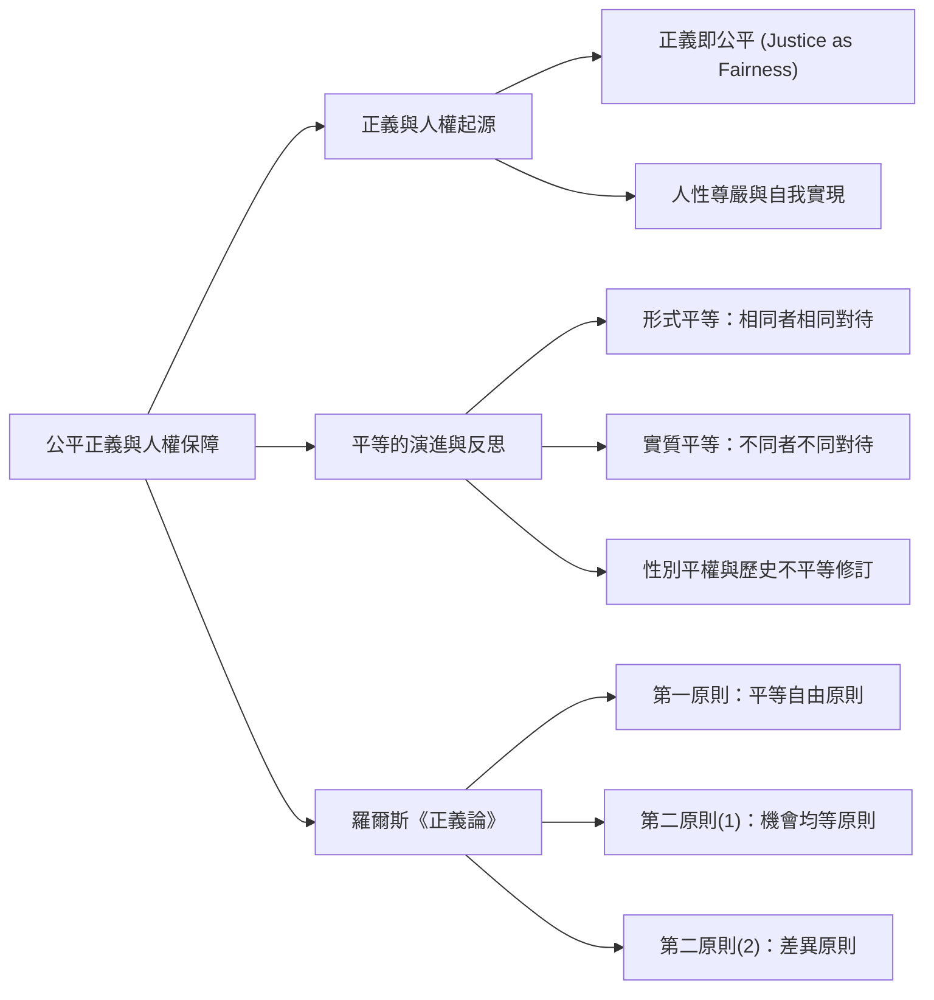
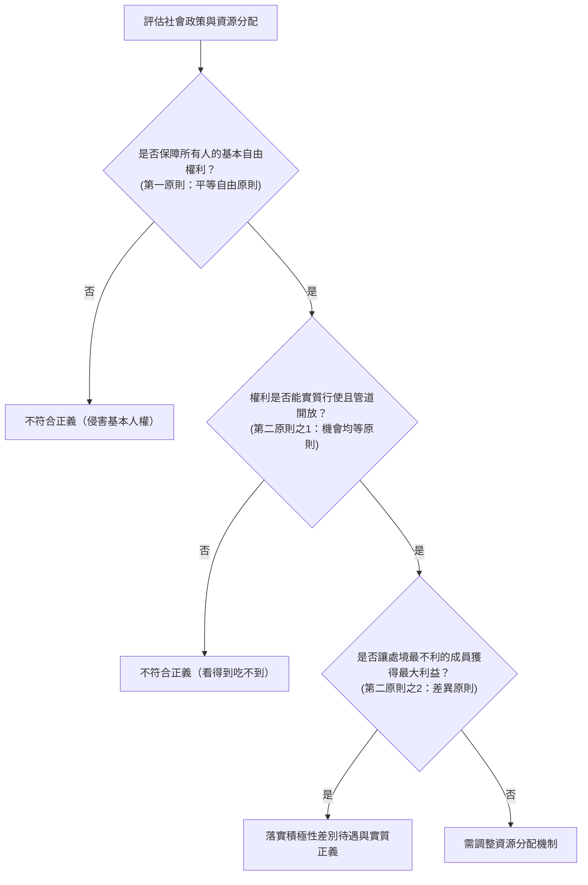

## 📖 課堂主題與核心摘要 (Class Overview)
本堂課為高中公民「公平正義與人權保障」單元，重點探討「正義即公平」的核心學術定義、人性尊嚴與人權的深層關聯，以及社會從「形式平等」走向「實質平等」的演進脈絡。老師詳細檢視了歷史上法律對女性的不合理規定，並深入剖析羅爾斯（John Rawls）《正義論》中的兩大原則（包含三個條件順序）：平等自由原則、機會均等原則與差異原則。學習目標在於掌握如何透過「積極性差別待遇」（積極平權措施）保障處境不利成員，落實社會的實質正義。

## 💡 核心知識點與觀念詳解 (Key Concepts)

### 1. 正義（Justice）的學術定義：正義即公平
- **語境觀念修正**：大眾文化或影視作品（如超級英雄打擊壞人）常將正義解讀為「賞善罰惡」，但公民學與學術上講述的 **Justice**，背後核心含義純粹為**「公平」（Fairness）**。
- **人權的開端**：人權之所以產生，與公平息息相關。若不認識並承認個體之間的「差異」，就無法真正做到公平。
- **經典生活比喻與反思**：
  * 大多數超級英雄（如超人拯救女友、蜘蛛人關心私事、復仇者聯盟進行復仇）本質上並非學術意義上的「公平」。
  * 動漫《我的英雄學院》中歐爾麥特「一人為我，我為人人」的概念，反而較接近公民學講述的社會公平。

### 2. 人性尊嚴（Human Dignity）與人權起源
- **專有名詞定義**：人性尊嚴是指**「人可以決定自己的生活方式與人生方向，並得以自我實現」**。這是人權概念出現的最根本核心。
- **歷史對比說明**：早年人類缺乏人性尊嚴保障時，常被當作奴隸或寵物飼養（如無尊嚴地被以 500 元任意買賣、被強迫角鬥）。正因為人類內心萌生「不願被如此對待」的感受，才開啟了爭取人權與保障尊嚴的歷史演進。

### 3. 形式平等 vs. 實質平等
- **形式平等（無差別對待）**：「相同的給予相同對待」。例如：普通選舉原則（一人一票、票票等值）。
  * *邏輯盲點*：若僅強調相同對待，當遇到腳受傷的同學時，若堅持「大家都是人，一律只能走樓梯不能搭電梯」，反而會造成實質上的極度不公。因此「相同的給予相同對待」的反面邏輯必須是「不同的必須給予不同對待」。
- **實質平等（合理之差別對待）**：「不同的給予不同對待」。例如：女性生理假、原住民保障名額等。
  * *歷史檢視（法律中舊有的性別不平等）*：過去法律常直接納入男尊女卑觀念（如父權優先原則、妻隨夫居、冠夫姓、離婚後孩子親權強制歸夫、婦女離婚後三個月內禁止再婚等）。現代法律已全面修訂，朝向實質平權邁進。

### 4. 羅爾斯（John Rawls）《正義論》與積極性差別待遇
羅爾斯的《正義論》（A Theory of Justice）是本章節最核心的考點。他提出了落實積極性差別待遇的**「兩大原則、三個條件順序」**：

【⏱️ 羅爾斯正義原則之操作順序流程圖】：

- **第一順序｜平等自由原則（Equality of Liberty Principle）**：每個人都擁有平等的基本自由與人權（類似形式平等、人皆有權）。
- **第二順序(1)｜機會均等原則（Equal Opportunity Principle）**：確保每個人的權利能真正實行與被保障，避免「看得到吃不到」。
- **第二順序(2)｜差異原則（Difference Principle）**：允許社會存在不平等，但資源分配必須使**「處境最不利的成員獲得最大的利益」**。

【經典生活例題與比喻拆解】：
- **「搶貓罐頭」比喻**：
  1. *平等自由原則*：擺一個罐頭在地上，每隻貓都可以來吃（人皆有權）。
  2. *機會均等原則*：若大貓試圖咬死或排擠小貓獨佔食物，必須給予安全保障與機制，確保每隻貓都有實質吃到食物的權利（防止權利無法行使）。
  3. *差異原則*：場上有一隻特別瘦弱殘疾的小貓，即使分到一樣多的食物依然孱弱。因此必須給予特別補充與照顧，讓處境最不利者得到最大利益。
- **「大學入學與社會政策」實例**：
  * 清華大學「旭日組」招生管道：專門招收經濟或環境處境不利的學生，即為「差異原則」的具體實踐。
  * 原住民文化保障：反思傳統假期皆以漢人文化為主，若要落實積極平權，應思考給予原住民歲時祭儀（如豐年祭、莫那魯道紀念日）等特別假期的必要性。

【📊 觀念與易混淆對比表】：
| 對比維度 | 形式平等 (Formal Equality) | 實質平等 (Substantive Equality) / 積極性差別待遇 |
| :--- | :--- | :--- |
| **核心概念** | 相同的給予相同對待（無差別對待） | 不同的給予不同對待（合理之差別對待） |
| **出發點** | 忽視個體背景與條件差異 | 承認個體處境、歷史與環境之不平等 |
| **代表原則** | 一人一票、基本自由權利保障 | 差異原則、機會均等原則 |
| **典型例證** | 一般高中生的基本報考資格 | 清大旭日組、原住民保障名額、女性生理假 |
| **潛在盲點** | 易造成強者恆強，弱者「看得到吃不到」 | 須妥善劃定界線，避免引發反向歧視疑慮 |

## ⚠️️ 老師強調考點與易錯陷阱 (Exam Focus & Pitfalls)
- **考點 1：正義的學術定義**：選擇題看到「正義」，切勿選「賞善罰惡」或「打擊壞人」，請務必直接替換為**「公平」**。
- **考點 2：羅爾斯兩原則的三條件順序（星號必考）**：
  * 順序絕不可顛倒：**平等自由原則 ➔ 機會均等原則 ➔ 差異原則**。
  * 考試常在「機會均等」與「差異原則」的順序上出誘導選項。
- **常見易錯陷阱**：
  * 誤以為「實質平等」就是無條件給予優待。事實上必須先滿足平等自由與機會均等後，才能進入「差異原則」（針對處境最不利者進行極大化補充）。
  * 誤以為「相同的給予相同對待」就是完美的平等，忽視了「不同的給予不同對待」的反面邏輯思考。

## 🔑 記憶口訣與解題技巧 (Mnemonics & Shortcuts)
- **羅爾斯正義三階破題 SOP**：
  1. **一查自由**：是否人人具備基本權利？（平等自由原則）
  2. **二查管道**：權利是否被強者壟斷或無法行使？（機會均等原則）
  3. **三查弱勢**：是否對最不利的成員給予最大利益？（差異原則）
- **速記口訣**：「**等 ➔ 機 ➔ 差**」（平等自由 ➔ 機會均等 ➔ 差異原則）。
- **觀念小結**：學習公民概念需具備「反向思考」能力（如課堂冷笑話暗示的逆向邏輯），看到法律條文時要主動思考其反面情況與適用邊界。

## 📝 課後作業與待辦事項 (Homework & Tasks)
- **課堂交代**：無特定作業（請學生課後務必複習課本第 51-52 頁羅爾斯理論與圖表，並預習後續社會安全制度章節）。

---
## 📚 專有名詞與重要公式/定義 (Glossary & Formulas)
* [正義即公平 (Justice as Fairness)]: 學術上正義的核心概念為公平分配與合理對待，而非民間傳統觀念的賞善罰惡。
* [人性尊嚴 (Human Dignity)]: 指個人能自主決定生活方式與方向，進而達成自我實現的根本人權概念。
* [形式平等 (Formal Equality)]: 相同的給予相同對待，不考慮個體背景與條件差異的齊頭式平等。
* [實質平等 (Substantive Equality)]: 不同的給予不同對待，考慮個體處境差異所進行的合理差別對待。
* [積極性差別待遇 (Affirmative Action)]: 為消除歷史或結構性不平等，對特定弱勢族群採取的保障、優惠或補償措施。
* [平等自由原則 (Principle of Equal Liberty)]: 羅爾斯正義論第一原則，主張每個人均享有平等的自由權利體系。
* [機會均等原則 (Principle of Fair Equality of Opportunity)]: 羅爾斯正義論第二原則之一，主張各項職位與機會對所有人開放，並需提供實質公平的競爭機會。
* [差異原則 (Difference Principle)]: 羅爾斯正義論第二原則之二，主張社會與經濟的不平等安排，必須對處境最不利的成員最為有利（Maximin）。

## 🧠 課後自測題 (Quick Review Quiz)

**第一題**：某大學針對偏遠地區及經濟弱勢學生設立「特殊選才專案」保障名額，請問這符合羅爾斯正義論中的哪一原則？
> **解題思維與答案**：符合「差異原則」。因為該政策針對社會中「處境最不利的成員」（經濟或環境弱勢學生），透過給予特別入學管道與名額，使其獲得相對有利的升學機會。

**第二題**：若某政府規定「所有人不分男女身體狀況，皆必須強制服兵役兩年」，這屬於「形式平等」還是「實質平等」？會有何盲點？
> **解題思維與答案**：屬於「形式平等」（相同的給予相同對待）。盲點在於忽視了個體生理條件差異與特殊處境，強求絕對一致的對待方式，反而可能導致實質上的不公正。

---
💡 筆記整理完畢！是否需要為你製作這份課堂筆記的測驗題庫、閃卡，或是針對「羅爾斯正義論」進行更深入的考題解析？