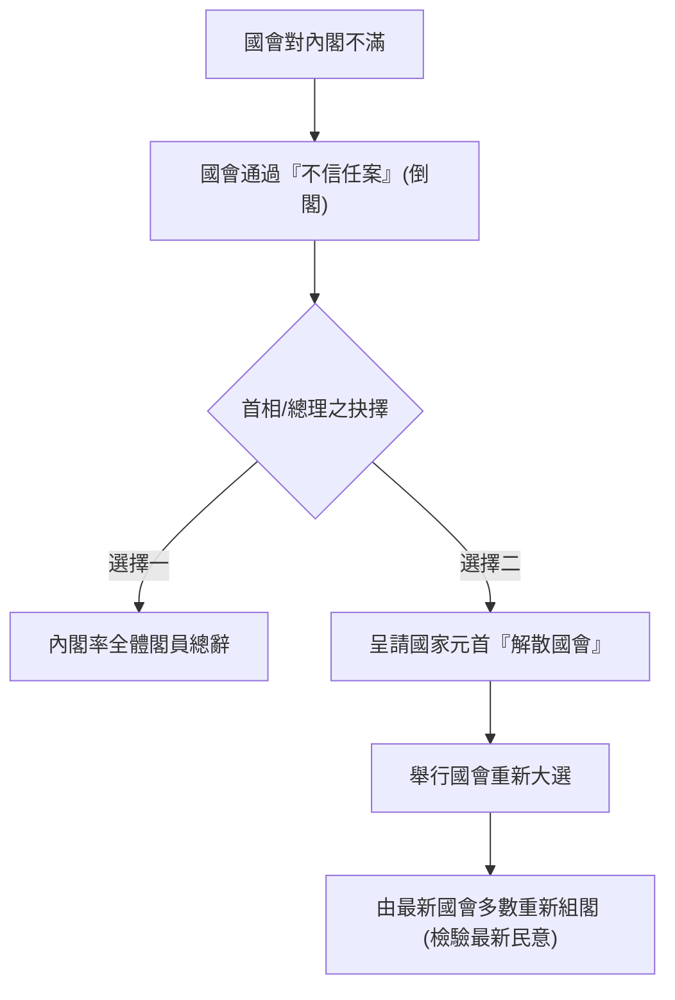
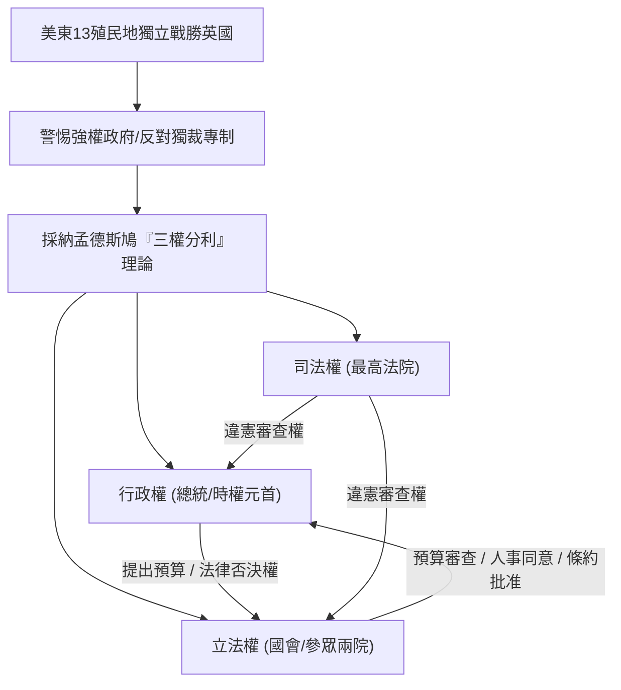

## 📖 課堂主題與核心摘要 (Class Overview)
本堂課核心探討民主國家兩大主流憲政體制——「內閣制」與「總統制」的組織架構、運作邏輯及其優缺點比較。老師透過「虛位元首與吉祥物」、「做作業分組」以及「三頭龍與互相持刀對峙」等生動比喻，深入剖析內閣制的行政立法融合與總統制的嚴格三權分利。結合歷史脈絡（如美國十三殖民地背景）與各國實例（英國、德國、美國），幫助學生掌握不同制度下權力互動、民意基礎與政局穩定度的核心差異，為高中公民與社會科憲政專題奠定紮實基礎。

【🌳 本課大綱樹狀心智導圖 (Mindmap)】：

```mermaid
graph LR
  Root["民主政府體制比較"] --> A["內閣制 (Parliamentary System)"]
  Root --> B["總統制 (Presidential System)"]
  
  A --> A1["核心特徵：行政與立法融合"]
  A --> A2["元首定位：虛位元首 (吉祥物/凝聚力)"]
  A --> A3["制衡機制：不信任案與解散國會"]
  A --> A4["運作優缺點：高效率與權責分明 vs 政局易不穩/聯合內閣爭執"]

  B --> B1["核心特徵：嚴格三權分利 (孟德斯鳩/三頭龍比喻)"]
  B --> B2["元首定位：時權元首 (國家元首 + 行政首長)"]
  B --> B3["民意基礎：雙元式民意 (總統與國會各自受權)"]
  B --> B4["權力牽制：法律否決權、預算審查、人事同意與國情咨文"]
```

## 💡 核心知識點與觀念詳解 (Key Concepts)

### 一、 內閣制（Parliamentary System）運作邏輯與特點

1. **虛位元首的定位與比喻**
   - **觀念解析**：內閣制的國家元首（如英國國王、德意志聯邦共和國總統）為「虛位元首」，僅具象徵性地位，無實質行政大權。
   - **課堂經典比喻（吉祥物與啦啦隊）**：
     - **吉祥物效應**：老師將虛位元首比作球隊的吉祥物或啦啦隊。吉祥物的作用是提供凝聚力、讓大眾感到喜愛與安心，其可愛程度與球隊的實際戰績（政績）無關。
     - **生活實例**：台北市的「熊讚」、台南市的「虱目魚」、高雄市的吉祥物貓咪、新竹穿客家衣服的獅子。民眾喜歡吉祥物能增強認同感，但不代表吉祥物要負責市政決策。
     - **各國體制差異**：英國無總統（由君主擔任虛位元首）；德國設有「總統」，但德國總統屬於虛位元首，與美國的實權總統性質完全不同。

2. **行政與立法的融合（以國會為核心）**
   - **權力來源**：行政權（內閣）來自立法權（國會多數黨或執政聯盟），內閣閣員通常兼任國會議員。
   - **制度優勢**：
     - **施政效率高**：行政與立法立場一致，法案與預算容易順利通過。
     - **權責分明（政治責任明確）**：由於行政與立法為同一執政團隊，政策成敗直接由該黨承擔，責任易於追究。
   - **潛在風險（濫權疑慮與司法監督）**：
     - 行政立法融合可能導致多數暴力或行政濫權。但老師特別強調：這**不等於專制獨裁**，因為內閣制國家仍保有「獨立運作的司法權」，司法機關仍可對違法或濫權行為進行監督與裁決。

3. **雙向制衡機制：不信任案與解散國會**
   - **國會對內閣**：國會可對內閣提出「不信任案」（倒閣），迫使內閣總辭。
   - **內閣對國會**：內閣總理（首相）被倒閣時，亦可呈請元首「解散國會」，進行重新大選。
   - **課堂比喻**：雙方互相「打對方一拳」。國會打內閣一拳（不信任案），內閣反打國會一拳（解散國會），交由選民做最終裁判。
   - **最新民意檢驗**：由於民意如流水，此機制能隨時重新檢驗並反應最新民意；但缺點是若頻繁倒閣與重選，會導致「政局不穩定」。

4. **聯合內閣（Coalition Cabinet）與分組做作業比喻**
   - **形成背景**：當國會無單一政黨取得過半席次時，必須由數個政黨聯合組成內閣。
   - **課堂經典比喻（學生分組做作業）**：
     - 聯合內閣就像學校課堂上的分組報告。為了湊足人數過關，有時必須跟立場或理念不完全相同的組員合作。
     - **利益交換與抬高身價**：小黨深知大黨需要自己的席次湊成多數，因此會進行政治叫牌（例如：「不給我特定部長職位，我就不合作」）。這種權力共享易引發內部爭執與政局動盪。

---

### 二、 總統制（Presidential System）運作邏輯與特點

1. **歷史起源與美國十三殖民地背景**
   - **歷史脈絡**：美國獨立戰爭後，十三個殖民地（13 States）剛脫離英國殖民統治，極度反對並警惕強大且集權的中央政府。
   - **國家名稱（United States of America）**：全名即代表「許多獨立州的聯合體」，各州早期擁有各自的法律、軍隊與運作制度。為了防止產生獨裁者，憲法設計的核心理念是「相互牽制與嚴格分權」。

2. **核心精神：嚴格的三權分利（Separation of Powers）**
   - **理論來源**：落實法國學者孟德斯鳩的三權分利理論。
   - **課堂經典比喻（三頭龍與刀頂對方喉嚨）**：
     - **三頭龍（Three-headed Dragon）**：三權（行政、立法、司法）就像一隻三頭龍的三顆頭，每顆頭有各自的想法，經常互相爭吵或牽制。雖然對外看似強大，但內部三頭互相吵架時容易引發施政僵局。
     - **互相持刀對峙**：三權之間的關係並非和睦相處，而是彼此拿著刀頂著對方的喉嚨，保持極度緊張的動態平衡。

3. **雙元式民意基礎（Dual Legitimacy）**
   - **雙重授權**：總統與國會議員分別由人民直接或間接選舉產生，各自擁有獨立的民意授權。
   - **政局影響**：當總統與國會多數黨屬於不同政黨時（分府政府），雙方均代表民意，容易出現「各說各話」、互不相讓的政策僵局。

4. **時權元首（兼具雙重身份）**
   - **公式定義**：\\(\text{總統權利} = \text{國家元首身份 (1)} + \text{最高行政首長身份 (2)}\\)。
   - **公佈法律與簽署責任**：總統公佈法律命令時**不需要**部長副署（背署），因為總統本身就是最高行政首長，直接對全民負責。

5. **行政與立法的相互牽制機制**
   - **總統對國會**：
     - **法律否決權（Veto）**：國會通過的法案，總統可以退回否決。
     - **國情咨文（State of the Union）**：總統得至國會發表演說，但僅具政治宣示與道德說服作用，總統無權直接向國會提出法案。
   - **國會對總統**：
     - **財政權（預算審查權）**：總統提出預算案，但審查與通過權完全掌握在國會手上（「錢袋子」在國會）。
     - **人事同意權與人事調查**：總統任命重要官員與法官，需經國會審查與同意。
     - **條約與宣戰同意權**：總統對外簽署條約或宣戰需經國會批准。
   - **無法解散與倒閣**：總統無權解散國會，國會亦無法通過不信任案解散內閣，雙方各自任期固定、各司其職。

---

【⏱️ 時序時間軸 / 步驟流程圖】：

#### 1. 內閣制「不信任案與解散國會」互動流程圖

#### 2. 美國總統制起源與嚴格三權分利架構圖

---

【📊 觀念與易混淆對比表】：內閣制 vs. 總統制深度比較

| 比較項目 | 內閣制 (Parliamentary System) | 總統制 (Presidential System) |
| :--- | :--- | :--- |
| **元首定位** | **虛位元首**（僅象徵國家，如吉祥物/啦啦隊） | **時權元首**（兼任國家元首與最高行政首長） |
| **權力結構** | **行政與立法融合**（以國會為核心） | **嚴格三權分利**（行政、立法、司法互相獨立） |
| **民意基礎** | **單一民意**（人民僅選舉國會議員，內閣由國會產生） | **雙元式民意**（人民分別選舉總統與國會議員） |
| **法案與預算提出** | 由內閣直接向國會提出 | 總統提預算案；法案由國會議員提出，總統僅能發起國情咨文建議 |
| **公佈法律副署** | 需要行政首長（首相/部長）簽署副署 | **不需要**閣員副署（總統自行簽署並承擔全責） |
| **相互制衡機制** | 國會可提**不信任案**；內閣可**解散國會** | 總統享有**法律否決權**；國會享有**預算審查/人事同意/條約批准** |
| **政局運作優缺點** | **優點**：施政效率高、責任明確。 **缺點**：倒閣頻繁易致政局不穩；聯合內閣易爭吵。 | **優點**：行政權穩定（固定任期）。 **缺點**：府會對立時易產生政治僵局、各說各話。 |
| **代表國家範例** | 英國、德國（德國總統為虛位）、日本 | 美國、拉丁美洲國家、菲律賓 |

---

## ⚠️ 老師強調考點與易錯陷阱 (Exam Focus & Pitfalls)

1. **考點一：德國總統 vs. 美國總統的制度差異（高頻星號考題）**
   - **易錯陷阱**：看到「總統」二字就以為是總統制！
   - **觀念釐清**：德國雖然設有總統，但屬於「內閣制」下的虛位元首（主要負責象徵性外交與儀式）；美國總統才是「總統制」下兼具國家元首與行政首長的「時權元首」。

2. **考點二：內閣制的行政立法融合不等於專制獨裁**
   - **易錯陷阱**：認為內閣制行政與立法權力融合成一體，就會演變成專制或極權。
   - **觀念釐清**：內閣制雖然沒有傳統行政與立法的嚴格分立，但其運作仍受民主機制監督，且**存在獨立運作的司法權**進行合憲性與合法性審查，因此與無法律約束的專制獨裁有本質上的不同。

3. **考點三：總統公佈法律命令「不需要副署」**
   - **易錯陷阱**：誤以為所有民主國家公佈法律都需要閣員副署。
   - **觀念釐清**：副署制度是內閣制下為了保護「虛位元首不擔負政治責任」而設計（由實際行政首長背書）。總統制的總統本身即為最高行政首長，自己決策並向選民負責，因此公佈法律不需要部長副署。

4. **考點四：國情咨文（State of the Union）非立法提案**
   - **易錯陷阱**：以為美國總統至國會發表國情咨文是在「提出法案」。
   - **觀念釐清**：在嚴格三權分立下，總統無權向國會直接提案。國情咨文僅為總統向國會發表的政策演說與政治建議，屬於道德說服性質，國會無義務必須照單全收。

---

## 🔑 記憶口訣與解題技巧 (Mnemonics & Shortcuts)

1. **破題速記口訣：【內閣吉祥融國會，總統三頭雙民意】**
   - **內閣吉祥融國會**：內閣制元首是「吉祥物」（虛位）；行政立法「融合」；核心在「國會」（行政權源自國會）。
   - **總統三頭雙民意**：總統制像「三頭龍」（嚴格三權分利）；具備總統與國會的「雙元民意」授權。

2. **解題判斷 SOP（三步驟快速鎖定題型）**
   - **Step 1 查元首與行政首長關係**：
     - 元首無實權、僅為象徵 \\(\rightarrow\\) 內閣制（虛位元首）。
     - 元首即最高行政首長 \\(\rightarrow\\) 總統制（時權元首）。
   - **Step 2 查制衡工具**：
     - 出現「倒閣（不信任案）」或「解散國會」 \\(\rightarrow\\) 內閣制。
     - 出現「法律否決權」、「預算審議與人事同意」且無解散國會權 \\(\rightarrow\\) 總統制。
   - **Step 3 查責任背署**：
     - 公佈法律需行政首長副署背書 \\(\rightarrow\\) 內閣制。
     - 總統直接簽署公佈免副署 \\(\rightarrow\\) 總統制。

---

## 📝 課後作業與待辦事項 (Homework & Tasks)

- **課堂交代事項**：無特定作業。
- **自主延伸學習建議**：課後可自行上網搜尋「台灣各縣市吉祥物」（例如台北熊讚、台南虱目魚等），加深對「虛位元首/凝聚力象徵」概念的理解與印象。

---
## 📚 專有名詞與重要公式/定義 (Glossary & Formulas)

* [虛位元首 (Head of State)]: 內閣制下的國家元首，僅具代表國家與凝聚國族認同的象徵性地位，不具備實際行政決策權。
* [時權元首 (Executive Head of State)]: 總統制下的總統，兼具國家象徵元首與最高行政首長雙重身份，綜理國家行政大權。
* [行政與立法融合 (Fusion of Powers)]: 內閣制的核心特徵，行政機關（內閣）由立法機關（國會）多數黨產生，閣員多兼任國會議員，政策推動具高度連動與效率。
* [三權分利 (Separation of Powers)]: 總統制的核心特徵，將政府權力嚴格劃分為行政、立法、司法三者，各自獨立運作且互相嚴格牽制與平衡。
* [雙元式民意 (Dual Legitimacy)]: 總統制下，總統與國會議員分別透過獨立的民意選舉產生，雙方均擁有合法的民意授權，容易在府會對立時產生政策僵局。
* [聯合內閣 (Coalition Cabinet)]: 當國會無任何政黨席次過半時，由數個政黨透過政治協商與權力共享共同組成的內閣體制。
* [不信任案與解散國會 (Vote of No Confidence & Dissolution of Parliament)]: 內閣制下國會倒閣與內閣解散國會的政治制衡機制，用以隨時反應與重驗最新民意。
* [總統行政權公式]: \\(\text{總統權力} = \text{國家元首身份 (1)} + \text{最高行政首長身份 (2)}\\)。

---

## 🧠 課後自測題 (Quick Review Quiz)

**【思考題一】**
某國舉辦全國大選，選出新一屆國會議員，隨後由國會佔多數的政黨領袖出任總理，而該國國王僅出席開幕典禮與頒發勳章。請問該國屬於何種憲政體制？若國會對總理政策不滿，可採取何種制衡機制？
> **解題思維與簡答**：該國屬於**內閣制**（國王為虛位元首，總理由國會多數黨產生）。若國會不滿總理政策，可對內閣提出**「不信任案」（倒閣）**；而總理亦可呈請國王**「解散國會」**重新大選。

**【思考題二】**
甲國總統與國會多數黨屬於不同政黨。當總統向國會提出年度預算案時，國會大幅刪減預算，總統憤而召開記者會批評國會，但無法解散國會。請問甲國最可能屬於何種制度？為何總統無法解散國會？
> **解題思維與簡答**：甲國屬於**總統制**。因為總統制實施嚴格的**三權分利**與**雙元式民意**，總統與國會任期固定且各自對選民負責，國會掌握預算審查權，而總統無權解散國會。

**【思考題三】**
為什麼內閣制國家雖然行政與立法權力融合，卻不會輕易變成專制獨裁國家？
> **解題思維與簡答**：因為內閣制國家仍設有**獨立運作的司法權**，能進行違憲審查與違法監督；此外，內閣隨時面臨國會不信任案的監督以及定期民意選舉的洗禮，故與專制獨裁有實質差異。

---

💡 這份筆記已完整歸納本堂課關於「內閣制與總統制」的所有重點與生動比喻。如果你希望進一步針對「雙首長制（半總統制）」進行延伸對比，或想嘗試做幾道模擬測驗題，隨時告訴我！