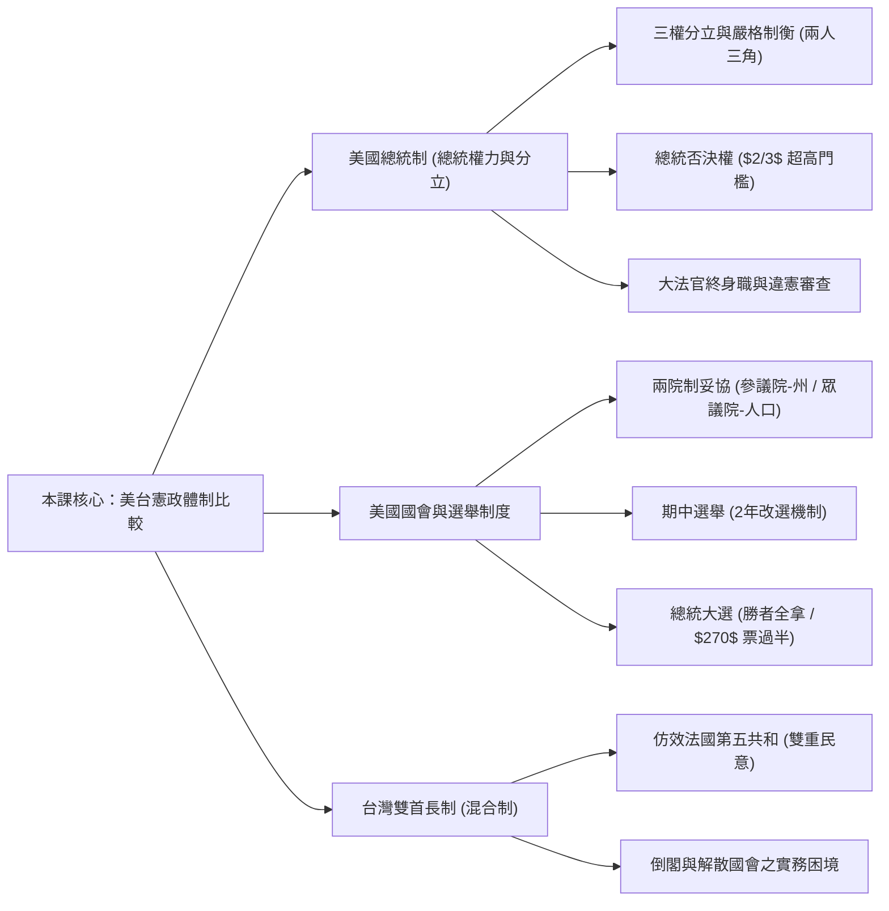
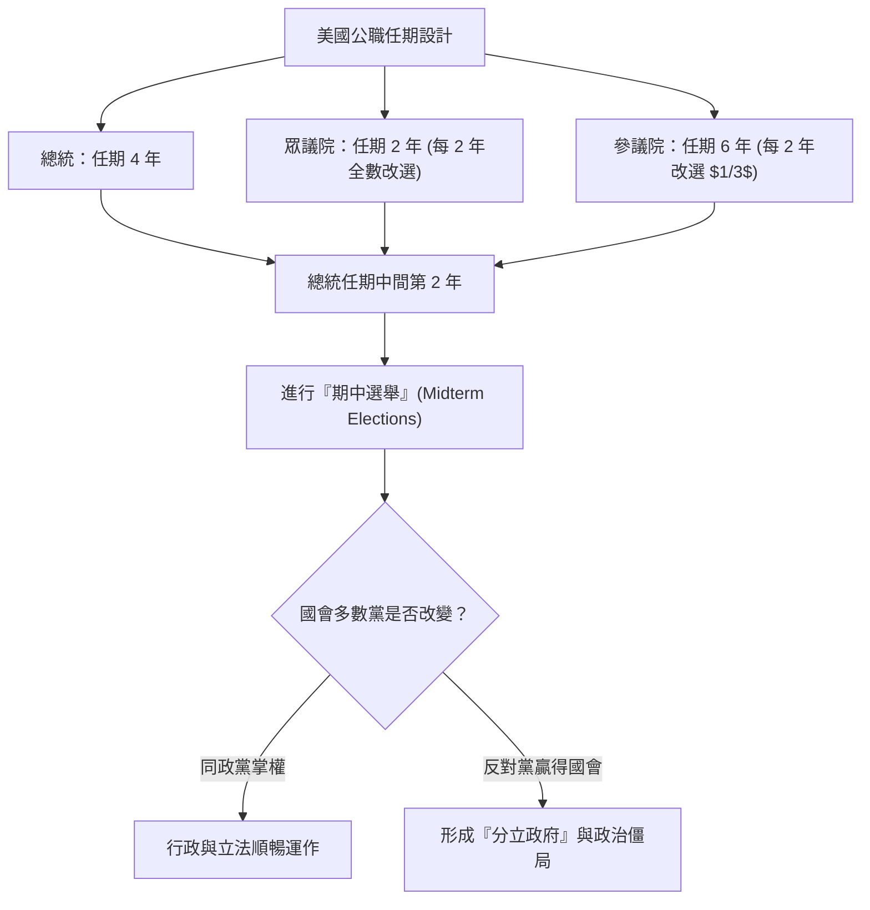

## 📖 課堂主題與核心摘要 (Class Overview)
本堂課主要探討民主國家憲政體制中的「美國總統制」與「台灣雙首長制（混合制）」。課堂深入剖析了美國三權分立與嚴格制衡機制（如總統否決權之高門檻、終身職大法官之違憲審查）、兩院制國會（參議院與眾議院）的歷史妥協起源、期中選舉及總統大選之選舉人團制度。同時，老師對比了我國仿效法國雙首長制的實務運作，特別點出立法院不信任案與解散國會機制在現實中的制度困境。學習目標在於融會貫通不同體制之設計初衷、運作優缺點，並掌握考題中常見的易錯陷阱與核心概念。

## 💡 核心知識點與觀念詳解 (Key Concepts)

### 1. 美國總統制：嚴格分權與「兩人三角」制衡機制
- **核心觀念與推導**：
  美國憲法採用「嚴格分權」（Separation of Powers）原則，行政、立法、司法三權各自獨立運作且互相牽制。
  - **行政與立法之牽制**：
    - **總統否決權 (Veto Power)**：若國會通過之法案總統不同意，可退回國會。老師特別強調：課本常誤用台灣法律用語「覆議」，美制英文原文實為「否決權」。
    - **重新表決門檻**：國會一般法案通過之基本門檻為過半數（即 \\(> \frac{1}{2}\\)）；但當總統行使否決權後，國會若要推翻總統否決，必須經**參議院**與**眾議院**兩院各自達到高門檻的三分之二（即 \\(> \frac{2}{3}\\)）同意。這項雙重三分之二門檻使得美國總統的否決權極具實質威脅力。
    - **權力對等分割**：總統擁有「人事提名權」與「預算提出權」；國會則擁有「人事同意權」與「預算審查權」，兩者互相卡關與對應。
  - **司法權之獨立與違憲審查**：
    - 聯邦最高法院（大法官）掌握「違憲審查權」（Judicial Review），既可宣告總統行政命令違憲，亦可宣告國會法律違憲。
    - 大法官採**終身職**（Life Tenure），僅在死亡或主動辭職時出缺。因此並非每任總統或每屆國會皆有機會提名同意大法官，這保障了司法權高度獨立於政黨輪替與政治壓力之外。

- **課堂經典比喻與生活實例**：
  - **「兩人三角」比喻**：老師將行政權與立法權比喻為「兩人三角」遊戲。若兩者政黨相同、目標一致，運作起來會非常迅速有效率；但若兩者目標相左，就會頻繁陷入「政治僵局」（Political Gridlock）。
  - **川普的現實案例**：老師以川普施政為例，指出即使總統發言再強勢，其政策與行政命令若遭最高法院宣告違憲或遭國會卡關，也無法隨心所欲，顯現美制制衡機制的強韌性。

---

### 2. 美國兩院制國會與歷史妥協
- **國會結構對比**：
  - **參議院 (Senate)**：代表「州」（State representation），無論州人口大小，每州均固定分配 \\(2\\) 席，展現各州平等地位。
  - **眾議院 (House of Representatives)**：代表「人口」（Population representation），依各州人口比例分配席次，展現民主民意基礎。
- **歷史起源（建國先賢的妥協）**：
  美國建國初期由 13 個殖民地聯合組成。建國先賢（Founding Fathers，老師特別提醒華盛頓僅為建國先賢之一，非唯一國父）在制定憲法時，大州主張依人口分配國會席次，小州擔心利益遭大州霸凌而堅持每州同等代表。雙方僵持不下幾乎導致建國失敗，最終妥協出「兩院地位平等、法案皆需兩院同時通過」的雙軌制。

- **【⏱️ 美國國會改選與期中選舉流程圖】**：

---

### 3. 美國總統大選與選舉人團制度
- **參選資格限制**：
  1. 必須為原生美國公民（Born citizen，非歸化/非移民）。
  2. 年滿 \\(35\\) 歲。
  3. 連續居住於美國本土 \\(14\\) 年以上。
- **選舉人團制度（Electoral College）運作**：
  - 各州依據人口與國會席次分配一定數量的「選舉人票」（例如加州有 \\(54\\) 票）。
  - **勝者全拿原則（Winner-Takes-All）**：公民進行普選投票後，在該州獲得相對多數票的候選人，即可拿走該州「全部」的選舉人票。
  - **過半當選門檻**：全美總選舉人票共有 \\(538\\) 票，候選人須取得過半數的 \\(270\\) 票（即 \\(> 270\\)）方能順利當選總統。

---

### 4. 台灣（我國）雙首長制（混合制）與實務困境
- **制度淵源**：
  我國修憲主要借鏡法國第五共和之「混合制」（Hybrid / Semi-Presidential System），結合內閣制與總統制運作。
- **雙重民意與雙首長**：
  - 人民分別投票選出「總統」（國家元首）與「立法委員」（立法權），具備雙重民意基礎。
  - 行政權由總統與行政院長共同構成（雙首長）。

- **【📊 觀念與易混淆體制對比表】**：

| 比較維度 | 美國總統制 | 台灣雙首長制（混合制） | 典型內閣制 |
| :--- | :--- | :--- | :--- |
| **行政首長** | 總統（單一首長） | 總統 + 行政院長（雙首長） | 內閣總理 / 首相 |
| **民意基礎** | 雙重民意（總統與國會各自直選） | 雙重民意（總統與立法院各自直選） | 單一民意（僅直選國會，總理由國會產生） |
| **國會解散權** | 無（國會任期固定，不可解散） | 有條件解散（立法院通過不信任案後，行政院長得呈請總統解散） | 有（總理得呈請元首解散國會重選） |
| **倒閣不信任案** | 無（國會無法發動倒閣） | 有（立法院得對行政院長提出不信任案） | 有（國會得對內閣提出不信任案） |
| **司法權特徵** | 大法官終身職，獨立行使違憲審查 | 大法官有任期限制，行使憲法法庭審查 | 多設有憲法法院或最高法院獨立行使 |

## ⚠️ 老師強調考點與易錯陷阱 (Exam Focus & Pitfalls)
- **必考點 1：美國總統「否決權」門檻計算與名詞正名**
  - **陷阱**：課本若寫「覆議」是誤用台灣法律詞彙，美制英文原文為「否決權」（Veto）。
  - **考點**：一般法案通過門檻為 \\(> \frac{1}{2}\\)；但總統否決後，國會重新表決須**參眾兩院各自達到 \\(\frac{2}{3}\\) 以上**高門檻才能推翻總統否決。
- **必考點 2：華盛頓不是唯一國父**
  - **陷阱**：題目若敘述「華盛頓是美國唯一的國父」為錯誤選項。美制建國先賢為複數（Founding Fathers），華盛頓僅為其中一位，因擔任第一任總統而最知名。
- **必考點 3：美國大法官「終身職」之政治影響**
  - **考點**：大法官為終身職（死亡或自願辭職才出缺），因此總統**無法保證**任期內一定有機會提名大法官，這造就了美國司法權獨立於行政與立法之外的特性。
- **必考點 4：台灣「不信任案與解散國會」的現實「打假球」現象**
  - **陷阱**：課本寫台灣有不信任案與倒閣機制，但實務上立委發動不信任案的機率極低。
  - **原因**：若立法院通過對行政院長的不信任案，行政院長可呈請總統解散立法院。立委發動倒閣會導致自己面臨「國會解散重選」（需負擔龐大選舉成本且不保證連任），因此立委絕不敢輕易發動，喊出倒閣往往只是政治口號或「打假球」。

## 🔑 記憶口訣與解題技巧 (Mnemonics & Shortcuts)
- **解題速記 SOP 1：美國國會兩院性質劃分**
  - 「**參**政以**州**為單位，**眾**人以**口**為依歸」
    - 參議院 = 州代表（每州固定 \\(2\\) 席，共 \\(100\\) 席）
    - 眾議院 = 人口代表（按人口比例分配席次）
- **解題速記 SOP 2：美台憲政機制對比破題關鍵字**
  - 見到「**過半數 (\\(\frac{1}{2}\\)) 通過、退回需兩院三分之二 (\\(\frac{2}{3}\\)) 同意**」\\(\rightarrow\\) 判斷為**美國總統否決權**。
  - 見到「**終身職、出缺才提名**」\\(\rightarrow\\) 判斷為**美國聯邦最高法院大法官**。
  - 見到「**提不信任案 \\(\rightarrow\\) 導致自己被解散**」\\(\rightarrow\\) 判斷為**台灣雙首長制之立委實務困境**。

## 📝 課後作業與待辦事項 (Homework & Tasks)
- **課堂交代作業**：無特定書面作業。
- **建議複習待辦**：請務必熟記美國總統制與台灣雙首長制的比較表格，並掌握美制「否決權」門檻與「期中選舉」之影響。

---

## 📚 專有名詞與重要公式/定義 (Glossary & Formulas)
* [否決權 (Veto Power)]: 美國總統退回國會法案之權力。若國會欲推翻否決，需參眾兩院各自達到 \\(\frac{2}{3}\\) 以上同意票，算式表達為：
  \\[ \text{推翻否決門檻} = \text{參議院} \ge \frac{2}{3} \quad \text{且} \quad \text{眾議院} \ge \frac{2}{3} \\]
* [終身職 (Life Tenure)]: 美國聯邦最高法院大法官之任期保障制度，除死亡或主動辭職外不得任意解職，用以維持司法獨立。
* [期中選舉 (Midterm Elections)]: 美國總統 4 年任期中間（第 2 年）進行的國會全面/部分改選，眾議院改選 \\(100\%\\)，參議院改選 \\(\frac{1}{3}\\)。
* [選舉人團制度 (Electoral College)]: 美國總統大選採行的間接選舉制度，多數州採「勝者全拿」原則，全美總票數為 \\(538\\) 票，當選門檻算式為：
  \\[ \text{當選門檻} \ge 270 \text{ 票} \quad \left( \text{即 } > \frac{538}{2} \right) \\]
* [分立政府 (Divided Government)]: 行政權（總統）與立法權（國會多數黨）由不同政黨掌握之現象，易引發政治僵局。
* [雙首長制 (Semi-Presidential System)]: 又稱混合制或半總統制，兼具總統制與內閣制特徵，行政權由總統與行政院長（總理）共享。

## 🧠 課後自測題 (Quick Review Quiz)

1. **問：若美國總統對國會通過的某項法案行使「否決權」，國會若要強制使該法案生效，需要滿足何種表決門檻？**
   - **答**：國會不能僅憑一般過半數（\\(> \frac{1}{2}\\)）重新通過，必須經過參議院與眾議院兩院各自進行重新表決，且兩院皆須達到高門檻的三分之二（\\(> \frac{2}{3}\\)）同意，才能推翻總統的否決。

2. **問：為什麼美國聯邦最高法院的大法官能夠高度獨立於行政與立法權之外？其任期制度有何特殊之處？**
   - **答**：因為美國大法官採「終身職」（Life Tenure）保障，除非死亡或主動辭職否則不會出缺。這使得大法官一旦任命後便無須討好總統或國會，亦不受政黨輪替影響，能專心行使違憲審查權。

3. **問：在我國（台灣）雙首長制下，為何立法院鮮少對行政院長提出「不信任案（倒閣）」？**
   - **答**：因為憲法規定若立法院通過對行政院長的不信任案，行政院長得呈請總統「解散立法院」。這意味著發動倒閣的立法委員將被迫面臨國會重選，需負擔龐大選舉成本且不保證連任，因此立委多半不願冒此風險，不信任案在實務上常成為政治口號。

💡 這份筆記已依據課堂錄音整理完畢！如果需要針對特定主題（如選舉人團票數計算或台灣歷次修憲細節）進行延伸討論，或是想試做更多情境題目，随时都可以告诉我！