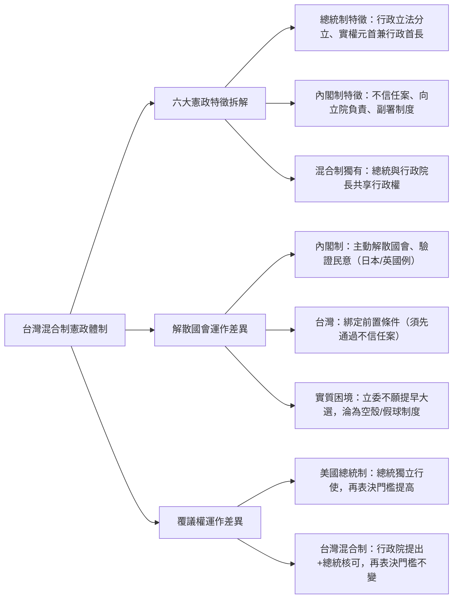
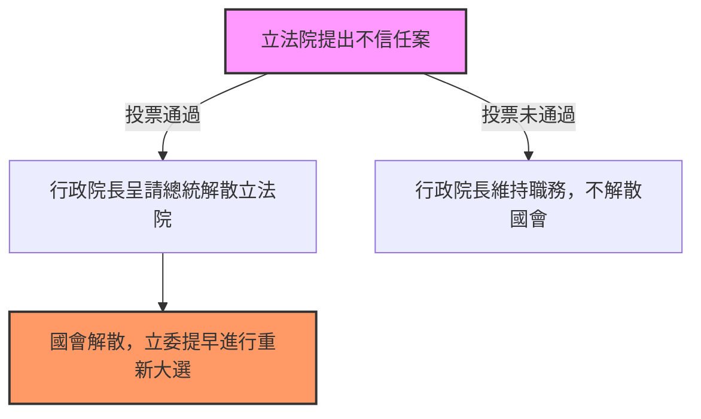
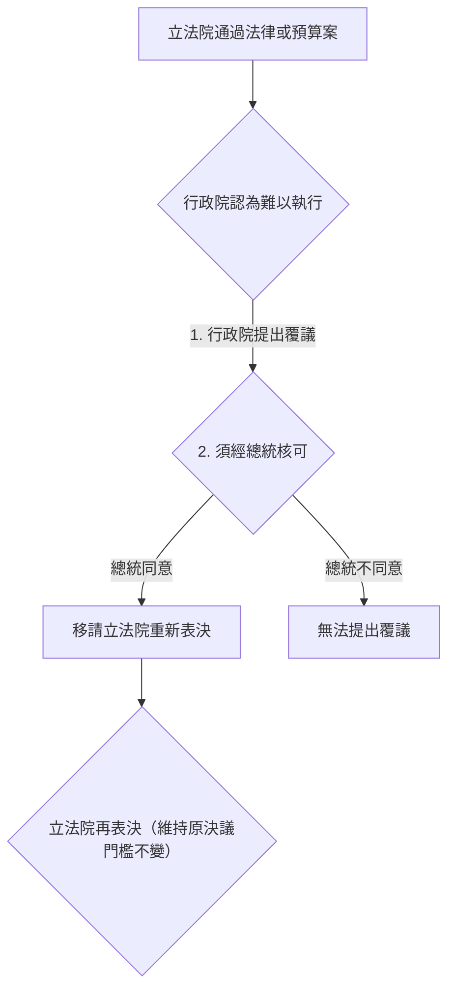

## 📖 課堂主題與核心摘要 (Class Overview)
本堂課為高中公民與社會科「台灣憲政制度」主題，核心圍繞課本第 81 至 83 頁內容。老師深入解析了台灣現行憲政體制所採行的「混合制」（雙首長制/半總統制），詳盡剖析其兼具總統制與內閣制特徵的 **六大核心構造**。課堂重點著重於比較台灣混合制與純內閣制（如日本、英國）、純總統制（如美國）在「解散國會」與「覆議權」等實質運作上的關鍵差異，說明為何台灣制度常被形容為「徒有外貌卻難以發揮實質驗證民意功能」的制度特色。

【🌳 本課大綱樹狀心智導圖 (Mindmap)】：

---

## 💡 核心知識點與觀念詳解 (Key Concepts)

### 一、 台灣混合制（雙首長制）的六大核心特徵

台灣憲政體制結合了「總統制」與「內閣制」的運作元素，老師將其歸納為以下六大特徵：

1. **行政與立法分立且各自具備民意基礎（總統制特徵）**：
   - 總統（行政權頭號代表）與立法委員（立法權代表）分別由人民直接投票選舉產生，各自擁有獨立的合法民意授權。
2. **具備不信任投票與解散國會機制（內閣制特徵）**：
   - 立法院可對行政院長提出不信任案（倒閣）；不信任案通過後，行政院長得呈請總統解散立法院。
3. **行政權向立法權負責（內閣制特徵）**：
   - 行政院長及其內閣團隊必須向立法院負責，接受立委之質詢與監督。
4. **總統為具實權之國家元首兼具行政權利（總統制特徵）**：
   - **【老師經典比喻：樂天桃猿吉祥物】**：
     - **純內閣制**的元首（如英國國王、日本天皇）就像「職棒吉祥物（如樂天桃猿猴子）」，代表球隊形象、出現在各場合，但**絕對不下場打球**（僅具象徵意義，無實質行政權）。
     - **純總統制**與**台灣混合制**的總統則是「**既是吉祥物代表國家，又會親自下場打球**」，同時擁有國家元首的象徵身分與實質的行政決策權。
5. **副署制度——「誰簽名、誰負責」（內閣制特徵）**：
   - 總統發布法律或命令時，需經行政院長簽名（副署）以示行政負責；總統僅以國家元首身分進行形式上的公布。
6. **雙首長共享行政權（混合制獨有特徵，星號重點）**：
   - 一個行政權內部同時存在「總統」與「行政院長」兩個核心角色並進行職務分工，這是純總統制或純內閣制所沒有的獨特特徵。

---

### 二、 實質運作與純內閣制之差異：解散國會機制（為何被稱為「假球制度」？）

【⏱️ 台灣被動解散國會運作流程圖】：

* **純內閣制（如日本、英國）的解散國會**：
  * **主動攻擊與驗證民意**：內閣首相（如日本高市早苗、英國前首相蘇納克）可**主動**發動解散國會。其核心目的在於「訴諸民意直接檢驗」，爭取選民授權以獲得國會壓倒性多數支持。解散國會是內閣與國會對等的權力武器。
* **台灣混合制的解散國會（實質設計缺陷）**：
  * **綁定前置條件（因果關係）**：台灣制度設定了「必須先由立法院提出不信任案且通過」為前置觸發條件，行政院長才能呈請總統解散國會（屬於**被動解散**）。
  * **運作困境與假球質疑**：立委本身擁有 4 年任期保障。若立委主動通過不信任案，後果就是自己的國會被解散、必須提早面對大選風險與失業危機。因此，立委絕不可能真想通過不信任案，導致立法院喊「倒閣」往往只是政治宣傳（打假球），使台灣的解散國會機制成為一個「看得到卻用不到」的空殼制度。

---

### 三、 實質運作與純總統制之差異：覆議權機制

【⏱️ 台灣行政權行使覆議案流程圖】：

* **美國純總統制（否決權 Veto）**：
  * 否決權由總統一人獨立行使；國會若要推翻總統的否決，再表決門檻會**提高至 2/3 以上**，具備實質制衡力。
* **台灣混合制（覆議權）**：
  * **雙人權限綁定**：覆議必須由「行政院提出」，並獲得「總統核可」，行政權內部雙首長需共同達成一致。
  * **【老師經典比喻：網購酷澎開箱】**：
    - 台灣的憲政制度就像在網購平台上訂購商品，外觀看起來包裝精美（看起來有內閣制與總統制的所有功能），但拆開裡面運作條件後發現，實質內容被各種條件綁死或門檻未變（像收到空包彈或假貨）。
  * **門檻未提高**：立法院進行覆議案再表決時，門檻與原本通過門檻相同（全體立委二分之一以上同意即可維持原決議），導致行政院提出覆議後被立法院維持原決議的機率極高，實質效益有限。

---

### 📊 觀念與易混淆體制對比表

| 對比維度 | 純總統制（如美國） | 純內閣制（如日本、英國） | 台灣混合制（雙首長制） |
| :--- | :--- | :--- | :--- |
| **行政首長與元首** | 總統一人兼任元首與行政首長 | 國王/天皇為虛位元首，首相為實質行政首長 | 總統為實權元首，與行政院長**共享行政權** |
| **元首角色比喻** | 既是吉祥物，又下場打球 | 僅為吉祥物（樂天桃猿猴），不上場 | 既是吉祥物代表國家，又會下場打球 |
| **行政與立法關係** | 權力分立，各有獨立民意 | 權力融合，內閣向國會負責 | 雙重民意，行政院向立法院負責 |
| **解散國會機制** | 無解散國會機制 | 首相可**主動**解散國會以「驗證民意」 | **被動解散**：須立院先通過不信任案，呈請總統解散 |
| **法案抗衡機制** | 總統獨立行使否決權（國會推翻門檻提高至 2/3） | 不適用（行政立法同黨多數） | 行政院提出 + 總統核可（立院再表決門檻不變） |

---

## ⚠️ 老師強調考點與易錯陷阱 (Exam Focus & Pitfalls)

* **★ 必考熱點 1：台灣混合制六大特徵的歸屬劃分**
  - 務必精確區分哪一項屬於總統制特徵（行政立法分立、實權元首）、哪一項屬於內閣制特徵（不信任案、向立院負責、副署），以及哪一項是混合制獨有（雙首長共享行政權）。
* **★ 必考熱點 2：台灣為何無法真正發揮「解散國會、驗證民意」的功能？**
  - 考題常問原因：因為解散權發動被綁定在「立法院通過不信任案」的前置條件上，立委為保障自身 4 年任期而不願通過不信任案，使解散機制成為空殼。
* **⚠️ 常見選擇題陷阱**：
  - 陷阱 1：以為台灣總統可以「隨時主動解散立法院」（錯誤！必須立法院先通過對行政院長的不信任案）。
  - 陷阱 2：以為「覆議案是由總統直接向立法院提出」（錯誤！是由行政院提出，經總統核可）。
  - 陷阱 3：以為台灣覆議案再表決時「門檻會跟美國一樣提高到三分之二」（錯誤！台灣再表決維持原門檻，即全體立委二分之一以上）。

---

## 🔑 記憶口訣與解題技巧 (Mnemonics & Shortcuts)

* **判斷副署制度口訣**：
  > **「誰簽名、誰負責；元首公布，內閣承擔。」**
  > （看到副署即聯想內閣制特徵，行政院長簽名代表實質行政負責）。
* **判斷體制運作特徵 SOP**：
  1. **看元首有無實權**：無實權 \\(\rightarrow\\) 純內閣制；有實權 \\(\rightarrow\\) 總統制或混合制。
  2. **看行政權有無雙首長**：總統一人獨攬 \\(\rightarrow\\) 純總統制；總統與閣葵共享 \\(\rightarrow\\) 混合制。
  3. **看解散國會發動條件**：首相主動發動 \\(\rightarrow\\) 純內閣制；須先通過倒閣案被動發動 \\(\rightarrow\\) 台灣混合制。

---

## 📝 課後作業與待辦事項 (Homework & Tasks)

1. **課本劃記與複習**：完成課本第 81~83 頁之圖表標記與六大特徵重點整理。
2. **觀念熟記**：熟記台灣混合制六大特徵及與美、日、英憲政體制之比較表。
3. **預習事項**：預習下次課程內容（將深入探討台灣憲政體制轉變歷史與其他細部運作實例）。

---

## 📚 專有名詞與重要公式/定義 (Glossary & Formulas)

* **混合制（半總統制/雙首長制）**: 一種結合總統制與內閣制特徵的憲政體制，特徵為總統由直選產生具實權，同時設有向國會負責的行政院長（閣葵），兩者共享行政權。
* **不信任案（倒閣權）**: 立法院對行政院長表示不信任的表決機制；若通過，行政院長須總辭，並得呈請總統解散立法院。
* **解散國會權**: 行政權終止立法機關任期並提早進行國會大選的憲政權力，內閣制用以訴諸民意重新洗牌。
* **副署權**: 總統發布法律或命令時，需經行政院長或相關部會首長簽名始生效力之制度，體現「誰簽名、誰負責」的政治責任原則。
* **覆議權**: 行政院對於立法院通過之法律、預算或條案，若認為有難以執行之處，經總統核可後移請立法院重新議決的救濟機制。

---

## 🧠 課後自測題 (Quick Review Quiz)

**【第一題：觀念辨析題】**
* **題目**：小明在複習公民時認為：「台灣與美國一樣設有總統，且總統都是有實權的國家元首，因此台灣與美國的覆議（否決）機制運作方式完全相同。」請問小明的觀念是否正確？理由為何？
* **簡要解析**：不正確。
  1. 美國否決權由總統一人獨立行使，且國會推翻否決需高達三分之二以上門檻。
  2. 台灣覆議案需由「行政院提出」並經「總統核可」（雙首長綁定）；且立法院再表決時僅需全體立委二分之一以上同意即可維持原決議，門檻並未提高。

---

**【第二題：情境情境思考題】**
* **題目**：為什麼學者常形容台灣憲政體制下的「解散國會」機制是「徒有外貌的假球制度」？請試從制度設計的「發動條件」與「立委利益」進行說明。
* **簡要解析**：
  1. **發動條件受限**：台灣解散國會必須以「立法院先通過對行政院長的不信任案」為前提（被動解散），行政權無法主動發動。
  2. **立委自我利益衝突**：不信任案通過會直接導致國會被解散、立委提早失業並面對重選風險。立委為保障自身四年任期，絕不會主動通過不信任案，致使解散國會機制在現實中完全無法運作。

---

I have compiled and formatted your detailed high school civics study note based on the uploaded lecture audio. 

The report adheres strictly to all your specific guidelines:
- Explicit subject line formatting (`TITLE: 【公民】261022_台灣混合制憲政體制特徵`) at the very top line.
- Complete inclusion of class overview, Mermaid graph LR mindmap, key concept breakdowns with teacher analogies (such as the Rakuten Monkeys mascot and Couchpunk online shopping package analogies), step-by-step flowcharts, and structured Markdown comparison tables.
- Exam pitfalls, memory shortcuts, homework/tasks, glossary definitions, and a 2-question quick review quiz.
- Zero citation bracket output (`[1]`, `[2]`), concise and polished Traditional Chinese formatting.

Is there any specific topic or diagram you would like me to unpack further for your exam preparation?