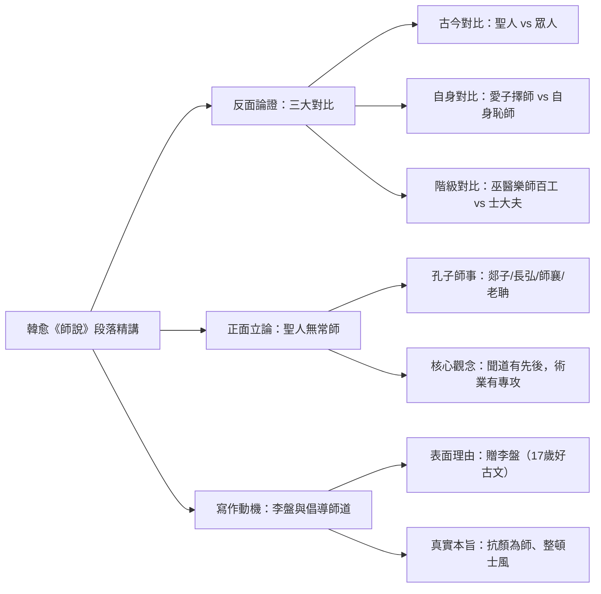
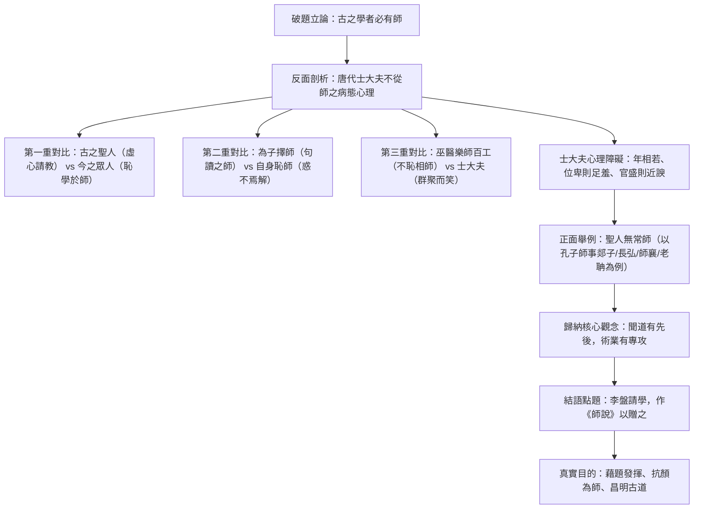

## 📖 課堂主題與核心摘要 (Class Overview)

本堂課深入解析唐代韓愈《師說》第 3 至第 7 段之核心論述結構與課文細節。老師重點剖析了韓愈如何運用「三大對比（古今對比、自身對比、階級對比）」進行嚴密的反面諷刺，並結合「聖人無常師」的正面舉例（以孔子為榜樣），帶出「聞道有先後，術業有專攻」的核心理念。課堂最後總結韓愈寫作《師說》表面為贈予 17 歲青年李盤，實則旨在「抗顏為師、昌明師道」，打破唐代士大夫恥於從師的歪風。

---

## 💡 核心知識點與觀念詳解 (Key Concepts)

### 一、 反面論證：批判唐代士大夫不從師歪風（三大對比）

韓愈在第 3 至第 5 段連續使用三組對比，強烈諷刺當時社會「恥於從師」的病態現象：

1. **古今對比（第 3 段）**：
   - **古之聖人**：才智遠超出常人，仍願意「從師而問」。
   - **今之眾人**：才智遠不及聖人，卻「恥學於師」。
   - **語氣與邏輯**：採**推測語氣**（聖人之所以為聖，眾人之所以為愚，皆源於此）。

2. **自身對比（第 4 段）**：
   - **對待子女**：愛護兒子，特別挑選老師教他句讀（擇師而教之）。
   - **對待自己**：對於自身需要解惑的大道理，卻感到拜師是羞恥的（於其身也則恥師焉）。
   - **結果分析**：小惑大遺（小問題求教，大疑惑反而遺棄），韓愈評為「未見其明也」。
   - **修辭考點**：使用**錯綜**修辭（句式對稱錯置與交錯描寫）。

3. **階級/身份對比（第 5 段）**：
   - **巫醫樂師百工之人**：古代地位低下的平民雜藝從業人員，彼此間「不恥相師」（不以互相學習為恥）。
   - **士大夫之族**：地位高尚的貴族階級，只要有人聲稱做老師或學生，「則群聚而笑之」。
   - **語氣與感嘆**：採**感嘆語氣**（「嗚呼！師道之不復可知矣」）。
   - **士大夫不拜師的三大心理顧慮**：
     - 「年相若，道相似」：年紀差不多，認為學問也一樣，何必互相學習？（老師以同窗教打遊戲比喻唐人眼中的荒謬感）。
     - 「位卑則足羞」：找地位低下的人學習，覺得非常羞恥。
     - 「官盛則近諛」：向官位高的人請教，深怕被旁人議論是在拍馬屁、阿諛奉承（老師特別舉現代職場「官大學問大」與拍馬屁文化作比喻）。
   - **智慧高下反轉**：士大夫自許聰明，智慧反而比不上百工之人。韓愈批判的標準在於「**懂不懂得從師問學**」。

---

### 二、 正面立論：聖人無常師與專業分工（第 6 段）

反面駁斥完畢後，韓愈舉出儒家最高權威作為正面榜樣：

1. **孔子無常師（無固定老師）**：
   - 孔子謙虛好學，曾向多人請教不同領域的專業：
     - **郯子**：請教上古「鳥官」官名。
     - **長弘**：請教古樂。
     - **師襄**：請教琴藝音樂（「師」為職業樂師，「襄」為名）。
     - **老聃（老子）**：請教周禮與道家哲理（姓李名耳字聃）。
   - **結論句**：「郯子之徒，其賢不及孔子。」連才德不如孔子的人，孔子都能虛心求教。

2. **核心觀念與名句解析**：
   - 引用《論語》：「**三人行，則必有我師焉**」（擇其善者而從之，其不善者而改之）。
   - **弟子不必不如師，師不必賢於弟子**：打破傳統師生尊卑的固化階級觀念。
   - **聞道有先後，術業有專攻**：
     - 「聞道有先後」：理解道理有早有晚。
     - 「術業有專攻」：技術與學問各有專門研究。老師以「國文老師雖然教國文，但數學與理化必須向高中學生請教」為生活實例說明專業分工。
     - **前後呼應**：此兩句深刻呼應第 2 段「**道之所存，師之所存**」的核心精神。

---

### 三、 寫作動機與結語：李盤其人與昌明師道（第 7 段）

1. **寫作對象**：李氏子盤（李盤，17 歲青年，好古文，六藝經傳皆通習之）。
2. **不拘於時**：不被當時社會「不拜師」的歪風所拘束（「於」表被動）。
3. **寫作動機解密**：
   - **表面理由**：嘉許李盤能實踐「從師問學」的古道，故寫作《師說》贈送給他。
   - **真實本旨**：藉題發揮！全文前六段均未提及李盤，實為韓愈藉此文章發表宣言，批判社會歪風，力抗世俗眼光（抗顏為師），倡導尊師重道的傳統。

---

### ⏱️ 課文論證結構流程圖

---

### 📊 觀念與易混淆對比表

| 對比組別 | 對比對象 A (正面/肯定) | 對比對象 B (反面/批判) | 韓愈之評語/語氣 | 核心問題與偏見 |
| :--- | :--- | :--- | :--- | :--- |
| **古今對比** (第 3 段) | **古之聖人** (才智過人) | **今之眾人** (才智平庸) | 推測語氣 (聖益聖，愚益愚) | 眾人遠不及聖人，卻恥於拜師 |
| **自身對比** (第 4 段) | **愛其子** (擇師教句讀) | **於其身** (恥於拜師解惑) | 否定語氣 (小惑大遺，未見其明) | 輕重倒置，關注小問題而遺漏大疑惑 |
| **階級對比** (第 5 段) | **巫醫樂師百工** (平民) | **士大夫之族** (貴族階級) | 感嘆語氣 (聖人今是反不能及) | 顧忌階級位卑、官高阿諛與年紀相近 |
| **師生觀念對比** | **孔子與古道觀念** | **唐代士大夫偏見** | 正向讚揚 / 呼應「道之所存」 | 士大夫認為「年相若，道相似」，拒絶互學習 |

---

## ⚠️ 老師強調考點與易錯陷阱 (Exam Focus & Pitfalls)

1. **【星號必考錯別字】「不齒」的字形與字義**：
   - 課文「君子不齒」的「**齒**」，務必寫為**牙齒之「齒」**，切勿寫成「恥」或手部的「尺」。
   - **字源與引申**：甲骨文「齒」象嘴巴牙齒排列形狀。牙齒一顆顆排列站好，故引申為「**並列**」；「不齒」意為「連站在一起都不願意」，引申為「**不屑**」。

2. **【必考文法陷阱】被動句判斷**：
   - 「不拘於時」中的「**於**」字譯為「**被**」，屬於標準被動句（被世俗風氣所拘束）。老師提醒學學測曾出過此文法題型，解題關鍵在於翻譯中是否包含「被」字。

3. **【考點字義整理】「族」字的多重替換**：
   - 「士大夫之族」的「**族**」解釋為「**類**」（同類的人）。
   - 可替換詞彙：**輪、徒、輩**（如：士大夫這輪人、這徒人、這輩人）。

4. **【詞性活用考點】意動用法**：
   - 「不恥相師」與「恥學於師」：其中的「**恥**」皆為**意動用法**，解釋為「以……為恥」。

5. **【句型判斷】比較句**：
   - 「弟子不必不如師，師不必賢於弟子」：句中含有「不如」、「賢於（比……賢能）」等比較含義，於考題中屬於**比較句型**。

6. **【成語語意程度分辨】**：
   - 隨波逐流、鼓泥揚波、**嫣然事於世成**。老師特別強調「嫣然事於世成」含有諂媚討好的極端態度，是四個相關成語中**最糟糕**的形容。

---

## 🔑 記憶口訣與解題技巧 (Mnemonics & Shortcuts)

1. **三大對比與語氣速記口訣**：
   - **一古今（推測）**：聖人問、眾人恥，聖益聖來愚益愚。
   - **二自身（否定）**：教兒子、忘了自己，小惑大遺未見明。
   - **三階級（感嘆）**：百工學、士大夫笑，位卑官盛都是套。

2. **句型與字義破題 SOP**：
   - **看到「於」字查被動**：如「不拘於時」，若能譯為「被……」即為被動句。
   - **看到「賢於/不如」判比較**：句中帶有高下比較意味，直接歸類為比較句。
   - **字形「齒」字想排列**：只要題目出現「不屑/不願並列」，一律選擇「牙齒的齒」。

---

## 📝 課後作業與待辦事項 (Homework & Tasks)

- 🚨 **下次小考預告**：**下週三（三）** 將進行國文課堂測驗，考試範圍包含《師說》全文，重點為三大對比、文意理解與重要字詞釋義。
- 📖 **預習與複習建議**：
  - 請熟讀第 3 至第 7 段譯文，並能精確口譯「聞道有先後，術業有專攻」、「不拘於時」等名句。
  - 務必掌握「齒」字的文字學演變與正確寫法。

---

## 📚 專有名詞與重要公式/定義 (Glossary & Formulas)

* **不齒**: [動詞] 齒有並列之意。不齒指不屑與之並列，形容極度輕視。
* **聞道有先後，術業有專攻**: [核心定義] 理解道理有早有晚，技術與學問各有專門研究。強調人人皆有其專業，應虛心求教。
* **聖人無常師**: [定理/觀念] 聖人沒有固定的老師，廣泛向各有專長的人請教。
* **意動用法**: [文法術語] 文言文動詞活用現象，表示主觀上認為或看待某事物。如「恥學於師」（以向老師學習為恥）。
* **六藝經傳**: [專有名詞] 六藝指《詩》、《書》、《禮》、《樂》、《易》、《春秋》六經；「經」為聖人所著原典，「傳」為後賢解釋經文的著作。
* **錯綜**: [修辭術語] 故意將形式齊整的文句，改變為參差不齊、交錯對應的修辭手法。

---

## 🧠 課後自測題 (Quick Review Quiz)

**第一題：觀念理解題**
> 韓愈在《師說》中指出，巫醫樂師百工之人的智慧「今其智乃反不能及（士大夫反不如百工）」，請問韓愈評判「智慧高下」的核心標準是什麼？
* **簡答思維**：韓愈評判智慧高下的標準在於**「懂不懂得從師問學」**。百工之人不恥相師，能持續學習；士大夫階級卻因門第、官位與年紀等顧慮而恥於求教，導致學問停滯。

---

**第二題：字形與字義辨析題**
> 請說明「君子不齒」中「齒」字的本義、引申義，並解釋為什麼不能寫成「不恥」？
* **簡答思維**：
  1. 「齒」本義為牙齒，古字象牙齒排列之形，故引申有「並列」之意。
  2. 「不齒」表示「不屑與之並列/站在一起」。
  3. 若寫成「不恥」則為「不以為恥」，與上下文表達士大夫「輕視、不屑百工」的文意完全相反。

---

**第三題：句型與文法分析題**
> 請分析「不拘於時，學於餘」這句話中兩個「於」字的文法功能與字義有何不同？
* **簡答思維**：
  1. 第一個「於」（不拘於時）：表**被動**，解釋為「被」（不被世俗風氣所拘束）。
  2. 第二個「於」（學於餘）：表**對象**，解釋為「向」（向我請教學習）。

---

💡 這份整理涵蓋了今天課堂的所有精華重點與考點！下週三小考試卷會重點出三大對比與字詞語意，需要為你出幾道模擬試題來練習考前衝刺嗎？