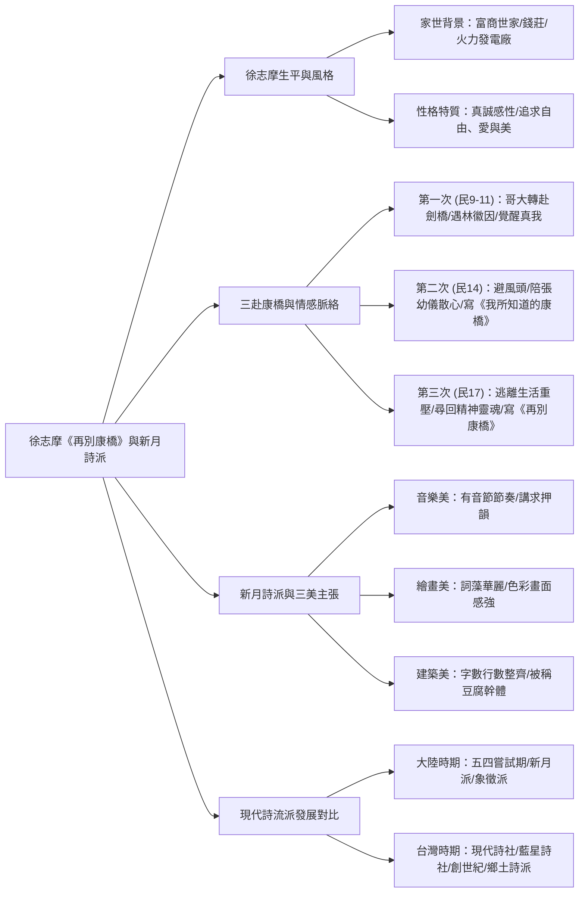
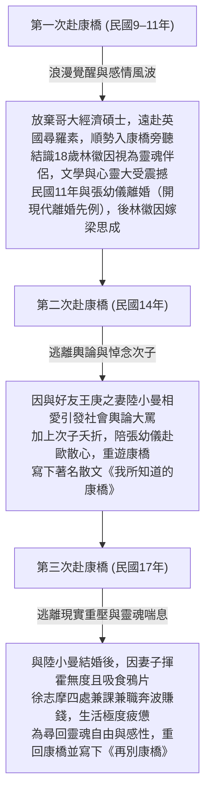

## 📖 課堂主題與核心摘要 (Class Overview)

本堂課重點研讀高中國文經典課文——徐志摩的《再別康橋》。老師由徐志摩顯赫的富商家世與感性率真的性格切入，詳細梳理其一生「三赴康橋」的情感起伏與心境轉折，帶領學生深入體會詩中唯美卻又隱含惆悵的不捨情懷。課堂同時系統化剖析了「新月詩派」的核心理論——「三美主張」（音樂美、繪畫美、建築美），並延伸介紹台灣現代詩發展的四大重要流派對比，協助學生全方位掌握段考與大考的常考重點。

---

## 💡 核心知識點與觀念詳解 (Key Concepts)

### 一、 徐志摩的生平背景與性格特質

1. **顯赫顯貴的家世背景**：
   - 徐志摩出生於江南富商世家且為獨子，家中事業版圖極大，開醬園、錢莊，甚至在當時的中國擁有罕見的**火力發電廠**。
   - 19 歲時由家族安排娶 16 歲的**張幼儀**（張氏精明幹練，後來甚至代為掌管徐家龐大產業）。父親原本寄望其出國學習金融管理以繼承家業。

2. **熱情率真與真誠的性格**：
   - **老師課堂經典舉例（國中 vs. 高中對比）**：
     - 國文中學過徐志摩的散文《我所知道的康橋》，他在文中描寫自己騎腳踏車追夕陽，因被美麗景致深深震撼，竟然直接在路上對著夕陽「跪了下來」。
     - 老師強調：一般人都帶有「偶像包袱」與面具（例如課堂上拿個人湯匙挖公用桶餐，大家心裡覺得噁心卻不敢講），但徐志摩是一個極度率真、毫無保留展現情感的人，眼界與感受力與常人不同。
   - **個人文章風格**：詞藻華麗、形容詞豐富、文青感十足。雖曾被部分讀者批評「太文」或文字浮躁，但這正是他內心熱情洋溢的自然流露。

3. **文學精神的三大核心**：
   - **自由**：主張人類的使命是「製造翅膀」，永恆追求靈魂的絕對自由，不受世俗規範束縛。
   - **愛**：對人對物充沛真誠，即使經歷複雜情感風波，親友與前妻（張幼儀）、情敵（梁思成）後續皆能與其保持良好友誼。
   - **美**：具備極高的審美敏銳度，能將尋常景物轉化為動人詩意。

---

### 二、 徐志摩「三赴康橋」之情感與心境演變

徐志摩一生共造訪英國康橋（今譯劍橋）三次，每次造訪皆伴隨著重大的人生與感情轉折：

- **心境對比重點**：
  - 《我所知道的康橋》（散文）：第二次前往，寫出康橋自然的熱烈與絢麗之美。
  - 《再別康橋》（新詩）：第三次前往，此時徐志摩深受現實生計折磨，康橋成為他唯一能脫離現實、尋回靈魂的聖地，因此詩中除了寫景優美之外，更瀰漫著濃厚的**惆悵與不捨**。

---

### 三、 新月詩派的核心理論——「三美主張」

- **成立背景**：民國初年由**徐志摩**、**聞一多**、**梁實秋**等人創立「新月社」（名稱源自泰戈爾詩集《新月集》）。徐志摩主攻詩歌創作，聞一多建立理論體系。
- **核心理念**：反對五四初期新詩「過度自由、缺乏規範」的現象，主張詩歌應「**帶著腳鐐跳舞**」（即在規則束縛下展現更極致的藝術成就）。
- **「三美」標準**：

| 三美指標 | 核心意涵 | 課堂範例與細節說明 |
| :--- | :--- | :--- |
| **🎵 音樂美** | 重視音節與節奏感 | 現代詩雖無近體詩嚴格限制，但新月派主張**必須押韻**、講求朗誦時的韻律與節奏變化。 |
| **🎨 繪畫美** | 重視詞藻色彩與畫面感 | 運用華麗精緻的字詞，使讀者閱讀時腦海中能浮現如圖畫般優明的意象。 |
| **🏛️ 建築美** | 重視結構整齊與視覺對稱 | 詩節結構嚴謹，**每節行數相等、每行字數相近**。視覺上極度整齊，因而被批評者稱為「**豆腐幹體**」或「**方塊詩**」。 |

---

### 四、 台灣現代詩四大流派對比表

課堂補充講義第 6 頁梳理了台灣現代詩發展的重要流派，此為大考極高頻考點：

| 詩社名稱 | 代表人物 | 核心主張與風格特色 | 關鍵關鍵字 |
| :--- | :--- | :--- | :--- |
| **現代詩社** | 紀弦 | 主張「**橫的移植**」，強調現代詩的「**知性**」與排斥情緒宣洩。 | 橫的移植、知性、主智 |
| **藍星詩社** | 覃子豪、余光中 | 主張「**縱的繼承**」，強調傳統詩情的延續，偏重「**抒情**」。 | 縱的繼承、抒情、傳統 |
| **創世紀詩社** | 創世紀鐵三角（瘂弦、洛夫、張默） | 引進西方「**超現實主義**」，風格前衛、意象奇特。 | 超現實主義、前衛、鐵三角 |
| **笠詩社 / 鄉土詩派** | 林亨泰等 | 關懷本土社會、展現濃厚的**本土情懷**與土地認同。 | 本土詩人、鄉土情懷、關懷現實 |

---

## ⚠️ 老師強調考點與易錯陷阱 (Exam Focus & Pitfalls)

1. **《再別康橋》的寫作時機與情感基調（★必考）**：
   - ❌ **易錯陷阱**：誤以為《再別康橋》是徐志摩第一次離開康橋時所寫的告別詩。
   - ⭕ **正確觀念**：此詩寫於**第三次（民國 17 年）**造訪康橋。當時徐志摩正處於為生活經濟奔波（供養陸小曼）的困頓期，前往康橋是為了「喘一口氣」。因此詩中文字看似輕盈，實則蘊含對現實生活的無奈與對康橋靈魂聖地的極度不捨。

2. **新月詩派的批評與平反（★星號重點）**：
   - ❌ **易錯陷阱**：認為現代詩絕對不能有格式，或認為「豆腐幹體」是褒義詞。
   - ⭕ **正確觀念**：「豆腐幹體/方塊詩」是外界對其視覺形式過於整齊的批評，但對新月派而言，這是堅持「建築美」與「帶著腳鐐跳舞」的藝術展現。

3. **著名經典詩句與對象判定（選題關鍵）**：
   - 《偶然》（「你我相逢在黑夜的海上，你有你的，我有我的，方向...」）：寫給**林徽因**的情感交會詩。
   - 《致梁啟超書》（「我將於茫茫人海中訪我唯一靈魂之伴侶；得之，我幸；不得，我命，如此而已。」）：為徐志摩回覆老師梁啟超勸誡其婚姻感情問題的名句。

---

## 🔑 記憶口訣與解題技巧 (Mnemonics & Shortcuts)

### 1. 新月詩派三大特徵速記口訣
> **「新月三美：音、畫、建（豆腐幹）」**
> - **音**樂美 ➔ 有節奏、講押韻
> - **畫**美 ➔ 詞藻華麗、色彩畫面
> - **建**築美 ➔ 字數整齊、豆腐幹體

### 2. 詩派判讀破題 SOP
在閱讀題型中，看到以下關鍵字即可快速秒殺答案：
1. 看見「**戴著腳鐐跳舞**」、「**形式整齊如方塊**」、「**三美原則**」 ➔ 判定為 **新月詩派**
2. 看見「**橫的移植**」、「**主智知性**」 ➔ 判定為 **現代詩社（紀弦）**
3. 看見「**縱的繼承**」、「**抒情傳統**」 ➔ 判定為 **藍星詩社（余光中）**
4. 看見「**超現實主義**」 ➔ 判定為 **創世紀詩社（瘂弦、洛夫、張默）**

---

## 📝 課後作業與待辦事項 (Homework & Tasks)

- **下次小考預告**：老師課末特別叮嚀**「下禮拜要考試」**，考試範圍包含《再別康橋》課文意象、徐志摩生平背景、新月詩派主張與台灣四大詩社對比。
- **講義畫線與複習**：完成補充講義第 4 頁至第 6 頁劃線內容之複習（特別是新月派與台灣現代詩發展簡表）。

---

## 📚 專有名詞與重要公式/定義 (Glossary & Formulas)

* **新月社 / 新月詩派**：民國初年由徐志摩、聞一多、梁實秋等人成立的文學社團，名稱源自泰戈爾《新月集》。主張新詩格律化，提出音樂美、繪畫美、建築美之「三美理論」。
* **建築美（豆腐幹體）**：新月詩派主張詩歌結構應具備視覺上的對稱與整齊，每節行數相同、每行字數相近，呈現方塊狀。
* **帶著腳鐐跳舞**：聞一多提出的詩歌創作觀點，指詩人在嚴格的格律規範（腳鐐）限制下，依然能創作展現出絕佳的藝術美感（跳舞）。
* **得之我幸，不得我命**：徐志摩於《致梁啟超書》中的名句，表達其甘願冒世俗輿論壓力，亦要勇敢追求真愛與靈魂伴侶的浪漫堅定態度。

---

## 🧠 課後自測題 (Quick Review Quiz)

**【第一題：觀念題】**
* **題目**：新月詩派主張詩歌創作應具備「三美」，若一首新詩在視覺排版上呈現每節行數相等、每行字數相近的方塊結構，請問這是符合三美中的哪一種美？
* **解析/答案**：**建築美**。因為字數與行數整齊劃一，在視覺上如同建築物般對稱穩固（亦被外界稱為「豆腐幹體」）。

**【第二題：情境理解題】**
* **題目**：徐志摩創作經典新詩《再別康橋》時，是他第幾次造訪康橋？當時的心境與創作背景為何？
* **解析/答案**：**第三次造訪（民國 17 年）**。當時徐志摩正深陷生活與經濟重壓（為供養陸小曼兼多份差事），重遊康橋是為了逃離現實獲得靈魂喘息，因此詩中除了描繪康橋之美，更蘊含了濃厚的惆悵與不捨。

**【第三題：詩派對比題】**
* **題目**：台灣現代詩發展中，主張「橫的移植」、強調現代詩應注重「知性」而非情緒宣洩的詩社是哪一個？其代表人物為何？
* **解析/答案**：**現代詩社**，代表人物為**紀弦**。