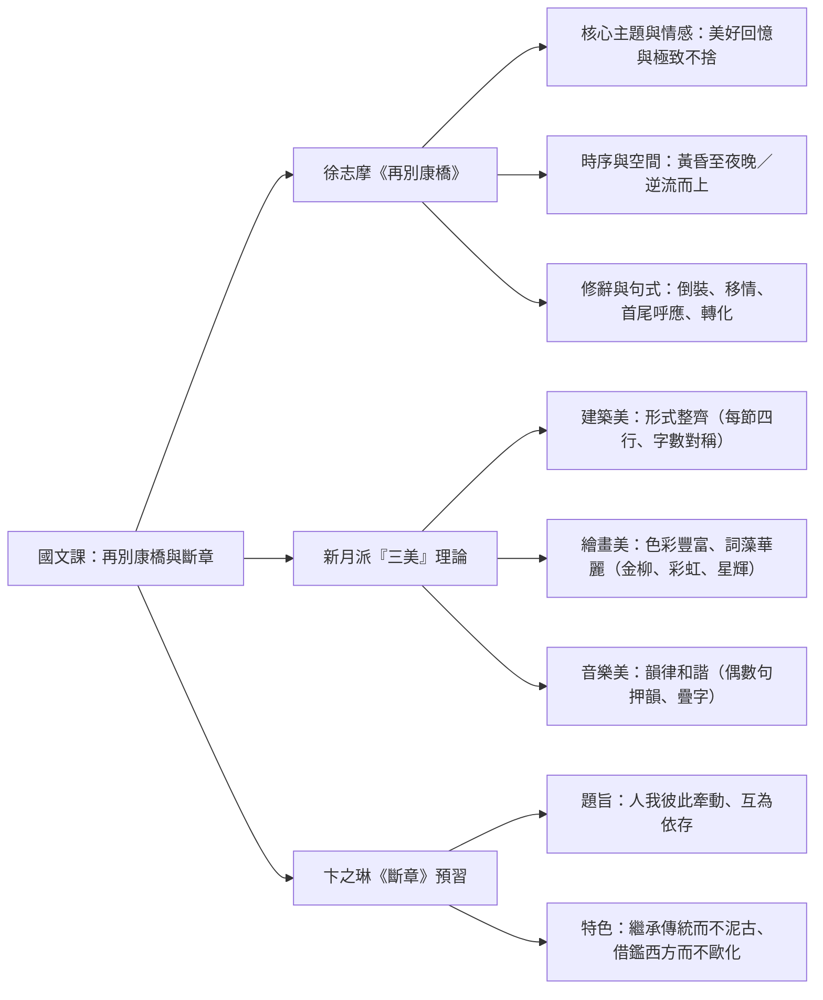

## 📖 課堂主題與核心摘要 (Class Overview)
本堂課主要深入解析徐志摩的現代詩經典《再別康橋》，並導讀卞之琳的《斷章》。老師透過詩句意象拆解、典故引申與生活化比喻，帶領同學體會徐志摩對康橋依依不捨的真摯情感，並詳細歸納新月派所提倡的「三美」文學主張（建築美、繪畫美、音樂美）。學習目標為掌握詩中的移情手法的運用、倒裝句與轉化修辭，並能精準辨析課文中的易錯字音、空間流向與情緒轉折折點，為考前複習奠定堅實基礎。

【🌳 本課大綱樹狀心智導圖 (Mindmap)】：


---

## 💡 核心知識點與觀念詳解 (Key Concepts)

### 一、《再別康橋》章節意象與情感逐節拆解

#### 1. 第一節：輕輕作別（離別的心態與時間背景）
* **詩句**：「輕輕的我走了，正如我輕輕的來；我輕輕的招手，作別西天的雲彩。」
* **「輕輕的」之深層意涵**：
  * **情感**：強調「不願驚擾」，展現出極度珍惜、愛護康橋的心態。
  * **【課堂生活實例】**：老師比喻，若班上有個調皮學生在睡覺，老師可能拍桌子大喊「起床」；但若是面對非常喜愛、優秀的學生，老師會輕輕拍他叫他起床。同樣地，對待喜愛的人事物與討厭的對象，態度完全不同（如學長接到學妹求救電話會溫柔相救，接到學弟電話則叫他自己搭「11路公車」回家）。
* **「西天的雲彩」之意象**：
  * **表層時間**：夕陽西下，點出時間起始於**黃昏／傍晚**。
  * **深層象徵**：象徵詩人在康橋所擁有的各種美好回憶。

#### 2. 第二節：金柳與艷影（離別之愁與波光魅影）
* **詩句**：「那河畔的金柳，是夕陽中的新娘；波光裏的艷影，在我的心頭蕩漾。」
* **「金柳」的雙重意象與古典典故**：
  * **色彩**：夕陽餘暉灑在柳樹上，呈現金黃色澤。
  * **離別意象**：古典文學中「柳」與「留」諧音。古人離別時常於霸橋折柳送行，暗含希望對方留下來的依依不捨。
* **譬喻與視覺化**：將金柳比喻為「新娘」，強調其搖曳生姿、嫵媚動人的姿態，令詩人心中波瀾蕩漾、久久無法平靜。

#### 3. 第三節：青荇與水草（極致的依戀與自我投射）
* **詩句**：「軟泥上的青荇，油油的在水底招搖；在康河的柔波裏，我甘心做一條水草！」
* **典故引申（《詩經·周南·關雎》）**：
  * 「參差荇菜，左右流之…窈窕淑女，寤寐求之…求之不得，寤寐思服，悠哉悠哉，輾轉反側。」
  * 原詩描述半夢半醒間對女子強烈的思念與追求；徐志摩借用「荇菜」典故，將這種極致的愛意全盤投射在「康橋」身上。
* **「招搖」字義注釋**：在此非誇耀或囂張之意，而是形容水草隨水流自在擺動流暢的姿態。
* **「甘心做一條水草」的深刻哲理**：
  * 寧可不當人而甘願做水草，是因為當了水草就能永遠沉浸在康河的柔波中，隨波逐流。這是一種「極端的戀棧與不捨」，為了這份愛甚至可以放棄自我主體性。
  * **【課堂熱烈討論】**：老師提到現代網路流行「徐志摩體（戀愛腦/愛腦）」：「你若事花朵，我願是綠葉…」「一生至少該有一次為了某個人而忘了自己…」。雖然老師與同學（如15號、22號、38號同學）討論認為現實生活中人不該為了感情失去自我，但對徐志摩而言，情感高於一切。

#### 4. 第四節：拜倫潭與彩虹夢（回憶的凝結）
* **詩句**：「那榆蔭下的一潭，不是清泉，是天上虹；揉碎在浮藻間，沉澱著彩虹似的夢。」
* **句式分析**：「不是清泉，是天上虹」採用否定的交錯/互文修辭，將實體的潭水（倫潭/拜倫潭）昇華為天上的彩虹。
* **意象說明**：湖水折射光影，結合水草浮萍，視覺上如同將璀璨的「彩虹夢」（象徵康橋歲月裡美麗的回憶與理想）揉碎沉澱於湖底。

#### 5. 第五節：尋夢放歌（情緒達到最高峰）
* **詩句**：「尋夢？撐一支長篙，向青草更青處漫溯；滿載一船星輝，在星輝斑斕裏放歌。」
* **字音考點**：「溯」必須唸作**「ㄙㄨˋ」**（意為逆流而上），極易讀錯。
* **「放歌」的情緒**：指放聲高歌，代表情緒達到全詩的最頂峰、極度歡愉與快樂。
* **【課堂生活實例】**：老師以學校校慶時班上沒擺攤、同學們一整天在教室拿麥克風歡唱 KTV 的歡樂氛圍，比喻「放歌」時極度高昂的情緒。

#### 6. 第六節：轉折與沉默（全詩情感關鍵拐點）
* **詩句**：「但我不能放歌，悄悄是別離的笙簫；夏蟲也為我沉默，沉默是今晚的康橋！」
* **情感轉折**：從第五節的「放歌」驟然跌入「不能放歌」。因為詩人突然從夢境回到現實，意識到「再別」的主題，離愁頓時湧上心頭。
* **【課堂生活實例】**：如同出國旅遊 5~7 天，在第 4、5 天玩得最開心時，突然想到旅程即將結束、馬上要回國，心中頓時生出無限失落感。
* **重要修辭（移情作用）**：夏蟲與康橋本無情感，但詩人將自己心中的沉痛離愁投射外物，覺得連夏蟲與康橋都在為他的離別而保持沉默。（類似杜甫「感時花踐淚，恨別鳥驚心」或失戀時覺得天空下雨是在為自己流淚）。

#### 7. 第七節：首尾呼應（瀟灑背後的沉重）
* **詩句**：「悄悄的我走了，正如我悄悄的來；我揮一揮衣袖，不帶走一片雲彩。」
* **結構技巧**：採用「首尾呼應」，將第一節的「輕輕的」替換為「悄悄的」。看似瀟灑告別、不帶走絲毫東西，背後隱含的卻是無比沉重與深沉的離情。

---

### 【⏱️ 時序時間軸與動態路徑圖】

```mermaid
graph TD
  subgraph 時序演變 (Time Sequence)
    T1["黃昏 / 傍晚<br>（西天的雲彩、夕陽中的金柳）"] --> T2["夜幕低垂 / 星夜<br>（滿載一船星輝）"] --> T3["深夜 / 告別時刻<br>（沉默是今晚的康橋）"]
  end

  subgraph 空間與水路軌跡 (Spatial & Water Route)
    S1["天上<br>（西天雲彩）"] --> S2["岸邊與水面<br>（河畔金柳、波光艷影）"]
    S2 --> S3["水底<br>（軟泥青草、水草柔波）"]
    S3 --> S4["潭水深處<br>（榆蔭下的一潭、浮藻彩虹夢）"]
    S4 --> S5["逆流而上『漫溯』<br>（向青草更青處）"]
    S5 --> S6["重回夜空與離去<br>（星輝斑斕 -> 悄悄離去）"]
  end
```

---

### 【📊 觀念與易混淆對比表】：新月派「三美」理論在《再別康橋》之展現

老師特別強調，胡適早期的白話詩較為平淡，而徐志摩等新月派詩人則極度強調詩歌的藝術美感，完美實踐了「三美」主張：

| 三美維度 | 核心定義 | 《再別康橋》課文具體展現與文本證據 | 考點判斷關鍵 |
| :--- | :--- | :--- | :--- |
| **建築美** | 形式整齊、結構規範 | 1. 全詩共七節，每節皆為**四行**。<br>2. 每節字數基本相等，第1、3句與第2、4句長短對稱。 | 視覺上排版極為整齊工整。 |
| **繪畫美** | 詞藻華麗、色彩鮮明、意象豐富 | 豐富色彩意象：**西天雲彩**（晚霞）、**金柳**（金黃）、**艷影**、**青荇**（翠綠）、**彩虹**（七彩）、**星輝斑斕**。 | 具備鮮明的視覺色彩與畫面感。 |
| **音樂美** | 韻律和諧、朗朗上口 | 1. 嚴格押韻：**偶數句押韻**（每節換韻）。<br>2. 善用疊字與雙聲疊韻：如「輕輕的」、「悄悄的」、「油油的」。 | 聽覺上節奏輕快流暢、具韻律感。 |

---

## ⚠️ 老師強調考點與易錯陷阱 (Exam Focus & Pitfalls)

1. **【必考字音字形】**：
   * 「向青草更青處漫**溯**」：關鍵字「溯」務必認明注音為 **ㄙㄨˋ**（意指逆流而上），**嚴禁讀成 ㄕㄨㄛˋ**，此為高頻錯題！
   * 「軟泥上的青**荇**」：荇（ㄒㄧㄥˋ），指水草。
2. **【動態路線方向】**：
   * 詩人的舟行路線是**「逆流而上」**，判斷依據全在第五節的「**溯**」（漫溯）字。若題目問順流或逆流，切勿猜錯。
3. **【時間跨度迷思】**：
   * 本詩時間並非從早到晚，而是從**「黃昏／傍晚」**延伸至**「夜晚／深夜」**。
4. **【經典倒裝句型轉換】**：
   * 「悄悄是別離的笙簫」\\(\rightarrow\\) 原句應為：**「別離的笙簫是悄悄（寂靜）」**。
   * 「沉默是今晚的康橋」\\(\rightarrow\\) 原句應為：**「今晚的康橋是沉默的」**。
5. **【修辭判斷陷阱】**：
   * 「夏蟲也為我沉默」：屬於**「移情作用」**（將主觀情緒投射於客觀事物），非單純擬人。
   * 「滿載一船星輝」：屬於**「轉化（具體化）」**，將抽象的光影回憶化為可載運的實物。

---

## 🔑 記憶口訣與解題技巧 (Mnemonics & Shortcuts)

* **新月派「三美」速記 SOP**：
  * **看排版** \\(\rightarrow\\) 整整齊齊 \\(\rightarrow\\) **建築美**
  * **看色彩** \\(\rightarrow\\) 絢麗華麗 \\(\rightarrow\\) **繪畫美**
  * **聽聲音** \\(\rightarrow\\) 押韻疊字 \\(\rightarrow\\) **音樂美**
* **情感轉折解題關鍵**：
  * 前五節：情緒持續升溫（美麗回憶 \\(\rightarrow\\) 感情投射 \\(\rightarrow\\) 尋夢放歌達到頂峰）。
  * 第六節：**「但我不能放歌」** 為全詩最核心轉折點，情緒驟降進入離愁沉默。

---

## 📝 課後作業與待辦事項 (Homework & Tasks)

1. **課本完成事項**：完成課本第 10 頁「問題與討論」第二題（填寫新月派「三美」理論表格，梳理建築美、繪畫美與音樂美）。
2. **預習劃線作業**：預習第 13 頁第二首詩——卞之琳《斷章》，請完成以下劃線重點：
   * **題解定義**：「斷章」指細碎的小事項或篇幅短小的詩文。
   * **核心旨意**：表現「人我彼此牽動、互為依存」的哲學思考。
   * **作者背景**：卞之琳受徐志摩賞識而進入詩壇；文學風格「繼承古典傳統而不泥古，借鑑西方現代詩潮而不歐化」。
   * **流派標籤**：新月派、象徵主義、現代詩派。

---

## 📚 專有名詞與重要公式/定義 (Glossary & Formulas)

* **新月派 (New Moon School)**：提倡現代格律詩的新詩流派，強調詩歌應具備「建築美、繪畫美、音樂美」三美原則。
* **移情作用 (Empathy / Affective Fallacy)**：創作者將自身強烈的主觀情感（如悲傷、離愁）投注於無情的外在景物（如夏蟲、天空），使其看似具備了同等的情感反應。
* **漫溯 (ㄙㄨˋ)**：逆著水流方向向上游舟行。
* **招搖**：在此指水草隨水波柔和擺動的姿態。
* **交錯句（互文）**：如「不是清泉，是天上虹」，透過否定與肯定的交錯對比，交織出更豐富的意象。
* **首尾呼應**：詩歌開頭與結尾使用相似或相同的句式與結構，使全詩結構更顯圓滿嚴謹。

---

## 🧠 課後自測題 (Quick Review Quiz)

**第一題【觀念辨析】**：
在《再別康橋》中，徐志摩寫道「在康河的柔波裏，我甘心做一條水草！」請問詩人為何不願做人而甘願做一條水草？這展現了何種情感？
* **解題思維/參考答案**：因為成了水草便能永遠留在康河的柔波之中，隨波擺動。這展現了詩人對康橋「極致的眷戀與依依不捨」，甚至願意為了這份愛而拋棄自我主體性。

**第二題【修辭與文法】**：
「夏蟲也為我沉默，沉默是今晚的康橋！」這兩句詩分別運用了什麼重要的修辭或句式手法？
* **解題思維/參考答案**：「夏蟲也為我沉默」運用了**移情作用**（將詩人自身的離別沉默投射到夏蟲身上）；「沉默是今晚的康橋」則運用了**倒裝句**（原句為：今晚的康橋是沉默的），藉此強化沉默寂靜的氛圍。

**第三題【考點避坑】**：
請問《再別康橋》中，詩人撐篙「漫溯」的方向是順流還是逆流？全詩寫作的時間跨度為何？
* **解題思維/參考答案**：由「溯」（ㄙㄨˋ）字可知，詩人的舟行路線為**逆流而上**；全詩寫作時間跨度是從**黃昏／傍晚**（西天雲彩、金柳夕陽）一直延續到**夜晚／深夜**（星輝斑斕、今晚沉默的康橋），並非寫一整天。

---

離選考與衝刺倒數計時！這份筆記已將課堂所有精華與陷阱全面封裝，複習時請特別留意「字音」與「轉折節點」，預祝考場奪取高分！