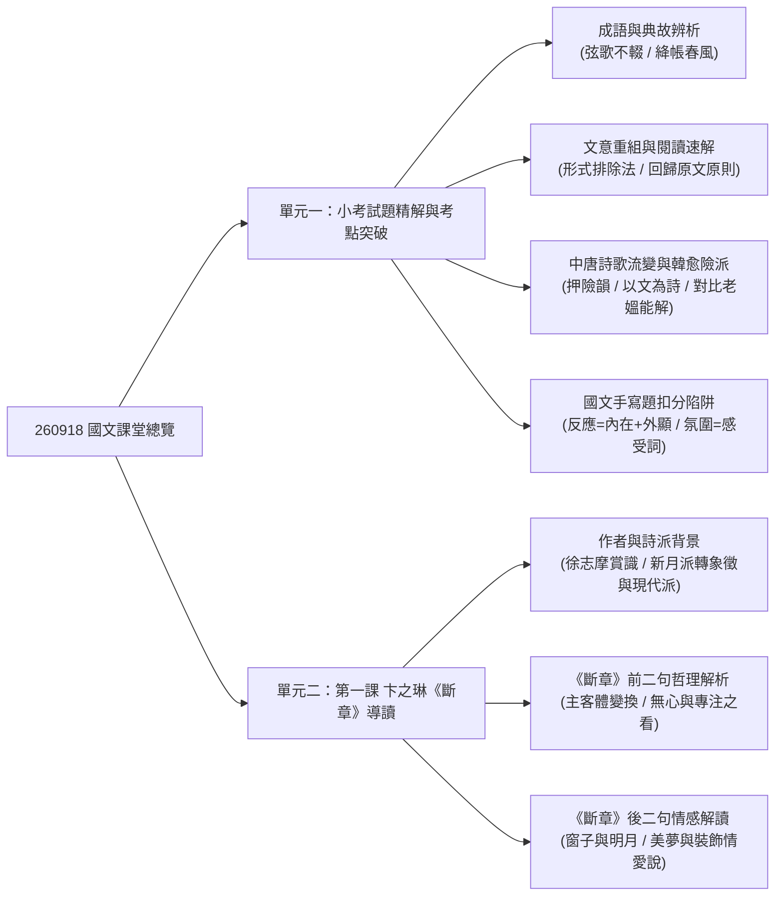
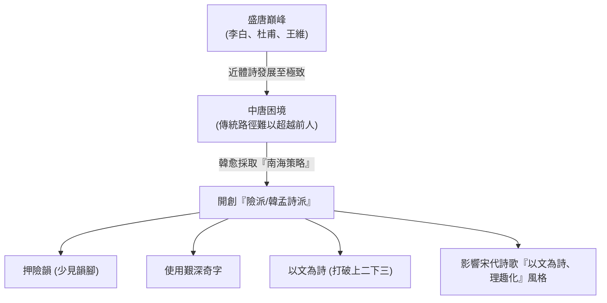

## 📖 課堂主題與核心摘要 (Class Overview)
本堂國文課包含「第一次小考試題檢討」與「新課第一課《斷章》導讀」兩大核心單元。試題檢討著重於常考成語語境用法、文意重組快速解題技巧、閱讀測驗「回歸原文」之非文本常識避坑原則，以及韓愈「險派」詩歌特色與手寫題精準答題要領。新課部分則針對現代詩人卞之琳及其代表作《斷章》進行精闢賞析，剖析象徵詩派特色、詩中「主體與客體」的哲學轉換，以及「看」與「裝飾」的多重情感解讀。本課學習目標在於提升國文閱讀理解與答題精準度，並掌握現代詩哲理美學的思辨方法。

【🌳 本課大綱樹狀心智導圖 (Mindmap)】：


## 💡 核心知識點與觀念詳解 (Key Concepts)

### 單元一：小考試題精解與文學史流變

1. **常考成語語境與典故辨析**：
   - **弦歌不輟**：典出周公制禮作樂與孔子弦歌不絕。老師強調此成語關鍵在於「推行教育、教化人心」，而非單純指音樂演奏。
   - **絳帳春風**：典出東漢大儒馬融講學，座後設紅色紗帳（絳帳）。常用於讚揚老師教導如春風化雨。
     - **語境陷阱**：需看後續搭配詞彙，若寫成「侍奉絳帳」，主詞即轉變為「學生」。

2. **閱讀理解「回歸原文」核心原則**：
   - 老師指出現代學測題型常引述科普、天文或現代散文，題目問的是「作者觀點與引文內容」，**切勿使用個人背景常識做答**。
   - **課堂實例**：理組同學在回答天文明學閱讀題時，常因套用自身豐富的理科知識而選錯，忽略了文本作者的特定假設或推論。國文閱讀測驗考驗的是「文本資訊擷取與理解能力」，而非百科真理。

3. **中唐詩歌流變與韓愈「險派（韓孟詩派）」特色**：
   - **歷史背景與「南海策略」**：盛唐時期李白、杜甫、王維、孟浩然等人的近體詩已達巔峰。中唐韓愈為在文學史上開創新局，採取「寫得不一樣」的策略，開創「險派」。
   - **三大核心特徵**：
     - **押險韻**：專挑極為少見、艱深難壓的韻腳。
     - **用字生僻**：使用艱深怪異的字詞，增加閱讀難度。
     - **以文為詩**：打破傳統近體詩的韻律結構。
       - 傳統近體詩句式公式：\\( \text{五言詩節奏} = \text{上二下三} \\)，例如「白日／依山／盡」。
       - 韓愈險派句式公式：\\( \text{散文句式節奏} = \text{打破二三結構} \\)，例如「一馬一龍一株」，完全屬於散文閱讀念法。

4. **國文非選擇題（手寫題）精準作答 SOP**：
   - **「個人反應」題型**：必須兼具雙重維度——「內在情緒」（如：緊張、害怕、驚慌）與「外顯行為」（如：叫學生安靜、招呼打招呼），僅寫「嚇到」會被扣分。
   - **「學習氛圍」題型**：必須寫出代表感受的形容詞（如：生動、活潑、有趣），若寫成「學到實用知識」或「連結生活經驗」（此為學習內容而非氛圍）即無法拿滿分。

### 單元二：卞之琳《斷章》全詩賞析與哲理思辨

1. **作者背景與詩派演變**：
   - **卞之琳**（讀音：ㄅㄧㄢˋ ㄓ ㄌㄧㄣˊ）：早年深受徐志摩賞識（徐志摩甚至未經其同意便主動幫忙投稿並獲刊登）。
   - 從「新月派」（注重浪漫與詩律）轉變為「象徵詩派」與「現代詩派」，作品充滿深邃哲理與多重解讀空間。

2. **《斷章》結構與主客體哲學轉換**：
   - **前兩句賞析**：「你站在橋上看風景，看風景人在樓上看你」
     - **主體與客體的動態轉換**：第一句中「你」是主體、「風景」是客體；第二句中「看風景人」成為主體，「你」則降為被看的客體。
     - **哲理意義**：人不會永遠是世界的核心主體，在不自覺間，自己也會成為別人眼中的客體與風景。
     - **「看」的心態多重性**：第一句的「看」是無心、隨意的；第二句的「看」則是專注、刻意的。老師舉例，這種專注的看可能是「戀慕（如球場上看帥哥）」、「監視（學務主任盯著學生）」、「好奇」或「仇視」。
   - **後兩句賞析**：「明月裝飾了你的窗子，你裝飾了別人的夢」
     - **空間與意象的主客轉換**：第三句以「窗子」為主體（本體），「明月」為裝飾物；第四句以「別人的夢」為主體，「你」成為裝飾夢境的客體。
     - **「裝飾」與「美夢」**：裝飾代表使事物更加美好。夢為日有所思夜有所夢的美夢，將全詩收束於浪漫的情感對位（情感說）。

---

【⏱️ 時序時間軸 / 步驟流程圖】：

**圖一：唐代詩歌發展與韓愈「險派」演變流程**


**圖二：《斷章》主體與客體（Subject vs. Object）動態轉換流程**
```mermaid
graph LR
  subgraph 前半首：視覺觀照
    S1["你 (主體/主動看)"] -->|無心欣賞| O1["風景 (客體)"]
    S2["樓上人 (主體/專注看)"] -->|刻意凝視| O2["你 (轉為客體)"]
  end
  
  subgraph 後半首：心靈意象
    S3["你的窗子 (本體/主體)"] -->|月光照入| O3["明月 (客體/裝飾)"]
    S4["別人的夢 (心靈主體)"] -->|因思念進入| O4["你 (客體/美好裝飾)"]
  end
```

---

【📊 觀念與易混淆對比表】：

**對比表一：唐代詩歌代表風格與句式對比**
| 對比維度 | 盛唐進體詩（如李白、杜甫） | 中唐險派（韓愈、孟郊、賈島） | 中唐平易派（白居易） |
| :--- | :--- | :--- | :--- |
| **核心風格** | 氣象萬千、韻律和諧、情景交融 | 奇特怪異、字詞生僻、充滿哲理與散文味 | 平易通俗、老媼能解、反映社會現實 |
| **句式韻律** | 嚴格遵守 \\( \text{上二下三} \\) 節奏（如：白日／依山／盡） | 打破節奏，\\( \text{以文為詩} \\)（如：一馬一龍一株） | 節奏順暢、朗朗上口 |
| **用字與押韻** | 押常用韻、文字精煉自然 | 押極少見之險韻、選用艱深字 | 用字淺顯易懂 |
| **創作心態** | 順應傳統詩律之美 | 追求創新、刻苦推敲（如賈島推敲典故） | 追求大眾化與教化功能 |

**對比表二：《斷章》各句之主體、客體與心態剖析**
| 詩句內容 | 主體（Subject） | 客體（Object） | 「看/裝飾」的心態與特質 |
| :--- | :--- | :--- | :--- |
| **你站在橋上看風景** | 你 | 風景 | 無心、隨意、漫無目的欣賞 |
| **看風景人在樓上看你** | 看風景人 | 你 | 刻意、專注、焦點集中（可能為戀慕、監視、好奇） |
| **明月裝飾了你的窗子** | 你的窗子（空間本體） | 明月 | 偶然的相遇、客觀自然美景之映襯 |
| **你裝飾了別人的夢** | 別人的夢（心靈世界） | 你 | 主觀情感之投射、美化夢境（日有所思夜有所夢） |

## ⚠️ 老師強調考點與易錯陷阱 (Exam Focus & Pitfalls)

1. **閱讀測驗陷阱：嚴禁套用個人背景常識！**
   - **必考方向**：學測與段考常考雙文對照或科普閱讀。題目要求「依據上文推論」，答案必須百分之百來自引文。即使文章觀念與現實常識不符，仍須依據文章作者觀點做答！
   - **易錯點**：理科生常憑藉自身豐富的理化天文知識選答，導致掉入命題陷阱。

2. **成語主體判斷陷阱**：
   - **星號重點**：「絳帳春風」指老師教導學生；但若題目寫成「侍奉絳帳」，主詞則是「學生」。作答時必須仔細觀察動詞與上下文搭配。

3. **手寫題字數與完整度扣分陷阱**：
   - **陷阱一（反應題）**：題目問「老師的反應」，若只寫「嚇到（僅內在情緒）」或只寫「叫學生安靜（僅外顯行為）」都會被扣一半分數。作答必須兼顧「內在心理狀態＋外顯行為動作」。
   - **陷阱二（氛圍題）**：題目問「學習氛圍」，必須填寫代表主觀感受的形容詞（如：活潑、生動、有趣）；若寫成學習內容（如：學到實用知識），屬答非所問。

4. **韓愈詩歌風格判定**：
   - **易錯陷阱**：選項若出現「老媼能解」，絕對不能選韓愈！「老媼能解」是白居易的詩歌特色；韓愈詩歌奇特生僻，絕非老婦人所能聽懂。

## 🔑 記憶口訣與解題技巧 (Mnemonics & Shortcuts)

1. **文意重組與排比句速解 SOP（三步破題法）**：
   - **Step 1 找對應詞**：觀察選項中的關鍵名詞對（如：伯樂 vs 千里馬），有相同/對應概念者常為相連句。
   - **Step 2 找接續結構與介詞**：例如「辱於...」與「死於...」，從句尾「...於」與句首「...於」判定前後順序（必定為「丁」在前面接「物」）。
   - **Step 3 形式排除**：透過結構緊密性直接刪去不合選項（例如判定丁物連用且首句確定後，直接鎖定答案），無需費時翻譯全文即可速解。

2. **國文閱讀理解避坑 SOP**：
   - **「回歸原文，忘掉常識」**：讀題時心中默念「只看文章怎麼說，不理現實怎麼運作」，嚴防直覺常識干擾。

3. **主客體辨識口訣**：
   - 「誰做動作誰主體，被看被飾是客體；下一秒鐘角色換，主客轉換真哲理。」

## 📝 課後作業與待辦事項 (Homework & Tasks)

- [ ] **【下週三（課堂執行）】國文課堂作文書寫**：因應中秋連假，老師會先發放作文題目，請於下週三課堂上完成寫作。
- [ ] **【下週四（必備工具）】攜帶黑筆**：請務必攜帶黑色原子筆以供作文與手寫改錯使用。
- [ ] **【下週四（繳交作業）】作業收繳**：
  - 繳交 **第一課《斷章》語文練習（語練）**。
  - 繳交 **數網題本（考卷/題本）**，老師將於課堂寫作文時一併批改。

---

## 📚 專有名詞與重要公式/定義 (Glossary & Formulas)

* **弦歌不輟**: 指依循禮樂教化人心、持續推行教育事業。
* **絳帳春風**: 典出東漢馬融講學設紅色紗帳，後用以尊稱師長教誨如春風化雨。
* **韓孟詩派（險派）**: 中唐韓愈、孟郊等人開創之詩歌流派，特徵為押險韻、選生僻字、以文為詩，打破傳統韻律。
* **老媼能解**: 唐代詩人白居易寫詩追求淺顯通俗，傳說每寫完詩必讀給老婦人聽，聽懂後方才定稿。
* **推敲**: 典出唐代詩人賈島在「鳥宿池邊樹，僧敲月下門」中斟酌使用「推」字或「敲」字的故事，後比喻反覆斟酌文字或思考問題。
* **主體與客體 (Subject & Object)**: 哲學概念。主體指發出認知或動作的核心；客體指受動作作用、被觀照對象。《斷章》中強調兩者間的動態相互轉換。
* **近體詩傳統句式公式**: 
  \\[ \text{節奏律動} = \text{上二下三} \\]
* **韓愈以文為詩句式結構**: 
  \\[ \text{散文節奏} = \text{打破上二下三（如：一馬一龍一株）} \\]

## 🧠 課後自測題 (Quick Review Quiz)

**第一題（閱讀理解原則）**：
* **題目**：在做國文閱讀測驗時，若發現引文內容與現實中的科學常識不符，應以何者為做答依據？為什麼？
* **解析/答案**：應嚴格以「引文內容與作者觀點」為作答依據。因為國文閱讀測驗考驗的是文本資訊擷取與文意理解能力，而非檢驗百科常識，切勿套用個人背景知識而掉入命題陷阱。

**第二題（詩歌流變與句式）**：
* **題目**：韓愈在唐代詩歌創作中採取了什麼策略？其詩歌節奏與盛唐李白、杜甫的近體詩有何根本差異？
* **解析/答案**：韓愈採取了「南海策略」（開創險派），透過押險韻、用奇字與「以文為詩」開創新路。盛唐近體詩遵守「上二下三」的韻律節奏（如：白日／依山／盡）；韓愈詩則常以散文語法破壞傳統節奏（如：一馬一龍一株），呈現散文化的念法。

**第三題（《斷章》哲理賞析）**：
* **題目**：請說明卞之琳《斷章》前兩句「你站在橋上看風景，看風景人在樓上看你」如何展現「主體與客體的轉換」？
* **解析/答案**：第一句中，「你」是主動發出觀看動作的「主體」，「風景」是被看的「客體」；但在第二句中，「看風景人」成為主體，而「你」則轉變為被觀察的「客體」。這展現了人在生活中不會永遠是中心主體，下一秒隨時可能成為別人眼中的客體與風景。

---

💡 **溫馨提醒**：需要我為這份《斷章》課文與試題檢討製作一份線上複習單卡（Flashcards）或課後小測驗（Quiz），幫助你在考前快速衝刺複習嗎？