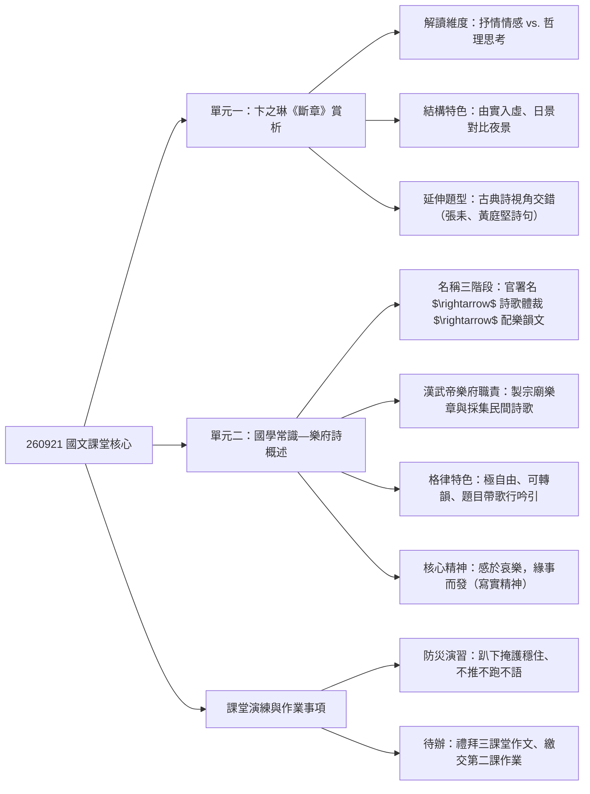
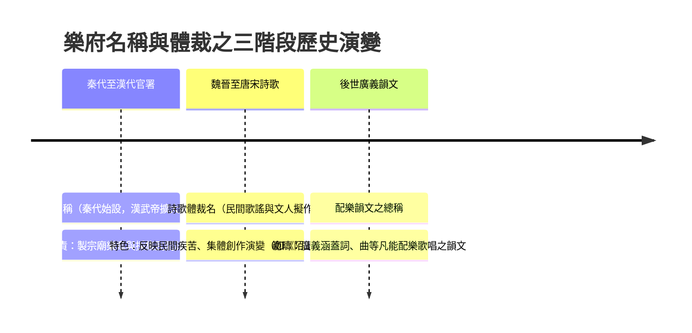

## 📖 課堂主題與核心摘要 (Class Overview)
本堂課前半段深入解析卞之琳現代詩《斷章》的二元對比、主客體變換哲理與古典詩視角交錯題型；課間進行全校防災演習；後半段則正式進入第八課《陌上桑》（別名《燕歌羅敷行》），系統化梳理國學常識「樂府詩」的起源、官署職責演變、格律特色與「感於哀樂，緣事而發」的核心寫實精神。本課學習目標在於掌握現代詩的哲理解讀維度，並能精確判斷樂府詩的體裁特徵與學測常見命題考點。

## 💡 核心知識點與觀念詳解 (Key Concepts)

### 一、 卞之琳《斷章》之深層賞析與哲理推導
《斷章》全詩僅四句：「你站在橋上看風景，看風景的人在樓上看你。明月裝飾了你的窗子，你裝飾了別人的夢。」課堂上老師帶領同學從兩大維度進行拆解：

1. **抒情層面（情感解讀）：**
   - **看與被看的多重可能**：看風景的人在樓上看你，包含喜歡、監視、關注或尋找把柄等多元人性心理。
   - **情景交融**：前兩句寫白天的「實景」（橋、風景、樓）；後兩句寫夜晚月光下的「虛景」（窗子、夢境），展現「日有所思，夜有所夢」的情感延續。
2. **哲理層面（主體與客體隨時變換）：**
   - **主客體流動性**：人常自視為觀察世界的「主體」，但同時也是他人眼中的「客體」。世界不以自我為中心，人與外在環境隨時發生牽連與互動。
   - **萬物互相依存**：即便個人產生厭世心理想遠離世界，人也無法孤立存在於社會之外，萬事萬物均處於隨時連結的動態網絡中。

#### 經典例題拆解：古典詩中的「視角交錯」題型
老師特別強調，學測常考「視角交錯/視線互換」的古典詩句，並舉出兩大經典例題：
- **例題一**：「偶見行人回手卻，一眼老子立屏間」
  - **解析**：前句為「作者觀察行人」，後句轉換為「行人回頭觀察作者自身」，形成視角對調。
- **例題二**：「江亭上何人坐，看我偏舟望翠微」
  - **解析**：前句為「作者看江亭上坐著的人」，後句為「亭上之人看著偏舟上的作者」，同樣屬於主客觀察視角交錯。

---

### 二、 樂府詩之起源、演變與體裁特色（課本 p.114-115）

#### 【⏱️ 樂府演變與官署發展歷史時間軸】

#### 1. 「樂府」名稱的三階段演變定義
- **第一階段（官署名稱）**：秦代已設，漢武帝時擴大規模，屬於政府機構名稱。
  - **兩大核心職責**：
    1. **製作宗廟樂章**：為朝廷典禮、上朝、祭祀等場合製作配樂與歌詞，內容多為歌頌功德。
    2. **採集民間詩歌（採風）**：派官員深入民間聆聽百姓吟唱，藉由民間歌謠瞭解百姓生活疾苦、民情風俗與施政得失，作為政策調整依據。
- **第二階段（詩歌體裁名稱）**：指採集整理後的民間歌謠（如東漢《陌上桑》、北朝《木蘭詩》），以及後世文人模仿其形式所寫的「擬樂府/擬作」。
- **第三階段（廣義配樂韻文）**：凡是能配合音樂歌唱的韻文總稱，廣義包含宋詞、元曲。

#### 2. 樂府詩的格律特色
- **題目識別標誌**：題目常帶有「歌」、「行」、「吟」、「引」、「謠」、「詞」、「調」等字樣，代表具備配樂可唱之特質。
- **格律限制極為寬鬆**：字數、句數、平仄、對仗皆**無嚴格限制**。
- **押韻規定**：必須押韻，但**「可以轉韻（換韻）」**，且無規定第幾句才能換韻，極具創作彈性。

#### 3. 核心精神與文學特色
- **「感於哀樂，緣事而發」**：因真實生活中的悲喜事件而觸發創作，具備強烈的**寫實主義精神**與反映民生疾苦的特質。
- **常用寫作手法**：善用**側面烘託**、**對話交談**與**民間歌謠風格**（如《陌上桑》描繪羅敷之美即採用側面烘託）。

---

#### 【📊 觀念與易混淆對比表】

| 對比維度 | 樂府詩 (Yuefu Poetry) | 近體詩 (Regulated Poetry, 唐詩) | 現代詩 (Modern Poetry, 新詩) |
| :--- | :--- | :--- | :--- |
| **起源發展** | 秦漢官署採集民間歌謠演變 | 唐代發展成熟之格律詩 | 五四運動後興起之白話詩 |
| **音樂性** | **可配樂歌唱** (採風音樂) | 不可歌唱 (僅供吟誦) | 多不可歌唱 (講求內部韻律) |
| **格律限制** | 極自由，平仄、句數、字數不限 | 極嚴格，平仄、句數、字數皆有定格 | 極自由，無格律限制 |
| **押韻要求** | **必須押韻，但可轉韻** | 一韻到底，不可轉韻 | **可壓韻亦可不壓韻** |
| **核心精神** | **感於哀樂，緣事而發** (寫實導向) | 寄情山水、邊塞、詠史等多重題材 | 個人情感表現與哲理探討 |

---

## ⚠️ 老師強調考點與易錯陷阱 (Exam Focus & Pitfalls)

- 📌 **必考重點一：樂府官署的兩大職責**
  - 學測常見選擇題考題，務必區分「製作宗廟典禮樂章（歌功頌德）」與「採集民間詩歌（採風觀政）」的不同目的。
- 📌 **必考重點二：樂府詩的押韻與格律陷阱**
  - **常見陷阱**：學生常誤以為樂府詩與現代詩一樣「完全不需押韻」，或是誤以為樂府詩像近體詩一樣「必須一韻到底」。
  - **正確觀念**：樂府詩**必須押韻**，但允許**「自由轉韻（換韻）」**！
- 📌 **必考重點三：古典詩「視角交錯」判讀題**
  - 題目給予未讀過的古詩句時，需能精準區分「作者看客體」與「客體回看作者」的視線轉換（如「偶見行人回手卻，一眼老子立屏間」）。
- 📌 **必考重點四：八字真言與寫實特色**
  - **必背標籤**：「感於哀樂，緣事而發」為樂府詩的核心精神，與《詩經》同屬「寫實主義」傳統，切勿與《古詩十九首》或浪漫派混淆。

---

## 🔑 記憶口訣與解題技巧 (Mnemonics & Shortcuts)

- 💡 **樂府詩題目破題速解 Key Words**：
  - 凡題目中包含 **「歌、行、吟、引、謠、詞、調」**（如《燕歌羅敷行》、《琵琶行》、《短歌行》），即可直接判定為樂府詩體裁！
- 💡 **樂府詩核心口訣**：
  - **「感於哀樂，緣事而發；字句不限，可以轉韻。」**
- 💡 **視角交錯題型解題 SOP**：
  1. 標記詩句中的動作主體（誰在看）與對象（看誰）。
  2. 比對前後句主客位置是否互換（\\(A \rightarrow B\\) 變為 \\(B \rightarrow A\\)）。
  3. 若前後句發生「觀察者與被觀察者對調」，即為「視角交錯/主客互換」結構。

---

## 📝 課後作業與待辦事項 (Homework & Tasks)

- 📅 **禮拜三（預定事項）**：
  - 課堂進行**作文寫作**。
- 📥 **作業繳交**：
  - 課後將收取**第二課作業**（第一課語文與養分學習單）。
- 🚨 **校園防災演習花絮與提醒**：
  - 本日課間完成地震演習（花費 9 分鐘清查人數完畢，符合北市府 10 分鐘合格標準）。
  - **地震避難口訣**：「趴下、掩護、穩住」。
  - **撤離原則**：「不推、不跑、不語（不聊天）」，沿途務必攜帶能充分保護頭部之物品。
  - 防災卡抽查班級：2 班、4 班、6 班、9 班、13 班、15 班。

---

## 📚 專有名詞與重要公式/定義 (Glossary & Formulas)

* [樂府]: 秦代始設、漢武帝擴大規模之官署名稱，後演變為採集民間歌謠及文人擬作之詩歌體裁，廣義亦指凡能配樂歌唱之韻文。
* [感於哀樂，緣事而發]: 漢代樂府詩之核心寫實精神，指創作源於民間生活之真實感觸與具體事件。
* [轉韻]: 樂府詩押韻之規範，允許在一首詩中更換韻腳，無嚴格之換韻句數限制。
* [主體與客體 (Subject & Object)]: 哲學與現代詩學觀念，主體指主動觀察與感知者，客體指被觀察與作用對象，兩者隨情境動態轉換。
* [側面烘託]: 一種詩歌描繪手法，不直接描寫主角本身，而透過周圍環境或周遭人物之反應來凸顯主角特質（如《陌上桑》描寫羅敷之美）。

---

## 🧠 課後自測題 (Quick Review Quiz)

1. **問答題**：請說明「樂府」一詞在文學史發展上的三個階段定義演變，並列舉漢武帝時期樂府官署的兩大核心職責。
   - *解題思維/簡答*：
     1. 三階段：(1) 秦漢官署名稱 \\(\rightarrow\\) (2) 民間歌謠與文人擬作之詩歌體裁 \\(\rightarrow\\) (3) 泛指一切可配樂歌唱之韻文（如詞、曲）。
     2. 漢武帝樂府職責：(1) 製作宗廟典禮樂章（歌功頌德） (2) 採集民間詩歌（採風觀政、了解民疾）。

2. **觀念判斷題**：小明認為「樂府詩既然來自民間歌謠，格律自由，所以寫作時完全不需要押韻，且不能換韻」，請問小明的觀念是否正確？請予以修正。
   - *解題思維/簡答*：
     - 不正確。樂府詩雖然字數、句數、平仄、對仗皆無嚴格限制，但**必須押韻**；且樂府詩押韻的特點是**「可以轉韻（換韻）」**，並非完全不壓韻，亦非如近體詩般必須一韻到底。

3. **視角分析題**：詩句「江亭上何人坐，看我偏舟望翠微」運用了何種文學視角手法？其與卞之琳《斷章》有何相似之處？
   - *解題思維/簡答*：
     - 運用了「視角交錯/主客互換」手法。前句為作者觀察江亭上的人，後句為亭上之人回看偏舟上的作者。這與《斷章》中「你站在橋上看風景，看風景的人在樓上看你」的主客體隨視角隨時變換的哲理結構完全一致。