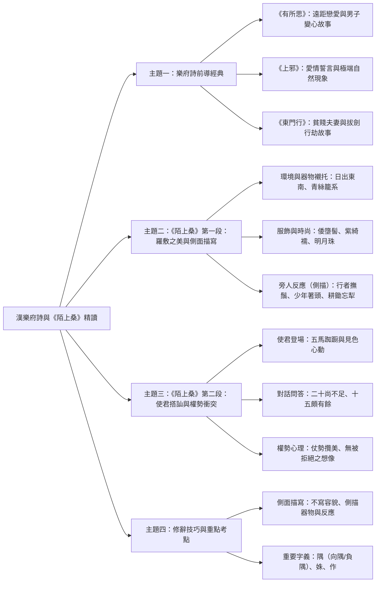
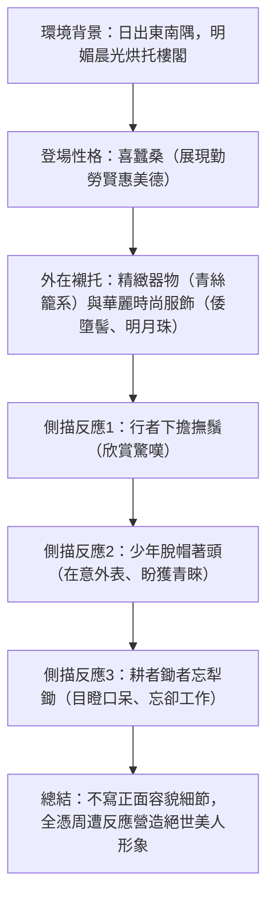

## 📖 課堂主題與核心摘要 (Class Overview)
本堂課以漢代樂府詩為核心，首先透過《有所思》、《上邪》與《東門行》三首經典樂府作品，引導學生理解樂府詩具備敘事性、反映民間生活與寫實情節的特點。隨後正式進入課文《陌上桑》第一段與第二段，深入剖析女主角羅敷的登場背景、精緻服飾與周遭旁人的誇張反應。課程特別強調「側面描寫」與「襯托」修辭手法的運用，並藉由使君（太守）搭訕羅敷的對話情節，揭示權勢者的自傲與古典詩歌中的角色衝突。學習目標包含掌握樂府詩敘事特色、文言字詞義辨析（如「隅」、「姝」、「作」）以及修辭襯托之解題技巧。

## 💡 核心知識點與觀念詳解 (Key Concepts)

### 一、樂府詩前導作品與敘事特色
1. **樂府詩核心特點**：
   - 樂府詩多採集自民間歌謠，反映底層社會生活與情感，具備強烈的**故事性（敘事性）**與**寫實風格**。
2. **前導作品賞析與課堂案例拆解**：
   - **《有所思》**：講述遠距離戀愛中，女子得知男方變心（「聞君有他心」）後，決絕地將精心製作的信物（雙珠玳瑁簪）燒毀並「當風揚其灰」的故事。
   - **《上邪》**：女子發誓永不與對方決絕（「乃敢與君絕」），除非發生「山無陵，江水為竭，冬雷震震，夏雨雪，天地合」等自然界極不可能發生之現象，極力表達對愛情的堅貞不渝。
   - **《東門行》**：反映貧賤夫妻百事哀的困境。丈夫因家徒四壁（「盎中無米，架上無衣」）悲痛至極，拔劍欲出門行劫；妻子牽衣哭勸（「顧念黃口小兒」），丈夫最終仍執意前去。
   - **【課堂創新教學】**：老師分享請學生依詩意畫圖，並透過 AI 圖像生成工具（如 Gemini）進行識圖與上色，用以檢驗學生是否真正理解詩歌情節與意境。

---

### 二、《陌上桑》第一段：羅敷登場與「側面描寫」
1. **出場場景與氛圍營造**：
   - **「日出東南隅，照我秦氏樓」**：設定早晨陽光灑落東南方的明亮景致，以美麗晨光烘托女主角羅敷登場（若天色昏暗則如恐怖片，此處以明媚景致襯托美人的美好）。
   - **「照我秦氏樓」中的「我」**：為唱者/說書人拉近與聽眾距離的講述口吻，非羅敷自稱。
2. **勤勞美德與器物襯托**：
   - **「羅敷喜蠶桑，採桑城南隅」**：養蠶採桑展現傳統婦女賢惠、勤勞的美德（傳統視角中「熱愛工作、幫襯家計」的好女人形象）。
   - **「青絲為籠系，桂枝為籠鉤」**：用青綠色絲線做籃繩、桂樹枝做籃鉤。採桑屬於勞動工作，卻使用極為精緻高級的器物，旨在**以物襯人**，烘托羅敷超凡脫俗之美。
3. **時尚裝扮與頭飾妝容**：
   - **「頭上倭墮髻，耳中明月珠。湘綺為下裙，紫綺為上襦。」**：
     - **倭墮髻**：漢代最流行之髮型（斜傾隨意、似散非散的美感）。
     - **明月珠 / 湘綺 / 紫綺**：精美耳飾與配色講究的上衣下裙，突顯其高雅品味與時代時尚。
4. **旁人反應（側面描寫的核心）**：
   - **行者**（過路人）：「下擔撫鬚」——放下扁擔摸鬍鬚，讚嘆驚艷。
   - **少年**（年輕人）：「脫帽著頭」——連忙整理髮巾帽子，在意自身外表，希望吸引羅敷注意（OS：「她會不會注意到我？」）。
   - **耕者與鋤者**（農夫）：「忘其犁 / 忘其鋤」——看傻了眼，連工作用的農具都忘記使用。
   - **「歸來相怨怒，但坐觀羅夫」**：回家後互相怨怪怠慢工作，全是因為停下來看羅敷看呆了。

【⏱️ 羅敷登場與旁人反應之側描推進流程圖】：

---

### 三、《陌上桑》第二段：使君搭訕與權勢心理剖析
1. **使君登場之威勢**：
   - **「使君從南方來，五馬立踟蹰」**：使君（太守，一郡最高行政長官）乘坐五馬大車巡視，見羅敷美貌便停下車馬徘徊不前（建色心動）。
2. **問答對話與進度推進**：
   - 「使君遣吏往，問是誰家姝？」→ 官員前去詢問美貌女子身分。
   - 「秦氏有好女，自名為羅敷。」→ 回答姓名。
   - 「羅敷年幾何？」→ 「二十尚不足，十五頗有餘。」→ 交代羅敷正值青春年華（約15~19歲）。
   - 「使君謝羅敷，寧可共載否？」→ 使君親自詢問：「願意和我共乘一車嗎？」
3. **使君心理與權勢展現**：
   - 使君身為年約40歲的高官，面對年輕少女直接進展到「要不要跟我走」，反映其**仗勢欺人、自恃權勢**的心理，在其價值觀中從未想過自己會被拒絕。

【📊 描寫手法對比表】：
| 描寫維度 | 直接描寫（正面描寫） | 側面描寫（襯托/側描） | 《陌上桑》實例應用 |
| :--- | :--- | :--- | :--- |
| **定義** | 直接對人物的五官、身材、膚色進行正面刻畫。 | 不直接寫人物容貌細節，透過環境、器物、服飾或旁人反應烘托。 | 本文完全未寫羅敷眼睛大小、鼻樑高低或膚色。 |
| **效果** | 具體明確，但缺乏讀者想像空間。 | 留白豐富，啟發讀者想像力，營造「無限之美」。 | 透過行者撫鬚、少年著頭、耕鋤忘犁等反應，證明羅敷絕頂美麗。 |
| **襯托層次** | 無（直接敘述） | 1. 美景烘托（日出晨光） 2. 美物襯托（青絲籠、明月珠） 3. 旁人誇張反應（忘其犁鋤） | 將環境、器具、服飾與旁人心理四重結合。 |

---

## ⚠️ 老師強調考點與易錯陷阱 (Exam Focus & Pitfalls)

1. **必考高頻字詞與字義辨析**：
   - **「隅」**：
     - 本義：角落（「日出東南隅」、「採桑城南隅」）。
     - 成語延伸：**「向隅」**——面對角落，引申為**錯失良機而失望**（例如：搶票請早，以免向隅）。
     - 成語延伸：**「負隅頑抗」**——憑藉險要地勢進行抵抗。
   - **「姝」**：注音 ㄕㄨ，指美貌女子（「問是誰家姝」）。
   - **「作」**：介詞，**因為**（「但作觀羅夫」：全是因為觀看羅敷的緣故）。
   - **「系」與「鉤」**：系（繩子）、鉤（籃子把手）。
   - **「頭」**：男子的束髮頭巾（古人先綁髮束頭，再戴帽子）。

2. **常見觀念陷阱與概念澄清**：
   - ❌ **易錯陷阱 1**：以為「照我秦氏樓」的「我」是羅敷自稱。
     - 💡 **正確觀念**：此處「我」是**唱者/說書人**的講述口吻，用以拉近與聽眾的距離。
   - ❌ **易錯陷阱 2**：以為第一段有詳細描寫羅敷的面貌長相。
     - 💡 **正確觀念**：第一段完全**沒有正面描寫**羅敷的五官細節！全段皆為**側面描寫（襯托）**。
   - ❌ **易錯陷阱 3**：混淆行者與少年的反應心態。
     - 💡 **正確觀念**：「行者下擔撫鬚」是年長過路人的純粹欣賞讚嘆；「少年脫帽著頭」是年輕男子在意自身外表、希望能吸引美貌女子注意的心態。

3. **延伸歷史與文化考點（《後漢書》孫壽時尚元素）**：
   - 課堂引用《後漢書》大美女孫壽為例，說明漢代時尚流行美學：**愁眉**（愁苦眉型）、**啼妝**（哭泣眼妝）、**墮馬髻**（斜傾髮型，同倭墮髻）、**折腰步**（婀娜步態）、**齲齒笑**（似愁似笑）。

---

## 🔑 記憶口訣與解題技巧 (Mnemonics & Shortcuts)

1. **《陌上桑》第一段側描速記口訣**：
   - **口訣**：「**景美物精服飾靚，路人少年農夫癡**」
   - **破題解法**：題目若問《陌上桑》如何塑造羅敷形象，依序尋找：
     1. **景**：日出東南隅（環境烘托）。
     2. **物**：青絲系、桂枝鉤（器物襯托）。
     3. **服**：倭墮髻、明月珠、紫綺襦（服飾襯托）。
     4. **人**：行者撫鬚、少年著頭、耕鋤忘犁（旁人反應側描）。

2. **樂府詩判讀破題 SOP**：
   - **第一步**：確認是否具備**故事性與對話**（如《有所思》雙珠玳瑁、《東門行》拔劍與妻哭勸、《陌上桑》使君問答）。
   - **第二步**：觀察是否反映**民間生活與社會寫實**（如愛情變心、貧窮犯罪、官員仗勢攬美）。

---

## 📝 課後作業與待辦事項 (Homework & Tasks)
- 📌 **明日考試**：明日課堂將進行「第一課考卷測驗」，請務必熟讀課本與註釋。
- 📌 **課後複習**：完成課本 p.116 - p.120 之課文與註釋研讀，重點加強第一、二段字詞義（「隅」、「姝」、「作」等）與側面描寫分析。

---

## 📚 專有名詞與重要公式/定義 (Glossary & Formulas)
* **樂府詩**：漢代採集民間歌謠或文人創作配樂之詩歌，特色為具故事性、句型自由、風格寫實，多反映社會底層現實。
* **側面描寫（側描/襯托）**：不直接描寫主體的特徵，而是透過環境烘托、器物對比或周遭人物的反應，間接突顯主體特徵的修辭手法。
* **隅**：角落。「日出東南隅」指東南方角落；成語「向隅」指面對角落，引申為錯失良機而遺憾失望。
* **倭墮髻**：漢代女子流行之髮型，將髮髻梳於一側，呈現微微傾斜、似散非散的隨性美感。
* **使君**：漢代對太守（一郡最高行政長官）的尊稱。
* **姝**：注音 ㄕㄨ，指美貌優雅的女子。

---

## 🧠 課後自測題 (Quick Review Quiz)

**第一題（修辭與描寫手法辨析）**：
* **題目**：《陌上桑》第一段中，作者完全沒有描寫羅敷的眼睛大小、鼻子高低或膚色，卻能讓讀者深切感受羅敷是絕世美女。請問作者主要採用了何種描寫手法？試列舉課文中兩種不同的呈現方式。
* **解析/答案**：
  * **描寫手法**：側面描寫（襯托手法）。
  * **呈現方式**：
    1. **器物與服飾襯托**：以精緻的「青絲籠系、桂枝籠鉤」及時尚華麗的「倭墮髻、明月珠、紫綺襦」襯托羅敷的美貌與品味。
    2. **旁人誇張反應**：透過過路人「下擔撫鬚」、年輕人「脫帽著頭」及農夫「忘其犁鋤」等失神反應，誇張突顯其驚世美貌。

**第二題（字義與成語應用題）**：
* **題目**：課文「日出東南隅」中的「隅」字原意為角落。請解釋成語「以免向隅」的文字原意與現代引申義。
* **解析/答案**：
  * **原意**：「向隅」指獨自面對角落（無法參與或共享）。
  * **現代引申義**：指錯失良機而感到遺憾、失望（如：門票數量有限，請盡速購買，以免向隅）。

---

💡 **溫馨提醒**：已為你整理好精美完整的國文考前衝刺筆記！記得今晚複習課本第 116 至 120 頁的課文與字詞釋義，準備明天的第一課考卷測驗喔！若需要進一步製作心智圖、課堂測驗或語音複習摘要，歡迎隨時告訴我！