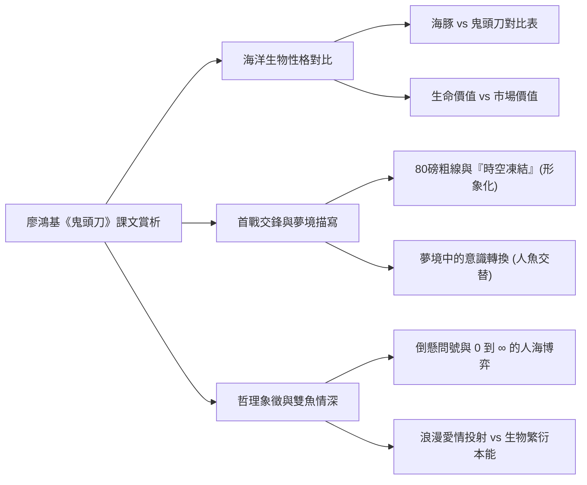
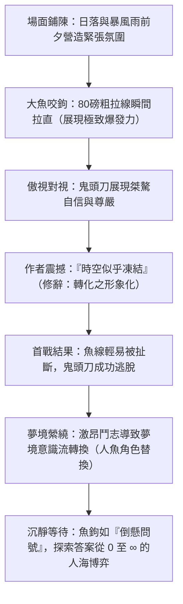

## 📖 課堂主題與核心摘要 (Class Overview)
本堂課主要針對台灣海洋文學名篇——廖鴻基《鬼頭刀》進行課文第 2 至 12 段的深度賞析與結構解構。課堂重點探討海豚與鬼頭刀在捕食方式、性格特質及與人互動上的顯著對比，並細緻分析作者首次與鬼頭刀交鋒時的動態場面描寫、夢境中的意識轉換手法，以及魚鉤象徵「倒懸問號」背後深刻的人海博弈哲理。學習目標在於掌握文章中的修辭技巧（如轉化中的形象化）、文意理解關鍵，以及學會分辨文學情感投射與生物學真實的差異。

---

## 💡 核心知識點與觀念詳解 (Key Concepts)

### 1. 海洋生物的對比：海豚與鬼頭刀之性格與生存智慧
課文第 2、3 段運用了靈活的對比手法，將海豚與鬼頭刀兩種不懼怕人類的海洋生物進行多維度剖析：

*   **捕食對象與方式**：
    *   **海豚**：主食為鰹魚。採取「分頭追趕、團隊圍捕」的方式，並將獵物分享給老弱同伴享用。作者藉此對比人類，強調海豚捕食僅為生存所需，而人類過度捕撈則常出自私慾與貪婪。
    *   **鬼頭刀**：主食為飛魚。採取單打獨鬥的高速追趕，精準算準飛魚落水的瞬間張大嘴巴吞食。
*   **與人類互動的態度**：
    *   **海豚**：親人、溫尋玩皮，但絕非盲目親近，而是隨時「保持警覺」，呈現「若即若離」的相處型態。
    *   **鬼頭刀**：神出鬼沒、極具自信且充滿桀驁不 rootCmd 的驕傲，完全不害怕人類，甚至直視人類眼睛而不迴避。

#### 📊 海豚與鬼頭刀觀念對比表

| 對比維度 | 海豚 (Dolphin) | 鬼頭刀 (Dorado / Dolphinfish) |
| :--- | :--- | :--- |
| **主要食物** | 鰹魚 | 飛魚 |
| **捕食特色** | 團隊圍捕、分頭追趕、分享老弱（生態平衡與利他） | 單獨高速追擊、精準計算飛魚落水瞬間（狂野與果斷） |
| **接觸人類方式** | 溫尋玩皮、親人，但**保持警覺**（若即若離） | 神出鬼沒、極具自信、不慌不忙、直視不迴避 |
| **象徵意涵** | 智慧與和諧的海洋靈魂 | 華麗外表、傲骨與強烈個體生命的展現 |

---

### 2. 鬼頭刀的生命價值與市場價值之省思
課文第 4 段探討了鬼頭刀的價值轉化：
*   **市價（經濟價值）**：在魚市場中，鬼頭刀被視為價格低廉的常見魚類。
*   **生命價值（作者視角）**：鬼頭刀真正的價值在於其活生生的「生命力」。包含其炫目華麗的外表（花彩、鮮黃、青色、發亮藍色的鮮豔色彩）與不屈不饒的桀驁自信。一旦被捕殺送往市場，失去生命的鬼頭刀便失去了那份奪目的華麗與傲骨，僅剩冰冷的魚肉價值。

---

### 3. 第一次交鋒與修辭亮點（形象化轉化）
課文第 5 段為文章的第一個高潮，描寫作者首次與鬼頭刀搏鬥：
*   **場景營造**：作者以日落、暴風雨前夕與夜幕降臨等自然景象，營造出緊張休閒且具壓迫感的對決氣氛。
*   **經典細節**：
    *   **\\(80\\) 磅粗線拉直**：象徵鬼頭刀巨大的拉力與狂暴的生命力量。
    *   **眼神對視**：鬼頭刀上鉤時依然充滿巨傲與自信，如眼神直視人間。
    *   **「時空似乎凍結住了」**：表達作者面對強勁對手時措手不及、震懾震撼的心理狀態。
*   **修辭拆解（形象化）**：「時空」屬於抽象概念，無法實際被「凍結」；將抽象的時間與空間比擬為可被凍結的具體物質，屬於轉化修辭中的**形象化**。
*   **交鋒結果**：鬼頭刀輕易扯斷魚線逃脫，展現其難以被征服的狂野。

#### ⏱️ 搏鬥場面與思考演變流程圖

---

### 4. 夢境描寫與意識流手法（虛實相生）
課文第 6 段描寫作者因未捕獲鬼頭刀而內心不甘，產生強烈的鬥志，進而在夢境中與鬼頭刀纏繞：
*   **意識轉換（切分分析）**：
    1.  `我常常幻覺進入鬼頭刀，他的眼、他的心` \\(\to\\) **主體為作者**（夢見鬼頭刀）。
    2.  `我終日沉浸悠游在藍色冰涼的海洋中……看到船底部的黑色陰影` \\(\to\\) **主體轉換為鬼頭刀**（以魚的視角看世界與船隻）。
    3.  `我靜靜的等待等待……那隻跟在船後游動的鮮美目標` \\(\to\\) **主體切回作者**（等待魚隻出現）。
*   **寫作手法分析**：這種看似雜亂、時空錯置的寫法，實為作者刻意**模仿夢境的無邏輯與混亂性**，透過虛構夢境呈現深層潛意識中強烈的執念與搏鬥渴望。

---

### 5. 倒懸的問號與海洋人生的哲學思考
課文第 7 段景象轉為遠山、浮雲、飛鳥與波濤，轉入漫長而沉悶的等待：
*   **「倒懸的問號」**：作者將下沉至海中的魚鉤比喻為一個個倒懸在海中的問號。
*   **「答案從 \\(0\\) 到 \\(\infty\\)（無窮），甚至無法收回」**：
    *   **漁夫的現實風險**：出海捕魚充滿未知，可能血本無歸（答案為 \\(0\\)），也可能大豐收（答案為 \\(\infty\\)），甚至連人帶船面臨危險（無法收回）。
    *   **深層哲理**：象徵人與自然/生物之間永恆的生存競爭與鬥智鬥勇，展現生命際遇的不確定性。

---

### 6. 雙魚情深：文學情感投射 vs. 生物學真實
課文第 8 至 12 段描寫作者再次遇到鬼頭刀，且為公母成雙出現：
*   **正面描寫**：詳細刻畫公魚與母魚在外觀與體型上的差異。
*   **初出海的經驗經驗**：經驗豐富的老漁夫（如海湧伯）皆知鬼頭刀常成雙成對出現；作者對雙魚出現感到驚奇，反映出其當時初次出海、經驗尚淺的背景。
*   **文學浪漫投射**：作者將母魚受傷、公魚隨侍不離的景象，擬人化為「悲傷、願分擔痛苦」的浪漫愛情故事。
*   **生物學真實**：魚類學家指出，公魚緊跟母魚不願離去，本質上是為了保護配偶以**維持種群個體的繁衍能力**，屬於生物演化上的本能行為。

---

## ⚠️ 老師強調考點與易錯陷阱 (Exam Focus & Pitfalls)

1.  **【混合題得分關鍵】海豚性格的完整描述**：
    *   **易錯陷阱**：回答海豚與人類接觸的特點時，若僅寫「溫尋玩皮」或「親人」，只能拿到一半分數。
    *   **滿分公式**：必須同時寫出兩個面向——既「**溫尋玩皮、親人**」，又「**保持警覺、若即若離**」。
2.  **【修辭辨析】轉化中的形象化**：
    *   考題常考「時空似乎凍結住了」的修辭法。請準確指出這是**轉化修辭**中的**形象化**（將抽象的時間空間具體形象化）。
3.  **【文意理解】夢境段落的寫作意圖**：
    *   段落中「人魚視角交替轉換」並非文筆雜亂，而是作者**模仿夢境的錯亂與無邏輯性**，用以表現潛意識中極度的執著與鬥志。
4.  **【象徵寓意】倒懸問號與 \\(0\\) 至 \\(\infty\\) 的含義**：
    *   須能指認「魚鉤」被比喻為「倒懸的問號」，而 \\(0\\) 到 \\(\infty\\) 象徵「漁夫出海博弈的高風險與極大不確定性」。

---

## 🔑 記憶口訣與解題技巧 (Mnemonics & Shortcuts)

*   **海豚 vs 鬼頭刀對比記憶口訣**：
    *   `豚群捕、鰹為食、親人警覺若即離`
    *   `刀單獵、飛為食、傲骨自信不避人`
*   **閱讀理解破題 SOP**：
    1.  看到「情感描寫（如：分擔痛苦、浪漫愛情）」 \\(\to\\) 判定為：**作者主觀的情感投射與擬人化**。
    2.  看到「繁衍、隨侍不離」 \\(\to\\) 判定為：**生物學客觀的種群延續本能**。
    3.  看到「抽象轉具體（如：凍結時空、倒懸問號）」 \\(\to\\) 優先判斷為：**轉化（形象化）或譬喻手法**。

---

## 📝 課後作業與待辦事項 (Homework & Tasks)

*   [ ] **明日待辦**：完成並繳交《鬼頭刀》學習單（老師明日講完將直接抽收並進行加分結算）。
*   [ ] **週三待辦**：
    *   課堂進行第 18 課考卷測驗（擇題考試）。
    *   收繳第 3 課與第 8 課的「雲和隨本 / 習作本」。
*   [ ] **下週一待辦**：準備段考單字與課文總複習測驗。

---

## 📚 專有名詞與重要公式/定義 (Glossary & Formulas)

*   **形象化（轉化修辭）**：將抽象的概念、情感或時空，以具體可感的事物、狀態進行描繪。例：`$ \text{時空凍結} $`。
*   **擬人化 / 情感投射**：將人的情感（如浪漫愛情、悲傷）投注於非人類的生物（如鬼頭刀）身上。
*   **倒懸的問號**：課文中對釣鉤的象徵性譬喻，代表對未知的探索與風險。
*   **數學與哲學數值區間**：
    \\[ \text{釣魚結果/人生際遇} \in [0, \infty) \\]
    表示從毫無所得（\\(0\\)）到無限可能（\\(\infty\\)）的極端變數。

---

## 🧠 課後自測題 (Quick Review Quiz)

**第一題【觀念理解】**
作者在課文中提到鬼頭刀在魚市場中的價格非常便宜，但他卻認為鬼頭刀極具價值。請問作者所認為的「價值」具體指什麼？
> **解題思維/參考答案**：作者認為鬼頭刀真正的價值在於活生生的「生命力」。包含其耀眼華麗的花彩外貌，以及面對強敵時不慌不忙、直視不迴避的強烈自信與傲骨。這份價值在魚被捕殺送往市場後便隨之消失。

**第二題【修辭與文意】**
課文中將海中的魚鉤比喻為「倒懸的問號」，並提到其答案是「從 \\(0\\) 到 \\(\infty\\)」。請說明這段話所蘊含的深層海洋哲理。
> **解題思維/參考答案**：象徵漁夫出海捕魚充滿風險與未知數，可能血本無歸（\\(0\\)），也可能大豐收（\\(\infty\\)），甚至面臨無法收回的危險。同時也象徵人與海洋生物之間永恆的生存博弈與對決。

**第三題【細節對比】**
請說明生物學家與作者（文學視角）對於「公鬼頭刀緊跟受傷母鬼頭刀不肯離去」的解釋有何不同？
> **解題思維/參考答案**：
> 1. 文學視角（作者）：將其擬人化為深情且浪漫的愛情投射，認為公魚願意分擔母魚的痛苦與悲傷。
> 2. 生物學視角：公魚緊跟母魚是為了保護配偶，以維持種群繼續繁衍後代的生物本能。