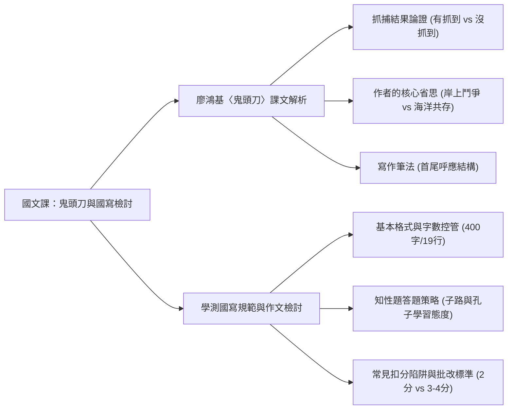
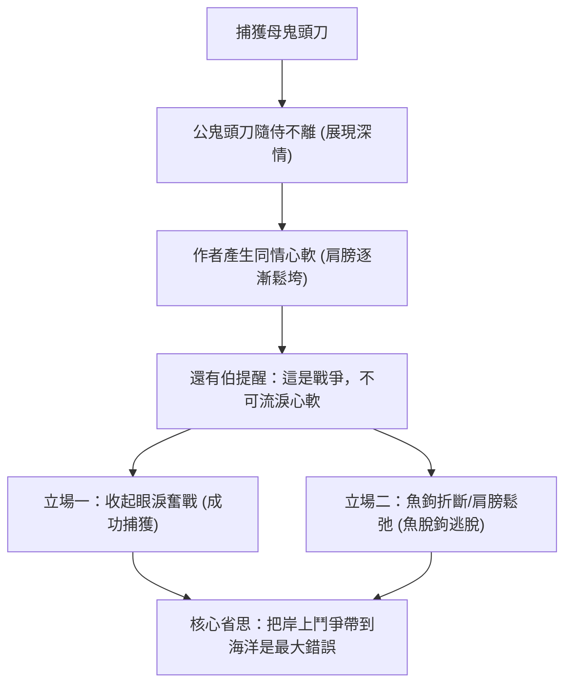
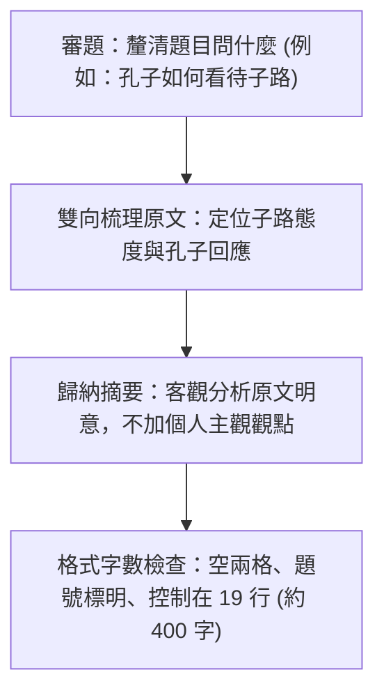

## 📖 課堂主題與核心摘要 (Class Overview)
本堂國文課分為兩大核心模組：第一部分為廖鴻基現代海洋文學名篇〈鬼頭刀〉的課文深度解析與學習單討論，重點聚焦於作者捕抓鬼頭刀的最終結果論證、人與海洋生態關係的深刻省思，以及「首尾呼應」的結構寫作筆法；第二部分為學測國寫知性統整題（以《論語》子路與孔子對話為例）的作文批改檢討，老師特別針對同學首次寫作常見的格式扣分陷阱、字數控制（19行黃金法則）與客觀分析答題架構進行詳細拆解與提醒。

【🌳 本課大綱樹狀心智導圖 (Mindmap)】：

---

## 💡 核心知識點與觀念詳解 (Key Concepts)

### 一、廖鴻基〈鬼頭刀〉文本深度解析與討論

#### 1. 抓捕鬼頭刀之結果與論證（學測混合題型拆解）
在學習單與課本「問題與討論」第二題中，針對「作者最終是否有成功將鬼頭刀抓回去」這一開放性議題，學測混合題型採取「先勾選立場，再說明判斷理由」的命題方式。老師強調：評分關鍵不在於勾選哪一個選項，而是在於**引用課文原文作為證據的精準度與理由完整性**。

- **立場 A：未抓到鬼頭刀**
  - **課本證據 1（肢體反應）**：課本第 45 頁第八段，作者的肩膀逐漸鬆垮放鬆，象徵其不再施力搏鬥，代表選擇放棄。
  - **課本證據 2（工具狀態）**：課本第 46 頁提及「還有伯撿起了折斷了的魚鉤」，魚鉤斷裂顯示魚隻最終脫鉤逃脫。
- **立場 B：有抓到鬼頭刀**
  - **課本證據（心理轉折）**：課本第 45 頁第八段，同行夥伴還有伯對作者說：「眼睛閉起來，如果當作是一場戰爭，就該忘掉眼淚。」勸導作者在人與魚的生克生存戰中不能心軟懦弱。作者聽從建議收起眼淚與同情心後，堅持奮戰至最後將其捕獲。

#### 2. 作者的核心省思：岸上鬥爭 vs. 海洋共存
- **關鍵原文字句**：「把岸上的鬥爭習性帶來海洋，原本就是我最大的錯誤。」（課本第 46 頁）
- **文意深層剖析**：
  - **「岸上的鬥爭」**：指人類社會中殘酷的人際競爭。在人類社會裡，展現溫馨或同情常被視為「懦弱的包袱」；人們從小經歷無休止的排名與勝負比較，習慣將競爭對手排除於後。
  - **海洋生態反思**：作者深愛海洋與海洋生物，因而產生深刻省思，質疑為何人類要將陸地上殘酷殘忍的競爭邏輯套用至大自然與海洋生物身上，進而思考「人與海洋生物和諧共存」的理性可能。

#### 3. 文章結構特色：首尾呼應筆法
- **時間軸呼應**：第一段描繪「黎明」，最末段（第十段）描繪「黃昏」，運用時間的推移形成完整時間結構。
- **物象/意象呼應**：第一段以「飛魚」破題，最末段同樣以「飛魚」收尾，達到前後緊密扣合、文章結構穩重之效果。

---

### 二、學測國寫/作文寫作規範與評分陷阱拆解

#### 1. 寫作基本格式與行數控管
- **格式規範**：題號必須標明清晰；無論是第 1 小題或第 2 小題，以及內文每段開頭，皆必須**嚴格縮排（空兩格）**。
- **行數與字數黃金比例**：
  - 最佳篇幅為 **19 行（約 400 字）**，上限為 **20 行**。自第 **21 行**起開始實施扣分。
  - 下限警告：若僅撰寫 10–15 行（約 200 多字），常因篇幅過短、論述不完整而遭大幅扣分。

#### 2. 引導式閱讀理解與摘要題型解析（以《論語》子路與孔子對話為例）
- **題目要求**：分析「孔子如何看待子路的學習態度」（限字數內摘要）。
- **高分完整架構**：必須雙向涵蓋：
  1. **子路的學習態度**：倚仗天賦而不重視後天學習（如以南山之竹自喻）。
  2. **孔子的觀點與回應**：認為雖有天賦，仍需透過後天學習、切磋琢磨（如括羽刮摩）方能成材，因此不贊同子路輕視學習的態度。

---

### 【⏱️ 課文與寫作流程圖】

#### 1. 〈鬼頭刀〉捕抓轉折與省思脈絡圖

#### 2. 學測國寫知性題（第一題）標準解題 SOP

---

### 【📊 觀念與易混淆對比表】

#### 表一：〈鬼頭刀〉抓捕結果立場與文本證據對比表
| 判斷立場 | 課本文本證據與文意 | 分析說明與論證邏輯 |
| :--- | :--- | :--- |
| **未抓到鬼頭刀** | 1. 作者肩頭完全鬆垮放鬆 2. 還有伯撿起折斷的魚鉤（第46頁） | 肩膀放鬆代表放棄抵抗；魚鉤斷裂直接證明魚隻脫鉤逃逸。 |
| **有抓到鬼頭刀** | 還有伯告誡：「眼睛閉起來，如果當作是一場戰爭，就該忘掉眼淚」（第45頁） | 作者聽取勸告後，體認到人魚生存戰不應心軟，收起同情並堅持將魚捕獲。 |

#### 表二：學測國寫第一題（知性統整）得分級距與扣分陷阱對比表
| 得分級距 | 答題表現特徵 | 常見錯誤與扣分陷阱 |
| :--- | :--- | :--- |
| **2 分 (偏低)** | 僅單向提及孔子的觀點，或僅單向提及子路的學習態度；或直接重述原文故事。 | 1. 漏寫對比的另一方。 2. 僅重述故事對話過程，缺乏歸納分析。 |
| **3 - 4 分 (良好/優秀)** | 完整寫出子路的態度與孔子的批判觀點，文意通順，標點符號運用正確。 | 若未達 4 分，多因句型過於口語、標點使用不當，或格式未空兩格。 |
| **致命扣分陷阱** | 格式錯誤（未空兩格、未寫題號）、字數超過 20 行（21 行起扣分）或少於 15 行。 | 錯把第一小題當成第二小題抒發「個人主觀看法」，或大量抄襲原文。 |

---

## ⚠️ 老師強調考點與易錯陷阱 (Exam Focus & Pitfalls)
- **學測混合題評分核心**：勾選選項本身可能占分比重低，理由與文本依據才是得分關鍵！若勾選正確但理由錯誤或未引原文，老師將直接給予 0 分。
- **國寫格式大忌**：
  - **題號遺漏與未縮排**：每小題開頭及段落開頭未「空兩格」，屬於非必要的致命失分。
  - **字數與行數陷阱**：國寫 400 字題目，最適行數為 19 行（上限 20 行）。**第 21 行起開始扣分**；低於 15 行（約 200 多字）則論述不完整。
- **國寫答題角色錯置**：在第一小題（客觀分析摘要題）中，切勿加入「我認為…」、「我的看法是…」等個人主觀抒情或評論。個人觀點必須嚴格保留至第二小題發揮。

---

## 🔑 記憶口訣與解題技巧 (Mnemonics & Shortcuts)
- **國寫知性題答題 3 步驟 SOP**：
  1. **精準對應**：問什麼答什麼，人物 A（子路態度）與人物 B（孔子評價）必須雙向兼顧。
  2. **客觀摘要**：用自己的話歸納原文明意，避免「直接大量抄錄原文」與「重複敘事故事」。
  3. **分清題型**：第一題寫「客觀分析」（零個人觀點），第二題寫「主觀立論」（個人見解）。
- **文章結尾穩重法則**：「首尾呼應法」（利用時間「黎明—黃昏」或經典物象「飛魚—飛魚」形成包夾循環結構）。

---

## 📝 課後作業與待辦事項 (Homework & Tasks)
- **課後作業**：
  1. 訂正並寫完《鬼頭刀》學習單（第 8、9 段問題與討論第 2 題，需寫明抓到/沒抓到的判斷立場與課本依據）。
  2. 依組別（1 至 7 組）於學習單填寫組別，由各組最後一位同學統整收齊繳交。
- **作文檢討待辦**：
  - 詳閱發回的國寫作文，針對老師劃記之格式錯誤（題號、空兩格）、字數問題及第 1 小題寫作盲點進行個人訂正。

---

## 📚 專有名詞與重要公式/定義 (Glossary & Formulas)
* **首尾呼應**：寫作修辭結構，指文章結尾處呼應開頭的描寫（如時間、地點、物象），使文章前後連貫、結構嚴謹完整。
* **知性統整題（學測國寫第一題）**：學測國語文寫作能力測驗題型，要求考生根據文本進行客觀資訊梳理、分析與摘要，不宜摻雜個人主觀評價。
* **混合題型**：結合單選/多選題與非選擇題的綜合考題，通常需先勾選立場或選項，再於限定字數內依據文本寫出判斷理由。

---

## 🧠 課後自測題 (Quick Review Quiz)

**第一題（文本解析）**：在廖鴻基〈鬼頭刀〉中，作者提到「把岸上的鬥爭習性帶來海洋，原本就是我最大的錯誤」，請問「岸上的鬥爭」指什麼？作者對此有何反思？
- **簡要解題思維與答案**：「岸上的鬥爭」指人類社會中殘酷的人際競爭與排名排擠。作者反思人不應將陸地上的殘酷競爭意識帶入海洋，並進而思考人與海洋生物和諧共存的可能性。

**第二題（國寫寫作規範）**：進行學測國寫知性統整題（如分析孔子如何看待子路）時，若限字數 400 字（19 行），下列何者為高分寫作策略？
(A) 儘量抄錄原文中的比喻與對話以充實字數  
(B) 深入發表「我認為不論有無天賦都應學習」的個人見解  
(C) 客觀同時寫出子路的學習態度與孔子的回應評價，並保持格式空兩格、控制在 19 行內
- **簡要解題思維與答案**：答案為 (C)。第一小題旨在考查客觀分析歸納能力，不應過度抄錄原文，亦不應加入個人主觀意見，且須兼顧兩方態度並符合格式字數要求。

---
💡 若需要針對作文改寫範例或《鬼頭刀》其他段落做延伸複習，隨時告訴我！