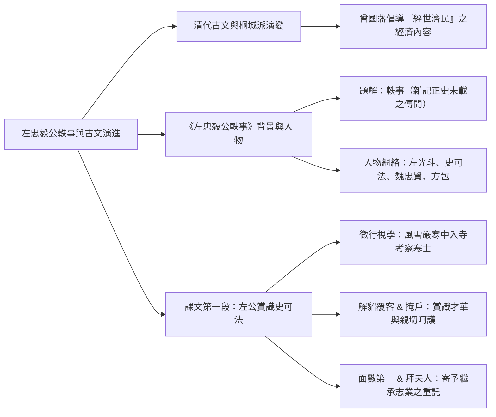
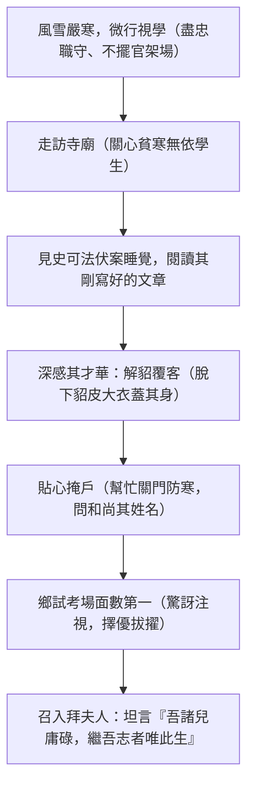

## 📖 課堂主題與核心摘要 (Class Overview)
本堂課為國文選文《左忠毅公軼事》之首堂講解。課堂前半段梳理清代古文演變，特別是桐城派於清末經曾國藩倡導加入「經世濟民（經濟）」精神之脈絡；後半段進入課文題解、複雜人物關係（左光斗、史可法、魏忠賢與作者方包之親戚鏈）及明代廠衛制度背景，並詳細剖析第一段左光斗「風雪微行、愛才賞識史可法」之核心故事。

## 💡 核心知識點與觀念詳解 (Key Concepts)

### 1. 清代古文演變與桐城派發展
- **曾國藩的提倡與「經世濟民」**：
  - 清代末年古文一度衰微，直到曾國藩帶領「湘軍」平定太平天國之亂後，因其英雄形象引發崇拜，帶動讀書人重新學習桐城派古文。
  - 曾國藩主張古文除考據、義理、文章外，更必須融入**「經濟」**內容。
  - **古今語義轉變**：古文中的「經濟」指**「經世濟民」**（經營社會、拯救人民）；現代指稱為錢財/財經的「經濟」，則是清末由日文翻譯傳入的概念。
- **段考叮嚀**：老師強調此段脈絡較短要先記熟，避免第三次段考加入明代六七個複雜派別時混淆。

### 2. 《左忠毅公軼事》題解與寫作背景
- **「軼事」體裁特色**：
  - 亦作「異事」、「異狀」，屬於傳記史料分支，專門記載正史未記載的逸聞瑣事，著重選取代表性事蹟凸顯人物性格。
  - 不同於一般史書從出生異象（如傳聞岳飛出生時紅光滿室）寫到大的流水帳寫法。
- **篇名「左忠毅公」之涵義**：
  - 「左光斗」為本名；「忠毅」為其死後追贈之諡號。篇名特別冠以「忠毅」，因全篇內容緊扣「忠」與「義」兩大精神指標。
- **採訪聽聞與人物脈絡**：
  - 作者方包（桐城人）與左光斗為同鄉。
  - **採訪傳播鏈**：左光斗 → 女婿方塗山 → 與方包父親（親戚兼好友）交好 → 方包聽父親轉述左光斗與史可法的事蹟而撰寫成文。
  - **政治背景與對立面**：明末東林黨（楊漣、左光斗）彈劾魏忠賢（閹黨/九千歲，掌握廠衛特務機構如錦衣衛、東廠）24 條大罪 → 魏忠賢先發制人污陷左光斗貪污下獄虐待致死 → 後續清算閹黨，左公恢復名譽追諡忠毅。
  - **史可法之承志**：史可法為左光斗學生，明末死守揚州城抗清，經歷「揚州十日」，後人於揚州梅花嶺設「衣冠塚」（見「梅花嶺」即聯想史可法）。

### 3. 第一段課文：左光斗「微行視學」與識拔史可法
- **【流程圖】左公識才與拔擢過程**：

- **課文文句與細節剖析**：
  - 「先君子常言」：引用去世父親的話，旨在增加文章的可信度與真實性。
  - 「微行」：暗中出行，不擺官員排場，避免地方官員做表面功夫或騷擾百姓。
  - 「解貂覆客」與「掩戶」：脫下貂皮大衣覆蓋史可法、離開時親自關門，展現左公對優秀人才才華的賞識與極致貼心的呵護。
  - 「拜夫人」：將史可法介紹給妻子，並感慨自家兒子平庸，唯有史可法能繼承自己的報國志業，對其寄予厚望。

- **【觀念對比表】主要歷史人物與派別對比**：

| 人物 / 派別 | 身份與政治立場 | 關鍵事蹟與代表象徵 | 在課文/歷史中的角色 |
| :--- | :--- | :--- | :--- |
| **左光斗** | 明末東林黨領袖，掌管教育官員 | 彈劾魏忠賢 24 大罪，遭廠衛下獄虐待致死；追諡「忠毅」 | 本文核心主角，愛才重義、盡忠職守 |
| **史可法** | 左光斗學生，明末忠臣 | 死守揚州城抵抗清軍；後人於揚州梅花嶺設衣冠塚 | 本文配角/承志者，繼承左公報國精神 |
| **魏忠賢** | 閹黨首領（太監），人稱「九千歲」 | 擅權專政，掌握廠衛（錦衣衛、東廠），污陷忠良 | 政治對立面（反派） |
| **方包** | 清代桐城派代表古文家 | 經由父親聽聞方塗山（左光斗女婿）轉述而撰寫本文 | 本文作者，桐城派古文家 |

## ⚠️ 老師強調考點與易錯陷阱 (Exam Focus & Pitfalls)
- **稱謂與日常應用文易錯陷阱**：
  - **「家大舍小令外人」**：稱呼自己尊長用「家」（家父、家母）；稱呼自己卑幼用「舍」（舍弟、舍妹）。稱呼對方親友用「令」（令尊、令堂、令師）。
  - **「先考」與「先妣」**：「先考」指去世的父親；「先妣」指去世的母親。
  - **「小女」 vs 「小女子」**：**「小女」是指「自己的女兒」**！女性自我介紹絕不可自稱「小女」（否則等於稱自己為女兒），應自稱「小女子」。
  - **「如喪考妣」**：形容極度悲傷（好像父母去世一樣），不可用於父母真的去世時。
- **成語字形字義陷阱**：
  - **「矍鑠」**：老而強健。**只能用於老人家**（例如「老當益壯，精神矍鑠」），不可用於年輕人在球場上的精神抖擻。
- **門戶之別**：
  - 「掩戶」之「戶」：指單扇門（推開雙扇的才叫門）。幫史可法關的是單扇門，而非窗戶。

## 🔑 記憶口訣與解題技巧 (Mnemonics & Shortcuts)
- **稱謂記憶口訣**：「家大舍小令外人」（稱己尊長用『家』，稱己卑幼用『舍』，稱人親屬用『令』）。
- **史可法解題關鍵字**：題目中若出現「揚州」、「揚州十日」、「梅花嶺」、「衣冠塚」，即可直接判斷對應歷史人物為「史可法」。
- **古今語義破題判斷**：
  - 古文「經濟」＝「經世濟民」（經營社會、救濟人民，強調實用治國）。
  - 現代「經濟」＝「錢財/財經」（清末日文翻譯引進的概念）。

## 📝 課後作業與待辦事項 (Homework & Tasks)
- 無特定作業（建議課後參閱補充講義第 67 頁關於明代廠衛制度與歷史背景，並預習課文第二段內容）。

---

## 📚 專有名詞與重要公式/定義 (Glossary & Formulas)
* **經世濟民**：古文中「經濟」之本義，意指經營社會、改善社會、拯救人民。
* **軼事（異事）**：傳記史料分支，專門記載正史未記載之逸聞瑣事，著重刻畫人物性格。
* **微行**：尊貴者或官員隱匿身份、穿著平民衣服暗中出行或巡視。
* **廠衛**：明代直屬於皇帝之特務機構。包括「錦衣衛」與「廠」（東廠、西廠、內行廠），集逮捕、審訊、處刑權力於一身。
* **衣冠塚**：因找不到死者遺體，僅埋葬其生前衣服鞋帽以供後人祭奠之墳墓（如史可法於揚州梅花嶺之塚）。

## 🧠 課後自測題 (Quick Review Quiz)
- **題目 1**：下列關於日常應用文稱謂的用法，何者完全正確？
  - (A) 少女小美向長輩自我介紹：「小女今年十七歲，請多指教。」
  - (B) 聽到同學父親過世，小明慰問說：「得知令尊去逝，令人悲傷如喪考妣。」
  - (C) 向他人介紹自己的弟弟，應稱為「舍弟」。
  - (D) 稱呼對方的老師，可尊稱為「家師」。
  - *簡析與答案*：**答案為 (C)**。(A) 小美應自稱「小女子」，「小女」是指自己的女兒；(B)「如喪考妣」用於未真的去世時形容極度悲傷，真的去世不可加「如」；(D) 稱呼對方老師應稱為「令師」。

- **題目 2**：左光斗在風雪嚴寒中「解貂覆客」並「掩戶」，其背後最主要的心理與意圖為何？
  - *簡析與答案*：並非男女私情，而是因為左光斗閱讀了史可法伏案所寫的文章後，深受其卓越才華折服，因而對貧寒優異的青年學子產生深切的愛護與拔擢之心。

- **題目 3**：古文中曾國藩主張桐城派古文需具備「經濟」內容，此處的「經濟」與現代所稱的「經濟」有何差異？
  - *簡析與答案*：古文「經濟」係指「經世濟民」（經營社會、拯救百姓）；現代「經濟」則指財經、金錢發展（係清末由日文翻譯傳入之詞彙）。

---
這份筆記已完整涵蓋本次課堂講述的所有內容！若你需要對明代廠衛制度或第二段課文做進一步探討，隨時告訴我！