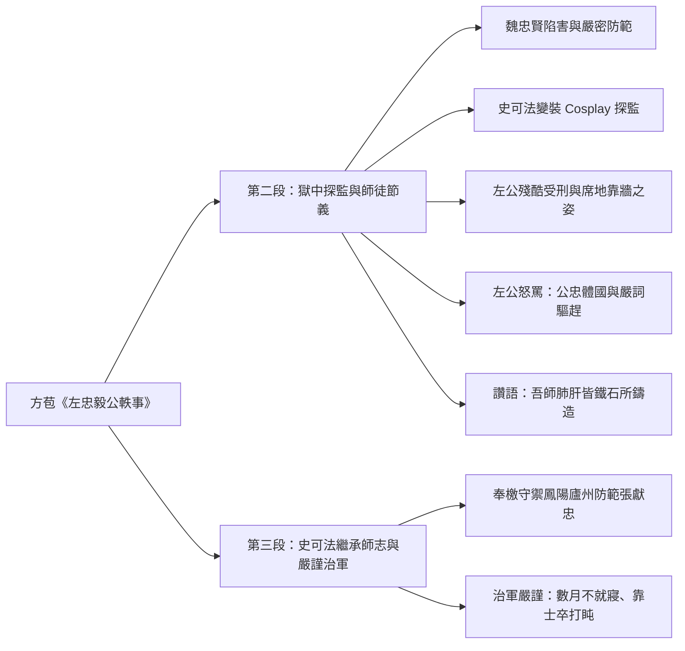
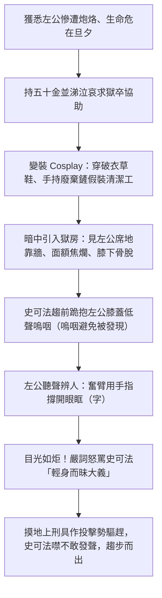

## 📖 課堂主題與核心摘要 (Class Overview)
本堂課主要研讀桐城派文學家方苞的經典散文名篇《左忠毅公軼事》第二段與第三段前半。課堂核心講述明末左光鬥遭魏忠賢閹黨陷害下獄後，弟子史可法冒死變裝探監的感人經過，以及左光鬥在極刑拷打下依然剛正不阿、嚴詞痛罵史可法以保全國家有用之身的忠義節操。此外，課程亦延伸至左公殉國後，史可法繼承師志奉命守禦鳳陽、廬州，恪盡職守、親自帶兵防範流賊張獻忠的治軍事蹟。

## 💡 核心知識點與觀念詳解 (Key Concepts)

### 一、 文章風格與段落結構脈絡
* **桐城派「雅潔」風格**：老師強調方苞文章特色在於「雅潔」，絕不寫無關廢話。第一段交代左光鬥與史可法相識賞識過程後，第二段直接跨越中間多年相處，直奔左公彈劾魏忠賢遭陷害入獄、面臨生死關頭的緊迫情節。

### 二、 史可法變裝探監的波折與冒險流程
* **魏忠賢黨羽嚴密防範（逆閹防伺甚嚴）**：左公被關進東廠監獄，外圍戒備極其森嚴，「雖加僕不得盡」（即使是僕人也無法靠近送餐），使左公與外界消息完全隔絕。
* **重金與真情打動獄卒**：史可法聽聞左公遭受殘酷「炮烙之刑」，且將不久於人世（旦夕死、且死），拿出五十金並痛哭哀求獄卒（「五十金涕泣謀於獄卒」）。老師妙喻：實質利益（錢）比情感表現（哭）更能發揮關鍵作用，最終打動獄卒。
* **喬裝打扮（變裝 Cosplay）**：因獄卒權力有限且防範嚴密，史可法穿著破爛衣服（長貧）、草鞋（草具）、背著竹框、手拿清除垃圾的鏟子（「手長鏟」，手轉品為動詞「手持」），假裝成清潔打掃人員（「微除不潔者」，微通「偽」）偷偷潛入。

### 三、 左光鬥獄中慘狀與「毅/節操」的三大精神展現
老師特別解析左光鬥在獄中雖受盡酷刑，卻透過三個極具張力的細節展現驚人的意志力（「毅」）：
1. **「席地以牆而坐」**：左公雙腿已被拷打殘廢（「左膝以下筋骨盡脫」），全體遍體鱗傷。一般人在極度劇痛下早已癱軟在地（老師以「體育課跑完 5000 公尺累癱」作比喻），但左公依然堅持靠牆坐著，象徵絕不屈服的剛強骨氣。
2. **「奮臂以指撥字，目光如炬」**：左公面部遭受慘絕人寰的炮烙燙傷（「面額焦爛不可變」），眼睛已被燙傷無法自行睜開（老師提及曾試將此情節輸入 AI 繪圖，因涉及極度暴力內容遭 AI 系統拒絕生成）。左公必須用盡全身力氣舉起手臂（「奮臂」），用手指將眼眶（字＝眼眶）撐開。縱使肉體毀壞，撐開後的雙眼依然「目光如炬」，展現無比堅定的精神意志。
3. **「嚴詞痛罵與作投擊勢驅趕」**：見到史可法抱膝痛哭，左公第一反應不是感動軟弱，而是生氣怒罵「庸奴！此何地也，而汝來前！」。左公深知國家大局已爛，自己必死無疑，史可法是繼承其志向、支撐國家的唯一希望。若史可法因探監被抓，國事將無人可救。左公甚至摸地上的刑具假裝要砸他（作投擊勢），硬將史可法逼走。這展現了「公忠體國、大義在前」的極致節操。

【⏱️ 史可法冒險探監與左公痛罵流程圖】：

### 四、 史可法繼承師志與嚴謹治軍
* **「吾師肺肝，皆鐵石所鑄造也」**：史可法事後每每流淚對人提及此事。老師強調，史可法完全理解老師怒罵背後的深情與期許，內心極度悲傷而非單純害怕。
* **奉檄守禦與恪盡職守**：左公死後，史可法奉命掌管鳳陽、廬州兩道軍事（「鳳廬道奉檄守禦」），抗擊性情殘暴的流賊張獻忠。
* **軍旅治軍防守 SOP**：每逢軍事戒備（「每有景/警」），史可法「數月不就寢」——老師澄清這並非好幾個月完全不睡覺，而是「不上床睡」。史可法讓士卒輪流休息（「將士更休」），自己則坐在營帳外，挑選十名健壯士兵，兩人一組蹲坐（「蹲鋸而背以枕」），自己靠在士兵背上打盹。每過一更（「肉壺一翻」）即輪換一組，隨時準備拔劍迎敵。

【📊 觀念與易混淆對比表】：
| 項目/詞語 | 文章課文原意 | 現代常見語義 / 易混淆概念 | 老師特別提醒考點 |
| :--- | :--- | :--- | :--- |
| **鐵石心腸** | **正面讚美**：讚美左光鬥意志如鐵石般堅貞剛毅。 | **負面貶義**：形容人冷酷無情、缺乏同理心。 | 屬古今異義詞，考題常設陷阱，須依語境判斷為正面讚美。 |
| **雖（加僕不得盡）** | **即使**（假設連詞）：即使是僕人都無法靠近。 | 雖然（轉折連詞）。 | 文言文常見考點，「雖」多作「即使」解。 |
| **且（且死）** | **即將**（副詞）：很快、即將面臨死亡。 | 並且、而且（遞進連詞）。 | 課文極高頻考點，音義同「將」。 |
| **極（極左公下廠獄）** | **等到**（副詞）：等到左公被關進東廠監獄。 | 極端、非常。 | 文言常見時間副詞。 |
| **噤若寒蟬 vs 三緘其口** | **噤若寒蟬**：因「害怕/高壓」而不敢說話。 | **三緘其口**：說話謹慎、嘴巴緊閉不發表意見（無害怕意）。 | 兩成語皆指不說話，但「噤若寒蟬」帶有害怕高壓環境的語義。 |
| **睚眥必報** | 「字」指**眼眶**。睚眥指瞪人一眼的小怨。 | 比喻心胸狹窄，極小的怨恨也一定要報復。 | 老師以「現代飆車族看一眼就打人」為生活比喻。 |

## ⚠️ 老師強調考點與易錯陷阱 (Exam Focus & Pitfalls)
- **【星號必考】詞性轉品與文言字詞**：
  - `手`長鏟：名詞轉動詞，意為「手持」鏟子。
  - `親`身而`昧`大義：親（輕視）、昧（昏暗/不明白），由形容詞轉動詞使用。
  - 逆閹防`伺`甚嚴：伺（音 sì），暗中偵察、監視。
  - 俟（音 sì）：等待；嬖（音 bì）：受寵愛的奸臣（指魏忠賢集團）。
- **【觀念陷阱】左光鬥怒罵史可法的兩重深刻原因**：
  - **公（國事大義）**：國事腐敗至極，自己已無能為力，史可法是支撐天下的唯一希望，不可為探監而冒險犧牲。
  - **私（師生深情）**：極其愛護學生，不忍見愛徒無謂殉難於監獄之中。
- **【修辭考點】「鑲嵌」修辭概念**：
  - 「天下是誰可支柱」之「支柱」為同義詞增字（相字）。老師特別說明學測考題會直接提供定義與範例，學生只需具備良好閱讀理解能力即可，不需死背鑲嵌的四種細部分類（相字、鑲字、配字、分字）。

## 🔑 記憶口訣與解題技巧 (Mnemonics & Shortcuts)
- **「三更半夜」時間推算法**：
  - 課文提到「肉壺一翻」（一更時間）。老師傳授記憶 SOP：固定記住「三更」為深夜 **23:00 - 01:00**（子時）。
  - 四更往後推算 2 小時（**01:00 - 03:00**），五更（**03:00 - 05:00**），一更（**19:00 - 21:00**），以此類推，考試遇到更次推算即可秒殺破題。
- **學測國文閱讀破題心法**：
  - 遇到文學理論或文法修辭題，不必慌張死記名詞。仔細閱讀題目給予的定義說明，對照選項中的關鍵動詞與上下文語境，即可準確答題。

## 📝 課後作業與待辦事項 (Homework & Tasks)
- **課堂指派**：無特定書面作業。
- **自主預習與複習**：請自主複習《左忠毅公軼事》第二段與第三段課文注釋、重點字詞轉品用法，並預習第三段後半段結尾課文。

---

## 📚 專有名詞與重要公式/定義 (Glossary & Formulas)
* [炮烙之刑]: 古代將金屬器具或柱子燒紅後烙燙犯人皮膚的酷刑。
* [逆閹]: 指明代宦官魏忠賢及其違背天理的奸黨分子的專橫霸道。
* [微除不潔者]: 微通「偽」，假裝成打掃清潔監獄的人員。
* [字]: 指眼眶。
* [目光如炬]: 眼光像火炬一樣燦爛有神，形容精神意志極其堅定剛烈或眼光遠大。
* [輕身昧大義]: 不珍惜自己的生命安全，以致於不懂得愛國愛民的天下大義。
* [噤若寒蟬]: 比喻因高壓害怕或戒懼而不敢發聲說話。
* [鐵石心腸]: 本課指意志堅貞剛強如鐵石一般（古今異義正面詞）。
* [奉檄守禦]: 檄為古代官府徵召、曉諭或聲討的公文。此指奉命掌管軍務防禦職務。
* [肉壺一翻]: 肉壺為古代滴水計時器（漏壺）。一翻代表過了一更的時間（約兩小時）。

## 🧠 課後自測題 (Quick Review Quiz)

**第一題：在《左忠毅公軼事》中，左光鬥見到史可法冒死探監時，非但沒有感動安慰，反而嚴詞怒罵並作投擊勢驅趕。請簡述左公「怒罵」背後包含了哪兩層深意？**
> **解題思維與答案**：
> 1. **公（國事大義）**：當時朝政極度腐敗，左公自知必死，而史可法是唯一能繼承其志向、支撐國家大局的人才。若史可法因探監暴露遭害，天下將無人可支撐。
> 2. **私（師生深情）**：左公極其愛護學生，不希望史可法為了私情而冒無謂的生命危險。

**第二題：文中史可法稱讚「吾師肺肝，皆鐵石所鑄造也」，請說明「鐵石心腸」一詞在本文中的涵義與現代常見語義有何不同？**
> **解題思維與答案**：
> 1. **本文涵義**：正面讚美詞，形容左光鬥在面對殘酷酷刑與生死考驗時，意志如鐵石般堅貞不屈、剛正不阿。
> 2. **現代語義**：負面貶義詞，形容人態度冷酷無情、缺乏同理心與情感。

**第三題：史可法在守禦鳳陽、廬州防範張獻忠時，「每有警，輒數月不就寢」，請問史可法是如何在維持警戒的同時進行休息與指揮的？**
> **解題思維與答案**：
> 史可法並非完全不睡，而是「不上床睡覺」。他讓麾下將士輪流休息（將士更休），自己則坐在營帳外，挑選十位健壯士兵，兩人一組蹲坐，自己靠在士兵背上打盹，每過一更（肉壺一翻）即輪換一組，隨時保持高度戒備狀況以快速應變。

💡 需要我將這份筆記製作成考前衝刺的心智圖卡，或是為你整理這篇課文的精選測驗題庫嗎？