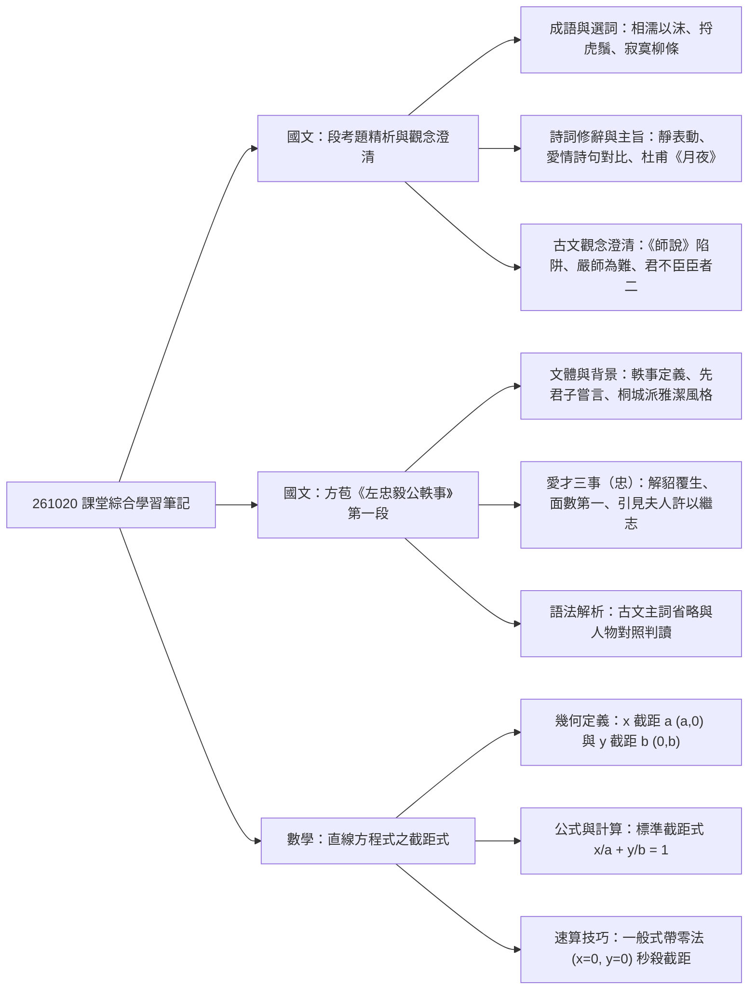
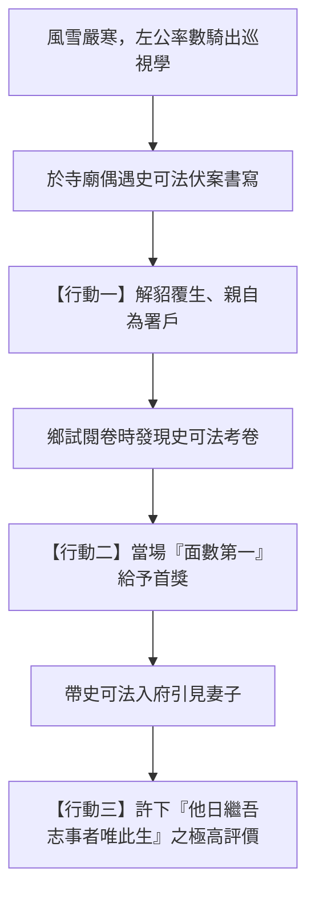
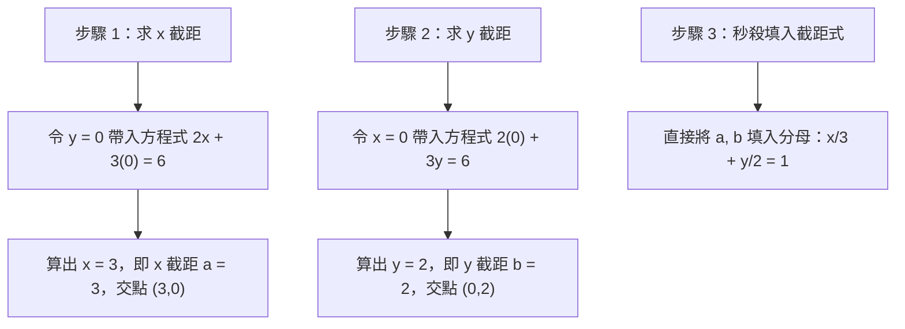

## 📖 課堂主題與核心摘要 (Class Overview)
本堂課前半段進行國文段考考卷檢討，重點涵蓋成語典故、現代詩歌與古典詩詞的修辭語境、韓愈《師說》考點陷阱、古文尊師重道精神及杜甫《月夜》的雙向思念手法。後半段則推進至古典散文方苞《左忠毅公軼事》第一段，深度分析左光斗「愛才即忠國」的核心精神與桐城派「雅潔」的主詞判讀。最後幾分鐘轉入數學單元，解說直線方程式「截距式」的幾何定義與速解轉換 SOP。本課核心學習目標在於掌握高頻考點細節、提升古文主詞判讀能力，並熟練直線截距式的幾何意涵與快速解題技巧。

【🌳 本課大綱樹狀心智導圖 (Mindmap)】：

## 💡 核心知識點與觀念詳解 (Key Concepts)

### 1. 國文段考錯題精析與古典詩文修辭
* **成語典故與字音字形**：
  * **相濡以沫**：原指泉水乾涸，魚兒互相吐唾沫濕潤對方以求生存；比喻在困境中同心協力、互相救助。老師特別補充：老子與莊子思想中，等到社會崩壞才來強調互助，不如「相忘於江湖」。
  * **捋虎鬚**：注意破音字「捋」（讀音為 `$lu\bar{o}$` 或 `$l\ddot{u}$`），意為用手指順著摸，此處指摸老虎鬍鬚，比喻冒險做極度危險的事（不可與「撫」字混淆）。
* **詩詞語境與視覺修辭**：
  * **以靜態畫面表現動態感**：例句如「波光裡的艷影，在我的心頭蕩漾」。河畔柳樹倒影本身屬於靜態景物，但透過水面波光閃爍與晃動，賦予其動態的躍動感，屬於視覺聯想經典修辭。
  * **徐志摩《再別康橋》語境選詞**：春天初生之柳條應選「寂寞」，因為初春柳芽剛萌發、淋漓稀疏，枝葉尚未繁茂，呈現清寂感；不可選「婆娑」（適用於夏秋枝葉繁茂隨風搖曳）或「鬱鬱」（草木茂盛濃密）。
* **韓愈《師說》考題高頻陷阱解構**：
  * **陷阱一（無恥 vs 不從事問學）**：韓愈在文中並非全盤批判士大夫「無恥」，而是批判士大夫階層「恥學於師」、「不從事問學」。
  * **陷阱二（愚人對象）**：文中「愚人」是指「今之眾人」（一般大眾/群大夫），而非士大夫之子。
  * **陷阱三（孔子與郯子）**：文中「孔子師郯子、貺子、師襄、老聃」，韓愈並非用孔子來批判或貶低郯子，而是說明「聖人無常師」，強調凡有一技之長者皆可為師。
* **古文尊師重道與君臣禮儀（《禮記·學記》/《韓非子》）**：
  * **嚴師為難**：「嚴」字作「尊嚴、尊敬」解。尊崇老師最為困難，尊師後其傳授之「道」方能受尊崇。
  * **君之不臣臣者二**：國君不以對待普通臣子方式對待下屬的情況有二：
    1. 大臣「為尸」時：祭祀中代表神明接受祭拜，此時身份等同神明。
    2. 大臣「為師」時：作為皇帝或國君的老師，國君因尊師重道而不以君臣之禮約束。
  * **雖召於天子，無北面**：雖受天子召見，亦不需行面向北方的君臣跪拜禮，展現尊師重道超越一般階級尊卑。
* **杜甫《月夜》：雙向思念的藝術手法**：
  * 杜甫身在長安（或被俘），思念遠在鄜州的妻子，但他不直接寫自己的孤單，而是透過想像「妻子獨自賞月思念長安的自己」，並寫出「香霧雲鬟濕，清輝玉臂寒」的情景，展現極致深沉的雙向思念。

【📊 觀念與易混淆對比表】：愛情與情感詩句主旨對比
| 經典詩句 | 出處 / 作者 | 核心主旨與語境解析 |
| :--- | :--- | :--- |
| **問世間情為何物，直教生死相許** | 元好問《摸魚兒》 | 強調愛情的至高境界，能夠超越生死、為對方**同生共死**。 |
| **衣帶漸寬終不悔，為伊消得人憔悴** | 柳永《鳳棲梧》 | 描寫因思念而消瘦憔悴，但依然**無怨無悔**的執著專一。 |
| **曾經滄海難為水，除卻巫山不是雲** | 元稹《離思》 | 表示見識過極致的深愛後，對其他人再無動心可能，極言**深情專一**。 |
| **兩情若是久長時，又豈在朝朝暮暮** | 秦觀《鵲橋仙》 | 強調愛的真諦在於靈魂契合，不拘泥於天天陪伴，超越**時空相守**。 |

---

### 2. 方苞《左忠毅公軼事》第一段文本深度解析
* **篇名與寫作背景**：
  * **「軼事」定義**：未記載於正史的散逸事蹟。開頭寫「先君子嘗言」（先父曾經說過），表明取材有所本，非憑空捏造。
  * **核心主題（以「忠」為本）**：左光斗（左公）在風雪嚴寒中堅持出巡視學，展現勤政盡責；而在寺廟中遇見史可法，傾心提拔人才，其本質是為了「強固國家大事」，故「愛才」即為「忠」的具體展現。
* **左公愛才惜才的三大具體行動**：
  1. **解貂覆生、為署戶**：於寺廟見史可法伏案書寫累倒，解下身上貂皮大衣為其覆蓋，並親自為其關閉門窗防寒。
  2. **面數第一**：鄉試閱卷時，當場將史可法列為第一名（「數」字轉品為副詞，意為當面簽名）。
  3. **引見夫人、許以繼志**：將史可法帶回府中介紹給妻子，並親口定調：「他日繼吾志事者，唯此生耳！」

【⏱️ 時序時間軸 / 步驟流程圖】：左忠毅公愛才惜才情節脈絡

* **桐城派「雅潔」風格與古文主詞判讀**：
  方苞文章文字精煉，常省略主詞。課堂重點練習主詞還原：
  * 「風雪嚴寒，從數騎出」\\(\rightarrow\\) 主詞：**左公**
  * 「文章方成草」\\(\rightarrow\\) 主詞：**史可法**
  * 「解貂覆生，為署戶」\\(\rightarrow\\) 主詞：**左公**
  * 「叩之寺僧」\\(\rightarrow\\) 主詞：**左公**
  * 「面數第一」\\(\rightarrow\\) 主詞：**左公**
  * 「召入，使拜夫人」\\(\rightarrow\\) 主詞：**左公**（召史可法入內）

---

### 3. 數學直線方程式：截距式與幾何意義
* **截距的幾何定義**：
  * **\\(x\\) 截距（\\(x\\)-intercept）**：直線與 \\(x\\) 軸相交之交點的 \\(x\\) 座標，假設為 \\(a\\)，則交點座標為 \\((a, 0)\\)。
  * **\\(y\\) 截距（\\(y\\)-intercept）**：直線與 \\(y\\) 軸相交之交點的 \\(y\\) 座標，假設為 \\(b\\)，則交點座標為 \\((0, b)\\)。
  * ⚠️ **觀念澄清**：截距是「座標數值」，可以為正數、負數或零，**絕非長度或距離**！
* **標準截距式公式**：
  若直線 \\(L\\) 的 \\(x\\) 截距為 \\(a\\)（\\(a \neq 0\\)）、\\(y\\) 截距為 \\(b\\)（\\(b \neq 0\\)），則直線方程式可寫為：
  \\[ \frac{x}{a} + \frac{y}{b} = 1 \\]

* **經典例題步驟拆解（一般式轉截距式）**：
  【題目】：已知直線方程式為 \\(2x + 3y = 6\\)，求其 \\(x\\) 截距與 \\(y\\) 截距，並將其化為標準截距式。

  * **解法一：同除常數項法（傳統推導）**：
    1. 觀察等號右側常數項為 \\(6\\)，將全式同除以 \\(6\\)，使等號右側變為 \\(1\\)：
       \\[ \frac{2x}{6} + \frac{3y}{6} = \frac{6}{6} \\]
    2. 約分整理：
       \\[ \frac{x}{3} + \frac{y}{2} = 1 \\]
    3. 對照標準式 \\(\frac{x}{a} + \frac{y}{b} = 1\\)，可得 \\(x\\) 截距 \\(a = 3\\)，\\(y\\) 截距 \\(b = 2\\)。

【⏱️ 步驟流程圖】：解法二：帶零法速算 SOP（老師大力推薦）

---

## ⚠️ 老師強調考點與易錯陷阱 (Exam Focus & Pitfalls)
1. **國文考題陷阱：選項微小錯誤魔鬼細節**：
   * 高中選擇題常在長句末端或某個字眼設計陷阱。例如：《師說》考題中，選項若寫「孔子以郯子為師以凸顯郯子之不肖」，此即為典型錯一個詞的陷阱（韓愈並無貶低郯子）。
2. **古文主詞迷思**：
   * 《左忠毅公軼事》文中有多處「動詞」省略主詞，段考極易出「下列選項何者主詞與其他三者不同」的題型，務必依上下文語境推敲是左公還是史可法。
3. **數學截距陷阱：截距不等於距離**：
   * 學生最常誤以為「截距是正的」。若直線通過 \\((-3, 0)\\)，則其 \\(x\\) 截距為 \\(-3\\)，而非 \\(+3\\)；若題目問「截距相等」，需特別注意是否有包含 \\(a = b\\) 或截距均為 \\(0\\)（通過原點）的特殊狀況。

---

## 🔑 記憶口訣與解題技巧 (Mnemonics & Shortcuts)
* **數學截距式速算「帶零法」 SOP**：
  > **求 \\(x\\) 截距令 \\(y = 0\\)，求 \\(y\\) 截距令 \\(x = 0\\)；求出數值填分母，右邊維持等於 \\(1\\)！**
  不用每次都費時解聯立或同除化簡，帶零法可在 3 秒內秒殺求出兩軸交點與截距式。

* **古文愛情詩解題關鍵字**：
  * 看到「同生共死 / 犧牲」 \\(\rightarrow\\) 關鍵字【生死相許】
  * 看到「憔悴 / 變瘦 / 無悔」 \\(\rightarrow\\) 關鍵字【衣帶漸寬終不悔】
  * 看到「非他不可 / 專一」 \\(\rightarrow\\) 關鍵字【曾經滄海難為水】
  * 看到「超越時間 / 靈魂契合」 \\(\rightarrow\\) 關鍵字【豈在朝朝暮暮】

---

## 📝 課後作業與待辦事項 (Homework & Tasks)
* **課堂交代事項**：
  * 段考成績核對：電腦畫卡刷卡成績若與自算有出入，請找老師確認（原則上以電腦讀卡數據為準）。
  * 課業進度：預習《左忠毅公軼事》第二段內容。
  * 作業項目：無特定指定作業，請儘速完成段考錯題訂正。

---

## 📚 專有名詞與重要公式/定義 (Glossary & Formulas)
* **\\(x\\) 截距 (\\(x\\)-intercept)**：直線與 \\(x\\) 軸交點之 \\(x\\) 座標值，記為 \\(a\\)，交點為 \\((a, 0)\\)。
* **\\(y\\) 截距 (\\(y\\)-intercept)**：直線與 \\(y\\) 軸交點之 \\(y\\) 座標值，记為 \\(b\\)，交點為 \\((0, b)\\)。
* **直線截距式公式**：
  \\[ \frac{x}{a} + \frac{y}{b} = 1 \quad (a \neq 0, b \neq 0) \\]
* **軼事**：史冊無記載，散落在民間或口耳相傳的人物事蹟。
* **桐城派「雅潔」**：清代散文流派方苞所倡導，文章強調語言典雅、結構簡潔，常靈活省略主詞與冗餘文字。
* **「興」修辭法**：古典詩歌聯想手法，「先言他物以引起所詠之詞」，如由「翩翩堂前燕」聯想到漂泊客子的鄉愁。

---

## 🧠 課後自測題 (Quick Review Quiz)

**第一題（國文：古文主詞與意涵判讀）**
> 方苞《左忠毅公軼事》中「他日繼吾志事者，唯此生耳！」一句，說話者與「此生」分別指何人？此句在文章主題上體現了何種精神？
* **【解題思維與答案】**：
  說話者為**左光斗（左公）**，「此生」指**史可法**。這句話展現左公慧眼識英雄、傾心提拔後進；文章將左公「愛才惜才」的舉動視為強國育才之本，深刻扣合主題中的「**忠**」（忠於國家大事）。

**第二題（數學：截距式與截距計算）**
> 若一條直線方程式為 \\(4x - 3y = 12\\)，請利用「帶零法」求出其 \\(x\\) 截距與 \\(y\\) 截距，並將其寫成標準截距式。
* **【解題思維與答案】**：
  1. 求 \\(x\\) 截距：令 \\(y = 0\\)，帶入得 \\(4x - 3(0) = 12 \Rightarrow 4x = 12 \Rightarrow x = 3\\)。故 \\(x\\) 截距 \\(a = 3\\)。
  2. 求 \\(y\\) 截距：令 \\(x = 0\\)，帶入得 \\(4(0) - 3y = 12 \Rightarrow -3y = 12 \Rightarrow y = -4\\)。故 \\(y\\) 截距 \\(b = -4\\)。
  3. 寫成標準截距式：
     \\[ \frac{x}{3} + \frac{y}{-4} = 1 \quad \text{或} \quad \frac{x}{3} - \frac{y}{4} = 1 \\]

**第三題（國文：詩詞主旨判讀）**
> 杜甫《月夜》中「香霧雲鬟濕，清輝玉臂寒」兩句，表面上描寫妻子的容貌與情態，實則運用了何種特殊的抒情手法？
* **【解題思維與答案】**：
  運用了「**雙向思念**（透過想像對方思念自己）」的襯托手法。杜甫不直接寫自己在長安對妻子的思念，而是想像妻子獨自於鄜州賞月，因長久站立思念自己而導致霧氣濕透雲鬟、月光照冷玉臂，從而更深層地烘托出雙方深摯綿長的互相思念。

---

💡 **溫馨提醒**：如果需要針對《左忠毅公軼事》第二段內容製作更詳細的課前預習卡，或想進一步挑戰更多直線截距式的幾何應用題（例如截距三角形面積計算），隨時告訴我！