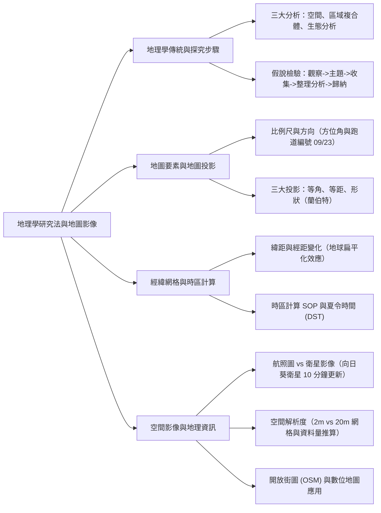
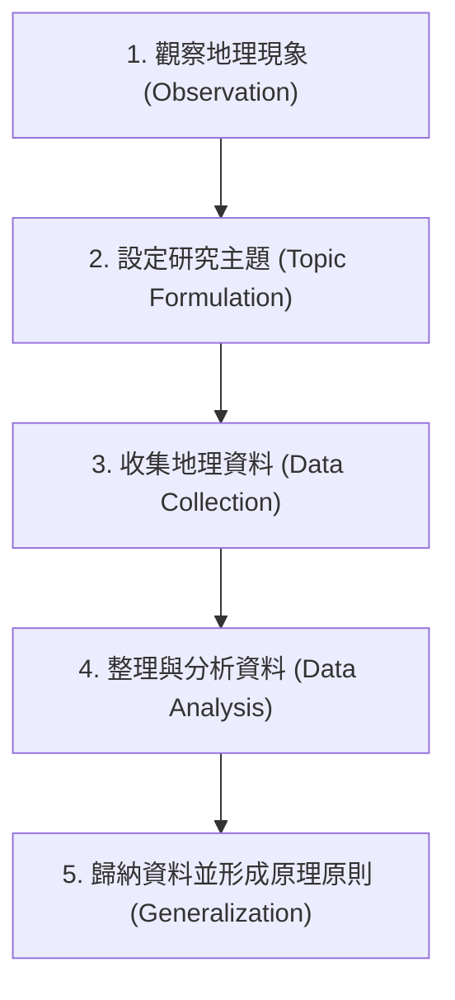
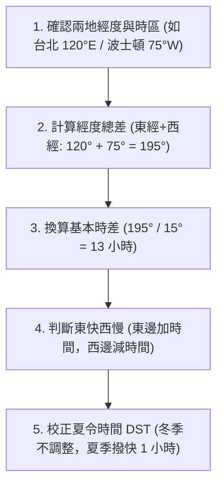

## 📖 課堂主題與核心摘要 (Class Overview)
本堂地理課統整了高一地理學核心研究法與地圖影像工具，旨在建立學生的空間概念與地理資訊分析能力。課堂重點涵蓋地理學三大傳統分析法、探究步驟 SOP、地圖要素（比例尺與方位角）、經典地圖投影特性，以及經緯網格與時區計算實務。此外，老師特別補充了航照圖、衛星影像的空間解析度（網格資料量推算）與開放街圖（OSM）的災難救援應用，幫助學生連結生活實例與考題趨勢。

【🌳 本課大綱樹狀心智導圖 (Mindmap)】：

---

## 💡 核心知識點與觀念詳解 (Key Concepts)

### 一、地理學三大分析傳統與探究流程

1. **地理學三大分析傳統**：
   * **空間分析 (\\(Spatial\ Analysis\\))**：著重於地表點、線、面現象的空間分布特徵、擴散模式及規律。
   * **區域複合體分析 (\\(Regional\ Complex\ Analysis\\))**：著重於特定區域內人地互動與區域特性的整體綜合分析。
   * **生態分析 (\\(Ecological\ Analysis\\))**：著重於自然環境與人類活動之間的相互影響與因果關係（即「人地關係」）。

【📊 觀念與易混淆對比表：地理學三大分析傳統對比】
| 分析名稱 | 核心觀念與定義 | 焦點重點 | 課堂解題技巧與原則 |
| :--- | :--- | :--- | :--- |
| **空間分析** | 分析現象在地表上的點、線、面空間分布與擴散規律 | 距離、方向、空間擴散、聚散模式 | 若題目探討地圖上點分布聚散或交通網路連通性 |
| **區域複合體分析** | 綜合研究某一特定區域內的所有人文與自然地理特徵 | 區域差異、區域特性劃分、綜合區域地理 | 若題目針對「特定地區」的整體人文與自然環境綜合比較 |
| **生態分析** | 研究人類活動與自然環境間的相互作用與影響 | 人地關係、環境適應、災害影響 | **解題速快原則**：若題目無法明確判斷，優先選擇老師最常考的「生態分析」 |

2. **地理事實發現與假說檢驗步驟**：
   地理探究遵循科學經驗法則，從地表實地觀察開始，經由資料收集與歸納，最終形成地理定理或原理原則。

【⏱️ 時序時間軸 / 步驟流程圖：地理假說檢驗探究 SOP】

---

### 二、地圖要素、方位角與地圖投影

1. **地圖要素與比例尺**：
   * **比例尺（\\(Scale\\)）測量**：老師特別叮嚀，考試時切勿以個人手掌或手指長度估算比例尺（每個人手指長度差異很大，如 \\(5\text{ cm}\\) 或 \\(8\text{ cm}\\) 不一），務必攜帶標準直尺進行精確量測。
   * **生活實例（方位判讀）**：課堂上老師引導學生透過周遭地標建立方位感，例如承德路往市林、北投、石牌方向為「北方」，往台北車站方向為「南方」，火車站以南為「南方」，右側為「東方」，左側為「西方」。

2. **方位角 (\\(Azimuth\\)) 與斜羅盤**：
   * 方位角以正北方為 \\(000^\circ\\)，依順時針方向旋轉測量至 \\(360^\circ\\)。例如：正東為 \\(090^\circ\\)，正南為 \\(180^\circ\\)，正西為 \\(270^\circ\\)，北北東（NNE）為 \\(022.5^\circ\\)。
   * **機場跑道編號實例**：飛機跑道兩端的雙位數編號即為其方向的方位角前兩位數（去除個位數 \\(0^\circ\\)）。
     * 例如標號 **09** 代表方位角為 \\(090^\circ\\)（正東向）。
     * 標號 **23** 代表方位角為 \\(230^\circ\\)（西偏南方向），跑道另一端則為 **05**（方位角 \\(050^\circ\\)，東北方向），兩端相差 \\(180^\circ\\)。
     * **飛機起降原理**：飛機必須「逆風」起降。台北松山機場若風向改變，降落路徑會由圓山捷運站頭頂下傾降落轉為向東起飛。

3. **地圖投影法比較**：
   因地球為三維球體，展開為二維平面地圖時必會產生變形。不同的投影法可保留不同的幾何特性。

【📊 觀念與易混淆對比表：常見地圖投影特性比較】
| 投影名稱 | 主要保持特性 | 適用場景與優點 | 代表投影法 / 課堂經典案例 |
| :--- | :--- | :--- | :--- |
| **等角投影** | 保留正確角度與方向 | 航海圖、航空圖、方向精確判讀 | 麥卡托投影、多圓柱投影 |
| **等距投影** | 保留特定方向上的正確距離 | 圓心至各點的距離量測、全球航線規劃 | 等距方位投影 |
| **正確形狀投影** | 保留局部區域的正確形狀 | 中緯度地區小範圍區域繪製 | 蘭伯特圓錐投影 (\\(Lambert\ Projection\\)) |

---

### 三、經緯網格特性與時區換算

1. **緯距與經距的幾何變化**：
   * **緯距（緯線間距離）**：由於地球受自轉離心力影響呈兩極稍扁、赤道略鼓的「扁橢球體」，使得高緯度地區的 \\(1^\circ\\) 緯距長度比赤道略大（赤道約 \\(110\text{ km}\\)，高緯區約 \\(111\text{ km}\\)）。
   * **經距（經線間距離）**：經線交會於南北兩極，因此兩條經線間的距離會隨著緯度增高而快速縮小。
     * 赤道（\\(0^\circ\\)）：\\(1^\circ\\) 經距約為 \\(111\text{ km}\\)。
     * 緯度 \\(60^\circ\\)：\\(1^\circ\\) 經距縮減為赤道的一半，約 \\(55.5\text{ km}\\)。
     * 緯度 \\(80^\circ\\)：\\(1^\circ\\) 經距僅剩約 \\(19\text{ km}\\)；極點（\\(90^\circ\\)）收斂為 \\(0\text{ km}\\)。

\\[ \text{經距} = 111\text{ km} \times \cos(\phi) \quad (\phi \text{ 為所在地緯度}) \\]

2. **時區換算與夏令時間 (\\(Daylight\ Saving\ Time, DST\\))**：
   * **中央經線**：全球每隔經度 \\(15^\circ\\) 劃分為一個時區（時差 \\(1\text{ 小時}\\)），中央經線必為 \\(15^\circ\\) 之倍數。凡使用同一中央經線的地區無時差（例如台北與上海均以 \\(120^\circ\text{E}\\) 為標準時，無時差）。
   * **夏令時間 (DST)**：夏季為善用早出之陽光（如早晨 \\(04:30\\) 日出），將時鐘撥快 \\(1\text{ 小時}\\)（實施期間約 \\(3\text{ 月} \sim 11\text{ 月}\\)）。目前美加地區仍保留，歐洲大部分地區已取消。

【⏱️ 時序時間軸 / 步驟流程圖：標準時區與跨國通話計算 SOP】

* **課堂經典計算例題**：
  * **題目**：住在美國波士頓（西經 \\(75^\circ\text{W}\\)，標準時 UTC-5）的林小姐於冬季 \\(12\text{ 月 } 25\text{ 日}\\) 當地晚上 \\(20:00\\) 打電話回台北（東經 \\(120^\circ\text{E}\\)，標準時 UTC+8）給家人，台北家人接獲電話的時間為？
  * **推導步驟**：
    1. 經度差：\\(120^\circ\text{E} + 75^\circ\text{W} = 195^\circ\\)。
    2. 時差：\\(195^\circ / 15^\circ = 13\text{ 小時}\\)（台北比波士頓快 \\(13\text{ 小時}\\)）。
    3. 時間計算：波士頓時間 \\(12\text{ 月 } 25\text{ 日 } 20:00 + 13\text{ 小時} = 12\text{ 月 } 25\text{ 日 } 33:00\\)。
    4. 換算跨日：\\(33:00 - 24\text{ 小時} = \text{次日 } 09:00\\)。
    5. **結論**：台北家人於 **\\(12\text{ 月 } 26\text{ 日}\\) 早上 \\(09:00\\) 接到電話。

---

### 四、地理空間影像、空間解析度與地理資訊

1. **航空照片圖 vs 衛星影像**：
   * **航照圖（無人機/飛機拍攝）**：涵蓋範圍小、解析度高，常用於農業局調查農田、土地重劃或局部工程。
   * **氣象衛星（如日本向日葵氣象衛星）**：每 \\(10\text{ 分鐘}\\) 更新一次影像，適用於極速變化的自然現象（如海底火山噴發、颱風路徑持續監測）。

2. **空間解析度 (\\(Spatial\ Resolution\\)) 與網格資料量估算**：
   * **定義**：網格資料（\\(Raster\ Data\\)）中單一網格（像元 \\(Pixel\\)）代表的實際地表邊長。
   * **高空間解析度**：如 \\(2\text{ m} \times 2\text{ m}\\) 網格，清晰度極高（可分辨船隻、車輛甚至人物），但資料量極大。
   * **低空間解析度**：如 \\(20\text{ m} \times 20\text{ m}\\) 網格，適合大範圍現象（如森林大火、颱風系統），資料量較小。
   * **課堂經典案例（長賜輪事件）**：\\(2021\text{ 年 } 3\text{ 月}\\) 長榮海運長賜輪卡在蘇伊士運河，誕生了「大排長龍」的課堂梗。歐洲哨兵二號（\\(20\text{ m} \times 20\text{ m}\\)）拍出的長賜輪較模糊，而美國商業衛星（\\(2\text{ m} \times 2\text{ m}\\)）則能極其清晰地拍出船體與輪廓。

【📊 觀念與易混淆對比表：空間解析度與資料量對比】
| 解析度等級 | 網格邊長 (\\(Grid\ Size\\)) | 單一網格地表面積 | 影像細緻度與涵蓋範圍 | 資料總量 | 經典適用場景 |
| :--- | :--- | :--- | :--- | :--- | :--- |
| **高空間解析度** | \\(2\text{ m} \times 2\text{ m}\\) | \\(4\text{ m}^2\\) | 極清晰，可看清個體細節，但涵蓋小 | **極大** | 運河船隻監測、建築物調查、都市規劃 |
| **低空間解析度** | \\(20\text{ m} \times 20\text{ m}\\) | \\(400\text{ m}^2\\) | 較模糊，無法分辨小物件，但涵蓋大 | **較小** | 森林大火範圍、颱風雲系、跨國地形觀察 |

* **網格資料量計算範例**：
  若要監測地表面積 \\(6400\text{ m}^2\\) 的操場區域：

\\[ \text{用 } 20\text{ m} \times 20\text{ m} \text{ 網格需求數} = \frac{6400\text{ m}^2}{20\text{ m} \times 20\text{ m}} = \frac{6400}{400} = 16\text{ 個網格} \\]

\\[ \text{用 } 2\text{ m} \times 2\text{ m} \text{ 網格需求數} = \frac{6400\text{ m}^2}{2\text{ m} \times 2\text{ m}} = \frac{6400}{4} = 1600\text{ 個網格} \\]

3. **開放街圖 (\\(OpenStreetMap, OSM\\)) 與數位地圖**：
   * **開放街圖 (OSM)**：由全民志工社群共同協作繪製的開放地理資料庫。
   * **災難救援應用**：例如尼泊爾土石流或花蓮光復鄉土石流後，原本道路被掩埋消失。防救災志工（如挖土機鏟超人）將清理開通的最新路況拍照上傳，即時更新至開放街圖，協助救援物資運輸。
   * **生活實例**：都市無障礙空間地圖（輪椅坡道）、哺集乳室分布地圖等。

【📊 觀念與易混淆對比表：紙本地圖 vs 數位地圖】
| 比較項目 | 紙本地圖 (\\(Paper\ Map\\)) | 數位地圖 (\\(Digital\ Map\\)) |
| :--- | :--- | :--- |
| **資料儲存與更新** | 靜態印刷，無法即時修訂 | 數值化儲存，可透過網路隨時動態更新 |
| **功能與操作** | 固定比例尺與圖例，無法自由開關圖層 | 可隨意放大縮小、隨心抽換套疊圖層（如衛星圖、交通圖） |
| **載體與應用** | 實體紙張 | 手機、平板等行動裝置 (Google Maps, OSM) |

---

## ⚠️ 老師強調考點與易錯陷阱 (Exam Focus & Pitfalls)

1. **比例尺量測陷阱（必定攜帶直尺）**：
   * ❌ **常見錯誤**：隨手用自己手指（如「我的食指應該是 \\(5\text{ cm}\\)」）量測考試題目比例尺。
   * ⭕ **考點破題**：每個人手掌與手指尺寸差異很大（課堂討論有人 \\(5\text{ cm}\\)，有人 \\(8\text{ cm} \sim 9\text{ cm}\\)），考試測量比例尺與地圖距離時，務必使用標準直尺量算。

2. **跑道編號與方位角混淆**：
   * ❌ **常見錯誤**：誤以為跑道號碼「09」代表乘以 9，或是第 9 號跑道。
   * ⭕ **考點破題**：跑道編號「09」代表方位角 \\(090^\circ\\)（東方）；「23」代表方位角 \\(230^\circ\\)（西南西方）。兩端方位角必定相差 \\(180^\circ\\)。

3. **緯距與經距變化的判斷**：
   * ❌ **常見錯誤**：誤以為緯度每相差 \\(1^\circ\\)，地表緯距都完全相等。
   * ⭕ **考點破題**：因為地球為兩極稍扁的橢球體，**越接近高緯度地區，\\(1^\circ\\) 的緯距反而微幅變大**（\\(110\text{ km} \rightarrow 111\text{ km}\\)）；而經距則隨著緯度增高而劇烈縮小（高緯度地區經線收斂）。

4. **空間解析度數字與資料量的反比陷阱**：
   * ❌ **常見錯誤**：誤以為數字較大的 \\(20\text{ m} \times 20\text{ m}\\) 代表解析度較高。
   * ⭕ **考點破題**：**網格尺寸數字越小（如 \\(2\text{ m} \times 2\text{ m}\\)），代表空間解析度越高**、影像越清晰；但所需的網格數量與**資料量會暴增**。

5. **跨國時區與加減方向陷阱**：
   * ❌ **常見錯誤**：計算西經地區時間時，直接將時間相減造成日期的跨日錯誤。
   * ⭕ **考點破題**：算時區時永遠牢記「東快西慢」。先計算總經度差換算時差，再依據目標位置在東側（加時間）或西側（減時間）進行計算，若超過 \\(24:00\\) 則日期加一日。

---

## 🔑 記憶口訣與解題技巧 (Mnemonics & Shortcuts)

1. **地理三大分析猜題極速 SOP**：
   * 遇到題幹極長、無法一眼判斷屬於哪種地理分析傳統時，**優先選擇「生態分析」**（因為考題最常著重於人與自然環境的相互影響與災害影響）。

2. **跑道方位角直覺換算術**：
   * 跑道數字 \\(\times 10^\circ = \text{跑道方位角}\\)。
   * 範例：跑道數字 \\(09 \implies 09 \times 10^\circ = 090^\circ\\)（正東）；跑道數字 \\(23 \implies 23 \times 10^\circ = 230^\circ\\)（西偏南）。

3. **經緯網格記憶金句**：
   * **「緯距高緯變大（地球扁），經距高緯縮小（經線會）」**。

---

## 📝 課後作業與待辦事項 (Homework & Tasks)

1. **習作練習**：
   * 完成翰林版/龍騰版地理習作中「四大燈塔最東/最西/最南/最北定位」與「機場跑道方位角與時區推算」之相關題目。
2. **課本複習**：
   * 熟讀地理課本第 41 頁關於經緯度緯距與經距長度對照表（重點觀察 \\(60^\circ\\) 時經距減半為 \\(55\text{ km}\\)、 \\(80^\circ\\) 時僅剩 \\(19\text{ km}\\) 之趨勢）。
3. **下週考程安排**：
   * **禮拜一課堂測驗**：老師將於下週一發放兩張地理平時測驗考卷，課堂上安靜作答並於當堂對答案檢討，請務必於週末完成前第一單元之課後複習。

---

## 📚 專有名詞與重要公式/定義 (Glossary & Formulas)

* **空間分析 (\\(Spatial\ Analysis\\))**：研究地理現象在地表上的點、線、面空間分布、擴散規律與排列模式的地理學傳統方法。
* **生態分析 (\\(Ecological\ Analysis\\))**：研究人類社會活動與自然地理環境之間相互作用、適應與影響的地理學傳統方法。
* **區域複合體分析 (\\(Regional\ Complex\ Analysis\\))**：綜合某一特定區域內所有自然與人文要素，研究其區域特徵與區域差異的地理學方法。
* **方位角 (\\(Azimuth\\))**：以正北方向為 \\(000^\circ\\)，依順時針方向旋轉量至目標線的角度，範圍為 \\(000^\circ \sim 360^\circ\\)。
* **空間解析度 (\\(Spatial\ Resolution\\))**：遙測影像或網格資料中，單一網格（像元）所代表的地表實際邊長大小。網格尺寸越小，解析度越高。
* **開放街圖 (\\(OpenStreetMap, OSM\\))**：由全球志工大眾共同建置與維護的免費自由地圖資料庫，常用於災害即時救援與特定生活圖層構建。
* **大圓航線 (\\(Great\ Circle\ Route\\))**：通過地心將地球平分為兩個相等半球的圓周弧線，地表任意兩點之間的最短距離即為大圓航線。
* **時差與經度公式**：

\\[ \Delta t (\text{時差小時}) = \frac{\Delta \text{經度}}{15^\circ} \\]

---

## 🧠 課後自測題 (Quick Review Quiz)

### 題一：跑道方位角與風向判讀
**題目**：某國際機場的跑道兩端分別標示為「09」與「27」。若今日氣象預報顯示當地吹「正東風」，請問飛機應該選擇由哪一個方向進場降落？該跑道標號「27」代表的方位角為多少度？

* **解析與答案**：
  1. 跑道「09」代表方位角 \\(090^\circ\\)（正東向），跑道「27」代表方位角 \\(270^\circ\\)（正西向）。
  2. 飛機起降必須「逆風」。吹正東風代表風從東邊吹來，飛機必須向東（迎向東風）起降，因此飛機應朝向標號 **09** 的方向降落。
  3. 標號「27」代表的方位角為 **\\(270^\circ\\)**（正西方）。

---

### 題二：衛星影像空間解析度與資料量推算
**題目**：某地防救災單位需要對一塊長 \\(200\text{ m}\\)、寬 \\(200\text{ m}\\) 的土石流受災區域（總面積 \\(40000\text{ m}^2\\)）進行精細影像分析。若分別使用高解析度衛星影像（網格 \\(2\text{ m} \times 2\text{ m}\\)）與低解析度衛星影像（網格 \\(20\text{ m} \times 20\text{ m}\\)），請問高解析度影像所需的網格數量是低解析度影像的幾倍？

* **解析與答案**：
  1. 低解析度網格面積：\\(20\text{ m} \times 20\text{ m} = 400\text{ m}^2\\)。所需網格數 \\(= 40000 / 400 = 100\text{ 個}\\)。
  2. 高解析度網格面積：\\(2\text{ m} \times 2\text{ m} = 4\text{ m}^2\\)。所需網格數 \\(= 40000 / 4 = 10000\text{ 個}\\)。
  3. 倍數計算：\\(10000 / 100 = 100\text{ 倍}\\)。
  4. **結論**：高解析度影像所需的網格數量為低解析度影像的 **100 倍**（資料量大幅增加）。

---

### 題三：跨時區與夏令時間實務計算
**題目**：住在台北（\\(120^\circ\text{E}\\)）的張先生於台灣時間 \\(6\text{ 月 } 1\text{ 日}\\) 上午 \\(10:00\\) 撥打電話給位於英國倫敦（\\(0^\circ\\) 經線）出差的同事。已知英國於夏季實施夏令時間（DST，撥快 \\(1\text{ 小時}\\)），請問倫敦同事接聽電話時的當地時間為幾月幾日幾點？

* **解析與答案**：
  1. 基本時差計算：台北（\\(120^\circ\text{E}\\)，UTC+8）與倫敦標準時（\\(0^\circ\\)，UTC+0）相差 \\(120^\circ / 15^\circ = 8\text{ 小時}\\)。倫敦標準時比台北慢 \\(8\text{ 小時}\\)。
  2. 依台北時間計算倫敦標準時：\\(6\text{ 月 } 1\text{ 日 } 10:00 - 8\text{ 小時} = 6\text{ 月 } 1\text{ 日 } 02:00\\)。
  3. 夏令時間 (DST) 校正：因 \\(6\text{ 月}\\) 英國實施夏令時間，時間需撥快 \\(1\text{ 小時}\\)：\\(02:00 + 1\text{ 小時} = 03:00\\)。
  4. **結論**：倫敦同事接聽電話的當地時間為 **\\(6\text{ 月 } 1\text{ 日}\\) 凌晨 \\(03:00\\)**。

---

💡 **學習提醒**：課後請務必搭配課本第 41 頁圖表再次複習緯距與經距的變化趨勢，並備妥直尺迎接下週一的平時測驗！如果需要進一步將這份筆記製作成複習測驗題庫或單字卡，可以隨時告訴我！