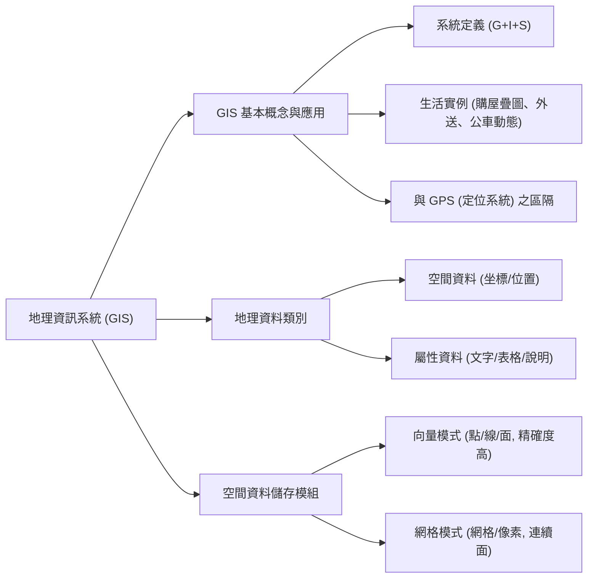
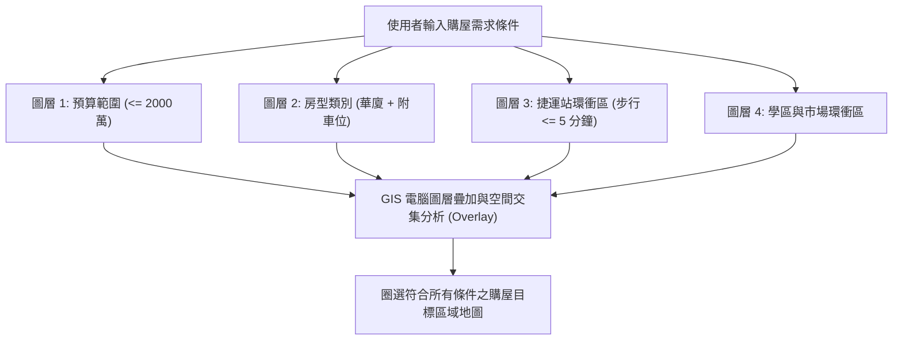

## 📖 課堂主題與核心摘要 (Class Overview)
本堂課為高中地理課程，主要探討「地理資訊系統（GIS）」的基本觀念、系統架構及其在日常生活中的實際應用。課程從生動的「購屋選擇」與「外送外帶服務」等生活情境切入，帶出 GIS 結合多圖層套疊分析與即時定位的核心優勢。進一步深入講解地理資料的兩大組成要素——「空間資料」與「屬性資料」，並詳細剖析電腦儲存空間資料的兩大核心模組：「向量模式」與「網格模式」之結構差異與適用場景。本章核心目標在於建立學生運用地理資訊進行空間分析、資料建構與考題判讀的解題能力。

## 💡 核心知識點與觀念詳解 (Key Concepts)

### 觀念一：地理資訊系統（GIS）概念與生活應用
- **系統定義與架構**：
  - **GIS (Geographic Information System)**：即「地理資訊系統」，由 **Geography（地理）**、**Information（資訊）**、**System（系統）** 三者組合而成。指利用電腦軟硬體，進行地理空間資料的收集、儲存、管理、分析與展示之系統。
  - **GPS (Global Positioning System)**：即「全球定位系統」，主要功能為「點對點即時定位與導航」，如車用導航、外送員路徑追蹤。GIS 則是以定位資料為基礎，進一步進行多維度空間分析與資訊圖層疊合。
- **經典課堂例題與生活實例**：
  - **例題：蔡餅（蔡明同學）購屋選擇與地圖套疊（Map Overlay）**
    - **情境背景**：蔡同學準備結婚購屋，擁有 2000 萬預算，考量未來家庭需求（預計生 5 個小孩，組籃球隊），列出嚴格的選屋條件：
      1. **預算條件**：總價 \\(\le 2000 \text{萬}\\)。
      2. **房屋類型**：電梯華廈（7 層樓左右），格局約 35 坪，必須附車位。
      3. **空間區位限制**：鄰近學區、鄰近傳統市場（方便買菜親手做便當）、距離捷運站步行 5 分鐘內、前往台北市中心通勤時間小於 15–20 分鐘。
    - **GIS 運作機制**：將上述條件分別轉化為單一地圖圖層（Layer），由電腦系統進行「圖層套疊分析（Overlay Analysis）」，過濾並圈選出台北市與新北市符合所有交集條件的區域（如大安區邊緣、士林區等）。
  - **生活實例：外送平台與公車動態**
    - 外送平台（如 Foodpanda / UberEats）媒合店家（如市區知名紅茶屋、奶茶站、小甜甜圈）、外送員位置與顧客住址，透過 GIS 計算最佳外送路徑與抵達時間（如 15 分鐘）。
    - 台北市公車動態系統結合車載 GPS 定位與 GIS 路線圖層，即時預估到站時間。

### 觀念二：空間資料與屬性資料 (Spatial vs. Attribute Data)
地理資訊系統中的資料由「空間」與「屬性」兩大維度相互搭配而成：
1. **空間資料 (Spatial Data)**：
   - **概念**：代表「在哪裡（Where）」，具備確切的地表空間位置或坐標資訊。
   - **表示方式**：以經緯度或平面直角坐標表示，例如台北市某地點坐標 \\((121.5^\circ\text{E}, 25.0^\circ\text{N})\\)。
2. **屬性資料 (Attribute Data)**：
   - **概念**：代表「是什麼（What / How）」，記載該空間位置的特徵、說明、統計數據或文字表格。
   - **表示方式**：文字、數字、表格、圖片、評分等。
- **經典課堂例題：黃位少同學的財產申報比喻**
  - **空間資料**：黃同學在桃園蘆竹區、龜山區、新北林口區所擁有的數筆土地地號與空間坐標位置 \\((X, Y)\\)。
  - **屬性資料**：各筆土地的地目、坪數、申報價值（如總身價 3.5 億）、土地所有權人姓名、公司登記名稱等表格資料。
  - **資料整合**：GIS 系統將「坐標（空間）」與「表格（屬性）」串聯，輸入姓名或坐標即可調出完整資料。

### 觀念三：資料儲存模組——向量模式 vs. 網格模式
電腦在儲存與呈現空間資料時，主要分為兩種資料結構：

1. **向量模式 (Vector Model)**：
   - **建構原理**：利用精確的點（Point）、線（Line）、面（Polygon）坐標向量點陣連貫而成，可表示為：
     \\[ (X_1, Y_1) \xrightarrow{\text{線段}} (X_2, Y_2) \xrightarrow{\text{多邊形}} (X_3, Y_3) \\]
   - **特性**：邊界極為精確、解析度高、繪圖細緻、資料量相對較小，但空間分析運算較複雜。
   - **適用場景**：界線分明的離散物體或網絡系統，如都市電纜線、地下管線、捷運路網、精準道路實景（Google 街景）、個別建築物或人像。

2. **網格模式 (Raster Model)**：
   - **建構原理**：將空間分割為許多大小相同的正方形網格（像素 Grid / Pixel），每個網格賦予單一屬性數值。
   - **特性**：邊界呈階梯狀（較模糊）、適合大面積連續性空間資料的處理與運算。
   - **適用場景**：界線模糊或連續漸變的自然現象，如森林覆蓋區、沙漠範圍、地形等高線/數位高程模型（DEM）、衛星遙測影像。

#### 【⏱️ 步驟流程圖】：GIS 購屋篩選與圖層套疊流程

#### 【📊 觀念對比表】：向量模式 vs. 網格模式與空間/屬性資料對比
| 對比維度 | 向量模式 (Vector Model) | 網格模式 (Raster Model) |
| :--- | :--- | :--- |
| **基本單位** | 點 (Point)、線 (Line)、面 (Polygon) | 矩形網格 / 像素 (Grid / Pixel) |
| **坐標表示** | 精確點坐標 \\((X, Y)\\) | 網格行列號 (Row, Column) |
| **精確度與邊界** | **高**（邊界清晰平滑） | **較低**（邊界呈鋸齒狀/階梯狀） |
| **資料特性** | 離散型、界線分明之要素 | 連續型、面狀分佈之要素 |
| **經典適用實例** | 電纜線路網、捷運線、行政區界、道路網路 | 森林覆蓋、沙漠、地形高度 (DEM)、衛星照片 |

| 對比維度 | 空間資料 (Spatial Data) | 屬性資料 (Attribute Data) |
| :--- | :--- | :--- |
| **回答問題** | 在哪裡？ (Where) | 是什麼？特徵為何？ (What / How) |
| **資料形式** | 經緯度、TWD97 坐標、圖形位置 | 文字、數字、統計表格、描述照片 |
| **課堂實例** | 土地或地標的經緯度坐標 \\((121.5^\circ\text{E}, 25.0^\circ\text{N})\\) | 土地所有權人、地價、房屋坪數、飯店星級評價 |

## ⚠️ 老師強調考點與易錯陷阱 (Exam Focus & Pitfalls)
- **必考重點一：GIS vs. GPS 的概念區分**
  - **常見陷阱**：題目問「車用導航顯示目前車速與位置」屬於何者？答案是 **GPS**（定位）；而「計算避開塞車的最優路徑」或「分析路網圖層」則屬於 **GIS**（空間分析）。
- **必考重點二：向量與網格模式的選用判斷（大考高頻題）**
  - **易錯陷阱**：若題目欲繪製「都市地下自來水管線」，應選用何者？答案為 **向量模式**（管線為明確方向與精確路徑之線狀要素）；若為「台灣北部玉山國家公園森林分佈」，則應選用 **網格模式**（大面積連續分佈）。
- **必考重點三：空間與屬性資料的結合應用**
  - **老師提醒**：公務機關或房產系統中，單有坐標無法得知地名，單有表格無法定位位置；考題常給出資料庫表格，要求學生判別欄位中何者為「空間資料」（如坐標欄位）、何者為「屬性資料」（如地價、名稱欄位）。

## 🔑 記憶口訣與解題技巧 (Mnemonics & Shortcuts)
- **解題速解口訣（GIS 資料模組雙心法）**：
  1. **向量 vs. 網格判斷口訣**：
     > **「點線精細選向量，大面連續用網格；管線路網走向量，森林沙漠蓋網格。」**
  2. **空間 vs. 屬性判斷口訣**：
     > **「圖形坐標找空間，文字表格歸屬性。」**
- **解題 SOP（GIS 圖層疊圖題型破題三步驟）**：
  - **Step 1**：列出題目給定之所有篩選條件（如：海拔 \\(> 1000\text{m}\\)、距道路 \\(< 100\text{m}\\)）。
  - **Step 2**：將每一項條件獨立畫出單一圖層（如：等高線圖層、道路緩衝區圖層）。
  - **Step 3**：進行圖層交集（AND / 疊合），重疊同時符合所有條件之區域即為正確答案。

## 📝 課後作業與待辦事項 (Homework & Tasks)
- **課堂交代事項**：
  - **課後作業**：無特定作業。
  - **待辦事項**：老師說明待全校/全班同學完成補考後，將於下次上課（下週二）統一發還考卷並訂正答案。

---

## 📚 專有名詞與重要公式/定義 (Glossary & Formulas)
* **GIS (Geographic Information System, 地理資訊系統)**：整合地理空間資料與屬性資料，具備資料收集、儲存、查詢、分析（如疊圖分析）與展示功能之電腦系統。
* **GPS (Global Positioning System, 全球定位系統)**：利用衛星訊號進行地表物體即時三維坐標（經度、緯度、高度）定位與導航之系統。
* **空間資料 (Spatial Data)**：記錄地表現象空間位置與地理幾何特徵之資料，通常以坐標 \\((X, Y)\\) 表示。
* **屬性資料 (Attribute Data)**：說明空間現象之品質、數量、名稱或特徵之文字、數字或表格資料。
* **向量模式 (Vector Model)**：以精確點坐標 \\((X_1, Y_1)\\) 組成點、線、面來表示空間要素之資料模組，優點為繪圖精確、圖形美觀。
* **網格模式 (Raster Model)**：將空間切分為等大網格像素（Pixel），以網格單元紀錄屬性值之資料模組，優點為結構簡單、適合大面積連續面分析。
* **圖層套疊 (Map Overlay Analysis)**：將不同主題之地理圖層相互疊加，透過空間邏輯運算（交集、聯集等）產出符合多重條件之新圖層。

## 🧠 課後自測題 (Quick Review Quiz)
1. **[單選題]** 當電力公司欲建立台北市全區的「高壓電纜線路與電線桿分布圖」時，在 GIS 系統中應採用何種資料儲存模組？理由為何？
   - **解題思維/簡答**：應採用 **向量模式**。因為電線桿（點）與高壓電纜（線）屬界線分明、方向精確的離散網絡要素，向量模式能提供高精確度的坐標定位與路網拓撲分析。
2. **[觀念應用題]** 外送平台（如 Foodpanda）在顯示「外送員騎車路徑」與「店家菜單評價」時，這兩者分別屬 GIS 中的何種資料類型？
   - **解題思維/簡答**：外送員即時騎車路徑包含位置與方向坐標，屬 **空間資料**；店家菜單價格、餐點評分與顧客文字留言，則屬 **屬性資料**。
3. **[情境整合題]** 某生欲利用 GIS 尋找適合設立「生態保護區」的地點，條件為：「海拔 1000 公尺以上」且「離省道 500 公尺以外」。請簡述其在 GIS 中如何透過圖層處理完成此任務？
   - **解題思維/簡答**：首先建立「數位高程圖層（DEM）」，篩選出海拔 \\(> 1000\text{m}\\) 的區域；同時建立「省道圖層」，劃出兩側 \\(500\text{m}\\) 的緩衝區並取其外部區域。最後將兩圖層進行 **套疊分析（Overlay）**，取兩者之交集區域即為適合地點。

💡 想針對向量與網格模式的轉譯題型進行進一步的練習測驗，或是想將這份筆記生成為互動單字卡或考前複習測驗嗎？