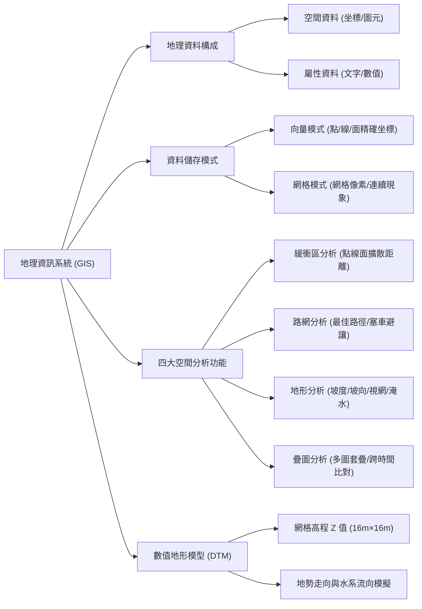
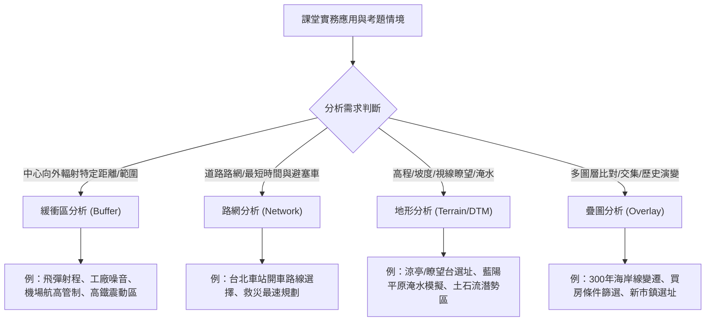

## 📖 課堂主題與核心摘要 (Class Overview)

本堂課為高中地理科關於「地理資訊系統（GIS）與空間分析」的重點精華課程 [1, 2]。課堂首先釐清地理資訊（Geographic Information）係由「空間資料」與「屬性資料」結合而成，並以台北市立明倫高中的空間坐標與行政屬性作為實例剖析 [1, 3, 4]。接著深入比較 GIS 資料庫中的「向量模式」與「網格模式」之儲存架構、幾何特性與適用時機 [5, 6]。最後詳盡說明 GIS 四大核心空間分析功能（緩衝區分析、路網分析、地形分析、疊圖分析）的運算邏輯，並結合全球定位系統（GPS）、颱風路徑、高鐵震動管制、阿妹演唱會震動爭議、基隆河氾濫平原與 300 年台灣海岸線變遷等豐富的生活與考題實例進行解構 [1, 7-9]。

---

## 💡 核心知識點與觀念詳解 (Key Concepts)

### 一、 地理資訊（GIS Data）的兩大核心構成

地理資訊系統（Geographic Information System, GIS）係結合地理學、電腦軟體、全球定位系統（GPS）與衛星遙測技術之綜合資訊系統 [1]。電腦欲處理地理資訊，必須同時具備以下兩種資料 [1]：

1. **空間資料（Spatial Data）**：代表地物在空間中的幾何位置與形狀 [1, 4]。包含點、線、面等二維坐標位置，例如使用 TWD97 二度分帶坐標系統標註地點 [4]。
2. **屬性資料（Attribute Data）**：代表地物的非空間特徵、名稱、說明文字或統計數值 [1, 4]。

\\[\text{地理資料 (Geographic Data)} = \text{空間資料 (Spatial Data)} + \text{屬性資料 (Attribute Data)}\\] [1, 4]

#### 🏫 課堂經典範例：明倫高中的 GIS 資料庫建立
老師在課堂上以「明倫高中」在網路與 GIS 資料庫中的儲存方式進行剖析 [3, 4]：
* **屬性資料**：學校名稱（明倫高中）、地址（台北市承德路三段 360 號）、郵遞區號（10580）、聯絡電話（2596-1567 轉 14）、全校總人數（約 1,600 人，每年級約 15 班，每班約 30 人）[3, 4, 10]。
* **空間資料**：明倫高中的二度分帶坐標，或是校區在地圖上的多邊形邊界點坐標 [4]。
* **歷史生活插曲**：明倫高中的正門雖已改至敦煌路，但官方登記地址仍維持承德路 [4, 10]。台北市許多路名反映了中國大陸地理名稱（如敦煌路、玉門街、哈密街、酒泉街、承德路等皆集中於西北方，象徵過去時代背景下的路名規劃思維）[4, 11]。

---

### 二、 地理資料儲存模式：向量模式 vs. 網格模式

電腦儲存空間資料主要分為「向量模式」與「網格模式」兩種架構 [5]：

1. **向量模式（Vector Model）**：
   * **原理**：利用明確的二維坐標點 \\((x_1, y_1), (x_2, y_2)\\) 透過點、線、面連結來儲存地物 [5]。
   * **特點**：精確度高、圖像細緻、資料結構較複雜、佔用較多對應邏輯區域 [5, 6]。
   * **適用對象**：精密都市內部特徵、明確幾何邊界的現象，如道路線條、公園邊界、橋樑、公用設施、縣市行政界線與學校校區等 [6]。

2. **網格模式（Raster Model）**：
   * **原理**：將空間分割成規則的方形格子（網格/像素），每一格賦予單一屬性值 [5]。
   * **特點**：結構簡單、易於進行多圖層疊加計算，但圖元解析度受限於格子大小 [5, 6]。
   * **適用對象**：
     * **均勻且連續的地理現象**：如一望無際的沙漠、連綿森林、廣袤草原 [6]。
     * **隨時間或空間連續變化的數值**：如氣溫等溫線、空氣品質（AQI / \\(\text{PM}_{2.5}\\)）、大氣壓力等 [12]。

#### 🎨 老師比喻說明：畫同學「私一凱」的人像圖
老師於黑板舉例，若要在電腦中儲存「私一凱」同學的畫像 [5, 13]：
* 若使用**向量模式**繪製，能精準描繪出其可愛的中分髮型與燦爛笑容，細節清晰可辨 [5, 13]。
* 若使用**網格模式**繪製，則會因為格子解析度限制，填滿格子後呈現出類似小綠人或像素點陣圖的輪廓，無法看清具體面貌特徵 [5, 13]。

---

### 三、 GIS 四大核心空間分析功能（Spatial Analysis）

#### 1. 緩衝區分析（Buffer Analysis）
* **定義**：以點、線、面等空間單元為中心，向外擴散劃定特定距離或範圍的區域 [7]。
* **課堂經典實例**：
  * **點的緩衝區**：鐵工廠噪音影響範圍 [7]；張惠妹（阿妹）於台北小巨蛋舉辦演唱會時唱《三天三夜》，因萬人同時跳動引發周邊居民房屋震動與噪音抗議，遭裁罰與禁唱規定 [8]；北韓發射飛彈射程設定 4,000 公里所能涵蓋的地理範圍 [14]。
  * **線的緩衝區**：蘇花改或公路沿線的空氣污染擴散範圍 [9, 15]；基隆河沿岸的河川氾濫影響範圍 [14]；高鐵行經路段因行駛震動而劃定的「半導體晶圓廠禁設管制範圍」[9]。
  * **面的緩衝區**：展覽館周邊音量干擾區域 [7]；松山機場周邊飛航管制區限制樓層高度不得超過 14 樓（防止飛機起降碰撞）[16]。
* **生態與防救災延伸**：基隆河兩側氾濫平原因水患風險，大多僅能規劃為籃球場、網球場、匹克球場（Pickleball）、停車場或流動廁所等非固定式簡易設施，避免洪水沖毀鋼筋水泥建築 [14, 16]。

#### 2. 路網分析（Network Analysis）
* **定義**：基於線形交通路網圖層，進行最佳路徑規劃、時間成本計算、避開塞車或事故路段分析 [8, 17]。
* **課堂經典實例**：
  * **前往台北車站路徑選擇**：走承德路直行需 20 分鐘（路程短但紅綠燈多、易塞車）；若改走環河北路/清昌橋快速道路雖行駛里程較遠，但僅需 18 分鐘 [17]。
  * **高速公路塞車救援與替代道路導引** [17]。

#### 3. 地形分析（Terrain / Topographic Analysis）
* **定義**：利用數值地形模型（DTM/DEM）針對高度、坡度、坡向、水流方向及視線範圍進行計算與模擬 [17, 18]。
* **課堂經典實例**：
  * **視網與瞭望台選址**：森林火災防火瞭望台或觀景涼亭選址，需登高極目四方並進行「兩點連線視線分析」以確保無地形遮蔽 [17, 18]。
  * **淹水高度模擬**：模擬海平面或降雨水位上升 2 公分、5 公分、1 公尺、5 公尺至 10 公尺時，宜蘭蘭陽平原將被淹沒的土地面積與範圍 [17, 18]。
  * **土石流潛勢區評估**：結合雨量、土石鬆散堆積量與地形坡度剖面進行綜合判讀 [9, 19]。

#### 4. 疊圖分析（Overlay Analysis）
* **定義**：將兩幅或多幅同坐標系、同投影、同比例尺的空間圖層進行交集（AND）、聯集（OR）或差集計算 [9, 20]。
* **課堂經典實例**：
  * **跨時間地景變遷**：比對近 300 年台灣西部海岸線變遷（透過多張歷史地圖套疊，觀察陸地淤積增長或海水侵蝕退縮狀況）[9, 20]。
  * **複合條件篩選**：小明委託房屋仲介購屋，輸入預算、鄰近捷運站、非災害區等多重條件進行圖層交集篩選 [9, 15]。
  * **最佳區位選址**：新市鎮開發（如林口新市鎮開發選址）或大型工業區最佳地點評估 [9, 19]。

---

### 📊 觀念與易混淆對比表

#### 表一：向量模式 vs. 網格模式對比
| 對比項目 | 向量模式 (Vector Model) | 網格模式 (Raster Model) |
| :--- | :--- | :--- |
| **基本單元** | 明確的點 \\((x, y)\\)、線、面幾何坐標 [5] | 規則的方形網格（像素 Grid/Pixel）[5] |
| **圖形品質** | 細緻、邊界明確、解析度高 [5, 13] | 呈網格狀（像素化/小綠人圖案）[13] |
| **資料結構** | 較複雜 [5, 6] | 簡單、便於圖層運算 [5, 6] |
| **代表性應用** | 精密都市特徵（道路、行政界線、校園建物）[6] | 連續地理現象（沙漠、森林、氣溫、AQI、氣壓）[6, 12] |

#### 表二：GIS 四大空間分析應用場景對比
| 空間分析功能 | 核心判斷關鍵字 | 課堂典型考題範例 |
| :--- | :--- | :--- |
| **緩衝區分析** | 環狀範圍、輻射距離、影響區域 [7] | 飛彈射程 [14]、工廠/演唱會噪音 [7, 8]、機場防航高管制 [16] |
| **路網分析** | 最佳路徑、最短時間、塞車替代道路 [8, 17] | 前往台北車站最速路線選擇 [17]、高速公路塞車導引 [17] |
| **地形分析** | 高程、坡度、視網、瞭望、淹水模擬 [17] | 防火瞭望台/涼亭選址 [17]、蘭陽平原淹水高度模擬 [18] |
| **疊圖分析** | 多圖套疊、複合條件交集、跨時間比對 [9, 20] | 近300年西部海岸線變遷 [9]、購屋條件多重篩選 [9] |

---

## ⚠️ 老師強調考點與易錯陷阱 (Exam Focus & Pitfalls)

### 📌 必考重點 (Exam Focus)
1. **地理資料判讀**：考試給定一組資料，必須精準分辨何者為「空間資料」（如 TWD97 坐標、坐標點）、何者為「屬性資料」（如校名、電話、人數），兩者結合方為「地理資料」[1, 4]。
2. **空間分析題型破題**：
   * 題目出現「擴散距離、受影響範圍、管制區」\\(\rightarrow\\) 必選 **緩衝區分析** [7, 9]。
   * 題目出現「淹水深度、看得到/看不到、涼亭觀景」\\(\rightarrow\\) 必選 **地形分析** [9, 17]。
   * 題目出現「找出同時符合 A、B、C 三種條件的地點」\\(\rightarrow\\) 必選 **疊圖分析** [9, 15]。

### ❌ 常見易錯陷阱 (Common Pitfalls)
1. **GIS 與 GPS 概念混淆**：GPS（全球定位系統）僅為提供坐標定位的硬體工具，僅屬 GIS 系統中的一部分資料來源，不可將 GIS 與 GPS 劃上等號 [1]。
2. **數值地形模型（DTM）模式誤判**：DTM 雖然用來表示地形高程，但在電腦儲存上屬於「網格模式」（將空間劃分為若干網格，每格紀錄中心點的高程 \\(Z\\) 值）[18, 21]。
3. **高鐵禁設晶圓廠區間分析**：此考題旨在避免震動影響晶片精密生產，是以高鐵軌道（線）向外延伸特定距離，屬於典型的「緩衝區分析」，切勿誤選為路網或疊圖分析 [9]。

---

## 🔑 記憶口訣與解題技巧 (Mnemonics & Shortcuts)

### 💡 GIS 空間分析解題 SOP 判斷法

\\[\text{讀題關鍵字} \longrightarrow \begin{cases} 
\text{距離/影響範圍/管制界線} &\Rightarrow \text{\textbf{緩衝區分析 (Buffer)}} [7] \\
\text{路線/塞車/最短時間/運輸} &\Rightarrow \text{\textbf{路網分析 (Network)}} [8, 17] \\
\text{高程/坡度/視線/瞭望/淹水} &\Rightarrow \text{\textbf{地形分析 (Terrain)}} [17] \\
\text{多條件篩選/跨年代比對/交集} &\Rightarrow \text{\textbf{疊圖分析 (Overlay)}} [9, 20]
\end{cases}\\]

---

## 📝 課後作業與待辦事項 (Homework & Tasks)

* **課堂作業**：本堂課無特定書面作業 [20, 21]。
* **課後待辦**：
  1. 熟記向量模式與網格模式的適用時機（都市精密幾何用向量，連續氣候/面狀自然現象用網格）[6, 12]。
  2. 熟練五種以上空間分析實例判讀，預備下週一課堂單元測驗 [9, 21]。

---

## 📚 專有名詞與重要公式/定義 (Glossary & Formulas)

* **GIS（地理資訊系統）**：結合硬體、軟體與地理空間資料，進行擷取、儲存、更新、操作、分析與展現空間資訊的電腦系統 [1]。
* **GPS（全球定位系統）**：利用衛星群進行全球地表三維坐標定位的系統 [1]。
* **空間資料 (Spatial Data)**：表達地物空間位置與幾何特徵之資料，如二度分帶平面坐標 \\((X, Y)\\) [1, 4]。
* **屬性資料 (Attribute Data)**：說明地物非空間特徵之文字、表格、圖像或數值記錄 [1, 4]。
* **向量模式 (Vector Model)**：利用精確幾何點坐標 \\((x, y)\\) 連結點、線、面來表示地物的資料結構 [5]。
* **網格模式 (Raster Model)**：將空間切分為規則方形網格（Grid），以像素點矩陣儲存屬性值的資料結構 [5]。
* **數值地形模型 (DTM / DEM)**：將地表高程以規則網格陣列化儲存，每一網格包含三維坐標 \\((X, Y, Z)\\)，其中 \\(Z\\) 為地形高度：
  \\[Z = f(X, Y)\\] [18, 21]
  例如課堂繪製之 \\(16\text{ m} \times 16\text{ m}\\) 網格 DTM，網格中心紀錄高程數值（如最高點 \\(128\text{ m}\\)，漸次向西南方降低至 \\(64\text{ m}\\) 與 \\(6\text{ m}\\)）[18, 21]。

---

## 🧠 課後自測題 (Quick Review Quiz)

### 題一：空間分析功能判讀
**題目**：竹科某半導體晶圓廠欲評估建廠位置，需同時滿足下列三個條件：（1）坡度小於 5% 的平坦地、（2）距離高鐵軌道 1.5 公里以外（避免微震動干擾）、（3）距離聯外交流道 3 公里以內。請問該科技廠應使用 GIS 的哪一種空間分析功能來找出最佳建廠用地？
> **解題思維與答案**：
> 本題需先利用「地形分析」算出坡度 [17]，再利用「緩衝區分析」分別劃出高鐵軌道外 1.5 公里與交流道 3 公里範圍 [7, 9]，最後將上述三個圖層進行**交集套疊**。因此最終選出最佳地點的核心功能為**疊圖分析（Overlay Analysis）** [9]。

### 題二：資料模式選擇
**題目**：環保署欲建立全台灣「即時空氣品質指標（AQI）」與「各縣市垃圾焚化爐位置」的 GIS 資料庫，請問這兩種資料分別最適合採用何種資料儲存模式？
> **解題思維與答案**：
> 1. 即時空氣品質（AQI）屬於隨時間與空間連續變化的地理現象，最適合採用**網格模式（Raster Model）** [6, 12]。
> 2. 各縣市垃圾焚化爐為點狀明確設施，位址幾何界線精確，最適合採用**向量模式（Vector Model）** [5, 6]。

---

👉 是否需要針對「DTM 數值地形模型的幾何運算」或「GIS 歷年學測指考經典真題拆解」進行更深入的延伸練習？