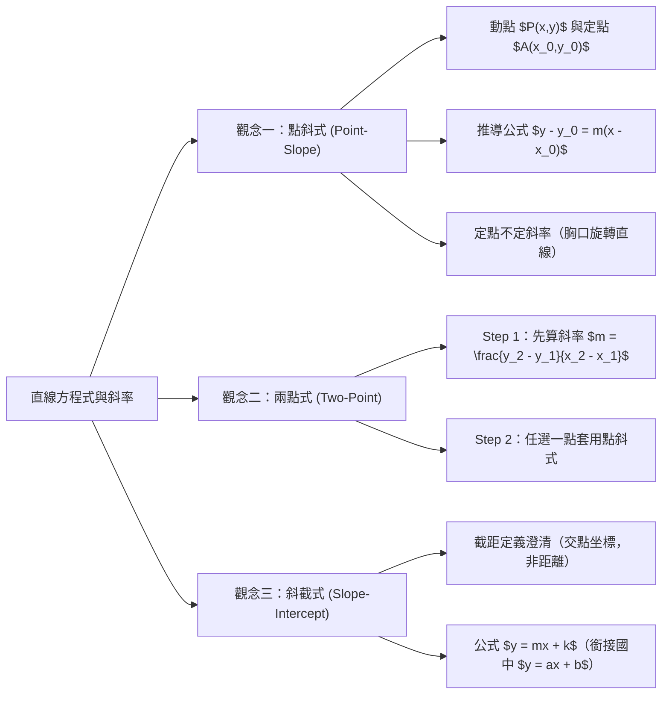
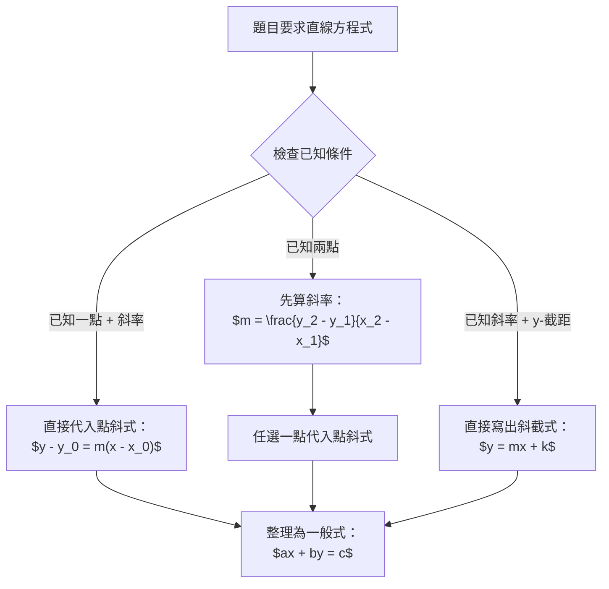

## 📖 課堂主題與核心摘要 (Class Overview)
本堂課為高中數學「直線方程式」的核心單元，主要講解如何從國中傳統的待定係數法轉型為高中以「斜率幾何意義」為核心的直觀描述法。課堂聚焦於直線方程式的三種經典表達形式：點斜式、兩點式與斜截式，並深入探討「動點與定點關係」以及「截距的正確數學定義」。學習目標在於培養學生看懂點斜式參數背後的幾何意義，並能靈活運用於定點旋轉直線與快速破題。

---

## 💡 核心知識點與觀念詳解 (Key Concepts)

### 觀念一：點斜式（Point-Slope Form）—— 高中直線方程式的靈魂

#### 1. 公式推導與幾何意義
在坐標平面上，若有一條直線通過已知定點 \\(A(x_0, y_0)\\)，且其斜率固定為 \\(m\\)。我們可以在直線上隨意找一個「動點」 \\(P(x, y)\\)。
因為直線上任意兩點連線的斜率皆為定值 \\(m\\)，根據斜率定義：
\\[ \frac{\Delta y}{\Delta x} = \frac{y - y_0}{x - x_0} = m \\]
將分母移項至等號右邊，即可得到**點斜式**標準型：
\\[ y - y_0 = m(x - x_0) \\]
* **幾何意義**：\\(x\\) 的變化量的 \\(m\\) 倍即為 \\(y\\) 的變化量。這代表直線上無數個動點 \\((x, y)\\) 必須滿足的代數關係式。

#### 2. 課堂經典例題拆解
* **【例題 1】已知點 \\(A(1, 3)\\) 且斜率 \\(m = 2\\)，求直線方程式。**
  * **步驟**：設定動點 \\((x,y)\\)，斜率關係為 \\(\frac{y - 3}{x - 1} = 2\\)。
  * **整理**：\\(y - 3 = 2(x - 1)\\) \\(\implies 2x - y = -1\\)。
* **【例題 2】解讀直線方程式 \\(y + 2 = -\frac{1}{3}(x - 5)\\)。**
  * **直覺判讀**：高中生應具備直接判讀能力——斜率 \\(m = -\frac{1}{3}\\)，且必定通過定點 \\((5, -2)\\)（因為當 \\(x = 5\\) 時，右式為 \\(0\\)，強迫 \\(y = -2\\)）。

#### 3. 老師經典比喻與延伸觀念：「定點不定斜率」
* **【例題 3】討論 \\(y + 5 = m(x - 2)\\) 的圖形幾何意義。**
  * **觀念**：此方程式的斜率 \\(m\\) 未定，但無論 \\(m\\) 為何值，當 \\(x = 2\\) 時，\\(y\\) 必為 \\(-5\\)。
  * **老師比喻**：就像是以胸口上的固定點 \\((2, -5)\\) 為旋轉中心，直線在胸口上像指針一樣轉來轉去（斜率可能是正、負或零），呈現「定點旋轉束」的幾何特徵。

---

### 觀念二：兩點式（Two-Point Form）—— 回歸斜率本質

#### 1. 高中與國中解法的思維差異
* **國中做法**：設 \\(y = ax + b\\)，將兩點坐標代入解 \\(a, b\\) 的二元一次聯立方程式。
* **高中做法**：拒絕解聯立！直接利用幾何性質拆解為兩步驟：
  1. 先求斜率 \\(m\\)。
  2. 選用任一已知點套用「點斜式」。

#### 2. 課堂經典例題拆解
* **【例題 4】已知直線通過 \\(A(1, 2)\\) 與 \\(B(4, 5)\\) 兩點，求直線方程式。**
  * **Step 1（計算斜率）**：\\(m_{AB} = \frac{5 - 2}{4 - 1} = \frac{3}{3} = 1\\)。
  * **Step 2（套用點斜式）**：
    * 若選用點 \\(A(1, 2)\\)：\\(y - 2 = 1 \cdot (x - 1) \implies x - y = -1\\)。
    * 若選用點 \\(B(4, 5)\\)：\\(y - 5 = 1 \cdot (x - 4) \implies x - y = -1\\)。
    * 兩者展開結果完全一致！

---

### 觀念三：斜截式與截距的正確定義（Slope-Intercept Form）

#### 1. 嚴謹觀念澄清：什麼是「截距（Intercept）」？
* **老師特別叮嚀（台灣數學課本翻譯常見誤解）**：
  * 「截距」的「句」**絕對不是距離（Distance）**！英文原名為 Intercept，意思是「截取之值」或「交點坐標值」。
  * **性質**：截距**有正、有負、也可以是零**！
  * **\\(y\\)-截距**：直線與 \\(y\\) 軸交點的 \\(y\\) 坐標（即通過點 \\((0, k)\\)）。

#### 2. 斜截式推導與國中觀念對接
* **定義**：已知斜率為 \\(m\\)，且 \\(y\\)-截距為 \\(k\\)（即通過點 \\((0, k)\\)）。
* **推導**：代入點斜式可得 \\(y - k = m(x - 0) \implies y = mx + k\\)。
* **【例題 5】斜率 \\(m = 2\\)，\\(y\\)-截距為 \\(-3\\)，求直線方程式。**
  * **解析**：\\(y\\)-截距為 \\(-3\\) 代表通過點 \\((0, -3)\\)。
  * **套用點斜式**：\\(y - (-3) = 2(x - 0) \implies y + 3 = 2x \implies y = 2x - 3\\)。
  * **對接國中**：國中學過的 \\(y = ax + b\\) 中，\\(a\\) 即為斜率 \\(m\\)，\\(b\\) 即為 \\(y\\)-截距。高中已將此觀念完全包覆與深化。

---

### 📊 觀念與易混淆對比表

| 項目 / 方程式形式 | 點斜式 (Point-Slope) | 兩點式 (Two-Point) | 斜截式 (Slope-Intercept) |
| :--- | :--- | :--- | :--- |
| **已知條件** | 通過點 \\((x_0, y_0)\\)，斜率 \\(m\\) | 通過兩點 \\((x_1, y_1)\\) 與 \\((x_2, y_2)\\) | 斜率 \\(m\\)，\\(y\\)-截距 \\(k\\)（交點 \\((0, k)\\)） |
| **數學表示式** | \\(y - y_0 = m(x - x_0)\\) | \\(y - y_1 = \left(\frac{y_2 - y_1}{x_2 - x_1}\right)(x - x_1)\\) | \\(y = mx + k\\) |
| **適用情境** | 高中解題最核心預設工具 | 題目僅給予兩坐標時 | 已知與 \\(y\\) 軸交點時快速表示 |
| **核心優勢** | 眼神掃過即可秒看斜率與定點 | 無需設 \\(y=ax+b\\) 解聯立 | 直接銜接函數圖形概念 |

---

### ⏱️ 公式推導與解題流程圖

---

## ⚠️ 老師強調考點與易錯陷阱 (Exam Focus & Pitfalls)

1. **【必考重點】高中解題禁忌**：
   * 切勿再習慣性假設 \\(y = ax + b\\) 代入兩點解聯立方程！高中所有直線題目優先使用**點斜式**，能節省大量計算時間。
2. **【超高頻易錯陷阱】截距的正負性**：
   * 題目若說「\\(y\\)-截距為 \\(-5\\)」，代表交點坐標為 \\((0, -5)\\)，**絕對不能記成距離而自動取絕對值**變成 \\(+5\\)。
3. **【高階考點】含參數直線的幾何解釋（定點不定斜率）**：
   * 當方程式出現未知數 \\(m\\)（如 \\(y - 1 = m(x + 3)\\)），要能立刻辨識出這是一條「必定通過定點 \\((-3, 1)\\)，但斜率未定」的旋轉直線，這在後續求直線與線段相交問題中是破題關鍵。

---

## 🔑 記憶口訣與解題技巧 (Mnemonics & Shortcuts)

* **點斜式速記口訣**：
  > **「左邊減 \\(y\\)，右邊減 \\(x\\)；斜率放在括號外，定點坐標正負反。」**
* **截距觀念避坑口訣**：
  > **「截距截距，有正有負不是距；交於何處，即為其值。」**
* **高中解題 SOP 技巧**：
  1. **找斜率 \\(m\\)**：若沒給，先用 \\(\frac{\Delta y}{\Delta x}\\) 算出。
  2. **抓定點 \\((x_0, y_0)\\)**：任選直線上確定的一點。
  3. **一秒開點斜**：寫出 \\(y - y_0 = m(x - x_0)\\) 後再進行整理。

---

## 📝 課後作業與待辦事項 (Homework & Tasks)

* **課堂交代事項**：無特定作業。
* **課間說明**：老師特別叮嚀同學課堂觀念需即時吸收，課間休息至 :20（共 15 分鐘）。若有段考小考錯題或觀念不清楚者，可至外面休息區找老師個別輔導訂正。

---

## 📚 專有名詞與重要公式/定義 (Glossary & Formulas)

* **斜率 (Slope, \\(m\\))**：直線上 \\(y\\) 變化量與 \\(x\\) 變化量的比值，公式為 \\(m = \frac{\Delta y}{\Delta x} = \frac{y_2 - y_1}{x_2 - x_1}\\)。
* **點斜式 (Point-Slope Form)**：已知斜率 \\(m\\) 與一點 \\((x_0, y_0)\\) 的直線方程式，公式為 \\(y - y_0 = m(x - x_0)\\)。
* **截距 (Intercept)**：直線與坐標軸交點的坐標值（非距離），與 \\(x\\) 軸交點坐標為 \\((a, 0)\\) 則 \\(a\\) 為 \\(x\\)-截距；與 \\(y\\) 軸交點坐標為 \\((0, b)\\) 則 \\(b\\) 為 \\(y\\)-截距。
* **斜截式 (Slope-Intercept Form)**：已知斜率 \\(m\\) 與 \\(y\\)-截距 \\(k\\) 的直線方程式，公式為 \\(y = mx + k\\)。
* **動點與定點 (Moving Point & Fixed Point)**：定點為已知固定坐標點 \\((x_0, y_0)\\)；動點為直線上代表任意點的變數 \\((x, y)\\)。

---

## 🧠 課後自測題 (Quick Review Quiz)

### 題一：觀念判讀題
已知一條直線方程式為 \\(y - 4 = -2(x + 3)\\)，請回答：
1. 此直線的斜率為何？
2. 此直線必定通過哪一個定點？

* **【思考與解析】**：
  對照點斜式標準型 \\(y - y_0 = m(x - x_0)\\)：
  1. 斜率 \\(m = -2\\)。
  2. \\(x - x_0 = x + 3 \implies x_0 = -3\\)；\\(y - y_0 = y - 4 \implies y_0 = 4\\)。故必定通過定點 \\((-3, 4)\\)。

---

### 題二：基本計算題
已知平面上兩點 \\(P(-2, 5)\\) 與 \\(Q(4, 1)\\)：
1. 請求出直線 \\(PQ\\) 的斜率。
2. 請利用高中「點斜式」寫出直線 \\(PQ\\) 的方程式，並化簡為一般式 \\(ax + by = c\\)。

* **【思考與解析】**：
  1. 計算斜率：\\(m = \frac{1 - 5}{4 - (-2)} = \frac{-4}{6} = -\frac{2}{3}\\)。
  2. 選用點 \\(Q(4, 1)\\) 寫出點斜式：
     \\[ y - 1 = -\frac{2}{3}(x - 4) \\]
     兩邊同乘以 \\(3\\)：\\(3(y - 1) = -2(x - 4) \implies 3y - 3 = -2x + 8 \implies 2x + 3y = 11\\)。

---

### 題三：觀念避坑題
若一條直線的斜率為 \\(3\\)，且其 \\(y\\)-截距為 \\(-4\\)，請寫出此直線方程式，並說明其與 \\(y\\) 軸的交點坐標。

* **【思考與解析】**：
  1. \\(y\\)-截距為 \\(-4\\)，代表交點坐標為 \\((0, -4)\\)（注意：截距有正負，非距離）。
  2. 代入斜截式 \\(y = mx + k\\)，得直線方程式為 \\(y = 3x - 4\\)。