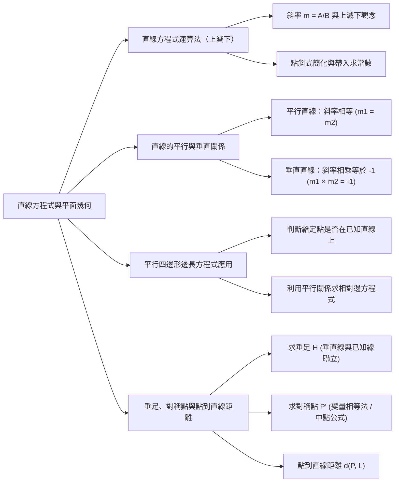
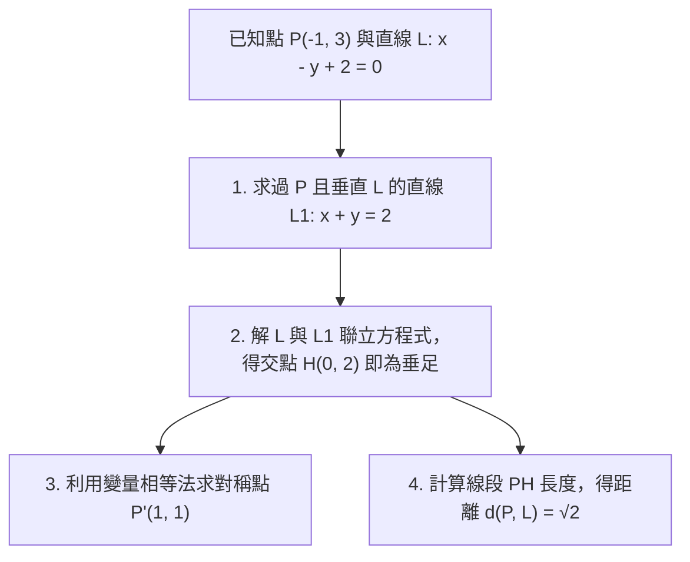

## 📖 課堂主題與核心摘要 (Class Overview)
本堂課為高中數學「平面幾何與直線方程式」的精華實戰課程，核心主題聚焦於**直線方程式的極速寫法（「上減下」萬能速算法）**、**直線的平行與垂直關係**，以及**平行四邊形邊長方程式**與**垂足、對稱點、點到直線距離**的綜合應用。老師透過觀念推導與豐富的經典例題，示範如何跳脫繁複的點斜式移項整理，改以直觀的「上減下」技巧秒殺各類直線方程式題目。學習目標為掌握直線斜率的代數與幾何意義，並能熟練運用變量相等法與聯立方程，快速解決高中大考的熱門幾何考題。

---

## 💡 核心知識點與觀念詳解 (Key Concepts)

### 1. 直線方程式「上減下」萬能速算法推導

傳統點斜式若已知斜率 \\(m = \frac{A}{B}\\) 且通過點 \\((s, t)\\)，寫成：
\\[ y - t = \frac{A}{B}(x - s) \\]
將分母 \\(B\\) 乘至左式，分子 \\(A\\) 展開右式：
\\[ B(y - t) = A(x - s) \Rightarrow B y - B t = A x - A s \\]
移項整理得：
\\[ A x - B y = A s - B t \\]
由此可發現：**左式的 \\(x\\) 係數為斜率分子 \\(A\\)，\\(y\\) 係數為斜率分母的負數 \\(-B\\)（即「分子乘以 \\(x\\) 減去 分母乘以 \\(y\\)」，簡稱「上減下」）**；而右式的常數項，只需要將已知點 \\((s, t)\\) 直接代入左式的 \\(A x - B y\\) 即可求得。

#### 經典例題步驟拆解 (課堂實戰練習)

* **例題一（正分數斜率）：** 斜率 \\(m = \frac{3}{2}\\)，過點 \\(A(1, 5)\\)
  * **步驟 1**：斜率分子為 \\(3\\)（上）、分母為 \\(2\\)（下），上減下寫出左式：\\(3x - 2y\\)。
  * **步驟 2**：代入點 \\(A(1, 5)\\) 求常數：\\(3(1) - 2(5) = -7\\)。
  * **結論**：直線方程式為 \\(3x - 2y = -7\\)。

* **例題二（整數斜率）：** 斜率 \\(m = 3\\)，過點 \\(A(1, 5)\\)
  * **步驟 1**：將整數改寫成分數 \\(m = \frac{3}{1}\\)，上減下寫出左式：\\(3x - 1y = 3x - y\\)。
  * **步驟 2**：代入點 \\(A(1, 5)\\) 得常數：\\(3(1) - 5 = -2\\)。
  * **結論**：直線方程式為 \\(3x - y = -2\\)。

* **例題三（負分數斜率與負號處理）：** 斜率 \\(m = -\frac{4}{3}\\)，過點 \\(A(1, 5)\\)
  * **步驟 1（關鍵技巧）**：將負號給**分母**，即斜率看成 \\(\frac{4}{-3}\\)。
  * **步驟 2**：上減下寫出左式：\\(4x - (-3)y = 4x + 3y\\)。
  * **步驟 3**：代入點 \\(A(1, 5)\\) 得常數：\\(4(1) + 3(5) = 19\\)。
  * **結論**：直線方程式為 \\(4x + 3y = 19\\)。

* **例題四（負整數斜率）：** 斜率 \\(m = -3\\)，過點 \\(A(1, 5)\\)
  * **步驟 1**：改寫成分數 \\(\frac{3}{-1}\\)（負號給分母），上減下得左式：\\(3x - (-1)y = 3x + y\\)。
  * **步驟 2**：代入點 \\(A(1, 5)\\) 得常數：\\(3(1) + 5 = 8\\)。
  * **結論**：直線方程式為 \\(3x + y = 8\\)。

---

### 2. 直線的平行與垂直關係

已知直線 \\(L: 3x + 2y - 6 = 0\\)，其斜率為 \\(m = -\frac{3}{2}\\)。

* **平行直線（\\(L_1 \parallel L\\)）**：
  * 斜率相同 \\(m_1 = -\frac{3}{2}\\)，前項 \\(x, y\\) 係數保持一致，直接設 \\(3x + 2y = k\\)。
  * 若過點 \\(A(-3, 2)\\)，代入得 \\(3(-3) + 2(2) = -5\\)，故平行線為 \\(3x + 2y = -5\\)。
* **垂直直線（\\(L_2 \perp L\\)）**：
  * 垂直斜率相乘等於 \\(-1\\)（\\(m_1 \cdot m_2 = -1\\)），故 \\(m_2 = \frac{2}{3}\\)。
  * 上減下得左式：\\(2x - 3y\\)（即 \\(x, y\\) 係數對調，中間加減號改變）。
  * 代入點 \\(A(-3, 2)\\) 得常數：\\(2(-3) - 3(2) = -12\\)，故垂直線為 \\(2x - 3y = -12\\)。

---

### 3. 平行四邊形頂點與對邊方程式（必考經典題）

* **題目條件**：平行四邊形兩鄰邊直線分別為 \\(L_1: 2x + 3y - 6 = 0\\) 與 \\(L_2: x - 3y + 3 = 0\\)，已知一頂點為 \\(P(5, 1)\\)。
* **解題步驟拆解**：
  1. **點位檢驗**：將 \\(P(5, 1)\\) 分別代入 \\(L_1\\) 與 \\(L_2\\)，發現 \\(2(5) + 3(1) - 6 = 7 \neq 0\\) 且 \\(5 - 3(1) + 3 = 5 \neq 0\\)。證明 \\(P\\) 點**不在此兩條已知邊上**，為其對角頂點。
  2. **求平行對邊**：
     * 對邊平行 \\(L_2 (x - 3y)\\)，且通過 \\(P(5, 1)\\)：方程式為 \\(x - 3y = 5 - 3(1) \Rightarrow x - 3y = 2\\)。
     * 對邊平行 \\(L_1 (2x + 3y)\\)，且通過 \\(P(5, 1)\\)：方程式為 \\(2x + 3y = 2(5) + 3(1) \Rightarrow 2x + 3y = 13\\)。

---

### 4. 垂足、對稱點與點到直線距離（大考十顆星焦點）

已知點 \\(P(-1, 3)\\) 與直線 \\(L: x - y + 2 = 0\\)：

* **求解三步驟流程圖**：

1. **求垂足 \\(H\\)**：
   * 原直線 \\(L\\) 斜率為 \\(1\\)。過 \\(P(-1, 3)\\) 之垂直線 \\(L_1\\) 斜率為 \\(-1\\)，寫成 \\(x + y = (-1) + 3 = 2\\)。
   * 解聯立：\\(\begin{cases} x - y = -2 \\ x + y = 2 \end{cases} \Rightarrow x = 0, y = 2\\)，故垂足為 \\(H(0, 2)\\)。
2. **求對稱點 \\(P'\\)**：
   * **變量相等法**：點 \\(P(-1, 3)\\) 到垂足 \\(H(0, 2)\\) 的座標變化量為：\\(x\\) 增加 \\(1\\)（\\(-1 \to 0\\)），\\(y\\) 減少 \\(1\\)（\\(3 \to 2\\)）。
   * 鏡像延伸至對稱點 \\(P'\\)：\\(x\\) 座標再 \\(+1 \Rightarrow 0 + 1 = 1\\)；\\(y\\) 座標再 \\(-1 \Rightarrow 2 - 1 = 1\\)。故對稱點為 \\(P'(1, 1)\\)。
3. **求點到直線距離 \\(d(P, L)\\)**：
   * 距離即線段 \\(\overline{PH}\\) 的長度：
     \\[ d(P, L) = \sqrt{[0 - (-1)]^2 + (2 - 3)^2} = \sqrt{1^2 + (-1)^2} = \sqrt{2} \\]

---

### 📊 觀念與幾何性質對比表

| 對比項目 | 平行直線關係 (\\(L_1 \parallel L_2\\)) | 垂直直線關係 (\\(L_1 \perp L_2\\)) |
| :--- | :--- | :--- |
| **斜率幾何特徵** | 傾斜角度相同，兩直線不相交 | 兩直線夾角為 \\(90^\circ\\) |
| **斜率代數關係** | \\(m_1 = m_2\\) | \\(m_1 \cdot m_2 = -1\\) |
| **方程式係數型態** | \\(Ax + By = k_1\\) 與 \\(Ax + By = k_2\\) (\\(x, y\\) 係數相同) | \\(Ax + By = k_1\\) 與 \\(Bx - Ay = k_2\\) (\\(x, y\\) 係數對調變號) |
| **求法快速口訣** | 前項照抄，帶點求常數 | 前項係數對調變號，帶點求常數 |

---

## ⚠️ 老師強調考點與易錯陷阱 (Exam Focus & Pitfalls)

* **「上減下」三個字必記**：老師叮嚀這是高中寫直線方程式最快的方法，上課特別指定同學用最特別顏色的筆劃上記號，務必熟練。
* **負號一定要給分母**：遇到斜率為負數（如 \\(m = -\frac{4}{3}\\)），**切記將負號指定給分母 \\(\frac{4}{-3}\\)**，這樣寫出來的直線方程式首項 \\(x\\) 係數才會是漂亮的正數（\\(4x + 3y = C\\)），避免計算出錯。
* **平行四邊形點位先帶入檢驗**：解平行四邊形題目時，給定的一點千萬不能直接假設在已知線上！必須先將點座標帶入方程式檢驗，確認該點是否滿足方程式，避免畫錯幾何結構。
* **截距定義陷阱（重點警告）**：老師特別強調「**截距有正有負，截距非距離**」！
  * \\(x\\) 截距為 \\(-5\\) 代表直線與 \\(x\\) 軸交於點 \\((-5, 0)\\)。
  * \\(y\\) 截距為 \\(-4\\) 代表直線與 \\(y\\) 軸交於點 \\((0, -4)\\)。
  * 絕對不能因為看到「距」字就擅自加上絕對值算成距離。
* **作圖習慣叮嚀**：數學幾何作圖求的是簡明精確，老師特別叮嚀不要像繪畫課一樣反覆描線（會「起毛球」/「Я融」），俐落一筆畫出幾何圖形才能輔助清晰思考。

---

## 🔑 記憶口訣與解題技巧 (Mnemonics & Shortcuts)

1. **「上減下」萬能寫法口訣**：
   * 斜率寫成分數 \\(\frac{\text{上}}{\text{下}}\\)，方程式左式直接寫成 \\(\text{上} \cdot x - \text{下} \cdot y\\)。
   * **右邊數字不重要，點帶進去就知道！**
2. **斜率正負號秒判法**：
   * 直線方程式 \\(Ax + By = C\\)：
     * 若 \\(x, y\\) 係數中間為**減號**（異號），斜率為**正**。
     * 若 \\(x, y\\) 係數中間為**加號**（同號），斜率為**負**。
3. **對稱點「變量相等」速解法**：
   *求點 \\(P\\) 對直線 \\(L\\) 的對稱點 \\(P'\\)，算完垂足 \\(H\\) 後：
   \\[\Delta x = x_H - x_P, \quad \Delta y = y_H - y_P\\]
   \\[x_{P'} = x_H + \Delta x, \quad y_{P'} = y_H + \Delta y\\]
   不必使用複雜代數公式，直接看座標推移變量即可秒殺。

---

## 📝 課後作業與待辦事項 (Homework & Tasks)

* **課後作業**：
  * 完成講義單元「類題三之五」（全員下課前演練，徹底落實垂足、對稱點與距離之計算）。
* **下次小考與待辦**：
  * 老師預告後續課堂將抽考「三之五（垂足、對称點與距離）」，講義頭上已畫三個框框，列為本章最核心的十顆星必考題，請務必複習。

---

## 📚 專有名詞與重要公式/定義 (Glossary & Formulas)

* **斜率 (Slope) \\(m\\)**：衡量平面上直線傾斜程度的量值，定義為 \\(y\\) 變化量與 \\(x\\) 變化量的比值：
  \\[ m = \frac{\Delta y}{\Delta x} = \frac{y_2 - y_1}{x_2 - x_1} \\]
* **「上減下」直線方程式萬能型態**：當斜率 \\(m = \frac{A}{B}\\) 且通過點 \\((s, t)\\) 時，直線方程式可表示為：
  \\[ A x - B y = A s - B t \\]
* **平行線斜率性質**：若兩不重合直線 \\(L_1 \parallel L_2\\)，則兩者斜率相等：
  \\[ m_1 = m_2 \\]
* **垂直線斜率性質**：若兩直線相互垂直 \\(L_1 \perp L_2\\)，則兩者斜率乘積為 \\(-1\\)：
  \\[ m_1 \cdot m_2 = -1 \\]
* **截距 (Intercept)**：直線與坐標軸交點的座標值（含正負號）。與 \\(x\\) 軸交於 \\((a, 0)\\) 則 \\(x\\) 截距為 \\(a\\)；與 \\(y\\) 軸交於 \\((0, b)\\) 則 \\(y\\) 截距為 \\(b\\)。
* **兩點間距離公式 (Distance Formula)**：兩點 \\(P(x_1, y_1)\\) 與 \\(H(x_2, y_2)\\) 之直線距離為：
  \\[ d(P, H) = \sqrt{(x_2 - x_1)^2 + (y_2 - y_1)^2} \\]

---

## 🧠 課後自測題 (Quick Review Quiz)

### 思考題一：上減下速算法演練
**題目**：已知直線 \\(L\\) 過點 \\(A(2, -3)\\)，且斜率 \\(m = -\frac{2}{5}\\)，請利用「上減下」速算法求 \\(L\\) 的直線方程式。
* **解題思維**：
  1. 將負號給分母，將斜率看成 \\(\frac{2}{-5}\\)。
  2. 上減下寫出左式：\\(2x - (-5)y = 2x + 5y\\)。
  3. 將點 \\(A(2, -3)\\) 代入左式計算常數：\\(2(2) + 5(-3) = 4 - 15 = -11\\)。
* **答案**：\\(2x + 5y = -11\\)

---

### 思考題二：垂直線方程式求法
**題目**：已知直線 \\(L: 4x - 3y = 7\\)，求過點 \\(P(1, 2)\\) 且垂直 \\(L\\) 的直線方程式。
* **解題思維**：
  1. 原直線 \\(L\\) 斜率為 \\(\frac{4}{3}\\)，故垂直線斜率為 \\(-\frac{3}{4}\\)（將負號給分母看作 \\(\frac{3}{-4}\\)）。
  2. 上減下寫出垂直線左式：\\(3x - (-4)y = 3x + 4y\\)。
  3. 代入點 \\(P(1, 2)\\) 求常數：\\(3(1) + 4(2) = 11\\)。
* **答案**：\\(3x + 4y = 11\\)

---

### 思考題三：變量相等法求對稱點
**題目**：已知點 \\(A(-2, 5)\\) 對某直線作垂直投影得垂足 \\(H(1, 2)\\)，請求點 \\(A\\) 對該直線的對稱點 \\(A'\\) 座標。
* **解題思維**：
  1. 觀察 \\(A(-2, 5) \to H(1, 2)\\) 的座標變化：
     * \\(x\\) 座標由 \\(-2\\) 變為 \\(1\\)，增加 \\(+3\\)。
     * \\(y\\) 座標由 \\(5\\) 變為 \\(2\\)，減少 \\(-3\\)。
  2. 對稱點 \\(A'\\) 為垂足 \\(H\\) 沿相同方向推移相同變量：
     * \\(x_{A'} = 1 + 3 = 4\\)
     * \\(y_{A'} = 2 - 3 = -1\\)
* **答案**：對稱點 \\(A'(4, -1)\\)