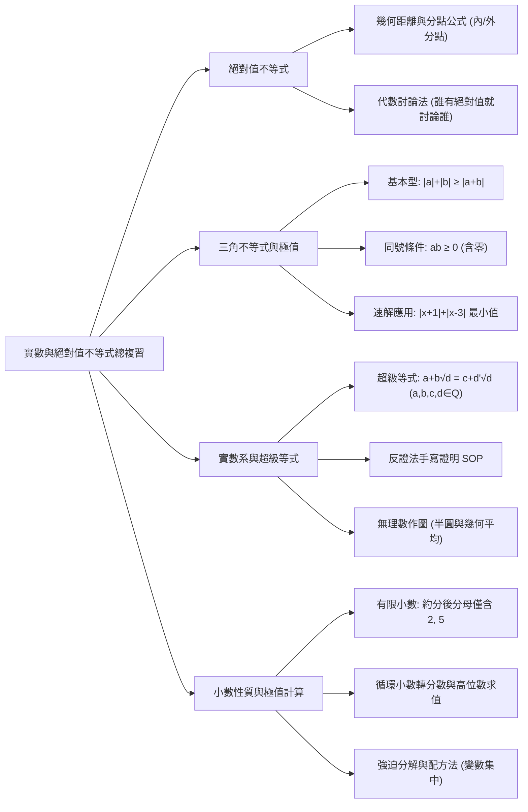
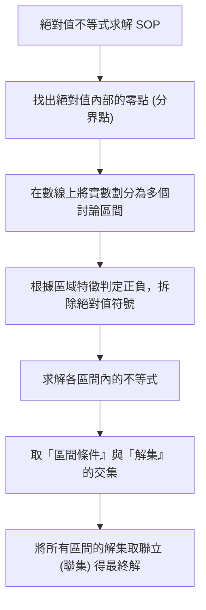

## 📖 課堂主題與核心摘要 (Class Overview)
本堂課為高一數學第一冊「實數與絕對值不等式」的考前總複習。課堂核心圍繞於絕對值不等式的幾何分點解法與代數分區間討論法、雙絕對值極值求解技巧（三角不等式應用）、超級等式（有理數相等定理）的反證法嚴密證明，以及有理數（有限小數與循環小數）的判定與運算推導。老師透過建中、北一女、松山等名校歷屆考題進行實戰拆解，並傳授遮住詳解預測步驟的考前高效複習策略，協助學生建立清晰的破題架構與考前衝刺思維。

【🌳 本課大綱樹狀心智導圖 (Mindmap)】：

---

## 💡 核心知識點與觀念詳解 (Key Concepts)

### 1. 絕對值不等式的雙重解法：幾何分點 vs. 代數討論

* **幾何距離與分點觀念**：
  絕對值 \\(|x - a|\\) 在幾何上代表數線上點 \\(x\\) 到點 \\(a\\) 的距離。
  * **基本型**：若 \\(|x - 30| < |x - 50|\\)，代表 \\(x\\) 到 \\(30\\) 的距離小於到 \\(50\\) 的距離。取中點 \\(m = \frac{30 + 50}{2} = 40\\)，因距離 \\(30\\) 較近，故解為 \\(x < 40\\)。
  * **含倍數型（課堂經典第 5 題拆解）**：對於不等式 \\(|x - 30| < 3|x - 50|\\)，高手會先思考等式：
    \\[ |x - 30| : |x - 50| = 3 : 1 \\]
    * **內分點**：在 \\(30\\) 與 \\(50\\) 之間按 \\(3:1\\) 切割，長度 \\(20\\) 分成四等份，得 \\(x = 45\\)。
    * **外分點**：在 \\(50\\) 右側按 \\(3:1\\) 切割（距離比為 \\(3:1\\)），長度 \\(20\\) 為兩等份，得 \\(x = 60\\)。
    * **方向判定**：思考點往左或往右移動時距離比的變化，得出 \\(x < 45\\) 或 \\(x > 60\\)。
* **代數區間討論法（高中的標準解答步驟）**：
  核心原則：「**誰有絕對值就討論誰！**」沒有絕對值的項切勿亂設分界點。
  以 \\(|x - 30| < 3|x - 50|\\) 為例，令絕對值內部為 \\(0\\) 得分界點 \\(x = 30, 50\\)，將數線拆為三個區間：
  1. **當 \\(x > 50\\) 時**：兩式皆正，直接去絕對值：
     \\[ x - 30 < 3(x - 50) \implies 2x > 120 \implies x > 60 \\]
  2. **當 \\(30 \le x \le 50\\) 時**：前正後負，後式加負號：
     \\[ x - 30 < -3(x - 50) \implies 4x < 180 \implies x < 45 \implies \text{交集得 } 30 \le x < 45 \\]
  3. **當 \\(x < 30\\) 時**：兩式皆負，皆加負號：
     \\[ -(x - 30) < -3(x - 50) \implies 2x < 120 \implies x < 60 \implies \text{交集得 } x < 30 \\]
  * **聯立合併**：結合第 2 與第 3 區間得 \\(x < 45\\)；再與第 1 區間取聯集，最終解為 \\(x < 45\\) 或 \\(x > 60\\)。

### 2. 三角不等式與雙絕對值極值速解

* **定理定義**：
  對任意實數 \\(a, b\\)，兩數先取絕對值再相加，必大於等於先相加再取絕對值：
  \\[ |a| + |b| \ge |a + b| \\]
  * **等號成立條件**：\\(a, b\\) **同號或有 0**（即 \\(ab \ge 0\\)），此時兩數方向一致，不互相抵消。
  * **嚴格大於條件**：\\(a, b\\) **異號**（即 \\(ab < 0\\)），正負抵消導致取絕對值後數值變小。
* **速解雙絕對值極值應用**：
  求 \\(f(x) = |x + 1| + |x - 3|\\) 的最小值。
  * **破題關鍵技巧**：利用絕對值內部加負號不改變數值的特性，將 \\(|x - 3|\\) 改寫為 \\(|-x + 3|\\)，讓變數 \\(x\\) 在相加時精準消去！
  * **推導過程**：
    \\[ f(x) = |x + 1| + |-x + 3| \ge |(x + 1) + (-x + 3)| = |4| = 4 \\]
  * **極值成立條件**：此時等號成立需滿足同號，即 \\((x + 1)(-x + 3) \ge 0 \iff (x + 1)(x - 3) \le 0 \iff -1 \le x \le 3\\)。

### 3. 超級等式（有理數相等定理）與反證法手寫證明

* **超級等式**：
  若 \\(a, b, c, d \in \mathbb{Q}\\)（必須全為有理數），且 \\(\sqrt{k}\\) 為無理數，若：
  \\[ a + b\sqrt{k} = c + d\sqrt{k} \iff a = c \text{ 且 } b = d \\]
* **手寫大題：反證法（Reduction to Absurdity）證明 SOP**：
  1. **假設反面**：假設 \\(b \ne d\\)。
  2. **移項推導**：
     \\[ a + b\sqrt{2} = c + d\sqrt{2} \implies (b - d)\sqrt{2} = c - a \implies \sqrt{2} = \frac{c - a}{b - d} \\]
  3. **導出矛盾**：因為 \\(a, b, c, d \in \mathbb{Q}\\) 且 \\(b \ne d\\)，故右式 \\(\frac{c - a}{b - d}\\) 必為有理數；然而左式 \\(\sqrt{2}\\) 已知為無理數。**「左式無理數 \\(\ne\\) 右式有理數」，產生嚴重矛盾！**
  4. **宣吿結論**：故原假設錯誤，得證 \\(b = d\\)；代回原式即得 \\(a = c\\)。

### 4. 實數系分類、小數性質與幾何作圖

* **有限小數判定定理**：
  一個最簡分數能化為有限小數，其**分母約分後質因數只能含有 2 或 5**。
  * **例題應用**：若 \\(\frac{A}{21} = \frac{A}{3 \times 7}\\) 介於 \\(1\\) 與 \\(3\\) 之間且為有限小數，則分子 \\(A\\) 必須能夠提供因數 \\(3\\) 或 \\(7\\) 來約掉分母的 \\(3\\) 或 \\(7\\)，使剩餘分母僅含 \\(2\\) 與 \\(5\\) 的次方。
* **循環小數轉分數與高位數求值**：
  轉分數口訣：「**有帽念 9，無帽念 0，由後往前念**」。
  * **經典考題（第 6 題打 10 顆星）**：求 \\(\frac{16241}{49950}\\) 小數點後第 \\(51\\) 位數字。
    1. 分子分母同乘以 \\(2\\) 得 \\(\frac{32482}{99900}\\)。
    2. 觀察分母結構可知其小數格式為 \\(0.ab\overline{cde}\\)，轉分數公式為 \\(\frac{abcde - ab}{99900}\\)。
    3. 逆推分子：\\(abcde - ab = 32482 \implies abcde = 32482 + 32 = 32514\\)，故該小數為 \\(0.32\overline{514}\\)。
    4. 循環節長度為 \\(3\\)（即 \\(5, 1, 4\\)）。排除前 \\(2\\) 位非循環位數後，剩餘 \\(51 - 2 = 49\\) 位。
    5. 計算 \\(49 \div 3 = 16 \dots 1\\)，故第 \\(51\\) 位數字為循環節第 \\(1\\) 個數字 **5**。
* **無理數作圖（半圓與幾何平均定理）**：
  要利用尺規作圖作出無理數 \\(\sqrt{12} = \sqrt{3 \times 4}\\)：
  1. 在直線上取相鄰兩線段長度分別為 \\(a = 3\\) 與 \\(b = 4\\)。
  2. 以兩線段總長 \\(a + b = 7\\) 為直徑繪製一個半圓。
  3. 從長度 \\(3\\) 與 \\(4\\) 的交界點作垂直線段垂直交於圓周上，此垂直線段長度即為 \\(\sqrt{3 \times 4} = \sqrt{12}\\)。

### 5. 課堂靈魂比喻與學習心態

* **賽車遊戲小地圖比喻**：複習牛皮紙講義時，要將詳解遮住、用「看」的去預測下一步解題動作。這就像玩賽車遊戲看旁邊的小地圖預判路線，或是高明棋手預想後續棋局，才能在考場快速破題。
* **牛肉麵老闆與醫師比喻**：讀書是自己的「事業 (Business)」，不需要盲目等待「動力」。正如牛肉麵老闆煮麵、醫師給病人看診不需要問有沒有動力，這是本分與目標。
* **貴族學校與工業革命小門**：School 原意為閒暇與娛樂，古代雅典學校是貴族交流的場所（科目僅有藝術、文學、天文、占卜）；工業革命後開了小門，才讓一般平民能透過學習翻身改變命運。
* **求婚與愛情感悟**：行為不等於愛的本質，可以愛對方同時又與對方吵架或嫌棄對方。考試與學習亦然，不因學校好壞或一時成績波動而看輕自己的事業。
* **狗啃骨頭比喻**：考前玩手機或盲目刷題要適可而止，不要像狗啃骨頭啃到滿嘴血還以為在吃肉，反而傷害了自己的學習節奏。

【⏱️ 時序時間軸 / 步驟流程圖】：絕對值不等式代數區間討論法 SOP

【📊 觀念與易混淆對比表】：

| 對比維度 | 絕對值不等式：幾何分點解法 | 絕對值不等式：代數討論解法 |
| :--- | :--- | :--- |
| **適用時機** | 雙絕對值且係數簡單、可直觀算距離時 | 含倍數、三絕對值以上或複雜代數式 |
| **核心觀念** | 利用數線上兩點距離比例（內分點與外分點） | 依零點劃分區間，強制去絕對值 |
| **優點** | 心算速度極快、圖像直觀 | 邏輯嚴密、絕不漏解，適用所有題型 |
| **易錯陷阱** | 外分點方向容易判斷錯誤 | 忘記將討論區間與計算結果取交集 |

| 對比維度 | 超級等式：有理數條件 (\\(a, b, c, d \in \mathbb{Q}\\)) | 超級等式：實數條件 (\\(a, b, c, d \in \mathbb{R}\\)) |
| :--- | :--- | :--- |
| **等式成立狀況** | \\(a + b\sqrt{k} = c + d\sqrt{k} \implies a=c\\) 且 \\(b=d\\) 恆成立 | **不一定成立！** 不能直接係數對照 |
| **反例說明** | 無反例，可由反證法完美證明 | 若 \\(a = 3 + 4\sqrt{2}, b = 0, c = 3, d = 4\\)，等式成立但 \\(a \ne c\\) |
| **解題策略** | 放心將有理數部與無理數部獨立聯立 | 必須尋找其他代數關係求解 |

---

## ⚠️ 老師強調考點與易錯陷阱 (Exam Focus & Pitfalls)

* **星號必考重點題型**：
  * **第 5 題（打 10 顆星）**：含倍數的三連絕對值不等式 \\(|x - 30| < 3|x - 50| < |x + 30|\\)，兼具幾何分點與代數區間討論精髓。
  * **第 37 題（打 10 顆星）**：斷考超級熱門題，絕對值幾何涵蓋範圍與邊界值評估。
  * **第 6 題（打 10 顆星）**：\\(\frac{16241}{49950}\\) 求指定小數點後高位數數字，必須熟練擴分與循環節構造。
  * **第 25 題（裝回絕對值）**：給定範圍 \\(-1 \le x \le 9\\) 寫回 \\(|x - 4| \le 5\\)，注意中點與半長度計算。
  * **第 28 題（手寫大題 10 分）**：絕對值分區間討論法，手寫題必須完整呈現三個區間的交集與聯集過程。
  * **第 17, 18, 19 題（折頁必看題）**：建中、北一女歷屆精選試題，今晚睡前務必完整複習。
* **學生常見易錯陷阱**：
  * **超級等式未檢查有理數條件**：多選題常見陷阱，若題目僅寫「\\(a, b, c, d\\) 為實數」，不可直接令有理部等於有理部、無理部等於無理部。
  * **絕對值討論亂設分界點**：「誰有絕對值就討論誰！」若式子中有未帶絕對值的項（如 \\(x + 1\\)），切勿將其設為分界點。
  * **多變數極值不可拆開獨立取極值**：對於多變數代數式（如 \\(xy - x + y + 7\\)），因同一個 \\(x\\) 與 \\(y\\) 必須同步變動，不可分開算最大值。必須利用**強迫分解**拆為 \\((x + 1)(y - 1) + 8\\) 將變數集中後再評估範圍。
  * **邊界值與等號判定**：若不等式題目無等號，其計算出的區間端點不可稱為「最大值」或「最小值」，最小值必須是實際可達到的數值。

---

## 🔑 記憶口訣與解題技巧 (Mnemonics & Shortcuts)

* **循環小數轉分數口訣**：「**有帽念 9，無帽念 0，由後往前念**」。
  例如 \\(0.52\bar{3}\\)，分母由後往前讀帽子與無帽子為 \\(990\\)，分子為全部數字減去無帽子部分：
  \\[ 0.52\bar{3} = \frac{523 - 5}{990} \\]
* **雙絕對值極值速解 SOP**：
  求解 \\(|x - a| + |x - b|\\) 最小值時，將第二式改寫為 \\(|-x + b|\\)，利用三角不等式將 \\(x\\) 消去，直接求得最小值為 \\(|a - b|\\)，等號成立於 \\(x\\) 介於 \\(a\\) 與 \\(b\\) 之間。
* **超級等式反證法四步驟 SOP**：
  「**假設反面 \\(\implies\\) 移項表示無理數 \\(\implies\\) 導出有無理數相等之矛盾 \\(\implies\\) 宣告原假設成立**」。
* **多變數極值強迫分解法**：
  遇到 \\(xy + ax + by + c\\) 結構，強制對拆為 \\((x + b)(y + a) + (c - ab)\\)，將散開的變數集中至兩個獨立括號內評估。

---

## 📝 課後作業與待辦事項 (Homework & Tasks)

* **複習教材雙本策略**：
  * **白本講義**：純觀念懶人包，考前熟讀基礎定義與公式，確保基本題與及格分數入手。
  * **牛皮紙講義**：歷屆精選題庫。請務必使用「**用看的、遮住詳解預測下一步**」的方法複習，培養考場預判能力。
* **具體交代題目與作業**：
  * **打勾重點題**：第 24, 25, 28, 33 題。
  * **星號必考題**：第 5, 6, 37 題（各打 10 顆星）。
  * **今晚睡前必看折頁題**：第 6 頁的第 17, 18, 19 題（建中、北一女歷屆精選）。
  * **手寫題練習**：熟練第 28 題分區間討論法寫法，以及超級等式反證法證明過程。

---

## 📚 專有名詞與重要公式/定義 (Glossary & Formulas)

* **絕對值幾何意義 (Absolute Value Distance)**：
  \\[ |x - a| \\]
  表示數線上點 \\(x\\) 與點 \\(a\\) 之間的幾何距離。
* **三角不等式 (Triangle Inequality)**：
  \\[ |a| + |b| \ge |a + b| \\]
  等號成立條件為 \\(ab \ge 0\\)（即 \\(a, b\\) 同號或至少一者為 \\(0\\)）。
* **超級等式 / 有理數相等定理 (Equality Theorem of Rational and Irrational Numbers)**：
  設 \\(a, b, c, d \in \mathbb{Q}\\)，且 \\(\sqrt{k} \notin \mathbb{Q}\\)，則：
  \\[ a + b\sqrt{k} = c + d\sqrt{k} \iff a = c \text{ 且 } b = d \\]
* **有限小數判定定理 (Finite Decimal Criterion)**：
  最簡分數 \\(\frac{p}{q}\\) 能化為有限小數 \\(\iff q = 2^m \times 5^n\\)（\\(m, n\\) 為非負整數）。
* **循環小數轉換公式 (Repeating Decimal Conversion)**：
  \\[ 0.a\bar{b} = \frac{ab - a}{90}, \quad 0.a\overline{bc} = \frac{abc - a}{990} \\]
* **無理數作圖幾何平均定理 (Geometric Mean Theorem for Irrational Construction)**：
  於半圓中，以直徑兩分割線段 \\(a\\) 與 \\(b\\) 之交界點作垂直高 \\(h\\)，則：
  \\[ h = \sqrt{ab} \\]

---

## 🧠 課後自測題 (Quick Review Quiz)

* **第一題**：求函數 \\(f(x) = |x - 2| + |x + 5|\\) 的最小值，並求此時 \\(x\\) 的範圍。
  * **解題思維與簡答**：將 \\(|x + 5|\\) 改寫為 \\(|-x - 5|\\)，由三角不等式得 \\(f(x) = |x - 2| + |-x - 5| \ge |(x - 2) + (-x - 5)| = |-7| = 7\\)。故最小值為 **7**，此時等號成立於 \\((x - 2)(-x - 5) \ge 0 \iff -5 \le x \le 2\\)。
* **第二題**：若 \\(a, b \in \mathbb{Q}\\)，且滿足 \\((a - 3) + (b + 2)\sqrt{5} = 0\\)，求 \\(a\\) 與 \\(b\\) 之值。
  * **解題思維與簡答**：因 \\(a, b\\) 為有理數且 \\(\sqrt{5}\\) 為無理數，可直接使用超級等式對照，得 \\(a - 3 = 0 \implies a = 3\\)，且 \\(b + 2 = 0 \implies b = -2\\)。
* **第三題**：已知最簡分數 \\(\frac{n}{110}\\) 能化為有限小數，且正整數 \\(n\\) 滿足 \\(10 < n < 30\\)，求 \\(n\\) 的可能值。
  * **解題思維與簡答**：將分母分解 \\(110 = 2 \times 5 \times 11\\)。要使約分後分母僅含因數 \\(2\\) 與 \\(5\\)，分子 \\(n\\) 必須為 \\(11\\) 的倍數。在 \\(10 < n < 30\\) 範圍內， \\(n\\) 可為 **11** 或 **22**。