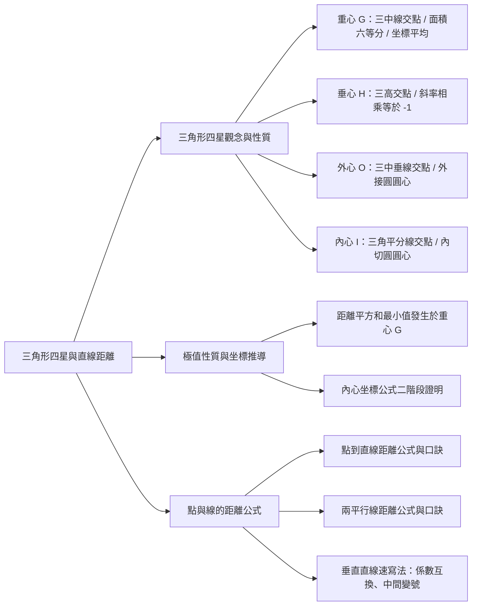
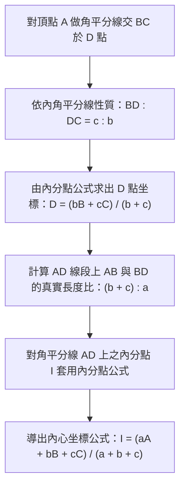

## 📖 課堂主題與核心摘要 (Class Overview)

本堂課為段考後的新進度銜接課程，核心主題聚焦於高中數學重要單元「三角形的四星（重心、垂心、外心、內心）」與「點到直線距離公式」。課堂首先複習國中幾何基礎，隨後深入講授高中的幾何代數坐標公式與二階段嚴謹證明，特別針對「內心坐標公式」進行完整的代數拆解。此外，課堂延伸探討了平面動點到三頂點距離平方和最小值的「重心極值性質」，並在尾聲傳授「點到直線距離」與「平行線距離」的速解公式、記憶口訣與垂直直線速寫技巧。

---

## 💡 核心知識點與觀念詳解 (Key Concepts)

### 1. 三角形的四星幾何意義與代數性質 (Four Centers of a Triangle)

* **重心 (\\(G\\), Centroid)**：
  * **幾何定義**：三角形三條「中線」的交點。
  * **核心性質**：
    1. **面積六等分**：三條中線將三角形切割成六個面積相同的小三角形。
    2. **線段比例 \\(2 : 1\\)**：重心分中線為 \\(2 : 1\\)（即 \\(\overline{AG} : \overline{GD} = 2 : 1\\)）。
    3. **坐標公式**：三頂點坐標相加除以 \\(3\\)，即：
       \\[ G = \frac{A + B + C}{3} = \left( \frac{x_1 + x_2 + x_3}{3}, \frac{y_1 + y_2 + y_3}{3} \right) \\]
  * **公式推導步驟拆解**：
    1. 設 \\(D\\) 為 \\(\overline{BC}\\) 邊之中點，則 \\(D = \frac{B + C}{2}\\)。
    2. 重心 \\(G\\) 為 \\(\overline{AD}\\) 上靠 \\(D\\) 側比例為 \\(2 : 1\\) 的內分點。
    3. 套用內分點公式：
       \\[ G = \frac{1 \cdot A + 2 \cdot D}{2 + 1} = \frac{A + 2 \cdot \left(\frac{B + C}{2}\right)}{3} = \frac{A + B + C}{3} \\]

* **垂心 (\\(H\\), Orthocenter)**：
  * **幾何定義**：三角形三條「高（垂直線）」的交點。
  * **解題 SOP**：
    1. 計算對應底邊（如 \\(\overline{BC}\\)）的斜率 \\(m_{BC}\\)。
    2. 利用兩垂直線斜率相乘等於 \\(-1\\)（即 \\(m_1 \cdot m_2 = -1\\)），算出高的斜率。
    3. 高線必定經過對應「頂點」（如頂點 \\(A\\)），寫出高線方程式 \\(L_1\\)。
    4. 同理求出第二條高線方程式 \\(L_2\\)，解聯立方程得出交點 \\(H\\)。

* **外心 (\\(O\\), Circumcenter)**：
  * **幾何定義**：三角形「外接圓」的圓心，亦為三邊「中垂線」的交點。
  * **核心性質**：外心到三角形三頂點等距離（即 \\(\overline{OA} = \overline{OB} = \overline{OC} = R\\)）。
  * **與垂心求法之對比**：中垂線亦與底邊垂直（斜率相乘為 \\(-1\\)），但中垂線經過的是「邊的中點」而非頂點。

* **內心 (\\(I\\), Incenter)**：
  * **幾何定義**：三角形「內切圓」的圓心，亦為三個內角「角平分線」的交點。
  * **核心性質**：內心到三角形三邊等距離（距離即為內切圓半徑 \\(r\\)）。
  * **內心坐標公式**：
    \\[ I = \frac{aA + bB + cC}{a + b + c} \\]
    *(其中 \\(a, b, c\\) 分別為頂點 \\(A, B, C\\) 對應之對邊長)*

---

### 2. 重心極值性質：平方和最小值 (Minimizing Sum of Squared Distances)

* **經典觀念題**：設 \\(P(x,y)\\) 為平面上任意點，求 \\(f(P) = \overline{PA}^2 + \overline{PB}^2 + \overline{PC}^2\\) 的最小值與此時的 \\(P\\) 點坐標。
* **核心結論**：使距離平方和 \\(\overline{PA}^2 + \overline{PB}^2 + \overline{PC}^2\\) 取得最小值的點 \\(P\\)，**必為 \\(\triangle ABC\\) 的重心 \\(G\\)**。
* **代數配方解釋**：
  以 \\(x\\) 軸方向觀察（\\(y\\) 軸獨立配方同理）：
  \\[ (x - x_A)^2 + (x - x_B)^2 + (x - x_C)^2 = 3x^2 - 2(x_A + x_B + x_C)x + (x_A^2 + x_B^2 + x_C^2) \\]
  提出 \\(3\\) 並配方：
  \\[ 3 \left( x - \frac{x_A + x_B + x_C}{3} \right)^2 + \text{常數項} \\]
  當 \\(x = \frac{x_A + x_B + x_C}{3}\\)（即三個 \\(x\\) 坐標的算術平均數，亦即重心的 \\(x\\) 坐標）時，式子取得極小值。

---

### 3. 點到直線距離與平行線距離 (Distance Formulas)

* **點到直線距離公式**：
  給定點 \\(A(x_0, y_0)\\) 與直線方程式 \\(L: ax + by + c = 0\\)（**注意：等號右側必須化為 \\(0\\)**），則點 \\(A\\) 到直線 \\(L\\) 的垂直距離 \\(d(A, L)\\) 為：
  \\[ d(A, L) = \frac{|a x_0 + b y_0 + c|}{\sqrt{a^2 + b^2}} \\]

* **兩平行線間距離公式**：
  給定兩平行直線 \\(L_1: ax + by + c_1 = 0\\) 與 \\(L_2: ax + by + c_2 = 0\\)，兩線間的距離 \\(d(L_1, L_2)\\) 為：
  \\[ d(L_1, L_2) = \frac{|c_1 - c_2|}{\sqrt{a^2 + b^2}} \\]

---

### 📊 觀念與四星性質對比表 (Comparison Table of Triangle Centers)

| 星體名稱 | 英文代號 | 幾何作圖交點 | 核心幾何性質 | 坐標與代數求解特徵 |
| :--- | :--- | :--- | :--- | :--- |
| **重心** | \\(G\\) | 三條**中線**交點 | 1. 面積六等分 2. 中線比例 \\(AG : GD = 2 : 1\\) | \\(G = \frac{A + B + C}{3}\\)（三點平均） |
| **垂心** | \\(H\\) | 三條**高線**交點 | 各高線與對應底邊垂直（斜率相乘等於 \\(-1\\)） | 解兩高線聯立（高線必過對應**頂點**） |
| **外心** | \\(O\\) | 三邊**中垂線**交點 | 到三頂點等距（外接圓圓心，\\(\overline{OA}=\overline{OB}=\overline{OC}\\)） | 解兩中垂線聯立（中垂線必過對應**邊中點**） |
| **內心** | \\(I\\) | 三**角平分線**交點 | 到三邊等距（內切圓圓心，距離等於內切圓半徑 \\(r\\)） | \\(I = \frac{aA + bB + cC}{a + b + c}\\)（邊長加權平均） |

---

## ⚠️ 老師強調考點與易錯陷阱 (Exam Focus & Pitfalls)

* **⭐ 星號必考：點到直線距離公式的「右側清零」陷阱**
  * 老師特別叮嚀：在使用點到直線距離公式時，直線方程式**等號右側必須先移項整理成 \\(0\\)**（即 \\(ax + by + c = 0\\)）。若漏將常數項移至左側（例如直接將 \\(3x + 4y = -4\\) 中的數值帶入），分子計算會完全錯誤。
* **⭐ 星號必考：求垂心與外心時帶入「點」的差異**
  * **求垂心 \\(H\\)**：求出高的斜率後，方程式必須**帶入「頂點」**。
  * **求外心 \\(O\\)**：求出中垂線斜率後，方程式必須**帶入「邊的中點」**。
* **常見速解命題：距離平方和最小值**
  * 段考若遇到求 \\(\overline{PA}^2 + \overline{PB}^2 + \overline{PC}^2\\) 的最小值與 \\(P\\) 點坐標，**切勿花時間展開配方**！直接認定 \\(P\\) 點即為重心 \\(G = \frac{A+B+C}{3}\\)，帶回原式即可快速求解。

---

## 🔑 記憶口訣與解題技巧 (Mnemonics & Shortcuts)

1. **點到直線距離公式口诀**：
   > **「根號係數平方和，分之將點帶入取絕對值！」**
   > *分母：\\(\sqrt{a^2 + b^2}\\)；分子：\\(|a x_0 + b y_0 + c|\\)。*

2. **平行線距離公式口訣**：
   > **「根號係數平方和，分之長數相減取絕對值！」**
   > *分母：\\(\sqrt{a^2 + b^2}\\)；分子：\\(|c_1 - c_2|\\)。*

3. **垂直直線速寫法（兩秒設定垂直線）**：
   * 給定原直線方程式 \\(ax + by + c = 0\\)，其垂直線方程式可依以下步驟速設：
     1. **「係數互換」**：將 \\(x\\) 與 \\(y\\) 的係數數字互換 \\(\rightarrow bx, ay\\)。
     2. **「中間變號」**：正號變負號，負號變正號 \\(\rightarrow bx - ay + k = 0\\)。
     3. **「代點求 \\(k\\)」**：將已知經過點代入求出常數項 \\(k\\)。

---

## 📝 課後作業與待辦事項 (Homework & Tasks)

* **課堂講義練習**：
  * 完成講義第 56 頁左側例題與演練。
  * 完成講義第 57 頁框框一「點到直線距離與平行線距離公式」填空。
* **待辦事項**：無特定作業，但下次上課前務必熟背四星定義與距離公式口訣。

---

## 📚 專有名詞與重要公式/定義 (Glossary & Formulas)

* **重心坐標公式**：
  \\[ G = \frac{A + B + C}{3} = \left( \frac{x_1 + x_2 + x_3}{3}, \frac{y_1 + y_2 + y_3}{3} \right) \\]
* **內心坐標公式**：
  \\[ I = \frac{aA + bB + cC}{a + b + c} \\]
  *(其中 \\(a, b, c\\) 分別為頂點 \\(A, B, C\\) 之對邊長)*
* **點到直線距離公式 (Point-to-Line Distance)**：
  \\[ d = \frac{|a x_0 + b y_0 + c|}{\sqrt{a^2 + b^2}} \\]
* **平行線間距離公式 (Distance Between Parallel Lines)**：
  \\[ d = \frac{|c_1 - c_2|}{\sqrt{a^2 + b^2}} \\]

---

## 🧠 課後自測題 (Quick Review Quiz)

**【第一題：點到直線距離計算】**
求點 \\(A(2, 5)\\) 到直線 \\(L: 3x + 4y + 4 = 0\\) 的垂直距離。
* **解題思維**：
  1. 確認直線等號右側為 \\(0\\)（已為標準式）。
  2. 套用口訣「根號係數平方和分之將點帶入取絕對值」。
  3. 分母：\\(\sqrt{3^2 + 4^2} = 5\\)。
  4. 分子：\\(|3(2) + 4(5) + 4| = |6 + 20 + 4| = 30\\)。
  5. 距離 \\(d = \frac{30}{5} = 6\\)。

**【第二題：重心極值速解應用】**
已知平面上三點 \\(A(3, 0), B(2, -1), C(-2, 4)\\)，求點 \\(P(x, y)\\) 使 \\(\overline{PA}^2 + \overline{PB}^2 + \overline{PC}^2\\) 取得最小值時的 \\(P\\) 點坐標與該最小值。
* **解題思維**：
  1. 利用重心極值性質，\\(P\\) 點必為 \\(\triangle ABC\\) 之重心 \\(G\\)。
  2. 計算重心 \\(G\\) 坐標：
     \\[ x = \frac{3 + 2 + (-2)}{3} = 1, \quad y = \frac{0 + (-1) + 4}{3} = 1 \implies P(1, 1) \\]
  3. 計算距離平方和：
     \\[ \overline{PA}^2 = (1-3)^2 + (1-0)^2 = 5 \\]
     \\[ \overline{PB}^2 = (1-2)^2 + (1 - (-1))^2 = 5 \\]
     \\[ \overline{PC}^2 = (1 - (-2))^2 + (1-4)^2 = 18 \\]
     \\[ \text{最小值} = 5 + 5 + 18 = 28 \\]

💡 需要我為你將這份筆記製作成方便隨身複習的單字/公式記憶卡（Flashcards）或是課後測驗題庫嗎？