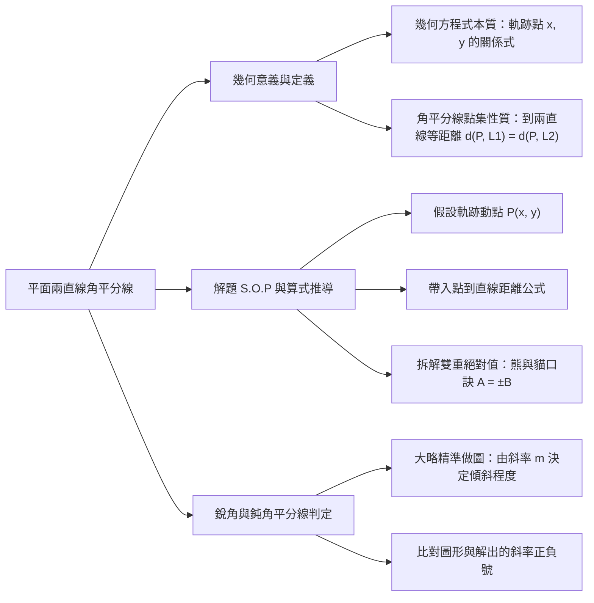
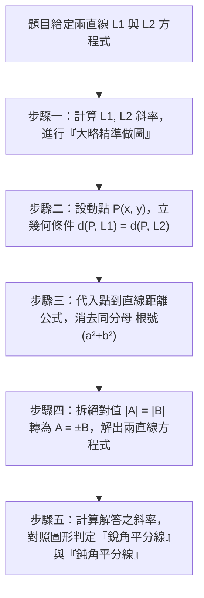

## 📖 課堂主題與核心摘要 (Class Overview)
本堂課為高中數學經典重點單元——**「平面上兩直線的角平分線方程式」**。老師強調「幾何方程式」的本質並非單純的公式代入，而是圖形上任意動點 \\(P(x, y)\\) 必須滿足的幾何關係式。本課的核心學習目標為：掌握角平分線上「點到兩邊等距離」的幾何特徵，熟練雙重絕對值的拆解技巧，並結合「大略精準做圖」觀念，透過直線斜率正確判定並區分「銳角平分線」與「鈍角平分線」。

【🌳 本課大綱樹狀心智導圖 (Mindmap)】：

---

## 💡 核心知識點與觀念詳解 (Key Concepts)

### 知識點一：幾何方程式的本質與角平分線幾何條件
1. **幾何方程式的真諦**：方程式並非圖形的「名字」，而是該圖形上無窮多個點 \\((x, y)\\) 都必須共同滿足的**座標關係式**。
2. **角平分線的軌跡定義**：平面上任意一點 \\(P(x, y)\\) 若落在兩直線 \\(L_1\\) 與 \\(L_2\\) 的角平分線上，其充要條件為**點 \\(P\\) 到兩直線的垂直距離相等**：
   \\[ d(P, L_1) = d(P, L_2) \\]

---

### 知識點二：課堂經典例題完整步驟拆解

**【課堂經典例題】**
已知平面上兩直線方程式為：
\\[ L_1: 2x + 3y - 1 = 0 \\]
\\[ L_2: 3x + 2y + 3 = 0 \\]
求 \\(L_1\\) 與 \\(L_2\\) 的角平分線方程式，並明確指出何者為**銳角平分線**、何者為**鈍角平分線**。

#### 拆解步驟一：大略精準做圖（判斷直線斜率與傾斜程度）
* 計算 \\(L_1\\) 的斜率：\\(m_1 = -\frac{a}{b} = -\frac{2}{3}\\)（負斜率，圖形較平緩）。
* 計算 \\(L_2\\) 的斜率：\\(m_2 = -\frac{a}{b} = -\frac{3}{2}\\)（負斜率，圖形較陡峭）。
* 在草稿頁畫出兩條負斜率直線，標註 \\(L_1\\) 與 \\(L_2\\)，並畫出平分兩直線夾角的兩條角平分線。由圖觀察可知：
  * **黃色線**平分較小的夾角 \\(\rightarrow\\) **銳角平分線**（圖形為負斜率）。
  * **紅色線**平分較大的夾角 \\(\rightarrow\\) **鈍角平分線**（圖形為正斜率）。

#### 拆解步驟二：設立動點並列出幾何距離等式
設動點 \\(P(x, y)\\) 為角平分線上任意一點，依距離公式列式：
\\[ \frac{|2x + 3y - 1|}{\sqrt{2^2 + 3^2}} = \frac{|3x + 2y + 3|}{\sqrt{3^2 + 2^2}} \\]

#### 拆解步驟三：化簡與拆解雙重絕對值
兩邊分母均為 \\(\sqrt{13}\\)，直接同乘消去，得到：
\\[ |2x + 3y - 1| = |3x + 2y + 3| \\]

利用**雙重絕對值拆解規則**（\\(|A| = |B| \iff A = \pm B\\)）：
1. **取正號（同號）**：
   \\[ 2x + 3y - 1 = +(3x + 2y + 3) \\]
   \\[ \implies x - y + 4 = 0 \\]
   * 計算此線斜率：\\(m = -\frac{1}{-1} = 1 > 0\\)（正斜率）。
   * **對照圖形結論**：此直線為 **鈍角平分線**。

2. **取負號（異號）**：
   \\[ 2x + 3y - 1 = -(3x + 2y + 3) \\]
   \\[ \implies 5x + 5y + 2 = 0 \\]
   * 計算此線斜率：\\(m = -\frac{5}{5} = -1 < 0\\)（負斜率）。
   * **對照圖形結論**：此直線為 **銳角平分線**。

---

### 【⏱️ 算式推導與解題 SOP 流程圖】

---

### 【📊 觀念與易混淆對比表：銳角平分線 vs. 鈍角平分線】

| 對比維度 | 銳角平分線 (Acute Angle Bisector) | 鈍角平分線 (Obtuse Angle Bisector) |
| :--- | :--- | :--- |
| **夾角定義** | 平分兩直線所夾交角中**小於 \\(90^\circ\\)** 的銳角區域 | 平分兩直線所夾交角中**大於 \\(90^\circ\\)** 的鈍角區域 |
| **幾何圖形特徵** | 穿過圖形中較狹窄的區域 | 穿過圖形中較寬闊的區域 |
| **本題例題斜率** | 解得 \\(5x + 5y + 2 = 0\\)，斜率 \\(m = -1\\)（負斜率） | 解得 \\(x - y + 4 = 0\\)，斜率 \\(m = 1\\)（正斜率） |
| **最終判定關鍵** | **必須仰賴「大略精準做圖」**，比對計算所得斜率與畫圖趨勢，無法單靠公式符號決定 | **必須仰賴「大略精準做圖」**，比對計算所得斜率與畫圖趨勢，無法單靠公式符號決定 |

---

## ⚠️ 老師強調考點與易錯陷阱 (Exam Focus & Pitfalls)

1. **⭐ 段考必考手寫題（重點叮嚀）**：
   * 本題型為**第二次段考極熱門的手寫非選擇題**。
   * **扣分地雷**：絕不能直接背結論或跳過推導！手寫題第一行**務必寫出幾何定義 \\(d(P, L_1) = d(P, L_2)\\)**，否則會被閱卷老師扣觀念分數。

2. **常見計算與觀念陷阱**：
   * **漏寫正負號**：拆絕對值時忘記有「正負兩種情況」（同號與異號），導致少解出一條角平分線（角平分線必有互相垂直的兩條）。
   * **無法區分銳鈍角**：算出兩條直線方程式後，未計算其斜率並繪製草圖，導致無法回答題目要求的「何者為銳角平分線 / 鈍角平分線」。
   * **正負號展開錯誤**：在展開 \\(-(3x + 2y + 3)\\) 時，容易漏掉變號（例如誤寫成 \\(-3x + 2y + 3\\)）。

---

## 🔑 記憶口訣與解題技巧 (Mnemonics & Shortcuts)

1. **【熊與貓絕對值拆解口訣】**：
   * 課堂比喻：當「一隻熊」與「一隻貓」取絕對值後相等時（即 \\(|\text{熊}| = |\text{貓}|\\)），解開絕對值的方法就是：**左邊拆開，右邊加上正負號**（\\(\text{熊} = \pm \text{貓}\\)）。
2. **【解題 SOP 三步破題法】**：
   * **一設**：設動點 \\(P(x, y)\\)。
   * **二列**：列出 \\(d(P, L_1) = d(P, L_2)\\) 並拆絕對值。
   * **三比**：算斜率，畫草圖，比對銳鈍角。

---

## 📝 課後作業與待辦事項 (Homework & Tasks)

* **課堂即時完成**：老師已於課堂上要求全班「蓋上講義與筆記」，當場完整手寫演練一遍經典例題推導。
* **課後待辦事項**：無特定指派課外作業，請務必於考前重新複習本題手寫推導流程與「大略精準做圖」之判斷細節。

---

## 📚 專有名詞與重要公式/定義 (Glossary & Formulas)

* **點到直線距離公式 (Point-to-Line Distance Formula)**：
  設點 \\(P(x_0, y_0)\\)，直線 \\(L: ax + by + c = 0\\)，則點 \\(P\\) 到直線 \\(L\\) 的垂直距離為：
  \\[ d(P, L) = \frac{|ax_0 + by_0 + c|}{\sqrt{a^2 + b^2}} \\]

* **角平分線軌跡定義 (Geometric Condition of Angle Bisector)**：
  角平分線上任意點 \\(P(x, y)\\) 至兩邊直線 \\(L_1, L_2\\) 等距離：
  \\[ d(P, L_1) = d(P, L_2) \\]

* **直線斜率一般式 (Slope of General Form)**：
  對於直線 \\(ax + by + c = 0\\)，其斜率 \\(m\\) 為：
  \\[ m = -\frac{a}{b} \\]

---

## 🧠 課後自測題 (Quick Review Quiz)

### 題一：觀念判斷題
**題目**：若兩直線相交於一點，其角平分線共有幾條？這兩條角平分線之間有何位置關係？
* **答案與解析**：共有 **\\(2\\) 條**（分別為銳角平分線與鈍角平分線）。這兩條角平分線必定**互相垂直**（其斜率相乘 \\(m_1 \times m_2 = -1\\)，例如本題中 \\(1 \times (-1) = -1\\)）。

### 題二：計算手寫實戰題
**題目**：已知兩直線 \\(L_1: x + 2y - 3 = 0\\) 與 \\(L_2: 2x + y + 1 = 0\\)，請求出兩直線的角平分線方程式。
* **答案與簡要思維**：
  1. 設動點 \\(P(x, y)\\)，依距離公式：
     \\[ \frac{|x + 2y - 3|}{\sqrt{1^2 + 2^2}} = \frac{|2x + y + 1|}{\sqrt{2^2 + 1^2}} \\]
  2. 消去同分母 \\(\sqrt{5}\\)，得 \\(|x + 2y - 3| = |2x + y + 1|\\)。
  3. 拆絕對值 \\(x + 2y - 3 = \pm(2x + y + 1)\\)：
     * 取正號：\\(x + 2y - 3 = 2x + y + 1 \implies x - y + 4 = 0\\)
     * 取負號：\\(x + 2y - 3 = -2x - y - 1 \implies 3x + 3y - 2 = 0\\)
  * **解答**：\\(x - y + 4 = 0\\) 或 \\(3x + 3y - 2 = 0\\)。

---

💡 **學習小建議**：這套推導邏輯在未來高二上「空間中兩平面的角平分面」以及高二下「空間中直線角平分線」會再次出現，如同老師所說的「數學旗桿」，只要觀念徹底打通，高二學習將能事半功倍！