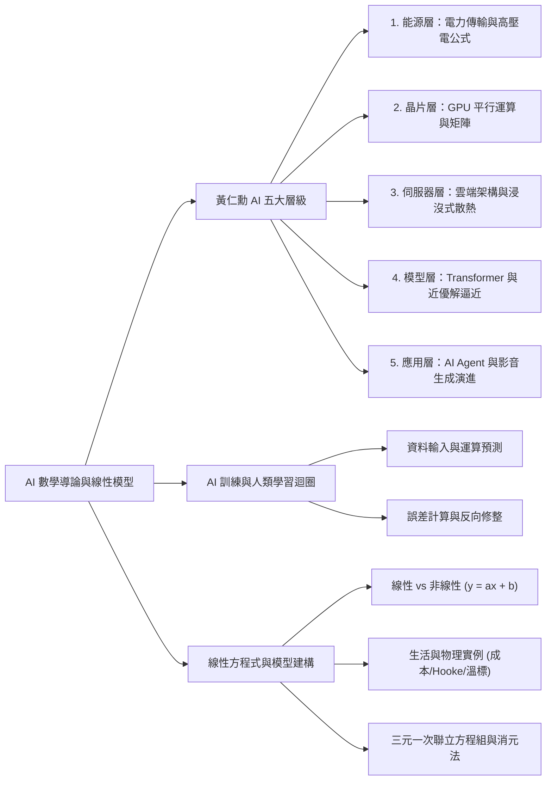
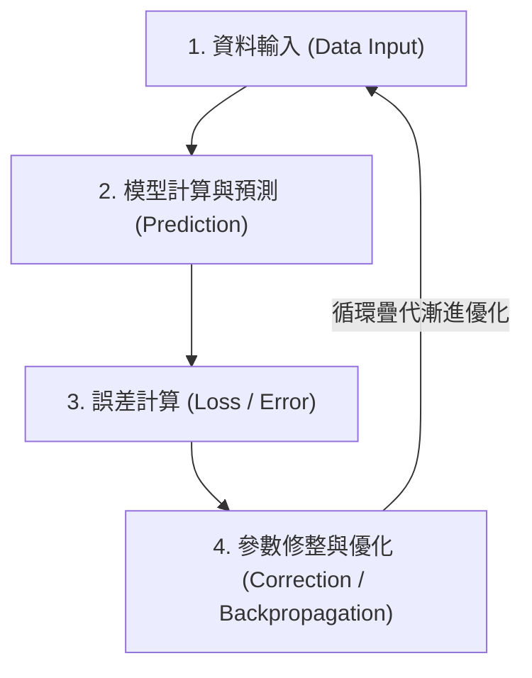

## 📖 課堂主題與核心摘要 (Class Overview)
本堂課為高中 AI 專班選修課程的第一週開學導論，核心旨在帶領學生建立「AI 與數學」之間的實質聯結與學習動機。課程前半段引述黃仁勳提出的「AI 五大層級架構」（能源、晶片、伺服器、模型、應用），解析各層級運作背後所需的數學工具，如微分方程、矩陣平行運算、統計逼近與編碼理論。後半段則從「AI 訓練與人類學習的誤差修正迴圈」切入，導出最基礎且關鍵的數學工具——「線性方程式與多元一次聯立方程組」。老師特別強調，理解數學背後的「動機與物理/生活意義」遠比盲目進行繁複計算更為重要。

## 💡 核心知識點與觀念詳解 (Key Concepts)

### 一、 黃仁勳 AI 五大層級與對應數學架構
老師引述黃仁勳對 AI 產業架構的劃分，說明各層級運作細節及背後不可或缺的數學知識：

1. **能源與電力層 (Energy & Power)**
   * **核心觀念**：AI 算力的實體極限在於電力供應與散熱。電廠建置（如核電廠需要大量水資源輔助冷卻，故多建於海岸或大河旁）、變電站位置規劃與電網佈局。
   * **物理與數學連結**：傳輸過程中的電能熱耗損公式為 \\(P_{\text{loss}} = I^2 R\\)。根據功率公式 \\(P = V I\\)，若要輸送相同功率 \\(P\\)，提高電壓 \\(V\\) 可使電流 \\(I\\) 等比例下降（\\(I = \frac{P}{V}\\)），進而使線路熱損耗 \\(P_{\text{loss}} \propto I^2\\) 呈現平方級下降。這正是設置高壓電網的物理原委。
   * **對應數學工具**：微分方程、三角函數、傅立葉分析 (Fourier Analysis)。

2. **晶片與硬體層 (Chip & Hardware)**
   * **核心觀念**：包含晶片設計（如 NVIDIA、AMD、聯發科、高通、Apple）與晶片製造（如台積電、Intel、三星）。晶片體積越小，發熱與耗電越低，性能越高。
   * **GPU 平行運算原理**：傳統計算如順序執行 \\(100\\) 個乘法再相加，CPU 需按部就班算完；NVIDIA GPU 則將 \\(100\\) 個乘法同時分發給 \\(100\\) 個獨立運算單元（平行處理），最後再彙整相加，大幅突破運算瓶頸。
   * **對應數學工具**：線性代數（矩陣運算 \\(A \times B\\)）、最佳化 (Optimization)、數值分析、抽象代數、編碼理論 (Coding Theory，如 Netflix 串流影片除錯與變動畫面壓縮技術)。

3. **伺服器與網路基礎設施層 (Server & Infrastructure)**
   * **核心觀念**：三大雲端巨頭（AWS、Microsoft Azure、Google Cloud）建置規模龐大的伺服器機房。
   * **散熱技術演進**：機房發熱量極高，傳統冷氣空調漸不敷使用，現代頂級伺服器採用「浸沒式液冷技術 (Liquid Immersion Cooling)」，將伺服器直接浸泡於不導電的特殊化學液體中。
   * **對應數學工具**：圖論 (Graph Theory)、流體力學與熱傳學數學模擬。

4. **模型層 (Model & LLM)**
   * **核心觀念**：以 Google 於 2017 年發表的 Transformer 演算法架構為起點，引爆當前大語言模型革命。目前全球具備原生大模型開發能力者主要為美國與中國。
   * **數學突破**：傳統數學窮舉法尋找「絕對最佳解」會遭遇指數級成長困境；現代 AI 模型改採機率與統計方法，在極短時間內尋找「目標值附近的近優解 (Approximation)」，這是算力得以實用化的核心關鍵。
   * **對應數學工具**：機率與統計、適應性學習與最佳化、微積分。

5. **應用層 (Application & AI Agent)**
   * **核心觀念**：包含生成式繪圖、影音創作（從 2016 年畫質扭曲演進至 2026 年極度逼真）、程式碼自動撰寫與 AI Agent（智能體，可自動串接雲端硬碟、生成考題、分類儲存）。

---

### 二、 AI 模型訓練與人類學習的「誤差修正迴圈」
老師對比了 AI 模型的訓練機制與人類學習過程，兩者具備高度一致的疊代架構：

* **核心哲學**：學習與訓練的核心不在於一次就得到滿分，而在於「計算誤差」並據此「進行修整」。考不好或計算出錯並不是失敗，而是提供客觀數據指導下一步如何優化參數。

---

### 三、 線性方程式與現實模型建構

1. **線性 (Linear) 與非線性 (Non-linear) 的本質差別**
   * 人類最擅長處理的是「線性問題」（形如 \\(y = ax + b\\)），因為其具備可預測性與疊加性。
   * 現實世界與科學前沿大多為「非線性問題」（如量子力學中的薛丁格方程式），人類通常使用「線性模型去逼近非線性真實情況」。

2. **課堂經典生活例題：飲料店成本模型**
   * **單變量線性模型**：
     設開店基本固定成本（杯子、水電、基本耗材）為 \\(100\\) 元，每賣出一杯飲料增加材料成本 \\(15\\) 元。
     總成本方程可寫為：
     \\[ y = 15x + 100 \\]
     其中 \\(x\\) 為飲料杯數，\\(y\\) 為總成本。若賣出 \\(10\\) 杯、 \\(20\\) 杯、 \\(30\\) 杯，可快速代入預測成本。
   * **多變量線性模型（延伸至三元）**：
     設紅茶杯數為 \\(x\\)、奶茶杯數為 \\(z\\)，固定成本為 \\(w\\)，每杯紅茶成本為 \\(u\\)、每杯奶茶成本為 \\(v\\)，總成本為 \\(y\\)：
     \\[ u \cdot x + v \cdot z + w = y \\]
     若給定多組觀察數據，即可建立聯立方程組求解未知參數。

---

### 四、 三元一次聯立方程組與消元法流程

課堂示範求解下列三元一次聯立方程組：
\\[ \begin{cases} x + y + z = 9 & \text{--- (1)} \\ 2x + 3y + z = 7 & \text{--- (2)} \\ x + 2y + 3z = 2 & \text{--- (3)} \end{cases} \\]

**解題步驟拆解（消元法 SOP）**：
1. **目標降階**：將「三元方程組」透過消去一個未知數，化簡為熟悉的「二元方程組」。
2. **消去未知數 \\(z\\)**：
   * 利用 \\((2) - (1)\\)：
     \\[ (2x + 3y + z) - (x + y + z) = 7 - 9 \implies x + 2y = -2 \quad \text{--- (4)} \\]
   * 利用 \\(3 \times (1) - (3)\\)：
     \\[ 3(x + y + z) - (x + 2y + 3z) = 3(9) - 2 \implies 2x + y = 25 \quad \text{--- (5)} \\]
3. **求解二元方程組**：聯立解方程 \\((4)\\) 與 \\((5)\\) 求出 \\(x\\) 與 \\(y\\)，再代回 \\((1)\\) 求出 \\(z\\)（此為下週高二矩陣與高斯消去法的前導觀念）。

---

### 五、 觀念與易混淆對比表

📊 **運算架構與模型邏輯對比表**

| 對比維度 | 傳統 CPU 運算 | NVIDIA GPU 平行運算 | AI 統計逼近模型 (Transformer) |
| :--- | :--- | :--- | :--- |
| **運算模式** | 串行運算（按順序單線程執行） | 平行運算（千百核心同時處理） | 機率與統計近優解逼近 |
| **數學核心** | 基礎算術 / 標量運算 | 矩陣與向量乘法 (\\(A \times B\\)) | 幾何逼近、損失函數極小化 |
| **目標解答** | 追求精確絕對解 | 大規模矩陣快速運算 | 尋找目標值附近的「近優解」 |
| **典型應用** | 一般文書、系統邏輯控制 | 圖形渲染、AI 深度學習訓練 | 大語言模型 (LLM)、AI Agent |

📊 **訊號類型對比表**

| 對比維度 | 類比訊號 (Analog) | 數位訊號 (Digital) |
| :--- | :--- | :--- |
| **數據特性** | 連續變化（如真實世界溫度、聲波） | 離散整數（如 0 與 1、顯示 21°C / 22°C） |
| **現實對應** | 自然界真實物理量 | 晶片與電腦處理數據 |

---

## ⚠️ 老師強調考點與易錯陷阱 (Exam Focus & Pitfalls)

* **必考與核心重點**：
  * **學習動機與物理意義 > 盲目計算**：老師特別叮嚀，高中階段能學到的數學只是 AI 的冰山一角，重點是理解「為什麼要發明這個數學工具（動機）」與「物理/生活意義」。
  * **高壓輸電減損公式**：務必熟記 \\(P_{\text{loss}} = I^2 R\\) 與 \\(P = VI\\)。高壓電傳輸的核心理由在於提升電壓 \\(V\\) 以降低電流 \\(I\\)，進而使熱損耗 \\(P_{\text{loss}}\\) 呈平方級大幅下降。
  * **平行運算本質**：GPU 強大之處在於將複雜運算拆解為矩陣拆分，交給無數處理單元同步運算再相加。
* **常見易錯與陷阱**：
  * **追求精確最佳解的迷思**：學生常以為數學與 AI 必須算出 100% 精確的絕對值，但大語言模型（如 Transformer）的核心是「統計與機率逼近」，在可接受時間內找尋「近優解」才是 AI 突破的關鍵。
  * **把誤差當成失敗**：在 AI 訓練與課堂學習中，計算出的 Loss (誤差) 是用來「修正參數」的客觀數據，切勿因一次測試或誤差而沮喪。

---

## 🔑 記憶口訣與解題技巧 (Mnemonics & Shortcuts)

* **高壓輸電減損口訣**：「壓高流低損極小」——升高電壓 \\(\rightarrow\\) 降低電流 \\(\rightarrow\\) 熱損耗呈平方級下降。
* **三元一次方程解題 SOP 技巧**：
  1. **一降階**：選定一個最容易消去的未知數（優先挑選係數為 1 或 \\(-1\\) 者，如 \\(z\\)）。
  2. **二聯立**：利用兩對方程互相加減，消去該未知數，化簡為二元一次方程組。
  3. **三代回**：解出兩個未知數後，代回最簡原式求出第三個未知數。

---

## 📝 課後作業與待辦事項 (Homework & Tasks)

* **課後作業**：無特定作業（本課程為無學分專班選修課，注重課堂專注度與觀念理解）。
* **待辦事項與建議**：
  * 下週課堂將發放更新版細緻講義，並正式進入「高二矩陣運算與高斯消去法」。
  * 建議課後預習國中與高一基礎方程解法及 Python 基礎語法（課堂範例將優先採用 Python 進行程式演示）。

---

## 📚 專有名詞與重要公式/定義 (Glossary & Formulas)

* **高壓輸電熱損耗公式**： \\(P_{\text{loss}} = I^2 R\\)，其中 \\(I\\) 為電流，\\(R\\) 為電線電阻。配合 \\(P = VI\\)，提升電壓 \\(V\\) 可降低電流 \\(I\\)，從而顯著減少傳輸過程中的電能熱耗損。
* **GPU 平行運算 (Parallel Computing)**：將大型計算作業（如大規模矩陣乘法）分割給數千個小型處理核心同時進行計算，最後再彙整結果，其運算速度遠高於傳統 CPU 的單線程串行處理。
* **Transformer 演算法架構**：Google 於 2017 年提出的深度學習模型架構，利用自注意力機制 (Self-Attention) 處理序列數據，為現代大語言模型 (LLM) 與 Generative AI 的技術核心。
* **浸沒式液冷 (Immersion Cooling)**：將伺服器主機直接浸泡於不導電的特殊化學冷卻液中進行散熱，為高密度 AI 資料中心解決巨大熱能的主要冷卻技術。
* **線性模型 (Linear Model)**：形如 \\(y = ax + b\\) 或 \\(ax + by + cz = d\\) 的數學方程，具備成比例與可相加的疊加性質，是人類預測現實數據與進行迴歸分析最基礎且重要的模型。

---

## 🧠 課後自測題 (Quick Review Quiz)

**第一題（物理與數學應用）**
* **題目**：為何台電在長距離輸送電能時，需要將電壓提升至數十萬伏特（高壓電）？請用功率公式 \\(P = VI\\) 與熱功率公式 \\(P_{\text{loss}} = I^2 R\\) 簡要說明。
* **解題思維與答案**：輸送功率 \\(P\\) 固定時，提升電壓 \\(V\\) 可使電流 \\(I = \frac{P}{V}\\) 大幅下降。根據 \\(P_{\text{loss}} = I^2 R\\)，電流 \\(I\\) 減半則熱損耗降為原來的 \\(\frac{1}{4}\\)；電壓提升百倍則電流降為萬分之一，可極大地減少電能傳輸過程中的無謂浪費。

**第二題（方程組與消元法）**
* **題目**：請利用課堂講授的消元法 SOP，求解下列三元一次聯立方程組：
  \\[ \begin{cases} x + y + z = 6 & \text{--- (1)} \\ 2x + y - z = 1 & \text{--- (2)} \\ x - y + z = 2 & \text{--- (3)} \end{cases} \\]
* **解題思維與答案**：
  1. 觀察 \\((1)\\) 與 \\((3)\\)，兩式相加可直接消去 \\(y\\)：
     \\[ (x+y+z) + (x-y+z) = 6 + 2 \implies 2x + 2z = 8 \implies x + z = 4 \quad \text{--- (4)} \\]
  2. 觀察 \\((2)\\) 與 \\((3)\\)，兩式相加亦可直接消去 \\(y\\)：
     \\[ (2x+y-z) + (x-y+z) = 1 + 2 \implies 3x = 3 \implies x = 1 \\]
  3. 將 \\(x = 1\\) 代入 \\((4)\\) 得 \\(1 + z = 4 \implies z = 3\\)。
  4. 將 \\(x = 1, z = 3\\) 代入 \\((1)\\) 得 \\(1 + y + 3 = 6 \implies y = 2\\)。
  5. 故聯立方程組之解為 \\((x, y, z) = (1, 2, 3)\\)。