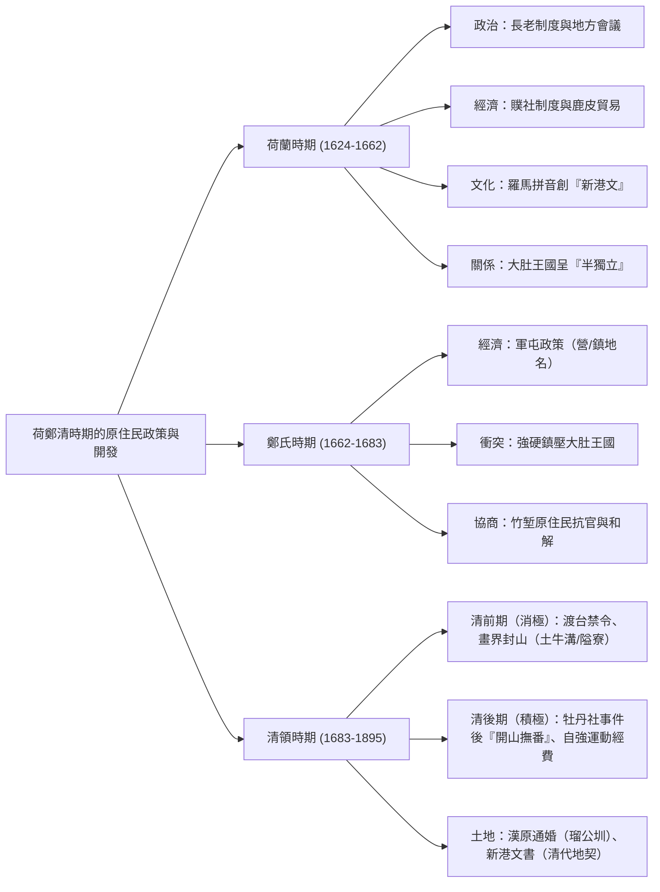
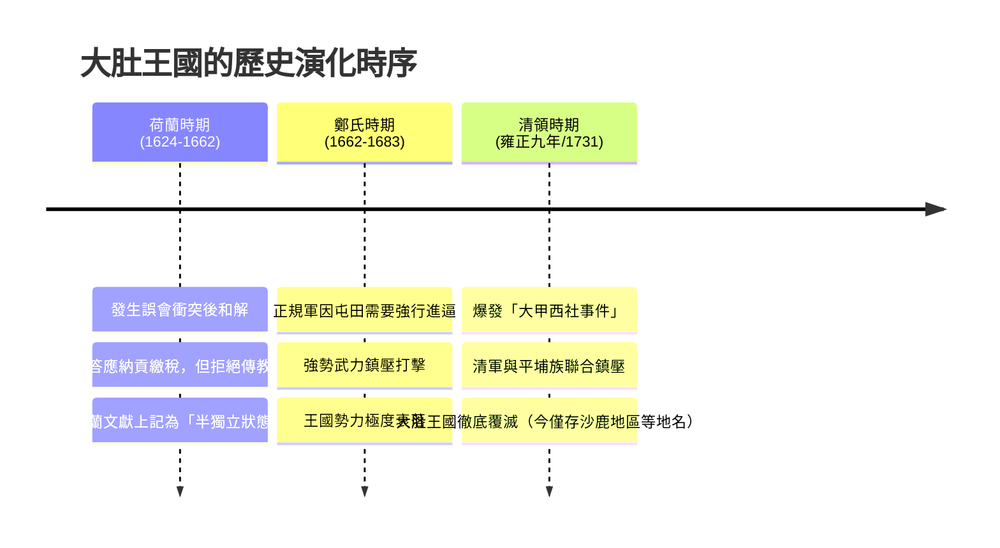

## 📖 課堂主題與核心摘要 (Class Overview)
本堂課深入探討台灣歷史上荷蘭東印度公司、鄭氏政權以及清領時期（前期與後期）對原住民的統治政策與土地開發演變。課堂重點剖析少數外來政權如何透過「以當地的少數人統治多數人」的殖民技巧（如地方會議與長老制度）、經濟承包（贌社制度）、文字拼音（新港文）及軍屯鎮壓來建立統治權力。此外，更詳細梳理了中部大肚王國在三朝演變下的興衰脈絡，以及清領時期從消極「畫界封山」轉為積極「開山撫番」的歷史背景與具體措施，協助學生釐清考題關鍵字與常見易錯陷阱。

## 💡 核心知識點與觀念詳解 (Key Concepts)

### 一、 荷蘭東印度公司的統治政策與原住民關係
1. **武力征服與平定南部**：
   - 荷蘭人以台南赤崁為基地（稱台灣為大員），擊敗麻豆社（西拉雅族）後確實控制南部部落，要求原住民服從、繳稅與負擔服勞役。
   - **北上擊退西班牙與東部探金（1642年）**：荷蘭人欲往東部採金，因中央山脈無路可通而沿西海岸北上。在淡水擊毀西班牙建之「聖多明哥城」（後於廢墟重建為淡水紅毛城）。當時西班牙軍隊因馬尼拉伊斯蘭教徒叛亂被調回，且日本實施天主教鎖國，西班牙已近乎放棄北部。荷蘭人後續東部探金未果（金礦實位於北部金瓜石，清代才被發現）。
2. **政治殖民技巧：長老制度與地方會議**：
   - **少數統治多數策略**：荷蘭東印度公司在台人員極少（最多僅約300人），無法直接管理各社。因此挑選部落頭目稱為「**長老**」，賦予其部落內部之行政權與司法權（刑事案件由長老審判，荷蘭人不干涉）。
   - **地方會議**：每年定期召集長老開會，宣達政令、根據考核進行賞罰。老師強調此為典型殖民技巧（如西班牙殖民美洲、日軍在中國成立汪精衛偽政權等，皆是用當地少數人統治大多數人）。
3. **經濟貿易：贌社制度與鹿產貿易**：
   - **贌社制度（承包制）**：荷蘭人不親自與原住民交易，將各部落交易權公開標售（發贌），由漢人商人承包。
   - **交易內容**：漢人拿鹽、鐵器及生活必需品向原住民交換獵捕的整隻鹿（鹿產貿易）。
   - **資源分配與去向**：鹿肉、鹿角中藥材歸漢人賣出；但**鹿皮必須全數繳交給荷蘭人**。荷蘭人再轉賣給日本，作為日本武士盔甲的柔和內襯。
4. **文化推廣：新港文與新港文書**：
   - **新港文**：荷蘭傳教士於新港社建立教堂與學校，利用「羅馬拼音」拼寫西拉雅族母語來翻譯聖經、傳播基督教。
   - **新港文書（雙語地契）**：清代漢人大量來台後向原住民租買土地，原住民為確保權益，要求在契據上同時列出漢文與新港文做對照。新港文書是**清代**產生的地契，保存了西拉雅語文，也是今日西拉雅族爭取復名與官方認定的重要歷史依據。
5. **荷蘭與大肚王國的互動**：
   - 大肚王國為跨部落的共主盟主。荷蘭人南北往來時曾與其發生武力誤會衝突。
   - 雙方和解後，大肚王答應「納貢/繳稅」（視為交朋友禮物），但**堅決拒絕傳教**。因此在荷蘭文獻中記錄大肚王國維持「**半獨立狀態**」。

### 二、 鄭氏政權的開發政策與原住民衝突
1. **軍屯政策（解決糧食危機）**：
   - 鄭成功率領約3萬軍民來台，首要任務為解決軍糧，實施「軍屯」制度，由軍隊派駐各地開墾。
   - **地名痕跡**：今日台灣許多帶有「營」、「鎮」字樣的地名，均為鄭氏屯田遺跡（如：新營、左營、下營、林鳳營、大里杄/鎮等）。
2. **對原住民的態度與大肚王國的衰落**：
   - 鄭軍為常備正規軍且有強烈生存需求，遭遇大肚王國阻撓時採取強硬消滅態度，導致大肚王國勢力大傷、急劇衰落。
3. **竹堑（新竹）原住民抗官與談判和解**：
   - 鄭氏軍隊向北開墾至竹堑時，引發原住民強烈反抗並殺死鄭軍將領。原住民因害怕報復而集體逃離清空該地。
   - 鄭成功恪守「不可強奪原住民土地」之訓令，親自派人談判協商，承諾不追究殺將之罪，最終促成原住民重返竹堑。

### 三、 清領時期的原住民政策演變
1. **清領前期（消極治理：1683-1874）**：
   - **政策核心**：將台灣視為邊疆海防防線，避免台灣成為亂源，採取消極隔離政策（如渡台禁令、畫界封山、禁鐵禁竹）。老師特別補充：劃界隔離並非台灣首創，清朝在廣西對付壯族時亦曾使用類似界線。
   - **畫界封山與防禦措施**：
     - **土牛溝**：沿山麓挖掘深約1至1.5層樓的溝渠，將挖出的土堆於溝旁形成似伏牛形狀的「土牛」，作為漢原邊界。
     - **界碑**：地質堅硬無法挖溝處（如岩石、河床），立石碑告示禁止跨越。
     - **隘口與隘寮**：於山口設置隘口檢查站，雇用「熟番」守衛隘寮（實施「以番制番」）。
   - **漢人取得土地的途徑**：
     - **武力搶奪/租借**：漢人開墾天性強烈（老師比喻：NASA要開墾火星派幾個漢人去就全種出來了），無視禁令跨界開墾。
     - **番漢通婚與土地獲取**：如郭留（瑠公）父子為了開鑿水圳與取得開墾地，父親娶泰雅族姐姐、兒子娶妹妹，成功獲取土地並開鑿「瑠公圳」。
2. **清領後期（積極治理：1874-1895）**：
   - **轉折事件**：1874年「牡丹社事件」，日本以琉球漂民被殺為由出兵台灣，並主張「番地無主論」。清廷驚覺台灣國防地位重要，轉為積極開發。
   - **開山撫番與廢除禁令**：沈葆楨等人來台，廢除渡台禁令與劃界封山，推動「開山撫番」，打通前後山道路，鼓勵漢人進入東部。
   - **經費來源（洋務運動/自強運動專款）**：1860-1870年代沈葆楨、丁日昌、劉銘傳在台推動的現代化建設（鐵路、電報、郵政等），資金均來自中國大陸「自強運動」的專款預算。

---

【⏱️ 大肚王國演變時序時間軸】：

---

【📊 荷、鄭、清三朝原住民政策與開發比較表】：

| 比較項目 | 荷蘭時期 | 鄭氏時期 | 清領前期 | 清領後期 |
| :--- | :--- | :--- | :--- | :--- |
| **治理態度** | 商業利益導向、少數殖民 | 生存導向、強硬軍屯 | 消極隔離、防民甚於防寇 | 積極開發、開山撫番 |
| **土地政策** | 劃定社域、贌社貿易 | 軍隊屯田（營/鎮地名） | 畫界封山、土牛溝隔離 | 廢除禁令、跨界開墾東部 |
| **原住民關係** | 設立長老、舉辦地方會議 | 武力鎮壓大肚王國、竹堑談判 | 「以番制番」（熟番守隘） | 開山撫番、撫綏納入編戶 |
| **核心關鍵字** | 長官、長老、贌社、新港文 | 軍屯、大里杄、新營/左營 | 土牛溝、隘寮、新港文書 | 牡丹社事件、沈葆楨、自強運動 |

## ⚠️ 老師強調考點與易錯陷阱 (Exam Focus & Pitfalls)

1. **★【題型速解關鍵字】長官、長老與地方會議**：
   - 題目敘述中只要出現「**長官**」（荷蘭駐台首長）或「**長老**」（荷蘭任命之原住民頭目）以及「**地方會議**」，**100% 為荷蘭時期**！不需要讀完整篇文章即可秒殺選答案。

2. **★【易錯陷阱】「新港文」與「新港文書」的年代歸屬**：
   - **新港文**：荷蘭傳教士創立（羅馬拼音拼寫西拉雅語，清代稱為紅毛字）。
   - **新港文書**：**清代**漢人與原住民簽訂的「雙語地契」（漢文與新港文對照）。看到「新港文書」切勿直覺選荷蘭時期，它是**清代**的契約文書！

3. **★【考點剖析】大肚王國的覆滅時間**：
   - 荷蘭時期：半獨立狀態（繳稅但不接受傳教）。
   - 鄭氏時期：軍屯衝突，嚴重衰落。
   - **真正消滅時間**：清領時期（**雍正九年大甲西社事件**才徹底被消滅）。

4. **★【歷史貫通考點】清後期台灣建設經費來源**：
   - 沈葆楨、丁日昌、劉銘傳在台灣推動的各項物力現代化建設，其經費均來自中國大陸的「**自強運動（洋務運動）**」專款預算。

## 🔑 記憶口訣與解題技巧 (Mnemonics & Shortcuts)

- **關鍵字秒殺法**：
  - 看見「長官 / 長老 / 地方會議 / 贌社 / 鹿皮出口」➔ 秒選 **荷蘭時期**。
  - 看見地名包含「營 / 鎮」（如左營、新營、柳營、林鳳營）➔ 秒選 **鄭氏軍屯遺跡**。
  - 看見「土牛溝 / 隘寮 / 熟番守隘 / 雙語地契（新港文書）」➔ 秒選 **清領前期**。
  - 看見「牡丹社事件 / 開山撫番 / 自強運動經費 / 廢除渡台禁令」➔ 秒選 **清領後期**。

- **解題邏輯小結**：
  - 荷蘭人要的是「**鹿皮與貿易利益**」（派漢人贌社、拿鹿皮賣日本）。
  - 鄭成功要的是「**軍糧與土地**」（派軍屯田、鎮壓大肚王）。
  - 清前期要的是「**社會穩定不造反**」（封山隔離、土牛防禦）。
  - 清後期要的是「**防止列強佔領台灣**」（開山撫番、全島開發）。

## 📝 課後作業與待辦事項 (Homework & Tasks)

- **課堂作業**：無特定作業（請著重複習本堂課之對比表格與關鍵字判斷）。
- **下次小考預告**：請預習清領時期台灣的經濟轉型（三大開港通商與茶、糖、樟腦出口貿易）。

---

## 📚 專有名詞與重要公式/定義 (Glossary & Formulas)

* [大肚王國]: 台灣中部平埔族（以拍瀑拉族沙轆社為核心）所建立的跨部落共主盟主政權，歷經荷蘭半獨立、鄭氏衰落，最終於清雍正年間大甲西社事件後覆滅。
* [贌社制度]: 荷蘭東印度公司將原住民部落的商品交易權包標（發贌）給漢人商人的承包制度。
* [新港文]: 荷蘭傳教士利用羅馬拼音為台南西拉雅族新港社語言所創立的拼音文字，清代稱為「紅毛字」。
* [新港文書]: 清代漢人與原住民土地交易時所簽署的雙語契約（漢文與新港文對照地契），為研究平埔族語言歷史的重要史料。
* [土牛溝]: 清領前期為劃分漢原界線（畫界封山）所挖掘的深溝，將挖出的土堆於溝旁形似伏牛，故稱土牛溝。
* [開山撫番]: 1874年牡丹社事件後，清廷派沈葆楨來台採取的積極政策，打通後山道路、廢除渡台禁令，並將原住民納入編戶管理。

## 🧠 課後自測題 (Quick Review Quiz)

1. **問：某份史料記載：「該部落願意每年向我方繳納禮物以維持友好，但堅決拒絕我方派駐傳教士進入其領地說明教義……」請問這段記載最可能描述哪一個政權與哪一個在地勢力的互動？**
   - *解題思維*：關鍵字為「願意繳納禮物（納貢/繳稅）」且「堅決拒絕傳教士」，符合荷蘭東印度公司對「大肚王國」呈「半獨立狀態」的歷史描述。答案為：荷蘭東印度公司與大肚王國。

2. **問：阿明在研究一份18世紀（清領時期）的台灣土地買賣契約時，發現左半段為漢文，右半段為羅馬拼音字母組成的文字。請問這份史料名稱為何？右半段文字最初是由誰所創立？**
   - *解題思維*：清代漢人與原住民簽訂的漢文與羅馬拼音對照地契稱為「新港文書」；右半段之羅馬拼音文字（新港文）最初是由17世紀荷蘭傳教士所創立。

3. **問：清領後期沈葆楨、劉銘傳等人在台灣興建電報線、鐵路等物力現代化建設，其主要資金來源與中國大陸當時的哪一場改革運動密切相關？**
   - *解題思維*：1860-1870年代清廷撥給台灣進行現代化建設與開山撫番的專款預算，均來自大陸推動的「自強運動（洋務運動）」。

---

💡 **溫馨提示**：如果需要將這份筆記生成為更便利複習的 **測驗題庫**、**單字/概念閃卡** 或 **簡報/心智圖檔案**，都可以隨時告訴我喔！