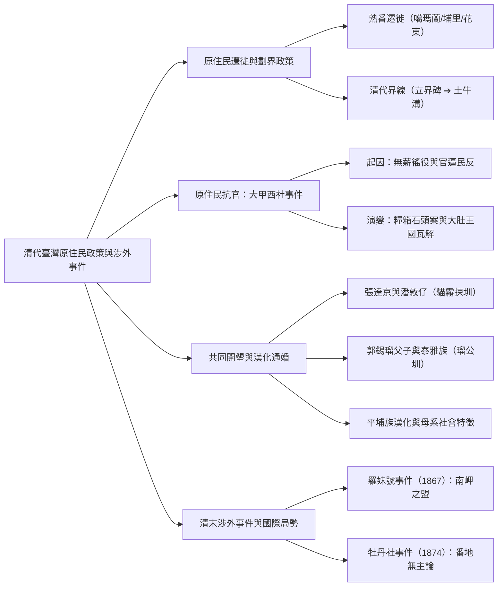
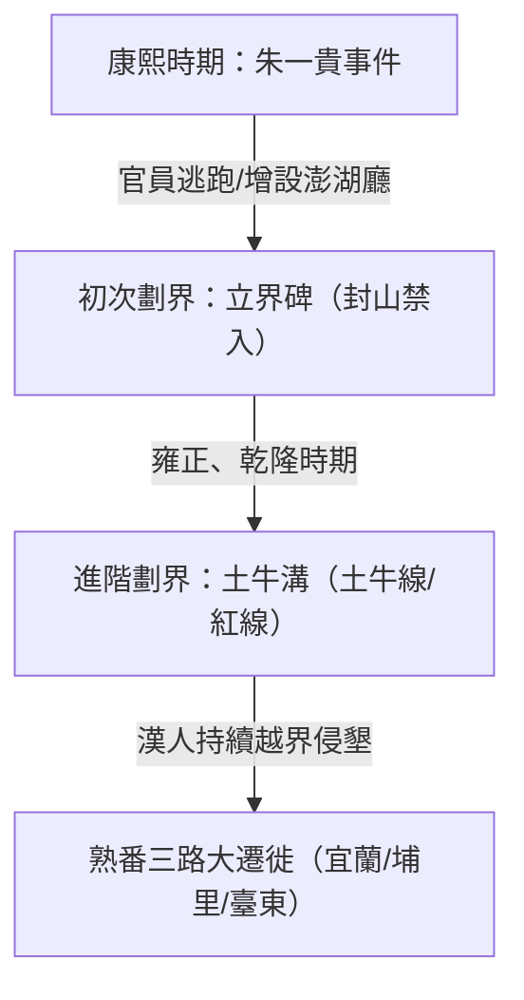
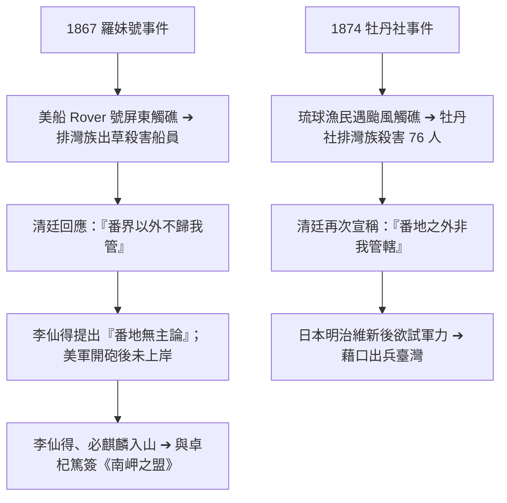

## 📖 課堂主題與核心摘要 (Class Overview)
本堂課深入探討清代臺灣原住民政策的演變、漢人開墾對原住民生存空間的影響，以及清末兩大重要涉外事件。課程重點涵蓋平埔族與生番的遷徙脈絡、清廷劃設番界（立界碑至土牛溝）的歷史背景、大甲西社事件與大肚王國的瓦解過程，以及漢原合作的「割地換水」水利開墾模式。最後剖析羅妹號事件與牡丹社事件，說明清廷「番界以外不歸我管」的態度如何引發「番地無主論」，進而影響近代臺灣國際政局。

---

## 💡 核心知識點與觀念詳解 (Key Concepts)

### 一、 原住民遷徙路線與清代番界變遷
1. **熟番遷徙與高山族的形成**：
   * 漢人越過番界侵墾熟番（平埔族）土地，迫使部分熟番遷移至界外。現今許多高山族（如阿美族）早期實際為平地平埔族，後被驅趕至界外才移居山地。
   * **三大遷徙方向**：
     * **北部**：遷至宜蘭，稱為**噶瑪蘭族**（屬熟番）。宜蘭當地的生番隨後被熟番噶瑪蘭族趕至花蓮。今日官方認證的噶瑪蘭族主要分佈於花蓮。
     * **中部**：迫於生存壓力遷入**埔里**盆地。
     * **南部**：一路向南遷往**臺東、屏東**一帶。

2. **清廷劃界政策演變**：
   * **康熙時期（立界碑）**：爆發**朱一貴事件**，臺灣官員逃跑，康熙皇帝大怒，隨後增設「澎湖廳」實施海禁，並採取「立石為界」政策，嚴禁漢人入山越界。
   * **雍正與乾隆時期（土牛溝）**：開始劃設「土牛溝」（地圖上以紅線標示，故又稱**土牛線**或**土牛紅線**），作為漢番分界的實體溝渠與土堆。

---

### 二、 清代原住民抗官事件：大甲西社事件
老師特別對比了三個不同時期的原住民抗官代表事件：**荷蘭時期（麻豆社事件）**、**清代（大甲西社事件）**、**日治時期（霧社事件）**。

1. **大甲西社事件（雍正九年，1731年）**：
   * **地理背景**：發生於臺中大甲一帶的大甲西社（平埔族熟番），屬於跨部落聯盟**大肚王國**轄下的部落。
   * **爆發主因（無薪徭役）**：清廷要求熟番承擔建縣衙、山區砍運木材等徭役。官員為趕進度強留熟番數週至月餘，且不付薪資。熟番荒廢農事導致無力繳稅，陷入「官逼民反」的惡性循環。
   * **導火線與第一階段**：官員姦淫番婦，熟番憤而放火燒毀官府與建築木材，打傷官員。清軍隨後派兵鎮壓並逮捕主謀。
   * **第二階段（假案陷害與大肚王國瓦解）**：
     * **地方官貪功造假**：地方官員欲藉平亂立功調回中央（北京），故設計召集熟番運送數百斤「裝滿石頭」的糧箱。過後打開陷害熟番偷糧，逼迫交糧否則砍頭。
     * **大肚王圍攻**：大肚王不忍族人受誣陷，率領 13 個部落聯合圍攻清軍。清軍以重兵鎮壓，大肚王國軍隊幾乎被全殲（兩千餘人僅存十餘人）。
     * **調查拆穿與結局**：雍正帝派員調查，調查官查閱糧倉帳本，發現全縣一年糧倉總收入僅 50 斤，不可能被偷上百斤，拆穿此假案。乾隆皇帝隨後命令將大甲西社殘餘遺族遷至縣府周邊就近監視，**大肚王國自此全面瓦解**。

---

### 三、 漢原共同開墾與「割地換水」水利發展
清代開墾需要龐大資金與水利設施，形成「墾號」經營，並透過與原住民通婚或合作取得土地與水資源。

1. **水利結構層級與名詞解析**：
   * **埤 / 塘（陂）**：大型蓄水池（如虎頭埤，規模極大可划船捕魚）。
   * **圳**：連結蓄水池的主幹水道。
   * **溝**：由圳分流出的中型分水溝。
   * **渠**：直接引水入田的小型水溝。

2. **經典割地換水案例比較**：
   * **中部：張達京與潘敦仔（貓霧捒圳）**：
     * 張達京為中部最大墾號「六館業戶」負責人（開墾範圍涵蓋台中市縣）。
     * 岸裡社（西拉雅族/巴宰族）頭目**潘敦仔**（後改漢名潘敦）擁有貓羅溪下游土地，但缺乏抽水技術；張達京提供資金技術開鑿**貓霧捒圳**，潘敦仔提供土地換取水資源。張達京更娶潘敦仔之女為妻（成為平埔族駙馬）。
   * **北部：郭錫瑠父子與泰雅族（瑠公圳）**：
     * 郭錫瑠開鑿**瑠公圳**引新店溪水至臺北盆地。因土地屬於泰雅族姊妹所有，郭錫瑠娶姊姊取得上游土地開圳；其子娶妹，父子二人娶姊妹花，順利取得整條瑠公圳的開發權。

3. **平埔族漢化與社會型態**：
   * **生活轉變**：平埔族逐漸漢化，飲食以米飯為主，農耕方式與漢人無異。
   * **母系社會特徵**：從歷史圖畫（如犁田、挑水者背上背有小孩）可觀察出平埔族保有傳統的**母系社會**特質。

---

### 四、 清代涉外事件：羅妹號事件與牡丹社事件
清廷對番界的「消極管轄」態度，直接引發了兩起改變臺灣命運的涉外事件。

1. **羅妹號事件（1867年）**：
   * **經過**：美國蒸汽船羅妹號（Rover）於屏東墾丁外海珊瑚礁觸礁，船員登陸後被排灣族視為入侵者出草殺害。生還者逃往廈門美領館。
   * **清廷態度**：美國駐廈門領事**李仙得（Charles W. Le Gendre）**向清廷抗議，清廷官員回應：「番界以外不歸我管」（化外之地）。
   * **番地無主論**：李仙得據此得出**「番地無主論」**，認為清廷不實施管轄即代表該土地無主。美軍海軍隨後開砲，但不敢進入叢林。
   * **《南岬之盟》**：李仙得在英國商人**必麒麟**陪同下進入屏東「十八番社」，與總頭目**卓杞篤**談判。雙方簽署《南岬之盟》，約定美英船隻若遇難，排灣族將給予救援而非殺害。
   * **觀念澄清**：《南岬之盟》僅為**私人救援協議**，不具備國際法效力，非國與國條約。

2. **牡丹社事件（1874年）**：
   * **經過**：羅妹號事件 7 年後，琉球漁民遇颱風飄至屏東，被牡丹社排灣族殺害 76 人。
   * **導火線**：生還者向清廷告官，清廷再次以「番地之外非我管轄」推卸責任。琉球轉向日本求助。
   * **日本出兵**：剛完成明治維新的日本急於測試軍力，遂以保護琉球藩民為由出兵臺灣牡丹社。

---

### 📊 觀念與易混淆對比表

| 對比項目 | 羅妹號事件 (1867) | 牡丹社事件 (1874) |
| :--- | :--- | :--- |
| **受害對象** | 美國蒸汽船 Rover 號船員 | 琉球遇難漁民 |
| **涉事原住民** | 屏東排灣族（十八番社） | 屏東排灣族（牡丹社） |
| **清廷回應** | 「番界以外不歸我管」 | 「番地之外非我管轄」 |
| **關鍵人物** | 李仙得、必麒麟、卓杞篤 | 日本政府（明治維新後） |
| **產生的結果** | 提出「番地無主論」、簽訂《南岬之盟》 | 日本以此為藉口首次對外出兵臺灣 |
| **協議性質** | 《南岬之盟》為**私人救援協議**（無法律效力） | 引發清日角力，影響後續續開山撫番 |

| 開墾水利項目 | 貓霧捒圳（中部） | 瑠公圳（北部） |
| :--- | :--- | :--- |
| **主導墾號/漢人** | 張達京（六館業戶） | 郭錫瑠（父子） |
| **合作原住民** | 岸裡社頭目潘敦仔（平埔族/熟番） | 太雅族（泰雅族/生番）婦女姊妹 |
| **水源與地區** | 引貓羅溪水，灌溉臺中地區 | 引新店溪水，灌溉臺北盆地 |
| **通婚模式** | 張達京娶潘敦仔之女（平埔族駙馬） | 郭錫瑠娶姊姊、其子娶妹妹 |

---

## ⚠️ 老師強調考點與易錯陷阱 (Exam Focus & Pitfalls)

1. **番地無主論的由來**：
   * **考點**：清廷面對羅妹號事件回答「番界以外不歸我管」，使美國領事李仙得提出「番地無主論」，這成為後來日本在牡丹社事件中出兵臺灣的重要藉口。
2. **《南岬之盟》的法律性質**：
   * **易錯陷阱**：選項若稱《南岬之盟》是「臺灣對外的第一個國際條約」或「具備法律效力的官方協定」皆為**錯誤**！它僅是李仙得與卓杞篤簽署的**私人救援協議**。
3. **清代劃界政策演變順序**：
   * **考點**：康熙時期因朱一貴事件實施「立界碑」；雍正、乾隆時期才開始繪製劃設「土牛溝」（土牛線/紅線）。
4. **大甲西社事件的本質**：
   * **考點**：屬於清代平埔族熟番的抗官事件，主因為官府無薪徭役過重與官逼民反，並非無端叛亂。事件最終導致跨部落的「大肚王國」徹底瓦解。

---

## 🔑 記憶口訣與解題技巧 (Mnemonics & Shortcuts)

1. **熟番遷徙順口溜**：
   * **「北去宜蘭噶瑪蘭，中入埔里，南前往台東屏東」**：幫助快速記憶平埔族受漢人侵墾後的移墾路線。
2. **水利系統層級結構 S.O.P.**：
   * **埤/塘 ➔ 圳 ➔ 溝 ➔ 渠**（蓄水 ➔ 主幹 ➔ 分流 ➔ 入田）。
3. **平埔族漢化判讀技巧**：
   * 口訣：**「平埔漢化，等同漢人」**。若題目考圖表題，觀察圖中犁田/挑水者背上背有小孩，可直接判斷該族群具備**母系社會**特徵。

---

## 📝 課後作業與待辦事項 (Homework & Tasks)

* **課堂交代事項**：無特定作業。請務必複習課本第 18 至 20 頁之「清代番界變遷、大甲西社事件與羅妹號/牡丹社事件」內容，預習下次課程（李仙得協助日本出兵之發展）。

---

## 📚 專有名詞與重要公式/定義 (Glossary & Formulas)

* **土牛溝（土牛線/土牛紅溝）**: 清代雍正、乾隆年間劃分漢人與原住民生活區域的界線，以挖溝堆土（土牛）為界，於地圖上常以紅線標記。
* **大甲西社事件**: 雍正九年（1731年）發生於臺中大甲一帶的平埔族熟番抗官事件，主因徭役不公與官員造假陷害，最終導致大肚王國瓦解。
* **大肚王國**: 臺灣中部原住民平埔族（巴宰族、巴布拉族等）所建立的跨部落聯合政權，於清代大甲西社事件後被清軍鎮壓瓦解。
* **岸裡社與潘敦仔**: 臺南/中部一帶的平埔族部落及其頭目。潘敦仔曾協助清廷平定大肚王國，後與張達京合作「割地換水」，改漢名潘敦並任清朝官職。
* **割地換水**: 清代漢人墾首與原住民合作開墾的模式，原住民提供土地，漢人提供資金與技術開鑿水圳，雙方共享水資源與地利（如張達京之貓霧捒圳）。
* **羅妹號事件 (1867)**: 美國船隻 Rover 號於墾丁觸礁，船員遭排灣族殺害。清廷宣稱「番界以外不歸我管」，引發李仙得提出「番地無主論」並簽署《南岬之盟》。
* **李仙得 (Charles W. Le Gendre)**: 羅妹號事件時任美國駐廈門領事，深入屏東與原住民談判，提出「番地無主論」，對清末臺灣涉外局勢影響深遠。
* **南岬之盟**: 1867 年李仙得與排灣族十八番社總頭目卓杞篤簽署的私人救援協議，約定救援遇難的美英船員。
* **牡丹社事件 (1874)**: 琉球漁民遇難於屏東遭排灣族牡丹社殺害，日本藉口清廷宣稱「化外之地」而發兵攻打臺灣原住民，為日本明治維新後首次對外用兵。

---

## 🧠 課後自測題 (Quick Review Quiz)

**第一題：**
清廷在羅妹號事件與牡丹社事件中，面對外國公使抗議原住民殺害遇難船員時，皆回應「番界以外不歸我管」或「化外之地」。請說明此一態度對臺灣國際地位帶來了什麼嚴重的後果？
> **解題思維/答案**：
> 清廷的推卸責任導致美國領事李仙得提出「番地無主論」（認為清廷不實施管轄即代表該土地無主）。這打破了清廷對臺灣全島的主權宣稱，更給予日本在 1874 年以保護琉球藩民為由出兵臺灣（牡丹社事件）的合法藉口。

**第二題：**
清代的「大甲西社事件」與「貓霧捒圳開鑿」分別反映了漢人入墾臺灣後，與平埔族原住民產生的哪兩種不同互動關係？
> **解題思維/答案**：
> 1. **大甲西社事件**：反映了「漢官對原住民的壓迫與衝突」，因無薪徭役過重與官員陷害，引發平埔族抗官與大肚王國的武力鎮壓瓦解。
> 2. **貓霧捒圳開鑿**：反映了「漢原合作與利益共享（割地換水）」，漢人墾首張達京提供開圳技術與資金，平埔族頭目潘敦仔提供土地，雙方並透過通婚建立緊密合作關係。

---
💡 建議課後結合課本第 18-20 頁圖表進行複習，著重掌握涉外事件的時間軸與因果關聯！