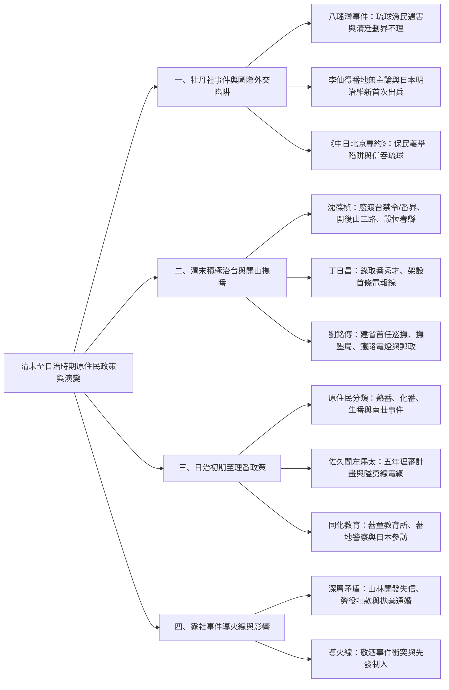
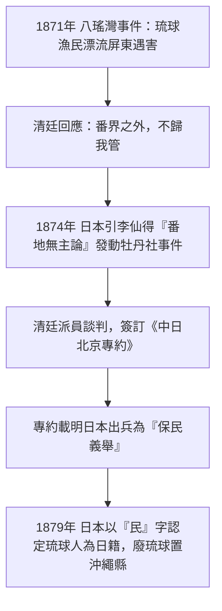
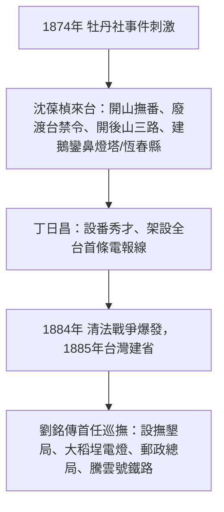

## 📖 課堂主題與核心摘要 (Class Overview)
本堂歷史課聚焦於 19 世紀後半期至 20 世紀初台灣原住民歷史與外來政權治台政策的劇烈轉變。講述核心從 1871–1874 年的「八瑤灣事件」與「牡丹社事件」切入，剖析日本如何利用清廷「番界之外不歸我管」的態度與李仙得的「番地無主論」，藉由《中日北京專約》中「保民義舉」四字巧取琉球主權，並引發清廷由消極渡台禁令轉為積極「開山撫番」（沈葆楨、丁日昌、劉銘傳之洋務運動建設）。後半段則延伸至日治時期的理番政策，涵蓋佐久間左馬太的「五年理蕃計畫」、高壓「隘勇線（電網）」圈圍、同化教育（蕃童教育所與蕃地警察）以及霧社事件的深層積怨與導火線。學習目標為掌握牡丹社事件的外交轉折、清末三大巡撫/大臣建設異同，以及日治理番政策對原住民社會的深遠影響。

---

## 💡 核心知識點與觀念詳解 (Key Concepts)

### 觀念一：牡丹社事件與《中日北京專約》外交陷阱
- **八瑤灣事件 (1871)**：琉球船隻遭遇風浪漂流至屏東八瑤灣（九棚），其中 54 人遭排灣族牡丹社等原住民殺害。倖存者向清廷台灣地方政府求助，清廷官員卻回應「番界之外，不歸我管」。
- **日本算計與李仙得角色**：剛完成明治維新的日本亟欲向外試探軍事實力。前美國駐廈門領事李仙得提出「番地無主論」，獲日本聘為軍事顧問。清廷總理衙門再次宣稱原住民居住地為「化外之民，界外不歸我管」，日本遂於 1874 年發動牡丹社事件出兵台灣（明治維新對外第一戰）。
- **《中日北京專約》與條文陷阱**：清廷因鴉片戰爭與英法聯軍經驗，輕視日本談判，全盤接受賠款，並在條約中承認日本出兵為「保民義舉」。日本隨即將「民」字解讀為清廷承認琉球人乃日本國民，於 1879 年廢琉球置沖繩縣，正式併吞琉球王國。
- **【課堂經典舉例與比喻】**：
  - **琉球 vs 小琉球**：老師強調今日本沖繩為歷史上的「琉球王國」（位於台灣東北方）；而台灣屏東的「小琉球」位於台灣西南方，兩者相差萬里，切勿混淆！
  - **李仙得的顧問契約**：日本問李仙得「若中國出兵怎麼辦？」，李仙得答「給好處就當軍事顧問並找美國斡旋」，促使日本放膽出兵。

### 觀念二：清末積極治台與洋務運動（沈葆楨、丁日昌、劉銘傳）
- **政策轉變**：牡丹社事件讓清廷意識到「台灣孤懸海外，極易被外國佔領」，遂從渡台禁令的消極防堵轉為積極開發。台灣各項現代化建設經費本質上皆來自清廷「自強運動」（洋務運動）。
- **沈葆楨 (1874 年來台)**：
  - **開山撫番**：廢除「渡台禁令」與「畫界封山」，允許漢人移墾山林以阻絕外國侵犯。
  - **東部開路**：開闢北路（蘇澳–花蓮）、中路（八通關古道：彰化/南投林圮埔–台東蒲石閣）、南路（屏東–台東）。
  - **海防設施**：興建鵝鑾鼻燈塔（指引船隻）、設立恆春縣並興建恆春古城。
- **丁日昌 (1876–1877 年來台)**：
  - **原住民教育**：設置「番秀才」錄取名額。
  - **電訊建設**：架設台灣第一條電報線，開啟台灣通訊時代。
- **劉銘傳 (1885 年建省後首任巡撫)**：
  - **理番與墾荒**：設「撫墾局」（總部在桃園大嵙崁/大溪），採「撫剿兼施」；設「番學堂」。
  - **現代化建設**：台北大稻埕安裝全中國第一盞電燈；設郵政總局；興建台北至基隆、台北至新竹鐵路（引進「騰雲號」蒸汽火車）。
- **【課堂經典舉例與比喻】**：
  - **蒸氣火車吹笛音效（嘟嘟聲）**：蒸汽釋放時閥門拉下，蒸汽噴出煙囪發出「嘟嘟」聲，最高時速僅 \\(40\text{ km/h}\\)。
  - **電影院與冷氣演進故事**：19 世紀冷氣發明最初用於冷卻工業機器與底片，因電影院裝冷氣而意外使電影大賣，繼而引入百貨公司；對比當時台灣大稻埕電燈一天只能亮 30 分鐘，展現時代技術演進對比。

### 觀念三：日治時期理番政策與「五年理蕃計畫」
- **原住民分類與南莊事件**：日治初期承襲「熟番、化番、生番」分類。1902 年爆發苗栗南莊事件，引發日人對山林資源開發統籌之重視。
- **五年理蕃計畫 (1910–1914)**：總督佐久間左馬太推動。建立「隘勇線」，沿山脊架設高壓電網圍堵原住民，收縮生存空間逼其繳械，並以武力討伐（如 1914 年太魯閣戰役）。
- **同化教育與蕃地警察**：設立「蕃童教育所」，由兼具治安與教育雙重職能的「蕃地警察」擔任教師。同時安排部落頭目（如莫那·魯道）出國赴日參訪現代化建設（搭飛機、高樓、冷氣），以威懾與懷柔並用。
- **【課堂經典舉例與比喻】**：
  - **莫那·魯道搭飛機驚呆**：莫那·魯道親眼見識日本現代化建設後極為震驚，認為日本遠較清朝進步且講求禮儀，因而積極配合同化政策，甚至將妹妹嫁給日本蕃地警察、帶領族人協助山林開墾（小規模集團移住）。

### 觀念四：霧社事件 (1930) 的矛盾積壓與導火線
- **深層矛盾**：日人未守承諾侵墾祖靈禁地、強迫勞役並扣留工資、日本蕃地警察拋棄莫那·魯道之妹（在日本已有原配）。
- **導火線（敬酒事件）**：宴會中莫那·魯道長子達多·莫那向日本警察吉村敬酒，吉村嫌其手髒而以警棍打人，隨後演變成肢體衝突。警察揚言報復，莫那·魯道研判無法善終，遂決定先發制人爆發霧社事件。

---

### ⏱️ 歷史事件演變流程圖 (Event Timelines)

#### 1. 牡丹社事件與琉球主權演變流程

#### 2. 清末積極治台巡撫建設時序

---

### 📊 觀念與易混淆對比表 (Comparison Tables)

#### 清末三大大臣/巡撫治台建設對比表
| 對比項目 | 沈葆楨 (1874來台) | 丁日昌 (1876-1877來台) | 劉銘傳 (1885-1891任巡撫) |
| :--- | :--- | :--- | :--- |
| **主要職銜** | 欽差大臣 / 船政大臣 | 福建巡撫 | 台灣建省首任巡撫 |
| **背景經費** | 自強運動（洋務運動）經費 | 自強運動（洋務運動）經費 | 自強運動（洋務運動）經費 |
| **理番核心** | 開山撫番（廢除渡台禁令、劃界封山） | 重視原住民教育（錄取番秀才） | 設撫墾局（桃園大嵙崁）、番學堂，撫剿兼施 |
| **交通與基礎設施**| 開闢後山三路（北、中、南路） | 架設台灣第一條電報線 | 興建台北–基隆、台北–新竹鐵路（騰雲號） |
| **防禦與地方行政**| 興建鵝鑾鼻燈塔、設恆春縣/築恆春城 | 鞏固海防防線 | 設郵政總局、大稻埕第一盞電燈、台北城 |

#### 清末「開山撫番」與日治「理番政策」對比表
| 對比維度 | 清末開山撫番 (沈葆楨/劉銘傳) | 日治理番政策 (佐久間左馬太) |
| :--- | :--- | :--- |
| **核心目標** | 增加漢人移民充實邊防，防止列強佔領 | 系統化掠奪山林木材與樟腦資源，建立絕對統治 |
| **管制手段** | 廢除番界、鼓勵開墾、設置撫墾局（撫剿兼施）| 設高壓電網「隘勇線」包圍、五年理蕃計畫武力討伐 |
| **教育與同化** | 設番學堂、錄取番秀才 | 設蕃童教育所，安排頭目赴日參訪現代化建設 |
| **基層執行者** | 撫墾局官員、清軍 | 兼具治安與教育雙重職能之「蕃地警察」 |

---

## ⚠️ 老師強調考點與易錯陷阱 (Exam Focus & Pitfalls)
- **必考重點一：《中日北京專約》「保民義舉」四字**：考試極常考日本如何合理化併吞琉球。關鍵在於清廷承認日本出兵係「保護『民』眾的義舉」，被日本做國際法條文操作，認定清廷已承認琉球人為日本國民。
- **必考重點二：地理方位別（琉球 vs 小琉球）**：課堂特別強調，琉球王國（沖繩）在台灣東北方；屏東小琉球在台灣西南方，解題時切勿混淆兩者地理與歷史背景。
- **必考重點三：自強運動與台灣建設的連結**：沈葆楨、丁日昌、劉銘傳在台灣的現代化建設，資金主要皆來自清廷的「自強運動（洋務運動）」，屬於物質層面的建設，並未涉及政治制度的實質改革。
- **易錯陷阱一：電報線與郵局的先後順序**：台灣是「先有電報線（丁日昌架設），後有郵政總局（劉銘傳設立）」，選項常顛倒兩者順序。
- **易錯陷阱二：蕃地警察的多重身份**：日治時期原住民地區的「蕃童教育所」老師並非普通文職教師，而是由「蕃地警察」兼任，警察同時掌握軍警治安控制與基層教育權力。

---

## 🔑 記憶口訣與解題技巧 (Mnemonics & Shortcuts)
- **清末三大巡撫/大臣速記 SOP**：
  - **沈葆楨** ➔ 「開山、解禁、建恆春」（開山撫番、廢渡台禁令、鵝鑾鼻燈塔與恆春縣）。
  - **丁日昌** ➔ 「電報、秀才、三個月」（第一條電報線、番秀才、在台時間極短）。
  - **劉銘傳** ➔ 「建省、鐵路、撫墾局」（台灣首任巡撫、騰雲號鐵路、大嵙崁撫墾局、大稻埕電燈）。
- **牡丹社外交陷阱破題關鍵字**：題目出現「番界之外不歸我管」、「番地無主論（李仙得）」、「保民義舉」➔ 直接連結《中日北京專約》與「日本併吞琉球（沖繩）」。

---

## 📝 課後作業與待辦事項 (Homework & Tasks)
- **課堂指派事項**：無特定作業。
- **建議預習章節**：預習下節課單元「日治時期地籍調查、土地丈量、租稅改革與清末施九緞事件（劉銘傳清丈土地引發之民變）」。

---

## 📚 專有名詞與重要公式/定義 (Glossary & Formulas)
* **番地無主論**: 前美國駐廈門領事李仙得提出之主張，認為清廷未實質統治之台灣原住民區域屬於「無主地」，不適用國際法主權保護，成為日本發動牡丹社事件之藉口。
* **保民義舉**: 1874 年《中日北京專約》中清廷同意之用語，指日本出兵台灣保護遭殺害之琉球漁民為正義之舉。日本據此宣稱清廷承認琉球人為日籍國民，並於 1879 年廢琉球置沖繩縣。
* **開山撫番**: 1874 年牡丹社事件後沈葆楨提出的治台政策，廢除渡台禁令與劃界封山，開闢通往東部道路，鼓勵漢人移民開墾山林。
* **八通關古道**: 沈葆楨開山撫番所開闢之「中路」，由彰化/南投林圮埔穿越中央山脈至台東蒲石閣（今玉里），為現存唯一列為國定古蹟的清代開山古道。
* **撫墾局**: 清代劉銘傳時期設立掌管原住民事務與山林開墾之機構，總部設於桃園大嵙崁（今大溪），採「撫剿兼施」策略。
* **隘勇線**: 日治時期佐久間左馬太總督推動「五年理蕃計畫」所使用之包圍線，以高壓電網與哨所封鎖山區，逼迫原住民繳械投降。
* **蕃地警察**: 日治時期派駐原住民部落之警察，除維護治安、監控部落外，兼任「蕃童教育所」教師，為日治理番統治的核心執行者。

---

## 🧠 課後自測題 (Quick Review Quiz)

### 思考題 1
**題目**：日本在 1874 年發動牡丹社事件後，為何能在 1879 年名正言順地將琉球王國改設為沖繩縣？其外交談判中的關鍵漏洞為何？
- **簡要解題思維與答案**：關鍵在於 1874 年簽訂的《中日北京專約》。清廷在條文中承認日本出兵係「保民義舉」。日本利用「民」字進行國際法解釋，聲稱清廷已承認琉球人為「日本國民」，因而於 1879 年廢琉球置沖繩縣。

### 思考題 2
**題目**：沈葆楨與劉銘傳皆在台灣推動大規模現代化建設，這兩位大臣的治台政策在「理番與開墾」方面有何具體的制度與措施差異？
- **簡要解題思維與答案**：沈葆楨核心在於「解禁與開路」，廢除渡台禁令與劃界封山，開闢後山三路；劉銘傳則設立專責機構「撫墾局」（總部在桃園大嵙崁），採「撫剿兼施」，並設置「番學堂」進行教育，同時大規模進行清丈土地。

### 思考題 3
**題目**：日治時期佐久間左馬太總督推動的「五年理蕃計畫」採用何種技術手段圈圍原住民？這與傳統清代的「劃界封山」有何本質上的不同？
- **簡要解題思維與答案**：佐久間左馬太採用高壓電網與哨所組成的「隘勇線」進行實體包圍與逐步收縮，迫使原住民交出武器；而清代的「劃界封山」僅為防範漢人進入番界之消極土牛溝/界碑隔離，缺乏主動掠奪山林資源與武力包圍的效果。

---
💡 這份歷史課筆記已為你梳理出最完整脈絡與考點，複習時可特別留意對比表與《中日北京專約》的外交陷阱！若需要針對劉銘傳鐵路、清丈事業或日治土地調查做延伸對比，歡迎隨時告訴我！