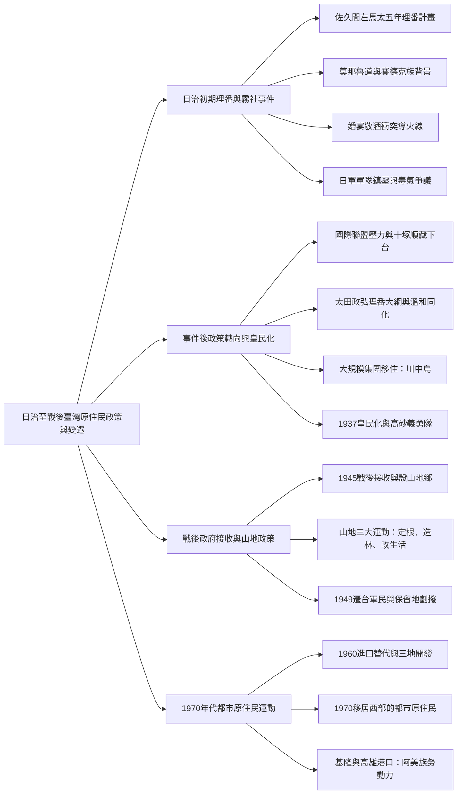
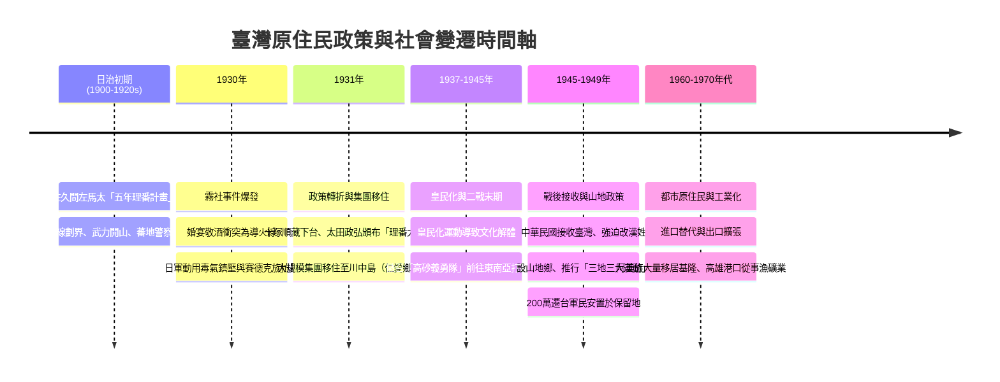

## 📖 課堂主題與核心摘要 (Class Overview)
本堂歷史課以「日治時期至戰後臺灣原住民政策與社會變遷」為核心，梳理了從日治初期佐久間左馬太的「五年理番計畫」、理番警察管理，到爆發震撼國際的「霧社事件」脈絡。課程深入剖析霧社事件的深層背景、導火線及日軍無情鎮壓，並說明事件後總督十塚順藏下台、太田政弘頒布「理番大綱」與實施「大規模集團移住」的政策轉變。最後延伸至皇民化運動下的高砂義勇隊徵召，以及戰後國民政府接收臺灣後的「山地三大運動」、山地保留地劃撥給遷台軍民，乃至1970年代都市原住民（以阿美族為主）向基隆、高雄港口遷徙的社會歷史演變。

【🌳 本課大綱樹狀心智導圖 (Mindmap)】：

---

## 💡 核心知識點與觀念詳解 (Key Concepts)

### 一、 日治初期理番政策與霧社事件爆發
* **理番政策的演進**：日治初期將原住民分為生番、熟番與劃番，但此分類不利於日人全面開發臺灣山林資源。因此總督佐久間左馬太實施「五年理番計畫」，先用「隘勇線」包圍劃界，後期以「武力開山」，並派遣「蕃地警察」深入部落直接管理。
* **莫那魯道與賽德克族的親日背景（老師經典破題與實例）**：
  * 賽德克族首領莫那魯道原本並不討厭日本，甚至認為日本比清朝文明禮貌。
  * 日本統治初期曾資助部落頭目赴日觀光，莫那魯道曾坐過飛機、目睹日本大街小巷滿地汽車與一次大戰先進武器，深刻了解日本的強盛。
  * 莫那魯道將妹嫁給日本蕃地警察，並協助日人開採山林，僅要求避開「祖靈之地」（主林之地）。
* **積怨與導火線（婚宴敬酒衝突）**：
  * **深層積怨**：日人未給足勞動報酬（辛苦工作一個月僅能換取劣酒）、蕃地警察在日已有家室並拋棄莫那魯道之妹、日人不顧承諾強行開採祖靈之地。
  * **直接導火線**：一次婚宴上，莫那魯道的弟弟向三名蕃地警察敬酒，警察嫌其手髒，用警棍三次打落酒杯。弟弟忍無可忍揮巴掌反擊（原住民常年赤腳打獵，手腳粗糙如菜瓜布，力道極大），導致3名警察毆打1人，隨後引發30名原住民圍毆3名警察。
  * 莫那魯道事後帶禮陪罪，警察不肯原諒並向總督府通報叛變，逼使莫那魯道發動反抗。
* **霧社事件經過與日軍鎮壓**：
  * **起義時機**：利用公學校運動會，日籍官員與商界名流聚集時突襲開殺。
  * **叢林戰困境**：日軍派兵600人鎮壓，死傷逾400人。原因在於日軍身穿長靴、攜帶重砲長槍，在臺灣茂密陡峭的叢林中寸步難行。
  * **臺灣山林的自然屏障**：課堂特別強調臺灣山林極度險惡，密林遮天，且有大雨後木材發黴產生的「瘴癘之氣」（如郁永河《裨海紀遊》所載），以及積水孵化的成千上萬「蚊子」傳播瘧疾與腦炎，許多日軍死於傳染病與自然環境。
  * **違禁毒氣與烈士結局**：日軍久攻不下，違規動用一戰禁用的毒氣由飛機空投。賽德克族戰士被迫衝出山口遭機關槍掃射，許多族人選擇懸樑或切腹自殺。莫那魯道殉道於山崖，遺體數十年後在台大人類學系地下室被發現（與山豬、黑熊標本堆放一起），直至民國60年代才移回南投仁愛鄉安葬。

### 二、 事件後的國際輿論壓力與理番政策轉向
* **國際聯盟（國聯）輿論與「三個不應該」**：
  * 臺灣民眾黨向國際聯盟控訴日軍暴行，引發國際社會對日本的強烈譴責。
  * **日軍的三個巨大錯誤（三不該）**：
    1. **不該動用軍隊對付平民**：軍隊僅能對外，動用軍隊會被認定為內戰或獨裁（老師舉陳水扁時期警察圍捕槍擊要犯詹龍欄，欲向陸軍借裝甲車衝鋒，高層獲悉後補充說明，強調不能用軍事武器對付國人）。
    2. **不該使用國際禁用的違禁武器（毒氣）**。
    3. **不該強行掠奪原住民土地與勞力**。
* **總督更替與太田政弘「理番大綱」**：
  * 總督十塚順藏因國際壓力遭彈劾下台，由太田政弘接任並頒布「理番大綱」。
  * 政策調整為「溫和理番、撫育同化、移風易俗」。
* **大規模集團移住（川中島）**：
  * 為澈底改變原住民習俗並防止再度反抗，將賽德克族殘存族人「大規模集團移住」至南投川中島（今南投縣仁愛鄉清流部落）。

### 三、 皇民化時期與戰後國民政府的接收與山地政策
* **1937年皇民化運動**：推行皇民化，導致原住民傳統文化加速解體。
* **太平洋戰爭（二戰末期）**：日軍將原住民青年徵召組成「高砂義勇隊」，投入東南亞叢林戰場（因原住民擅長叢林地形作戰）。
* **1945年戰後接收與強迫改姓**：中華民國政府接收臺灣後，實施強迫改用漢姓，並設置「山地鄉」，以民意代表取代傳統部落頭目與長老。
* **三地三大運動**：政府為名正言順取得原住民山地資源與土地，推行「定根（定居耕作）、造林（植樹）、改生活（改善生活）」運動。
* **1949年遷台軍民安置**：200萬撤退來台的外省軍民被安置於「山地保留地」，進一步擠壓原住民原有的土地空間。

### 四、 1960-1970年代經濟轉型與都市原住民
* **1960年代山地開發**：進口替代時期，政府開放山地保留地給漢人開發。
* **1970年代都市原住民湧現**：隨著臺灣工業化擴張與出口擴張，西部城市極度缺乏勞動力，原住民大量移居都市。
* **產業與地理分佈**：
  * 主要從事高體力勞動的「漁業與礦業」。
  * 集中於臺灣南北兩大港口城市：**基隆**與**高雄**（採礦與遠洋漁業產品需經由港口輸送）。
  * **阿美族**是最多且最早移居都市的原住民族群。
  * **性別分工**：男性從事粗重體力活；女性大多在戶從事「家庭代工」（如老師阿嬤貼貼紙、裝牙籤，1萬張貼紙僅賺50元，收入微薄艱辛）。

---

【⏱️ 時序時間軸 / 步驟流程圖】：

---

【📊 觀念與易混淆對比表】：

| 對比維度 | 日治初期理番政策 | 日治中後期政策（霧社事件後） | 戰後國民政府山地政策 |
| :--- | :--- | :--- | :--- |
| **核心主持者/法規** | 佐久間左馬太（五年理番計畫） | 太田政弘（理番大綱） | 中華民國政府（山地三大運動） |
| **主要理番手段** | 隘勇線圍劃、武力開山、警政嚴管 | 溫和理番、撫育同化、移風易俗 | 強迫改漢姓、設山地鄉、民代取代頭目 |
| **人口與土地政策** | 小規模集團移住、開發山林資源 | 大規模集團移住（如賽德克族移至川中島） | 開放保留地給漢人與遷台軍民，推行「定根、造林、改生活」 |
| **文化與社會影響** | 觸發激烈武力抗爭（霧社事件） | 1937皇民化運動，原住民傳統文化解體 | 原住民失去土地，1970年代大量轉化為都市原民勞工 |

---

## ⚠️ 老師強調考點與易錯陷阱 (Exam Focus & Pitfalls)

1. **霧社事件的起因非單一「仇日」**：
   * **必考點**：莫那魯道初期極度讚賞日本文明與國力，並將妹妹嫁給日警。事件爆發是「長期薪資剝削、妹妹被拋棄、聖地被侵犯」與「婚宴敬酒打落酒杯」等衝突疊加的結果。
2. **國際輿論與政局變動**：
   * **星號必背**：臺灣民眾黨向「國際聯盟」控告日本，導致總督十塚順藏遭彈劾下台，繼任者太田政弘才推出「理番大綱」與「川中島集團移住」。
3. **二戰期間的徵召**：
   * **常見陷阱**：太平洋戰爭即二戰末期戰場，非兩場獨立戰爭。原住民被組編成「高砂義勇隊」是投放在「東南亞」進行叢林戰，而非中國戰場。
4. **戰後山地三大運動的實質目的**：
   * **考點解析**：口訣「定根、造林、改生活」，表面為輔導原住民農耕生活，實質為政府名正言順取得原住民山地土地與資源。
5. **都市原住民的地理與族群特徵**：
   * **命題方向**：1970年代都市原住民主要集中在**基隆與高雄**兩大港口（從事漁業與採礦業），且以**阿美族**人數最多、離鄉最早。

---

## 🔑 記憶口訣與解題技巧 (Mnemonics & Shortcuts)

1. **戰後山地三大運動必背口訣**：
   * 快速記憶：**「定根、造林、改生活」**
   * 拆解：定居耕作（定根）＋ 植樹造林（造林）＋ 改善習慣（改生活） = 取得土地的名目。
2. **日治理番政策演變四字 SOP**：
   * **「隘」線圍劃 \\(\rightarrow\\) 「武」力開山 \\(\rightarrow\\) 「警」政管理 \\(\rightarrow\\) 「溫」和移住（川中島） \\(\rightarrow\\) 「皇」民徵召**
   * （口訣提示：隘 \\(\rightarrow\\) 武 \\(\rightarrow\\) 警 \\(\rightarrow\\) 溫 \\(\rightarrow\\) 皇）
3. **都市原住民破題關鍵字判斷**：
   * 題目出現「1970年代」、「遠洋漁業 / 採礦業」、「家庭代工」、「基隆 / 高雄港口」 \\(\rightarrow\\) 破題直接鎖定：**都市原住民（阿美族為主）**。

---

## 📝 課後作業與待辦事項 (Homework & Tasks)

* **課堂交代事項**：課堂中老師引導學生於課本/講義划線重點（包括1937皇民化、高砂義勇隊、戰後山地三大運動等核心概念）。
* **待辦事項**：無特定作業。請同學課後自主複習本篇筆記，並熟記三地三大運動口訣與霧社事件前後政策轉變對比。

---

## 📚 專有名詞與重要公式/定義 (Glossary & Formulas)

* **五年的理番計畫 (Five-Year Governance Plan)**: 日治初期總督佐久間左馬太提出的原住民治理政策，以隘勇線包圍、武力開山及理番警察壓制原住民，藉以開採山林資源。
* **霧社事件 (Wushe Incident, 1930)**: 賽德克族首領莫那魯道因不滿日人長期剝削與警察壓迫，於公學校運動會發動的反抗事件，遭日軍以毒氣與重兵殘酷鎮壓。
* **理番大綱與川中島 (Policy Outline & Kawanakajima)**: 霧社事件後總督太田政弘頒布的溫和同化政策，並將賽德克族殘部大規模集團移住至南投川中島（今南投仁愛鄉清流部落）。
* **高砂義勇隊 (Takasago Volunteers)**: 太平洋戰爭爆發後，日軍利用臺灣原住民精通叢林作戰特長所組成的臺灣原住民義勇軍，投放在東南亞戰場。
* **山地三大運動**: 戰後國民政府於原住民山地鄉推行的「定根、造林、改生活」運動，實質目的在於取得山地保留地與國家資源管理權。
* **都市原住民 (Urban Indigenous People)**: 1970年代因臺灣經濟轉型與工業化缺工，由原鄉移居西部位於基隆、高雄等港口城市從事漁礦業與基層勞動的原住民群體。

---

## 🧠 課後自測題 (Quick Review Quiz)

**第一題：單選思考題**
日治時期霧社事件爆發後，引發國際聯盟的高度關注與輿論壓力，最終導致時任臺灣總督十塚順藏下台。請問當時向國際社會揭發日軍使用違禁毒氣與軍隊暴行的臺灣本土政治團體為何？
(A) 臺灣文化協會
(B) 臺灣民眾黨
(C) 臺灣地方自治聯盟
(D) 臺灣共產黨

> **【解析與答案】**
> **答案：(B)**
> 課堂強調，當時向國際聯盟控告臺灣總督十塚順藏違反國際公約、動用毒氣與軍隊對付平民的團體正是**臺灣民眾黨**，此舉成功塑造國際壓力，迫使總督下台並轉向「溫和理番」。

---

**第二題：觀念簡答題**
戰後國民政府在原住民地區推行「山地三大運動」，請寫出其三大運動的口訣內容，並簡述政府推行此運動背後的實質土地目的。

> **【解析與答案】**
> 1. **三大運動口訣**：**「定根、造林、改生活」**（即定居耕作、植樹造林、改善生活）。
> 2. **實質目的**：表面上為輔導原住民轉型農業與提升生活水準，實質上係政府藉由規範土地使用名目，逐步取得與控管原住民傳統山地保留地資源。

💡 這份整理涵蓋了整堂課的脈絡與經典細節。如果你需要將這份筆記製作成「單元複習測驗卷」或是「簡報/圖卡摘要」，請隨時告訴我！