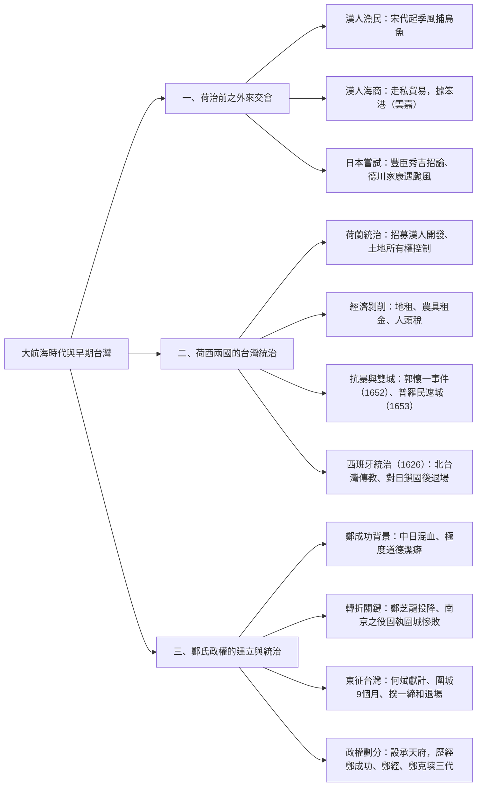
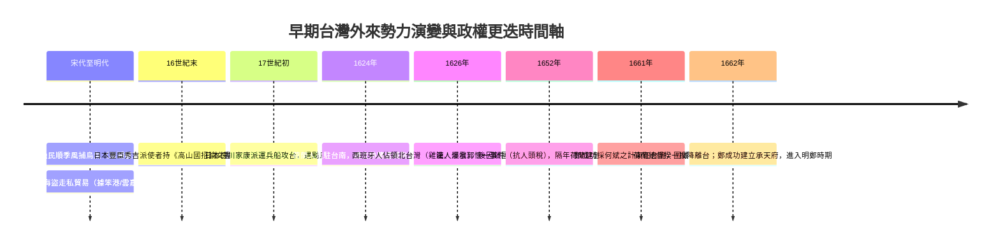

## 📖 課堂主題與核心摘要 (Class Overview)

本堂課聚焦於大航海時代背景下，台灣從邊陲躍升為東亞貿易樞紐的歷史轉折。課程詳細梳理了荷西時期之前閩粵漁民與海商（如笨港顏思齊等）的早期活動、日本豐臣秀吉與德川家康侵台失敗的始末，進而深入探討荷蘭東印度公司的殖民統治機制、對漢人的經濟剝削與郭懷一抗荷事件。最後，課堂延伸至明鄭政權的建立，拆解鄭成功的性格特徵、南京之役的決策失誤、何斌獻計攻台及鄭氏三代在台統治的歷史脈絡。

【🌳 本課大綱樹狀心智導圖 (Mindmap)】：

---

## 💡 核心知識點與觀念詳解 (Key Concepts)

### 一、大航海時代背景與荷西來台前的外來勢力

1. **地理位置優越**：大航海時代的特徵為歐洲人來到亞洲進行跨國貿易，台灣因位於東亞航道樞紐，成為各方勢力交會之地。
2. **季節性漁民（宋代起）**：
   - 來源：以中國閩粵地區（福建、廣東）為主。
   - 活動型態：順應季風與洋流前來捕撈烏魚（製作烏魚子），並在澎湖搭蓋工寮，屬季節性停留，未常住台灣。
3. **海商／海盜（明代海禁政策下）**：
   - 背景：明朝實施海禁，這群人將中國貨物走私賣給西方人。中國官方視其為「海盜」，西方人則視其為「商人」。
   - 據點考證：根據李旦介紹荷蘭人去台南的說法，海商原本聚集於「笨港」。笨港台語發音近「北港」（今雲林），但亦有拆解音近嘉義「布袋港」（海商顏思齊之墓即位於嘉義布袋），故歷史學家通稱為**雲林、嘉義一帶**。
4. **日本戰國與江戶幕府的佔領嘗試**：
   - **16世紀（豐臣秀吉）**：欲佔領台灣作為海外據點。其派使者攜帶《高山國招諭文書》招降，但因語言不通（對原住民念日文詔書），原住民以為侵略而開打，使者狼狽逃回。
   - **17世紀（德川家康）**：吸取教訓後準備多艘運兵船欲直接登陸，卻於7–9月間在海上遭遇颱風慘敗，連上岸都沒有（天佑台灣）。

### 二、荷蘭人的殖民統治、漢人招募與郭懷一事件

1. **招募漢人開發（人口販運比喻）**：
   - 荷蘭東印度公司在台職員最高僅約300人，無法獨立開發，且當時原住民尚未普及農耕。
   - 荷蘭人利用中國大陸貧苦、海禁的背景，以「提供房屋、田地、農具、耕牛、種子」為誘餌（老師比喻為現代緬甸KK園區的高薪誘惑），吸引漢人偷渡來台。
2. **制度性剝削與「人頭稅」陷阱**：
   - 漢人抵台後發現所有物資僅有「使用權」而無「所有權」，房租、地租、農具押金、耕牛租金層層扣剝，收成還需繳稅。
   - 漢人若想放棄工作在草叢「躺平」，荷蘭人則祭出「人頭稅」（只要頭還連在脖子上吸氣，每人需繳15塊），連呼吸都要收錢，極度壓迫。
3. **郭懷一事件（1652年）**：
   - **起因**：漢人受不了一直被課重稅（尤其是人頭稅）與壓迫。
   - **實力對比**：漢人約3萬人，荷蘭人僅300人（100倍兵力差距）。
   - **失敗主因**：內部有人通報告密、荷蘭人從巴達維亞調動軍隊，以及原住民「岸裡社」協助荷蘭人鎮壓漢人。
   - **影響**：1653年荷蘭人在漢人聚居的普羅民遮街興建「普羅民遮城」（今赤崁樓），作為專門管控漢人的防禦堡壘。

### 三、台江內海地理布局與雙城建構

老師課堂特別解析經典課本圖畫，拆解荷蘭人在台南的空間布局：
- **外圍沙洲（七鯤鯓）**：台江內海景觀外圍有七塊首尾相連的沙洲。
- **熱蘭遮城（Zeelandia）**：建於沙洲上（今安平古堡），直接控管台江內海進出要道（鹿耳門），旁邊的市集稱為「大員市鎮」。
- **普羅民遮城（Provintia）**：建於台江內海東岸本土（今赤崁樓），郭懷一事件前為漢人耕作的「普羅民遮街」，事件後改建為城，專管漢人。
- **地理演化**：當時熱蘭遮城與普羅民遮城隔著台江內海，需靠船隻往來；如今台江內海已淤積填平為陸地與街廓。

### 四、西班牙人佔領北台灣（1626年）

1. **目標**：以雞籠（基隆）、滬尾（淡水）為據點，主攻「天主教傳教」與「對日貿易」。
2. **退場原因**：日本德川幕府實行「鎖國政策」導致對日貿易受阻；加上菲律賓爆發伊斯蘭教動亂，西班牙抽調北台灣兵力救援，最終被荷蘭人北上驅逐。

### 五、明鄭政權的建立與鄭成功的性格分析

1. **鄭成功的性格與家庭背景**：
   - 中日混血：父親鄭芝龍（閩南海商/水師提督），母親田川氏（日本人）。傳說母親摸了海邊「鵝卵石」而懷孕（台南鄭氏家廟至今仍展示此石頭）。
   - 極度固執與嚴重「道德潔癖」：鄭芝龍以為投降清朝可繼續當水師提督掌管貿易，鄭成功因忠君道德堅決反對；鄭芝龍被清朝處決後，鄭成功回福建救母，發現母親受辱自殺，因無法接受遺體不潔，下令開腸剖肚取內臟裝麻袋、將屍體浸泡海水三天三夜後才下葬。
2. **南京之役（慘敗轉折）**：
   - 圍攻南京時，大將甘輝與萬禮建議直接攻城，鄭成功固執堅持圍城40天等待自動投降，導致清朝援軍到達反包圍。甘輝、萬禮掩護鄭成功撤退時親眼被清兵砍死，鄭軍勢力大傷，僅剩金門、廈門兩小島。
3. **東征台灣（1661–1662年）**：
   - 通事何斌（精通荷文的會計）向鄭成功獻上地圖與水文糧食情報，建議圍城。
   - 鄭成功接受建議圍城9個月，並切斷水源糧食，荷蘭總督揆一（Coyett）最終出城締和投降，撤離台灣。
4. **政權劃分**：鄭成功改普羅民遮城為「承天府」，作為行政中心。

---

### 【⏱️ 時序時間軸 / 步驟流程圖】

---

### 【📊 觀念與易混淆對比表】

#### 對比表一：荷蘭 vs. 西班牙在台統治比較

| 比較項目 | 荷蘭（荷蘭東印度公司） | 西班牙 |
| :--- | :--- | :--- |
| **主要據點** | 台灣南部（大員、赤崁） | 台灣北部（雞籠、滬尾） |
| **統治核心目標** | 轉口貿易、鹿皮與蔗糖出口、農業開發 | 傳教、對日貿易轉運 |
| **宗教信仰** | 基督教新教（長老教會） | 天主教 |
| **主要退場原因** | 1662年被鄭成功圍城9個月後擊敗締和撤離 | 因對日鎖國失去貿易價值、菲律賓動亂抽兵，1642年被荷蘭驅逐 |

#### 對比表二：台南雙城（熱蘭遮城 vs. 普羅民遮城）比較

| 比較項目 | 熱蘭遮城 (Zeelandia) | 普羅民遮城 (Provintia) |
| :--- | :--- | :--- |
| **地理位置** | 台江內海外圍沙洲（一鯤鯓） | 台江內海東岸本土（原本的普羅民遮街） |
| **興建背景** | 荷蘭人初來台時興建（1624年） | 1652年郭懷一事件後，為加強管控漢人而建（1653年） |
| **主要功能** | 統治中心、軍事防禦、對外貿易集市（大員市鎮） | 專門行政管理、控制漢人耕作區 |
| **今日古蹟名稱** | 安平古堡 | 赤崁樓 |

---

## ⚠️ 老師強調考點與易錯陷阱 (Exam Focus & Pitfalls)

1. **笨港位置與歷史爭議（考點高頻區）**：
   - 考題常考「海商顏思齊與李旦的據點笨港位於何處」。
   - **陷阱題**：台語發音「八槓」聽起來像北港（雲林），但顏思齊墓地位於嘉義布袋（音近布袋港）。歷史學家概括為**雲林或嘉義一帶**，切勿死背單一縣市名稱。
2. **明朝滅亡的真正原因（常見觀念誤區）**：
   - **陷阱**：許多學生誤以為明朝是被清朝滅掉的。
   - **正解**：明朝是被**李自成流民**攻陷北京滅亡（崇禎皇帝自殺）；清朝是入關打跑流民後，順勢統一中國並鎮壓南明政權。
3. **荷蘭招募漢人的經濟本質（選擇題盲點）**：
   - 荷蘭人給予房屋、土地、農具，**漢人僅有「使用權」而無「所有權」**。
   - 郭懷一事件的導火線是**人頭稅**與重稅壓迫，而非單純的種族衝突。
4. **日本兩次侵台失敗的原因對比**：
   - 豐臣秀吉：**人為與文化差異**（對原住民念日文招諭文書，語言不通被出草）。
   - 德川家康：**自然氣候因素**（七至九月遭遇颱風，未登陸即失敗）。

---

## 🔑 記憶口訣與解題技巧 (Mnemonics & Shortcuts)

1. **鄭氏三代傳承口訣**：
   - 順序：鄭成功 \\(\rightarrow\\) 鄭經 \\(\rightarrow\\) 鄭克塽
   - **速記口訣**：「**成功不成功，正經不正經，客不爽**」
2. **荷蘭雙城位置判斷法**：
   - **沙洲看海**：沙洲／安平 \\(\rightarrow\\) 熱蘭遮城（對外貿易、大員市鎮）。
   - **陸地管人**：本土／赤崁 \\(\rightarrow\\) 普羅民遮城（郭懷一事件後建，專門管漢人）。

---

## 📝 課後作業與待辦事項 (Homework & Tasks)

- **無特定作業**（老師課堂未特別指派頁數或題號，請自主複習本篇筆記重點與重點對比表格）。

---

## 📚 專有名詞與重要公式/定義 (Glossary & Formulas)

* **大航海時代 (Age of Discovery)**：15至17世紀歐洲船隊開辟新航道、進行跨洲貿易與殖民擴張的時期。
* **高山國招諭文書**：1593年日本豐臣秀吉派使者攜帶至台灣招降原住民的官方文書，為日本稱台灣為「高山國」之歷史文獻證據。
* **人頭稅**：荷蘭東印度公司對台灣居民按人口徵收的稅種，只要存活呼吸即需繳納（每人約15法羅林/塊），引發郭懷一抗暴。
* **郭懷一事件 (1652年)**：台南漢人因不滿荷蘭人高壓統治與人頭稅重課所發起的抗荷革命，因內部通報及原住民協助荷軍而失敗。
* **七鯤鯓**：昔日台江內海外圍首尾相連的七個沙洲地形，「一鯤鯓」即為熱蘭遮城（今安平）所在地。
* **何斌**：原為荷蘭東印度公司之漢人通事與會計，後向鄭成功提供台南海岸地圖、鹿耳門水道與糧水情資，促成鄭氏東征台灣。

---

## 🧠 課後自測題 (Quick Review Quiz)

**第一題：** 
荷蘭東印度公司在台灣統治時期，曾以「提供住房、農具、耕牛與種子」誘惑中國沿海漢人偷渡來台開發。請說明漢人來台後，在土地與資產的「權利歸屬」上有何陷阱？最終引發郭懷一事件的核心稅制為何？
> **解題思維與答案：**
> 1. **權利陷阱**：漢人僅獲得土地與資產的「使用權」，所有權仍歸荷蘭公司所有，且需支付高昂的地租、房屋租金、農具押金與耕牛租金，損壞或死亡還需賠償。
> 2. **核心稅制**：即使漢人放棄耕作「躺平」，仍需繳納「人頭稅」（只要存活呼吸即需每人繳納15塊），最終逼使漢人起兵反抗。

**第二題：** 
請比較荷蘭人興建的「熱蘭遮城」與「普羅民遮城」，兩者在地理位置、興建背景及統治功能上有何顯著差異？
> **解題思維與答案：**
> 1. **熱蘭遮城（今安平古堡）**：位於台江內海外圍沙洲（一鯤鯓），建於1624年，為荷蘭統治中心、軍事要塞及對外貿易集市（大員市鎮）。
> 2. **普羅民遮城（今赤崁樓）**：位於台江內海東岸本土（赤崁），因1652年爆發郭懷一事件，荷蘭人於1653年興建，目的為專門控管漢人耕作區與行政監視。

---

💡 **溫馨複習小建議**：本堂課歷史脈絡清晰，複習時請務必對照「雙城地理關係」與「荷西對比表」，並熟記鄭氏三代的演變順序！若需要針對任何細節進行延伸討論或觀念測驗，歡迎隨時提出。