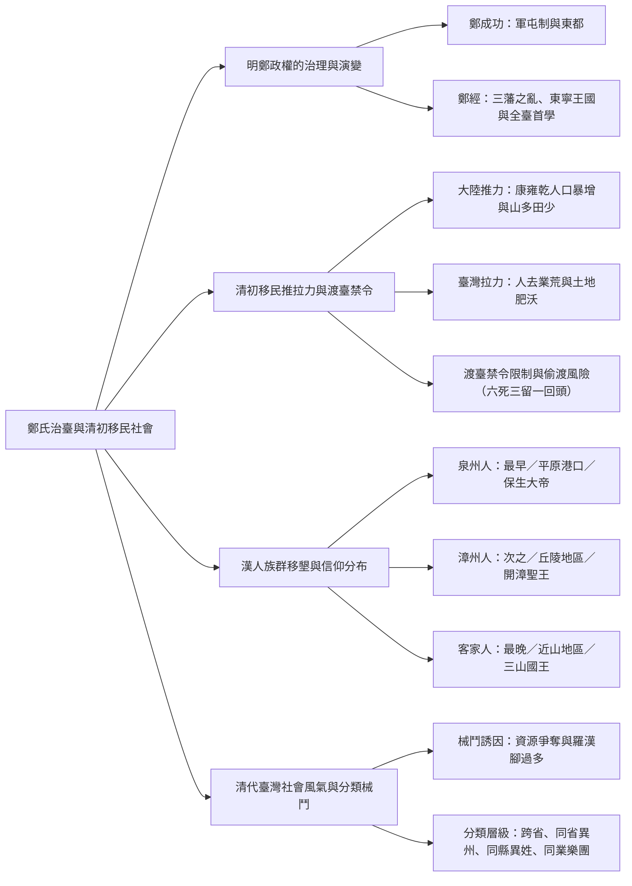
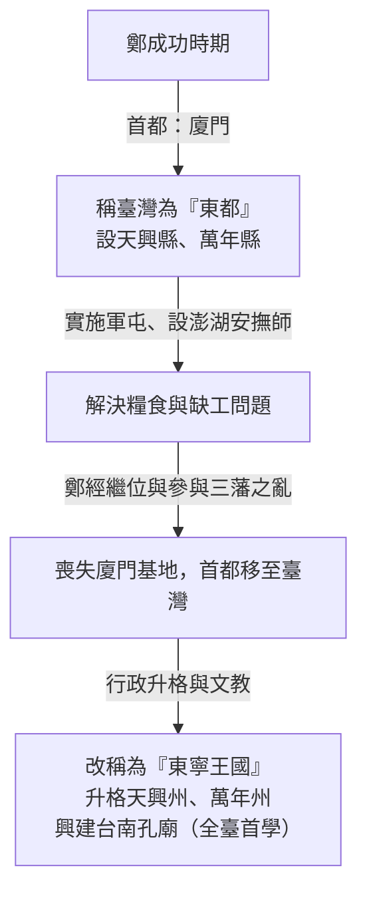
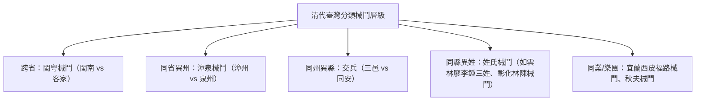

## 📖 課堂主題與核心摘要 (Class Overview)

本堂課主要講授「明鄭時期的治理轉折」與「清領初期的臺灣漢人移民社會發展」。課程詳細剖析鄭成功至鄭經父子時期的屯田策略、名號與行政區劃變遷，並深入探討清初「渡臺禁令」下的移民推拉力、偷渡風險與社會結構。同時，針對漢人三大族群（泉州、漳州、客家）的移墾順序、地理分布、神明信仰及「分類械鬥」風氣進行多維度的歸納與比較，協助建立完整的清初臺灣史觀。

---

## 💡 核心知識點與觀念詳解 (Key Concepts)

### 1. 明鄭政權的治理演變與政權轉折

#### (1) 鄭成功時期：軍屯制度與「東都」建立
* **糧食危機與軍屯制**：鄭成功率軍來臺後，面臨首要難題為糧食供給。為解決軍糧，採行「兵農合一」的軍屯（屯田）政策。然而，軍隊開墾土地過程中常與原住民爆發土地利益衝突。
* **經典課堂實例（南投林奇將軍廟）**：課堂提及在竹塹地區及南投均曾發生屯田衝突。南投原住民曾殺害鄭成功的參軍「林奇」；後人為紀念他，將當地山區稱為「波林奇」，現今南投竹山地區設有「林將軍廟」供奉林奇將軍。
* **招纜流民與澎湖安撫師**：因戰亂與天災，大量中國沿海流民逃至澎湖馬公。鄭成功於澎湖設置「安撫師」，專責招攬流民來臺耕墾，解決當時臺灣「有地無人」的缺工問題。
* **「東都」之名由來**：鄭成功統治時期，政權首都實質設於**廈門**，將臺灣定位為東方的都城，故稱臺灣為「東都」。

#### (2) 鄭經時期：行政改制與儒學文教
* **三藩之亂與首都轉移**：鄭經曾率軍參與中國大陸的「三藩之亂」，最終敗北並徹底喪失廈門基地。鄭經退回臺灣後，正式將臺灣作為政治中心，因而將「東都」改稱「東寧」（東寧王國）。
* **行政區劃升格**：隨著首都定於臺灣，鄭經將原來的「天興縣、萬年縣」升格改制為「天興州、萬年州」。
* **文教制度引進**：鄭經採納陳永華建議，引進中國傳統文教與科舉制度，興建台南孔廟（即「全臺首學」），為臺灣官方儒學教育之始。
* **課堂觀念澄清（台北孔廟 vs 台南孔廟）**：老師特別強調，全臺最早且於明鄭時期興建的孔廟是台南「全臺首學」；而台北市大龍峒孔廟則是後來中華民國政府時期所興建，兩者年代與歷史背景完全不同。

---

### 2. 清領初期渡臺政策與人口推拉力

#### (1) 清廷治臺方針：「為防而治」與「人去業荒」
清朝於 1683 年（康熙 22 年）派施琅攻取臺灣。為防止臺灣再度成為反清復明的割據基地，採取「為防而治」消極治理方針，大舉將在臺漢人遣返回大陸，導致臺灣初期出現「人去業荒」、產業一度廢棄的現象。

#### (2) 移民臺灣的推力與拉力分析
儘管清廷頒布嚴格的「渡臺禁令」，但在強大人口與經濟壓力下，中國沿海移民仍源源不絕偷渡來臺：
* **中國大陸推力（天災人口爆發）**：
  * **人口暴增**：康雍乾三朝（約一個半世紀）人口從 2 億陡增至 4.5 億，但可耕地面積未顯著增加。
  * **美洲作物養活人口**：依賴大航海時代傳入的美洲作物（地瓜/番薯、玉米、花生等）維持生計，造成極度嚴重的「人多地少」危機。
  * **閩粵區域特性**：福建與廣東地區「山多田少」（俗稱「七山二水一分田」），加上頻繁的天災與動亂，生存極其困難，形成推離原鄉的巨大力量。
* **臺灣拉力**：臺灣土地肥沃、資源豐富，經「人去業荒」後呈現「地廣人稀」的狀態，吸引無業貧民渡海尋求生機。

#### (3) 渡臺禁令條款與偷渡黑話
清廷嚴格管制漢人渡臺，主要規定包括：
1. **需領有官府許可證**（無證照者即為偷渡）。
2. **限單身男子**（不得帶兄弟同行）。
3. **嚴禁攜家帶眷**（防止漢人於臺灣深根立業）。
4. **禁止粵民（廣東人）來臺**：清廷認為廣東沿海多海盜且剽悍，易成為反抗勢力，故全面封殺粵籍移民。直到「牡丹社事件」後，沈葆楨與丁日昌為推動「開山撫墾」，才由丁日昌招攬廣東潮州、汕頭地區（潮善地區）移民來臺。

* **偷渡風險與俗諺「六死三留一回頭」**：
  * 偷渡者多乘坐船體小且常嚴重超載的「同安船」，橫渡風浪險惡的臺灣海峽（尤其冬季東北季風浪高可達 3 公尺以上）。
  * **偷渡黑話**：船長若遇乘客精神崩潰或生病，會下達密語：
    * 「**種芋頭**」：佯稱修船將發瘋或患病的乘客騙至無人沙洲拋棄。
    * 「**餵魚兒**」：直接將乘客拋入海中丟棄。
  * 俗語「六死三留一回頭」精準道出渡海極高死亡率（十人中六人死於海難或折磨、三人成功抵臺、一人臨陣退縮）。
* **「羅漢腳」社會問題**：受限於禁帶家眷政策，臺灣社會呈現極度的「男多女少」。許多無法成家立業、無固定工作的單身男子，夜晚常睡在廟宇羅漢像腳下，稱為「羅漢腳」，成為日後社會動盪與械鬥的主力。

---

### 3. 漢人族群移墾地理分布與信仰對比

由於移民來臺時間先後不同，直接決定了各大族群在臺灣的開墾順序、地理空間分布與隨身祈求的神明信仰：

* **第一批（最早/最多）：泉州人**
  * **移墾區域**：最早抵達，佔據地理條件最佳的**西部沿海平原、港口與城鎮**。
  * **信仰神明**：**保生大帝**（沿海風大、環境惡劣，特別重視醫神與身體健康）。
* **第二批（次之）：漳州人**
  * **移墾區域**：較泉州人晚到，平原多已被佔據，主要分佈於內陸**丘陵地**與平原邊緣。
  * **信仰神明**：**開漳聖王**（祈求開墾丘陵土地順利）。
* **第三批（最晚/最少）：客家人（粵籍/閩南客家）**
  * **移墾區域**：因渡臺禁令限制，來臺時間最晚，被迫深入**近山地區與丘陵深處**。
  * **信仰神明**：**三山國王**（來自廣東潮州揭陽三山神，祈求山區平安鎮山）。

#### 📊 臺灣清初三大移民族群對比表

| 對比項目 | 泉州人 | 漳州人 | 客家人（含粵民） |
| :--- | :--- | :--- | :--- |
| **來臺順序** | 最早抵達 | 次之 | 最晚抵達（因渡臺禁令限制粵民） |
| **人口比重** | 人數最多 | 人數次之 | 人數最少 |
| **地理分布** | 西部沿海平原、港口、商埠 | 內陸丘陵地區、平原邊緣 | 近山地區、丘陵山谷 |
| **主要信仰** | 保生大帝（醫神） | 開漳聖王（開墾神） | 三山國王（山神/鎮山） |
| **原鄉居住說** | 擇沿海平原（與原鄉相近） | 擇丘陵地（與原鄉相近） | 擇山區（與原鄉相近） |

> **註（課堂補充學說）**：關於移民分布，學界有兩種說法：其一為「**原鄉生活經驗相近說**」（移民依大陸原鄉地形選擇居住地）；其二為「**械鬥逼退說**」（原本大家均於平原混居，後經多次分類械鬥敗北者被迫向內陸或山區遷移）。

---

### 4. 清代臺灣社會風氣與「分類械鬥」

清代臺灣社會因「羅漢腳」充斥、官府統治力量薄弱且資源爭奪激烈，爆發極為普遍的集體武力衝突，稱為「分類械鬥」。械鬥分類層級極為細緻且無所不鬥：

1. **跨省族群械鬥**：閩粵械鬥（福建閩南人 vs 廣東客家人）。
2. **同省異州械鬥**：漳泉械鬥（同屬福建省，漳州人 vs 泉州人）。
   * **課堂經典對罵實例**：泉州人嘲諷漳州人「張州人都很髒」；漳州人見泉州人祭拜用豬頭，則反嗆「全州人都是豬（台語：轉啦/全豬）」，雙方因而爆發激烈集體砍殺。
3. **同州異縣械鬥**：交兵（如同屬泉州府的三邑人 vs 同安人）。
4. **同縣異姓械鬥**：姓氏械鬥（如雲林地區廖、李、鍾三姓氏械鬥且世代不通婚；彰化王功地區林姓與陳姓械鬥）。
5. **同姓異業/樂團械鬥**：
   * **宜蘭西皮福路械鬥**：同族/同鄉因傳統樂曲北管派系（西皮派 vs 福路派）搶奪酬神演出與神明陣頭而拿樂器大打出手。
   * **宜蘭秋夫械鬥**：搬家公司與轎夫同業爭奪顧客資源爆發的集體械鬥。

---

## ⚠️ 老師強調考點與易錯陷阱 (Exam Focus & Pitfalls)

1. **【絕對必考題型】明鄭漢人來臺主因是「海禁政策」還是「遷界令」？**
   * **正確答案**：**遷界令**。清廷為斷絕鄭成功沿海物資補給頒布遷界令，強制沿海居民內遷，導致大量漢人被迫跟隨鄭成功渡海來臺。
   * **解題陷阱**：若單選題選項中**沒有**「遷界令」，則退而求其次選擇「**海禁政策**」（因為廣義的海禁政策包含了遷界令）。

2. **【古蹟建設年代陷阱】台南孔廟 vs 台北孔廟**
   * **考點解析**：鄭經時期引進文教制度興建的孔廟是台南的「**全臺首學**」。
   * **常見陷阱**：題目若問明鄭時期建的孔廟，切勿勾選台北大龍峒孔廟（台北孔廟為日治/民國時期政府興建）。

3. **【名稱改制考點】鄭經為何將「東都」改為「東寧」？**
   * **觀念破解**：鄭成功時期政權首都設於**廈門**，故將臺灣視為東方都城稱「東都」。鄭經時期因參與「三藩之亂」失敗，徹底丟失廈門，迫將首都轉移至臺灣，臺灣成為實質政治中心，故改稱為「東寧王國」（東寧），並將天興縣、萬年縣升格為天興州、萬年州。

4. **【渡臺禁令條款陷阱】廣東人（粵民）為何被禁止來臺？**
   * **觀念破解**：清廷認為廣東沿海多海盜且風氣剽悍，來臺易演變成反抗勢力，故嚴禁粵民來臺。
   * **解題連貫**：粵民直至**牡丹社事件**後，沈葆楨與丁日昌推行開山撫墾，由丁日昌招攬潮汕地區移民才得以合法來臺。因此客家人/粵民來臺時間最晚、人數最少。

---

## 🔑 記憶口訣與解題技巧 (Mnemonics & Shortcuts)

1. **渡臺偷渡風險口訣**：「**六死三留一回頭**」
   * 10 位偷渡移民中：6 人罹難死於海峽、3 人順利留臺開墾、1 人臨陣反悔不敢上船。

2. **偷渡黑話判斷關鍵字**：
   * 「**種芋頭**」：騙乘客至無人沙洲拋棄（棄置）。
   * 「**餵魚兒**」：將生病或發瘋乘客拋入海中（扔海）。

3. **渡臺禁令四大限制（證、單、禁、粵）**：
   * **證**：需領有官方渡臺許可證。
   * **單**：僅限單身男子渡臺。
   * **禁**：嚴禁攜家帶眷。
   * **粵**：嚴禁粵民（廣東人）渡臺。

4. **移民族群分布與信仰破題速記**：
   * **泉州**：最早 → 沿海平原港口 → 保生大帝（吹海風求健康）。
   * **漳州**：次之 → 內陸丘陵地區 → 開漳聖王（開墾丘陵土）。
   * **客家**：最晚 → 近山山區地區 → 三山國王（山區鎮山神）。

---

## 📝 課後作業與待辦事項 (Homework & Tasks)

* **課堂交代事項**：無特定作業。
* **下階段進度預告**：老師說明次堂課將繼續講解第二章後半段（清領初期社會演變續篇），並隨後進入第三課課程。建議同學們課後先預習清代臺灣分類械鬥的平息過程與祖籍神明信仰演變。

---

## 📚 專有名詞與重要公式/定義 (Glossary & Formulas)

* **軍屯制（屯田）**: 鄭成功為解決軍糧問題所採行的兵農合一開墾制度，使軍隊分駐各地開墾土地，但常與原住民爆發土地利益衝突。
* **澎湖安撫師**: 鄭氏政權於澎湖設立的官職，專門撫恤與招攬自中國大陸逃至澎湖的流民至臺灣參與開墾。
* **全臺首學**: 台南孔廟之別稱，由鄭經時期引進儒學與科舉文教制度所興建，為臺灣歷史上第一座官辦學府。
* **三藩之亂**: 清初平西王尚可喜、平南王耿精忠、靖南王吳三桂爆發的反清叛亂，鄭經曾率軍響應，最終失敗並失去廈門基地。
* **東寧王國**: 鄭經失去廈門後，將臺灣升格為政治首都所採用的正式國號（將東都改為東寧）。
* **人去業荒**: 施琅攻臺後，清廷實施消極治臺，將大批在臺漢人強行遣回大陸，導致臺灣初期土地與產業大量廢棄荒蕪。
* **渡臺禁令**: 清廷為防止臺灣再度成為反清復明基地，對漢人渡海來臺所頒布的嚴格限制政策（需許可證、限單身、禁攜眷、禁粵民）。
* **同安船**: 清代臺灣海峽偷渡客常搭乘的木造小型帆船，船體狹窄且普遍嚴重超載，橫渡黑水溝極具危險性。
* **羅漢腳**: 清代臺灣因渡臺禁令（禁攜眷）導致嚴重男多女少，社會上無業、未婚、無固定居所的單身游民階層。
* **分類械鬥**: 清代臺灣漢人移民社會因祖籍、姓氏、利益資源爭奪或同業競爭所爆發的集體武力流血衝突。
* **西皮福路械鬥**: 宜蘭地區因北管音樂派系（西皮派與福路派）搶奪酬神演出與神明陣頭所爆發的著名同業械鬥。

---

## 🧠 課後自測題 (Quick Review Quiz)

### 題目一：單選題
關於明鄭時期臺灣行政區劃與名稱的演變，鄭經將「東都」改稱為「東寧」、「天興縣／萬年縣」升格為「天興州／萬年州」的主要歷史背景為何？  
(A) 鄭成功攻下赤崁樓，建立漢人第一個政權  
(B) 鄭經參與三藩之亂失敗，失去廈門，迫將首都轉移至臺灣  
(C) 清廷頒布遷界令，導致大量漢人移民湧入臺灣  
(D) 陳永華建議引進科舉制度，為了配合文教升格  

> **【解題思維與答案】**  
> **答案：(B)**  
> **解析**：鄭成功時期首都在廈門，故稱臺灣為「東都」；鄭經時期響應三藩之亂敗北，失去廈門後只能將首都實質移至臺灣，因而將臺灣改稱為「東寧」（東寧王國），並將天興縣、萬年縣升格為天興州、萬年州。

---

### 題目二：問答觀念思考題
清領初期實施嚴格的「渡臺禁令」（如限制許可證、禁攜眷、禁粵民），為何仍無法阻擋閩粵移民大量偷渡來臺？請結合「推力與拉力」理論簡要說明。

> **【解題思維與答案】**  
> **答**：  
> 1. **推力（中國大陸）**：康雍乾時期人口暴增至 4.5 億，而閩粵地區「山多田少」（七山二水一分田），加上天災戰亂頻繁，生存極其困難，形成巨大的推離力量。  
> 2. **拉力（臺灣）**：臺灣土地肥沃，且清初「人去業荒」後呈「地廣人稀」狀態，吸引無業貧民渡海尋求生機。當原鄉推力與臺灣拉力遠大於法規懲罰時，移民寧可冒「六死三留一回頭」的風險偷渡來臺。

---

### 題目三：連線配對與觀念題
請寫出清代臺灣「泉州人、漳州人、客家人」三大族群在「開墾地理位置」與「主要祈求神明」上的對應關係，並說明客家人來臺時間較晚的原因。

> **【解題思維與答案】**  
> **答**：  
> 1. **泉州人**：最早抵達，分佈於**西部沿海平原、港口**；信仰**保生大帝**（求健康醫病）。  
> 2. **漳州人**：次之抵達，分佈於**內陸丘陵地區**；信仰**開漳聖王**（求開墾順利）。  
> 3. **客家人**：最晚抵達，分佈於**近山地區／山區**；信仰**三山國王**（求山區鎮山平安）。  
> 4. **客家人較晚來臺原因**：清廷在渡臺禁令中設有「嚴禁粵民（廣東人）來臺」條款，直至牡丹社事件後丁日昌招攬潮汕移民才正式解禁，故客家人渡臺時間最晚、人數最少。

---

💡 **學習小建議**：如果需要將這份筆記進一步製作成複習測驗卡（Flashcards）或圖文摘要（Infographic），我可以隨時為你生成相應的學習工具喔！