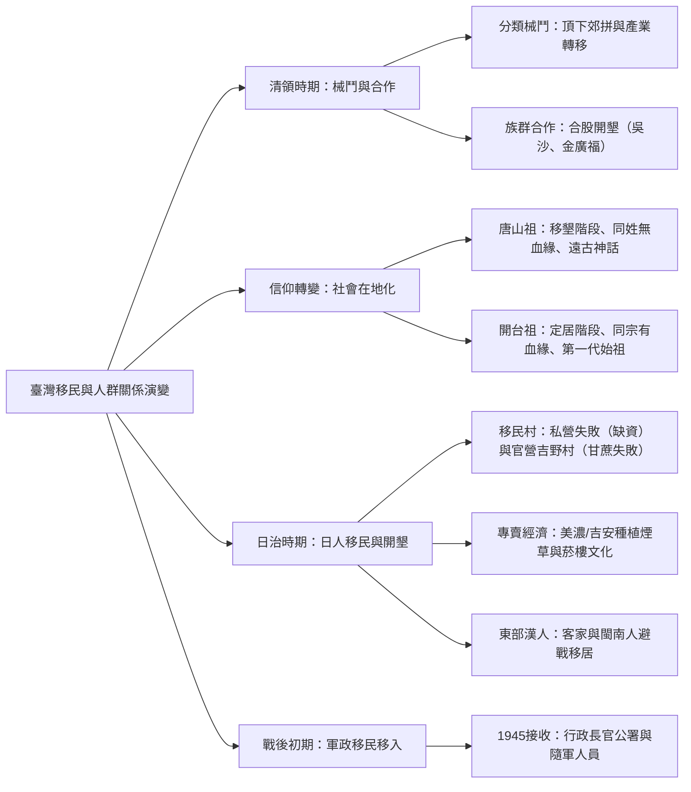
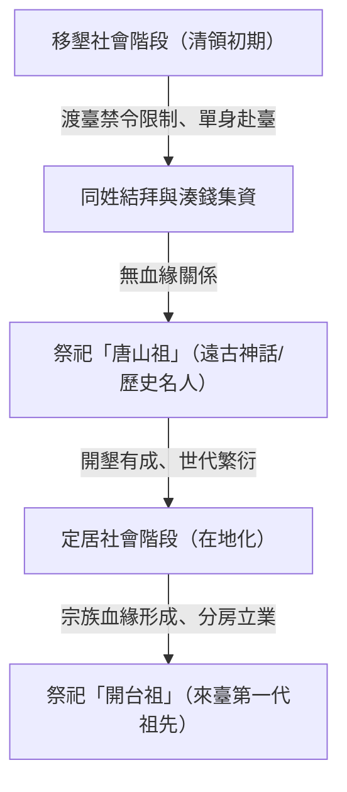

## 📖 課堂主題與核心摘要 (Class Overview)
本堂歷史課以臺灣跨時期的「移民史」與「人群關係演變」為核心脈絡，深度剖析清領時期、日治時期至戰後初期的族群互動與社會結構變遷。課程重點解析清領時期分類械鬥（如頂下郊拼）與族群合作（如吳沙開墾噶瑪蘭、金廣福墾號）的背後成因，並透過祭祀信仰從「唐山祖」過渡至「開台祖」的轉變，說明臺灣社會如何由「移墾社會」轉型為「定居社會（在地化）」。最後，探討日治時期官私營移民村（如吉野村）的推動與挫折、南進政策下的專賣經濟（菸草與美濃/吉安菸樓），以及戰後初期的軍政移民移入，構建完整的臺灣多元族群發展全貌。

【🌳 本課大綱樹狀心智導圖 (Mindmap)】：

---

## 💡 核心知識點與觀念詳解 (Key Concepts)

### 觀念一：清領時期的族群關係——分類械鬥與合股合作
清領時期因資源有限與利益競爭，衝突與合作並存，展現出高度經濟與空間導向的人群互動。

1. **分類械鬥與「頂下郊拼」**
   - **械鬥質性**：械鬥常呈現複合式型態，包含省籍、州縣、甚至同姓氏不同職業與庄頭的衝突。打輸的一方往往被迫離開原墾地。
   - **經典歷史事件：頂下郊拼（艋舺）**
     - **背景與成員**：雙方皆為泉州人。**頂郊**為三邑人（惠安、安溪、南安）；**下郊**（又稱廈郊）為同安人，主要從事與廈門的貿易。
     - **衝突原因**：爭奪艋舺（今萬華）商貿地盤與碼頭利權。
     - **過程與結果**：頂郊打贏；下郊打輸後離開艋舺，北遷至**大稻埕**（今迪化街、大龍洞一帶，如保安宮周邊）重新發展。
     - **後續產業轉變**：1860 年臺灣開港通商後，艋舺因河沙淤積導致大船無法進出而沒落；大稻埕反而因淡水開港，快速發展為**茶葉集散地（茶葉棧）**，出現著名買辦商人李春生，下郊因而「因禍得福」。

2. **族群合作與合股制度**
   - **合股制度背後成因**：開墾需向官府購買開墾執照（墾照），因執照昂貴且個人資金不足，故採取「合股湊錢」模式，進而促進跨族群合作。
   - **經典例題與歷史實例**：
     - **吳沙開墾噶瑪蘭（宜蘭）**：漳州人吳沙採取「閩粵合作」，帶領閩南人與廣東客家人越過界線開墾噶瑪蘭（因西部位子已被佔滿）。墾民克服海盜（蔡牽）威脅並向官府納稅，嘉慶年間官府順勢將蘭陽平原納入界內，設立**噶瑪蘭廳**。
     - **新竹金廣福墾號**：由粵籍姜秀鑾與閩籍周邦正等集資合股成立，共同推動新竹隘墾區的開發。

---

### 觀念二：祖先信仰與社會轉型——從「唐山祖」到「開台祖」
臺灣社會結構由移民渡海的「移墾社會」，轉變為繁衍後代的「定居社會」，其演變過程體現在祖先祭祀型態的改變。

1. **唐山祖信仰（移墾社會階段）**
   - **社會背景**：受「渡臺禁令」限制（僅限單身男子，不得攜家帶眷），初期移民彼此之間**大多無血緣關係**。
   - **祭祀型態**：同姓氏者為求生存與結夥互助，共同出資尊奉原鄉神祇或遠古歷史/神話名人為共同祖先。
   - **舉例說明**：姓劉者祭祀漢高祖劉邦、漢武帝劉徹或劉備；姓李者祭祀老子；姓孔者祭祀孔子；姓關者祭祀關公；姓丁者祭祀穆罕默德等。

2. **開台祖信仰（定居社會 / 在地化階段）**
   - **社會背景**：移民在臺娶妻生子、繁衍世代（第二、三代以上），對遠古唐山祖缺乏實感，轉而重視在臺灣落地生根的家族脈絡。
   - **祭祀型態**：改為祭祀「來臺第一代祖先（開台祖）」。祭祀成員具有**明確的血緣關係**，屬於同宗族（分大房、二房、三房等）。
   - **歷史意義**：象徵移民社會正式過渡為定居社會，順利完成「落地生根（在地化）」。

【⏱️ 臺灣社會轉型與祖先信仰演變流程圖】：

【📊 唐山祖與開台祖對比表】：
| 比較維度 | 唐山祖信仰 | 開台祖信仰 |
| :--- | :--- | :--- |
| **社會發展階段** | 移墾社會（移民初期、移墾開荒） | 定居社會（落地生根、在地化完成） |
| **成員血緣關係** | **無血緣關係**（僅同姓氏、結拜兄弟或同鄉） | **具有明確血緣關係**（同宗族、分房子孫） |
| **祭祀對象** | 原鄉神祇、遠古神話人物或歷史名人（如劉邦、老子、關公） | 來臺開基第一代祖先（開台始祖） |
| **主要功能** | 集資購買墾照、共同開墾、結夥互助防衛 | 凝聚血緣宗族向心力、分配家族產業與祭祀 |

---

### 觀念三：日治時期的日人移民與東部開發
日治時期總督府為紓解本國人口壓力與推動政策，推動了規模不一的移民與產業開發。

1. **移民背景與結構**
   - **人口壓力**：日本本島二戰末期人口達 1 億，而割臺初期臺灣人口僅約 300 萬人。
   - **人口結構**：二戰結束時在臺日人約 30 萬，其中高達 20 萬人為在臺灣出生的**「灣生」**，實際自日本移入者約 10 萬人。移入職業包含軍公教、警察、商人，以及最大宗的**農業移民**。

2. **官私營移民村比較**
   - **私營移民村（早期）**：私人企業於東部推動，因嚴重缺乏資金與造鎮經驗（興建房舍、醫院、學校、自來水等設施極為耗資）而告失敗。
   - **官營移民村（1910年代起）**：總督府直接主導，東部第一個官營移民村為花蓮港廳**吉野村**。
   - **失敗原因**：官方盲目套用開墾北海道的成功經驗，以為農業技術可克服一切；企圖在東部種植戰略作物**甘蔗**（原規劃發酵為酒精/乙醇供工業與軍事使用），但因東部土質不適宜、氣候水土不服及傳染病蔓延而挫敗，後改為獎勵性質。

3. **1930年代南進政策與專賣經濟（菸草文化）**
   - 配合南進政策與軍備整頓，配合專賣制度推動高利潤作物**煙草（菸草）**種植。
   - 著名日人移民村與菸樓分布：高雄**美濃**、花蓮**吉安**。區內保留許多專為烤乾煙草設計的「菸樓」（樓中樓構造、中央鏤空、底層燒火烤乾煙草）。

4. **漢人移居東部**
   - 桃竹苗客家人與臺南、雲林閩南人，為「避戰（躲避戰亂）」移居東部開墾，帶動東部漢人人口快速成長。

【📊 私營移民村與官營移民村對比表】：
| 比較項目 | 私營移民村（早期試辦） | 官營移民村（1910年代起） |
| :--- | :--- | :--- |
| **主導單位** | 私人企業 / 民間公司 | 臺灣總督府（官方直營） |
| **代表地點** | 臺灣東部早期墾區 | 花蓮港廳吉野村（東部第一個官營移民村） |
| **挫折與失敗成因** | 缺乏資金與造鎮經驗（水電、醫院、學校等公共設施耗資過巨） | 盲目套用北海道經驗；企圖種植甘蔗因土質不適、傳染病與水土不服挫敗 |

---

### 觀念四：戰後初期的軍政移民
1945 年二戰結束後，國民政府接收臺灣，行政長官公署（陳儀部隊、隨軍文武官員與接收人員）移入臺灣，成為戰後外省籍移民移入臺灣的第一波起點。

---

## ⚠️ 老師強調考點與易錯陷阱 (Exam Focus & Pitfalls)
- 🌟 **頂下郊拼的勝負影響（必考！）**：切記「頂郊（三邑人）打勝留艋舺；下郊（同安人）打敗遷大稻埕」。大稻埕後來因 **1860 年開港通商** 及**茶葉貿易崛起**，而艋舺因「河沙淤積」沒落，下郊呈現「因禍得福」的演變。
- ⚠️ **唐山祖 vs. 開台祖的判斷陷阱**：題目若提到「祭祀遠古歷史名人/神話人物（如劉邦、關公、老子）」且成員「同姓但無血緣關係」，必為**唐山祖**；若提及「祭祀來臺第一代」、「同宗族有血緣關係、分房祭祀」，則為**開台祖**。
- ⚠️️ **官營移民村的試錯作物陷阱**：日治東部官營移民村（如吉野村）當初試圖種植的戰略作物是**甘蔗**（非稻米，亦非小麥），因土質不適與傳染病而未能如願成功。

---

## 🔑 記憶口訣與解題技巧 (Mnemonics & Shortcuts)
- 💡 **頂下郊拼記憶速記法**：
  - 「三邑頂勝留在萬，同安下敗到大道」：三邑人（頂郊）勝，留在艋舺（萬華）；同安人（下郊）敗，遷往大稻埕（迪化街/茶葉棧）。
- 💡 **祖先信仰二分破題法**：
  - **無血緣 + 拜名人 = 唐山祖**（移墾社會）
  - **有血緣 + 拜第一代 = 開台祖**（定居社會 / 在地化）

---

## 📝 課後作業與待辦事項 (Homework & Tasks)
- 複習本章「臺灣族群關係與移民史」講義內容。
- 整理「頂下郊拼與大稻埕發展歷史」簡短條列。
- 無特定作業，請預習下次課程章節。

---

## 📚 專有名詞與重要公式/定義 (Glossary & Formulas)
* **頂下郊拼**: 1853 年發生於艋舺的泉州同鄉分類械鬥事件，由頂郊（三邑人）對抗下郊（同安人），導致下郊移居大稻埕並帶動當地茶葉貿易發展。
* **合股制度**: 清領時期墾民因墾照昂貴且個人資金不足，共同湊錢購買執照並合作開墾的經濟合作模式（如吳沙開墾噶瑪蘭、金廣福墾號）。
* **唐山祖**: 移墾社會初期，無血緣關係的同姓移民共同湊錢祭祀的原鄉神祇或遠古歷史/神話名人。
* **開台祖**: 定居社會階段，具有明確血緣關係的同宗族子孫，共同祭祀來臺開墾的第一代始祖。
* **灣生**: 日治時期在臺灣出生（生於臺灣）的日籍移民後代。二戰結束前約有 20 萬人。
* **吉野村**: 位於花蓮港廳，為臺灣東部第一個由總督府推動設立的官營日人移民村。
* **菸樓**: 日治時期配合專賣制度種植煙草（美濃、吉安等地）所興建用於烘烤燻乾煙草的高樓建築。

---

## 🧠 課後自測題 (Quick Review Quiz)

**第一題：**
清領時期艋舺發生「頂下郊拼」後，打輸的下郊（同安人）遷往大稻埕發展。請問大稻埕後來之所以能超越艋舺，最關鍵的歷史契機與產業轉變為何？
> **解題思維與答案：**
> 關鍵契機為 **1860 年臺灣開港通商**。艋舺因淡水河河沙淤積導致大船無法駛入而逐漸沒落；大稻埕則藉由淡水開港的便利，發展成為臺灣最重要的**茶葉集散地（茶葉棧）**，進而躍升為繁榮的商貿重鎮。

**第二題：**
小明在臺灣某地考察一座古老宗祠，發現該宗祠由姓劉的村民共同建立，祠堂內供奉的祖先為漢高祖劉邦與三國蜀漢劉備。請問這座宗祠反映了當時臺灣社會的何種信仰特徵與社會型態？
> **解題思維與答案：**
> 反映了**「唐山祖」**信仰與**「移墾社會」**型態。因為祭祀對象為遠古歷史人物（劉邦、劉備），且成員僅為同姓氏結夥、無直接血緣關係，屬於移民開荒初期為了互相扶持而建立的唐山祖組織。

---

## 📖 課堂主題與核心摘要 (Class Overview)
本堂歷史課以臺灣跨時期的「移民史」與「人群關係演變」為核心脈絡，深度剖析清領時期、日治時期至戰後初期的族群互動與社會結構變遷。課程重點解析清領時期分類械鬥（如頂下郊拼）與族群合作（如吳沙開墾噶瑪蘭、金廣福墾號）的背後成因，並透過祭祀信仰從「唐山祖」過渡至「開台祖」的轉變，說明臺灣社會如何由「移墾社會」轉型為「定居社會（在地化）」。最後，探討日治時期官私營移民村（如吉野村）的推動與挫折、南進政策下的專賣經濟（菸草與美濃/吉安菸樓），以及戰後初期的軍政移民移入，構建完整的臺灣多元族群發展全貌。

【🌳 本課大綱樹狀心智導圖 (Mindmap)】：

---

## 💡 核心知識點與觀念詳解 (Key Concepts)

### 觀念一：清領時期的族群關係——分類械鬥與合股合作
清領時期因資源有限與利益競爭，衝突與合作並存，展現出高度經濟與空間導向的人群互動。

1. **分類械鬥與「頂下郊拼」**
   - **械鬥質性**：械鬥常呈現複合式型態，包含省籍、州縣、甚至同姓氏不同職業與庄頭的衝突。打輸的一方往往被迫離開原墾地。
   - **經典歷史事件：頂下郊拼（艋舺）**
     - **背景與成員**：雙方皆為泉州人。**頂郊**為三邑人（惠安、安溪、南安）；**下郊**（又稱廈郊）為同安人，主要從事與廈門的貿易。
     - **衝突原因**：爭奪艋舺（今萬華）商貿地盤與碼頭利權。
     - **過程與結果**：頂郊打贏；下郊打輸後離開艋舺，北遷至**大稻埕**（今迪化街、大龍洞一帶，如保安宮周邊）重新發展。
     - **後續產業轉變**：1860 年臺灣開港通商後，艋舺因河沙淤積導致大船無法進出而沒落；大稻埕反而因淡水開港，快速發展為**茶葉集散地（茶葉棧）**，出現著名買辦商人李春生，下郊因而「因禍得福」。

2. **族群合作與合股制度**
   - **合股制度背後成因**：開墾需向官府購買開墾執照（墾照），因執照昂貴且個人資金不足，故採取「合股湊錢」模式，進而促進跨族群合作。
   - **經典例題與歷史實例**：
     - **吳沙開墾噶瑪蘭（宜蘭）**：漳州人吳沙採取「閩粵合作」，帶領閩南人與廣東客家人越過界線開墾噶瑪蘭（因西部位子已被佔滿）。墾民克服海盜（蔡牽）威脅並向官府納稅，嘉慶年間官府順勢將蘭陽平原納入界內，設立**噶瑪蘭廳**。
     - **新竹金廣福墾號**：由粵籍姜秀鑾與閩籍周邦正等集資合股成立，共同推動新竹隘墾區的開發。

---

### 觀念二：祖先信仰與社會轉型——從「唐山祖」到「開台祖」
臺灣社會結構由移民渡海的「移墾社會」，轉變為繁衍後代的「定居社會」，其演變過程體現在祖先祭祀型態的改變。

1. **唐山祖信仰（移墾社會階段）**
   - **社會背景**：受「渡臺禁令」限制（僅限單身男子，不得攜家帶眷），初期移民彼此之間**大多無血緣關係**。
   - **祭祀型態**：同姓氏者為求生存與結夥互助，共同出資尊奉原鄉神祇或遠古歷史/神話名人為共同祖先。
   - **舉例說明**：姓劉者祭祀漢高祖劉邦、漢武帝劉徹或劉備；姓李者祭祀老子；姓孔者祭祀孔子；姓關者祭祀關公；姓丁者祭祀穆罕默德等。

2. **開台祖信仰（定居社會 / 在地化階段）**
   - **社會背景**：移民在臺娶妻生子、繁衍世代（第二、三代以上），對遠古唐山祖缺乏實感，轉而重視在臺灣落地生根的家族脈絡。
   - **祭祀型態**：改為祭祀「來臺第一代祖先（開台祖）」。祭祀成員具有**明確的血緣關係**，屬於同宗族（分大房、二房、三房等）。
   - **歷史意義**：象徵移民社會正式過渡為定居社會，順利完成「落地生根（在地化）」。

【⏱️ 臺灣社會轉型與祖先信仰演變流程圖】：

【📊 唐山祖與開台祖對比表】：
| 比較維度 | 唐山祖信仰 | 開台祖信仰 |
| :--- | :--- | :--- |
| **社會發展階段** | 移墾社會（移民初期、移墾開荒） | 定居社會（落地生根、在地化完成） |
| **成員血緣關係** | **無血緣關係**（僅同姓氏、結拜兄弟或同鄉） | **具有明確血緣關係**（同宗族、分房子孫） |
| **祭祀對象** | 原鄉神祇、遠古神話人物或歷史名人（如劉邦、老子、關公） | 來臺開基第一代祖先（開台始祖） |
| **主要功能** | 集資購買墾照、共同開墾、結夥互助防衛 | 凝聚血緣宗族向心力、分配家族產業與祭祀 |

---

### 觀念三：日治時期的日人移民與東部開發
日治時期總督府為紓解本國人口壓力與推動政策，推動了規模不一的移民與產業開發。

1. **移民背景與結構**
   - **人口壓力**：日本本島二戰末期人口達 1 億，而割臺初期臺灣人口僅約 300 萬人。
   - **人口結構**：二戰結束時在臺日人約 30 萬，其中高達 20 萬人為在臺灣出生的**「灣生」**，實際自日本移入者約 10 萬人。移入職業包含軍公教、警察、商人，以及最大宗的**農業移民**。

2. **官私營移民村比較**
   - **私營移民村（早期）**：私人企業於東部推動，因嚴重缺乏資金與造鎮經驗（興建房舍、醫院、學校、自來水等設施極為耗資）而告失敗。
   - **官營移民村（1910年代起）**：總督府直接主導，東部第一個官營移民村為花蓮港廳**吉野村**。
   - **失敗原因**：官方盲目套用開墾北海道的成功經驗，以為農業技術可克服一切；企圖在東部種植戰略作物**甘蔗**（原規劃發酵為酒精/乙醇供工業與軍事使用），但因東部土質不適宜、氣候水土不服及傳染病蔓延而挫敗，後改為獎勵性質。

3. **1930年代南進政策與專賣經濟（菸草文化）**
   - 配合南進政策與軍備整頓，配合專賣制度推動高利潤作物**煙草（菸草）**種植。
   - 著名日人移民村與菸樓分布：高雄**美濃**、花蓮**吉安**。區內保留許多專為烤乾煙草設計的「菸樓」（樓中樓構造、中央鏤空、底層燒火烤乾煙草）。

4. **漢人移居東部**
   - 桃竹苗客家人與臺南、雲林閩南人，為「避戰（躲避戰亂）」移居東部開墾，帶動東部漢人人口快速成長。

【📊 私營移民村與官營移民村對比表】：
| 比較項目 | 私營移民村（早期試辦） | 官營移民村（1910年代起） |
| :--- | :--- | :--- |
| **主導單位** | 私人企業 / 民間公司 | 臺灣總督府（官方直營） |
| **代表地點** | 臺灣東部早期墾區 | 花蓮港廳吉野村（東部第一個官營移民村） |
| **挫折與失敗成因** | 缺乏資金與造鎮經驗（水電、醫院、學校等公共設施耗資過巨） | 盲目套用北海道經驗；企圖種植甘蔗因土質不適、傳染病與水土不服挫敗 |

---

### 觀念四：戰後初期的軍政移民
1945 年二戰結束後，國民政府接收臺灣，行政長官公署（陳儀部隊、隨軍文武官員與接收人員）移入臺灣，成為戰後外省籍移民移入臺灣的第一波起點。

---

## ⚠️ 老師強調考點與易錯陷阱 (Exam Focus & Pitfalls)
- 🌟 **頂下郊拼的勝負影響（必考！）**：切記「頂郊（三邑人）打勝留艋舺；下郊（同安人）打敗遷大稻埕」。大稻埕後來因 **1860 年開港通商** 及**茶葉貿易崛起**，而艋舺因「河沙淤積」沒落，下郊呈現「因禍得福」的演變。
- ⚠️ **唐山祖 vs. 開台祖的判斷陷阱**：題目若提到「祭祀遠古歷史名人/神話人物（如劉邦、關公、老子）」且成員「同姓但無血緣關係」，必為**唐山祖**；若提及「祭祀來臺第一代」、「同宗族有血緣關係、分房祭祀」，則為**開台祖**。
- ⚠️ **官營移民村的試錯作物陷阱**：日治東部官營移民村（如吉野村）當初試圖種植的戰略作物是**甘蔗**（非稻米，亦非小麥），因土質不適與傳染病而未能如願成功。

---

## 🔑 記憶口訣與解題技巧 (Mnemonics & Shortcuts)
- 💡 **頂下郊拼記憶速記法**：
  - 「三邑頂勝留在萬，同安下敗到大道」：三邑人（頂郊）勝，留在艋舺（萬華）；同安人（下郊）敗，遷往大稻埕（迪化街/茶葉棧）。
- 💡 **祖先信仰二分破題法**：
  - **無血緣 + 拜名人 = 唐山祖**（移墾社會）
  - **有血緣 + 拜第一代 = 開台祖**（定居社會 / 在地化）

---

## 📝 課後作業與待辦事項 (Homework & Tasks)
- 複習本章「臺灣族群關係與移民史」講義內容。
- 整理「頂下郊拼與大稻埕發展歷史」簡短條列。
- 無特定作業，請預習下次課程章節。

---

## 📚 專有名詞與重要公式/定義 (Glossary & Formulas)
* **頂下郊拼**: 1853 年發生於艋舺的泉州同鄉分類械鬥事件，由頂郊（三邑人）對抗下郊（同安人），導致下郊移居大稻埕並帶動當地茶葉貿易發展。
* **合股制度**: 清領時期墾民因墾照昂貴且個人資金不足，共同湊錢購買執照並合作開墾的經濟合作模式（如吳沙開墾噶瑪蘭、金廣福墾號）。
* **唐山祖**: 移墾社會初期，無血緣關係的同姓移民共同湊錢祭祀的原鄉神祇或遠古歷史/神話名人。
* **開台祖**: 定居社會階段，具有明確血緣關係的同宗族子孫，共同祭祀來臺開墾的第一代始祖。
* **灣生**: 日治時期在臺灣出生（生於臺灣）的日籍移民後代。二戰結束前約有 20 萬人。
* **吉野村**: 位於花蓮港廳，為臺灣東部第一個由總督府推動設立的官營日人移民村。
* **菸樓**: 日治時期配合專賣制度種植煙草（美濃、吉安等地）所興建用於烘烤燻乾煙草的高樓建築。

---

## 🧠 課後自測題 (Quick Review Quiz)

**第一題：**
清領時期艋舺發生「頂下郊拼」後，打輸的下郊（同安人）遷往大稻埕發展。請問大稻埕後來之所以能超越艋舺，最關鍵的歷史契機與產業轉變為何？
> **解題思維與答案：**
> 關鍵契機為 **1860 年臺灣開港通商**。艋舺因淡水河河沙淤積導致大船無法駛入而逐漸沒落；大稻埕則藉由淡水開港的便利，發展成為臺灣最重要的**茶葉集散地（茶葉棧）**，進而躍升為繁榮的商貿重鎮。

**第二題：**
小明在臺灣某地考察一座古老宗祠，發現該宗祠由姓劉的村民共同建立，祠堂內供奉的祖先為漢高祖劉邦與三國蜀漢劉備。請問這座宗祠反映了當時臺灣社會的何種信仰特徵與社會型態？
> **解題思維與答案：**
> 反映了**「唐山祖」**信仰與**「移墾社會」**型態。因為祭祀對象為遠古歷史人物（劉邦、劉備），且成員僅為同姓氏結夥、無直接血緣關係，屬於移民開荒初期為了互相扶持而建立的唐山祖組織。

---

💡 **溫馨提示**：已為您整理好這份完整的高中歷史學習筆記！若想針對「頂下郊拼」或「日治移民村」製作更深入的考前單頁圖表或測驗卡片，都可以隨時告訴我喔！