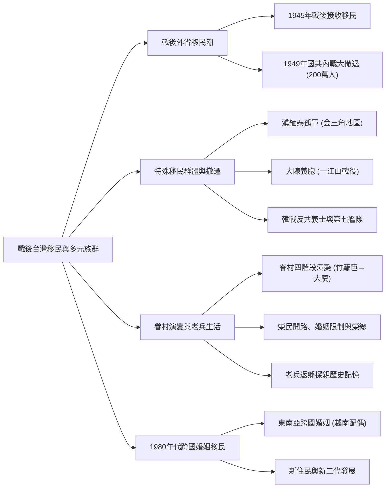
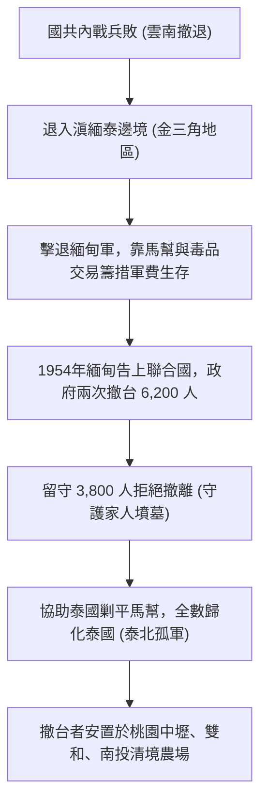
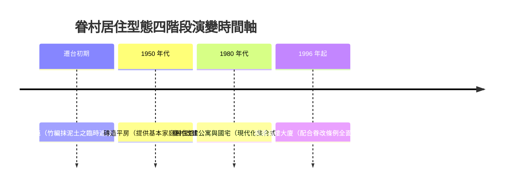

## 📖 課堂主題與核心摘要 (Class Overview)

本堂課聚焦於二戰後臺灣的移民潮與族群演變，詳細剖析自 1945 年戰後接收至 1949 年國共內戰引發的 200 萬外省移民潮，並延伸探討滇緬泰孤軍、大陳義胞與韓戰反共義士等特殊移民歷史。同時，課程梳理了眷村建築由「竹籬笆」到「高樓大廈」的四階段演變、榮民對臺灣基礎建設（如中橫公路）的奉獻與生活困境，以及 1980 年代起東南亞婚姻移民（新住民）對臺灣社會結構的深遠影響。本課核心目標在於建立對戰後臺灣多元族群形成脈絡、歷史記憶與現代社會交融的完整認知。

---

## 💡 核心知識點與觀念詳解 (Key Concepts)

### 1. 戰後外省移民潮的階段與規模
- **「外省人」稱呼的起源**：課本常將 1949 年隨國民政府遷台者統稱為外省人，但實際上從 **1945 年國民政府接收臺灣** 起，即有陸續來台的移民被稱為外省人，概念並非始於 1949 年。
- **1949 年大撤退規模**：國共內戰爆發後，來台軍人及軍眷約 **100 萬人**，非軍人身分的難民與平民亦約 **100 萬人**，總計約 **200 萬人** 湧入臺灣。
- **人口結構衝擊**：臺灣人口短時間內從 400 萬急遽暴增至 600 萬，此波移民潮亦被視為 20 世紀全球規模最大的難民潮之一。

---

### 2. 特殊邊境與離島撤遷群體

#### 🟡 滇緬泰孤軍（金三角地區）
- **地理範圍**：位於雲南、緬甸、泰國、寮國（老撾）四國交界的「金三角地區」。
- **成因與遷移**：國軍於對日抗戰時期駐防四川，內戰時轉駐雲南。國民黨敗退後，高官搭乘飛機撤台，留守雲南的上萬部隊（由戴國會將軍等人領導）撤入泰緬邊境。
- **生存與毒品交易**：為在孤立無援環境中生存並籌措軍費，部隊於緬甸擊退緬軍建立據點，並種植大麻與生產海洛因，與當地「馬幫」合作外銷全球。
- **兩次撤台與留守泰北**：民國 43 年（1954 年）緬甸告上聯合國，聯合國要求中華民國撤軍。政府派機分兩批撤回約 6,200 人，剩餘 **3,800 人** 因許多家屬安葬當地（堅信「有墳墓可拜的地方才是家鄉」）選擇留守。
- **歸化泰國與現代影響**：留守部隊後受泰國政府邀請剿滅馬幫，換取全數歸化泰國國籍並妥善安葬家屬遺骸。如今泰北地區仍掛中華民國國旗，臺灣設有泰北臺灣學校及伊甸基金會志工服務。
- **臺灣安置點**：撤台的 6,000 多人主要安置於 **桃園中壢（如龍岡忠貞新村）**、**新北雙和地區（中永和）** 及 **南投清境農場**。

#### 🟡 大陳島撤退（1955 年一江山戰役）
- **背景**：大陳島位於浙江外海。蔣中正因浙江籍貫情結堅持死守。
- **一江山戰役**：1955 年中共攻陷一江山島，大陳島陷入絕境。蔣中正請美軍協助人道撤離，將島上上萬軍民全數撤往臺灣，稱為「大陳義胞」。
- **產業與安置**：大陳義胞撤台後安置於南投埔里等地。因浙江特產為紹興酒，政府特地設立 **埔里酒廠** 由大陳義胞專門釀造紹興酒。

#### 🟡 韓戰爆發與反共義士
- **美國外交政策轉折**：1949 年美方發表《對華政策白皮書》，檢討國民黨敗退係因自身貪腐失人心，一度欲放棄國民政府。1950 年韓戰爆發後，美軍派 **第七艦隊** 執行「海峽中立政策」（防中共攻台，亦防臺灣反攻大陸）。
- **韓戰戰俘**：韓戰期間國軍參戰並接收被俘或投誠的共軍（稱為反共義士），後將其收編納入國軍部隊。

---

### 3. 眷村建築演變與老兵生活脈絡

- **榮民（榮譽國民）與臺灣建設**：退伍國軍由退輔會安排參與重大工程，如開闢 **中橫公路**、泰魯閣工程及開墾清境農場，過程中許多人不幸殉職。
- **婚姻限制與榮總成立**：蔣中正為維持部隊戰力，對軍人結婚設有極嚴格之軍階、年齡與政審限制，導致大量基層老兵終生未婚、孤苦無依。政府後設榮民安養中心（榮家），並為滿足醫療需求成立 **榮民總醫院（榮總）**。

> 📖 **【課堂感人歷史故事拆解】**
> 老師於座談會遇見一位六歲來台的老兵：當年他在南京下關碼頭拿著五塊錢與醬油瓶準備去買醬油，突遇蜂湧至港口的撤退難民潮，被無意間擠上最後一艘撤退貨輪。躲在船艙三日來到基隆，被好心老兵收養長大。直到民國 76 年（1987年）兩岸開放探親，他憑著一只保存 38 年的醬油瓶回到南京老家，在即將拆除的老宅佛堂裡，與 80 多歲的老母親相認擁抱落淚，道盡時代變局下的離散悲劇。

---

### 4. 1980 年代起全球性婚姻移民（新住民）
- **背景**：1980 年代起，臺灣部分經濟弱勢男性選擇透過跨國婚姻娶東南亞（特別是越南）女性。
- **社會貢獻**：越南配偶勤勞養家，甚至在台繼續求學取得高學歷；其生育的「新住民二代」數量已達數十萬，成為臺灣少子化浪潮中極為關鍵的新生代力量。

---

### 📊 觀念與易混淆對比表：戰後移民群體全方位對比

| 群體名稱 | 主要來源與時空背景 | 遷台/落腳原因 | 臺灣主要安置與分布地點 | 特色與歷史影響 |
| :--- | :--- | :--- | :--- | :--- |
| **一般外省移民** | 1945年接收與1949年國共內戰（約200萬人） | 隨國民政府撤退、避難 | 全台各大眷村、都會區 | 人口暴增，形成獨特的眷村文化與飲食 |
| **滇緬泰孤軍** | 雲南退入金三角之國軍部隊 | 聯合國協調撤台（撤離 6,200 人） | 桃園中壢（龍岡）、雙和、南投清境農場 | 留守 3,800 人歸化泰籍（泰北孤軍）；撤台者帶入滇緬雲南美食文化 |
| **大陳義胞** | 浙江外海大陳島軍民（1955年） | 一江山戰役失守，美軍協助整體撤離 | 南投埔里、花蓮、高雄等大陳新村 | 安置於埔里並設立埔里酒廠釀造紹興酒 |
| **韓戰反共義士** | 韓戰期間被俘或投誠之共軍 | 拒絕返回中國，選擇來台 | 收編編入國軍各部隊 | 奠定 123 自由日，作為冷戰宣傳範例 |
| **東南亞新住民** | 1980年代起之跨國婚姻配偶（以越南為主） | 臺灣跨國婚姻發展 | 全台各地 | 填補臺灣少子化缺口，新二代成為臺灣重要新力量 |

---

## ⚠️ 老師強調考點與易錯陷阱 (Exam Focus & Pitfalls)

- **考點一：「外省人」出現的時間點**：課本題目常設定 1949 年，但需注意「1945 年戰後接收即已開始有外省移民」。
- **考點二：美軍第七艦隊任務性質**：非單純「保衛臺灣」，而是因韓戰爆發執行的「海峽中立政策」（防中共攻台，同時也阻止國軍反攻大陸）。
- **考點三：《對華政策白皮書》的背景**：1949 年美方發表白皮書，檢討國民黨因失人心而敗退，責在國民黨而非美國；直到韓戰爆發美國才改變對台態度。
- **考點四：特殊移民落腳地與產業對應（極高頻考點）**：
  - 滇緬孤軍 → 桃園中壢（龍岡忠貞新村）、雙和、南投清境農場（雲南滇緬美食）。
  - 大陳義胞 → 南投埔里（設立埔里酒廠釀造紹興酒）。

---

## 🔑 記憶口訣與解題技巧 (Mnemonics & Shortcuts)

### 💡 眷村建築演變四口訣
> **「40竹籬笆，50起平房，80蓋公寓，96變大廈」**

### 💡 歷史選擇題破題關鍵字判斷 SOP
- 看到 **「浙江外海、一江山戰役、紹興酒、埔里酒廠」** ➔ 答案秒選：**大陳義胞**。
- 看到 **「金三角、雲南緬甸、泰北、忠貞新村、清境農場」** ➔ 答案秒選：**滇緬泰孤軍**。
- 看到 **「第七艦隊、海峽中立政策、對華政策白皮書」** ➔ 答案秒選：**韓戰爆發（冷戰轉折）**。

---

## 📝 課後作業與待辦事項 (Homework & Tasks)

- **課堂作業**：無特定作業（請徹底複習本章節戰後臺灣移民與族群演變內容）。

---

## 📚 專有名詞與重要公式/定義 (Glossary & Formulas)

* **外省人**：指二戰後（1945年起）及國共內戰（1949年）隨國民政府由中國大陸各省遷居臺灣的移民及其後代。
* **滇緬泰孤軍（泰北孤軍）**：國共內戰後撤入滇緬泰邊境金三角地區的國軍部隊，歷經聯合國撤軍，留守者後歸化泰國，主要分佈於泰北地區。
* **大陳義胞**：1955 年一江山戰役後，在美軍協助下從浙江省大陳島整體撤退來台的軍民。
* **海峽中立政策**：1950 年韓戰爆發後，美國總統杜魯門派遣第七艦隊巡邏臺灣海峽，防止中共攻台亦阻止國軍反攻大陸的冷戰戰略。
* **榮民（榮譽國民）**：退伍軍人的尊稱，政府設有退輔會輔導其就業（如開闢中橫公路）、就養與就醫（設立榮民總醫院）。
* **新住民**：自 1980 年代起透過跨國婚姻（以東南亞及中國大陸為主）移居臺灣並取得國籍的新移民及其二代。

---

## 🧠 課後自測題 (Quick Review Quiz)

### 題目一（單選題）
**關於二戰後遷台特殊群體的敘述，下列何者正確？**
(A) 滇緬孤軍全數於民國 43 年在聯合國協調下撤回臺灣安置於埔里  
(B) 大陳義胞因撤退來台後安置於南投埔里，促成了埔里酒廠釀造紹興酒的產業發展  
(C) 美軍第七艦隊協防台海主要目的是全力支持蔣中正反攻中國大陸  
(D) 「外省人」這一稱呼嚴格始於 1949 年國共內戰大撤退之後  

> **【解題思維與答案】**
> - (A) 錯誤，孤軍僅部分撤台（約6,200人），剩餘3,800人留守泰北；且埔里主要是大陳義胞與埔里酒廠。
> - (B) 正確，大陳義胞來自浙江，善釀紹興酒，政府於埔里設酒廠由其釀造。
> - (C) 錯誤，第七艦隊執行的是「海峽中立政策」，防止雙方互相攻擊。
> - (D) 錯誤，1945年戰後接收即已開始有外省人稱呼。
> **答案：(B)**

---

### 題目二（思考問答題）
**請簡述 1950 年「韓戰爆發」對美國對台政策產生的關鍵轉變，以及其對臺灣局勢的影響。**

> **【解題思維與答案】**
> 1. **政策轉變**：1949 年國民政府敗退來台後，美國發表《對華政策白皮書》擬放棄國民政府；但 1950 年韓戰爆發後，美國意識到臺灣在冷戰防線中的戰略地位，隨即派遣第七艦隊協防臺灣海峽。
> 2. **對台影響**：美軍執行「海峽中立政策」，客觀上阻止了中共對臺灣的軍事進攻，穩定了一代偏安的臺灣局勢，也開啟了日後美援與中美共同防禦條約的合作契機。