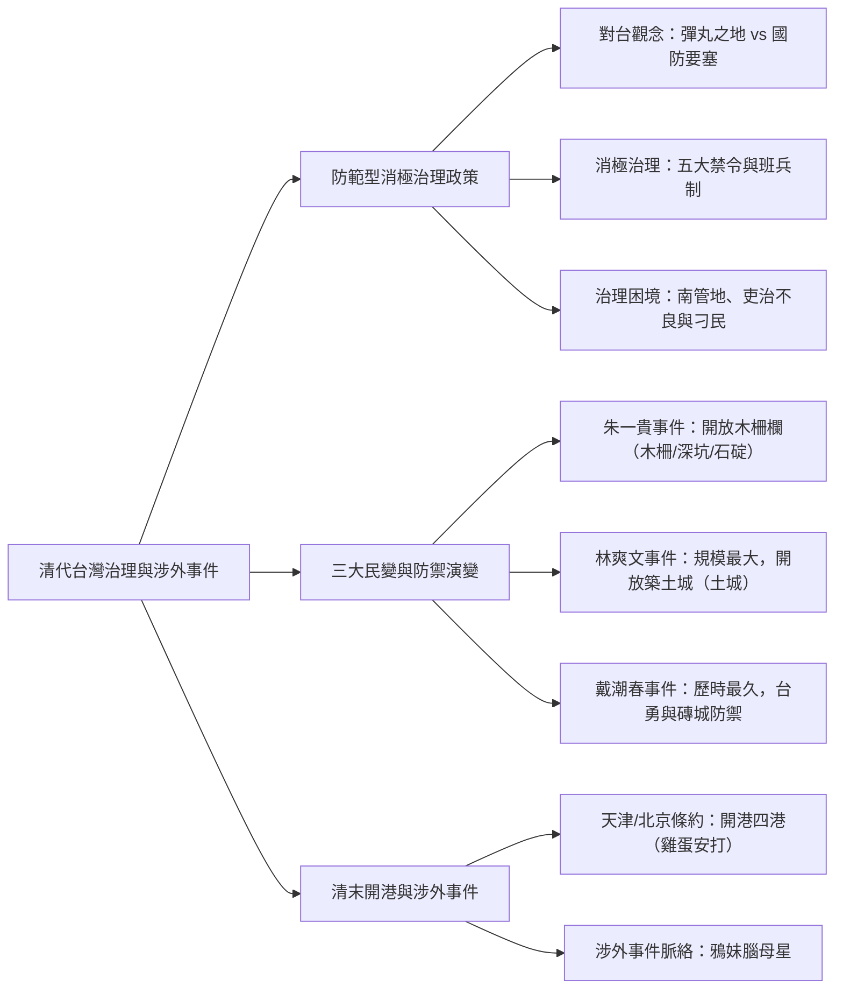
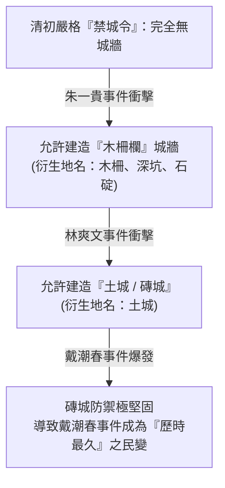

## 📖 課堂主題與核心摘要 (Class Overview)
本堂課核心圍繞於**清代台灣的消極治理政策、三大民變與演變，以及清末開港通商後的涉外事件**。老師首先講述清初對台戰略價值的觀念轉變（從康熙帝視為「彈丸之地」到施琅提出防衛價值），並詳細剖析清廷為防範動亂而實施的「五大禁令」與班兵制度之弊端。隨後深入解析因吏治不良所引發的「三年一小亂，五年一大亂」三大經典民變（朱一貴、林爽文、戴潮春事件），及其對台灣城防建設與地名（如木柵、土城）的深遠影響；最後銜接至 \\(1860\\) 年英法聯軍後台灣開港通商（「雞蛋安打」四港）與重要涉外事件的開端。

---

## 💡 核心知識點與觀念詳解 (Key Concepts)

### 一、清廷對台戰略定位之演變：從「彈丸之地」到「門戶要塞」
1. **康熙帝的初始觀念**：
   - 早期視台灣為「海外彈丸之地」（蛋丸之地），面積狹小且孤懸海外。
   - **比喻與數據說明**：若以台灣面積約 \\(3,6000 \text{ km}^2\\) 計算，中國大陸面積約為台灣的 \\(256\\) 倍（\\(3,6000 \times 256\\)）。類似於新加坡曾稱台灣不大，或陳唐山部長稱新加坡「屁屎大」，乃至川普以「白宮辦公桌（中國）與原子筆尖（台灣）」形容兩者比例。清初康熙亦認為台灣僅如子彈般微小，棄留一度猶豫。
2. **施琅的戰略反駁**：
   - **國防意義**：台灣拱衛東南四省（江蘇、浙江、福建、廣東）門戶，守住台灣即可保衛東南半壁。
   - **經濟與交通**：農作物豐富，且居東北亞（朝、日）與東南亞之交通樞紐。
   - **歷史延伸**：麥克阿瑟將軍後來亦稱台灣為美軍反共防線上的「不沉航空母艦」。
3. **治理基本方針——「為防範而治理」**：
   - 清廷最終決定保留台灣，但並非為了開發，而是為了**防範台灣再次成為海盜或反清勢力（如鄭氏）之基地**。

---

### 二、清初消極治理的「五大禁令」與政制困境
因為「為防範而治理」，清廷對台灣施加了嚴格的管制措施：

1. **五大禁令內容**：
   - **渡台禁令**：需申請許可證、嚴禁攜眷、僅限單身男子來台（導致台灣男女比例嚴重失調，羅漢腳充斥）。
   - **劃界封山（台劃界）**：立石或挖溝劃定漢人與原住民邊界，嚴禁越界。
   - **禁鐵**：嚴格限制鐵器製造與輸入，使用鐵器需向官府申請許可。
   - **禁城**：嚴禁台灣興建磚石城牆壘堡，防止叛亂份子據城固守。
   - **搬兵輪駐（班兵制度）**：台灣不設本土軍隊，軍事防務全由福建抽調士兵，實施「三年一輪」駐防。

2. **班兵制度與官僚系統弊端**：
   - **士兵素質差**：來台班兵多為福建剩餘或淘汰之邊緣兵源，且三年即換，無心在地維護治安。
   - **行政隸屬問題**：台灣當時隸屬福建省轄下，行政資源分散且決策延宕，成為「南管地」（極難治理）。
   - **吏治不良與官逼民反**：來台官員多為遭貶官或貪墨之徒，面對性格強悍的「台灣刁民」（清代文獻用語），常以壓榨手段治民，導致民怨深重，頻頻引發「抗官事件」。
   - **義民與鄉土神祇衍生**：因無可靠本土軍隊，動亂時官府常招募地方民眾（義民）協助平亂。平亂陣亡者被集中供奉於「義民廟」，或無主孤魂之「大眾廟」、「萬善祠」。

---

### 三、清代台灣「三大民變」深度剖析與城防演進
清代統治台灣 \\(212\\) 年間，大小記載民變多達 \\(300\\) 多起，平均每年發生 \\(1.4\\) 起，因而有「**三年一小亂，五年一大亂**」之俗諺。

#### 1. 朱一貴事件（康熙年間）
- **起因與經過**：高雄內門縣官極度貪腐，村民欲起義卻無人敢帶頭。後見高雄養鴨池中的朱一貴能「指揮鴨群如軍隊」，遂拱其為首领，稱「鴨王」。朱一貴打著「反清復明」旗號，自稱「永和王」，攻陷台南府城（當時僅有普羅民遮城與熱蘭遮城）。
- **官府反應**：官員多倉皇逃往澎湖（此亦為澎湖後置廳管轄之因）。
- **平定過程**：朱一貴與閩客合作起義，後因與客家領袖杜英軍爭奪帝位破裂，杜英軍組織「六堆」客家村落配合官府擊敗朱一貴。
- **影響與城防改變**：事後清廷發現無城牆易失守，**首度放寬「禁城令」，允許興建木柵欄城牆**。進而誕生了「木柵」地名（如台北木柵，外圍防禦原住民之深坑、石碇）。

#### 2. 林爽文事件（乾隆年間）
- **起因與經過**：**台灣規模最大的民變**。林爽文為彰化張州籍黑道幫派「天地會」領袖。因其堂兄弟與叔父之堂口火拼，官府趁機掃蕩逮捕欲貪功升官。林爽文前往交涉請賞臉放人，官吏態度強硬並威脅連坐，激怒天地會，進而引發全台大動亂。
- **平定過程**：乾隆帝派大將福康安來台，運用族群矛盾，組織平埔族、全州人、客家人聯合軍隊，並於南頭切斷南北防線、阻絕其遁入番界，最終將其平定。
- **影響與城防改變**：木柵欄防禦力不足，事後清廷**允許興建土牆與磚城（土城）**，如台北土城、台南土城地名之由來。

#### 3. 戴潮春事件（同治年間）
- **起因與經過**：**歷時最久的民變**。戴潮春為彰化八卦山一帶幫派「八卦會」領袖，招募台籍士兵（台勇/台籍民兵）與泉州人起事。
- **平定過程與特徵**：此事件牽涉複雜的張泉分類械鬥與台勇勢力。
- **影響與城防改變**：因前次事件後全台各主要城鎮均已興建堅固的磚石土城，官軍難以輕易攻破叛軍佔領之城池，導致此動亂成為**清代耗時最長**才平定的民變。

#### 📊 三大民變多維度比較表
| 比較維度 | 朱一貴事件 | 林爽文事件 | 戴潮春事件 |
| :--- | :--- | :--- | :--- |
| **發生帝王/時期** | 康熙年間 | 乾隆年間 | 同治年間 |
| **事件歷史定位** | 清代首起大規模民變 | **規模最大**之民變 | **歷時最久**之民變 |
| **領導者背景** | 養鴨戶（自稱永和王/鴨王） | 天地會領袖（黑道幫派） | 八卦會領袖（幫派/台勇） |
| **祖籍與組織** | 漳州人，後與杜英軍（客家六堆）分裂 | 漳州人，天地會堂口 | 漳州人，八卦會、招募台勇 |
| **爆發主因** | 地方官員極度貪腐（官逼民反） | 官吏掃蕩堂口、挑釁且欲貪功升官 | 幫派勢力結合台勇與族群衝突 |
| **平定關鍵** | 客家六堆組織與官府合作平定 | 福康安率平埔、泉州、客家聯軍切斷南北 | 官府動員地方士紳與不同族群勢力平定 |
| **城防突破** | 許可興建**木柵欄**城牆 | 許可興建**土城（磚城）** | 因土城/磚城已普及，官軍極難攻破 |

---

### 四、清末開港通商與重要涉外事件
\\(1857 \sim 1860\\) 年英法聯軍之役後，清廷簽署《天津條約》與《北京條約》，台灣正式開港通商，融入世界貿易體系。

1. **開港四港口口訣——「雞蛋安打」**：
   - **雞（基隆）**：早期寫為「雞籠」（因雞籠山形似雞籠）。
   - **蛋（淡水）**：北部重要貿易港。
   - **安（安平）**：台南門戶。
   - **打（打狗）**：即今高雄（註：打貓為今嘉義民雄）。

2. **重要涉外事件演進脈絡**：
   - **記憶口訣**：「**鴉妹腦母星**」（鴉片戰爭 \\(\rightarrow\\) 羅妹號事件 \\(\rightarrow\\) 樟腦事件 \\(\rightarrow\\) 牡丹社事件 \\(\rightarrow\\) 清法戰爭/法國）。
   - **羅妹號事件（\\(1867\\)）**：美國船隻在恆春半島遇難，船員遭原住民殺害。美國駐廈門領事李仙得（Le Gendre）交涉時，清廷官員稱「番地無主」，李仙得遂直接與十八番社總頭目卓杞篤簽署和平盟約。此「**番地無主論**」為後續日本發動牡丹社事件埋下伏筆。
   - **樟腦事件（\\(1868\\)）**：英商碧齊林（Pickering）在安平欲出口樟腦，因清廷中央《北京條約》廢除樟腦專賣之公文延遲到達台灣地方官府，台灣官府扣壓其樟腦船。碧齊林直接請英軍砲轟安平港。最終清廷確認公文後開放樟腦自由買賣，英國亦承認私自出兵不當。

---

## ⚠️ 老師強調考點與易錯陷阱 (Exam Focus & Pitfalls)

1. **⭐️⭐️⭐️ 城防建設與地名演變（極高頻考點）**：
   - 無城牆 \\(\xrightarrow{\text{朱一貴事件}}\\) **木柵欄**（台北木柵、深坑、石碇） \\(\xrightarrow{\text{林爽文事件}}\\) **土城/磚城**（台北土城、台南土城）。
   - 題目問「為何戴潮春事件歷時最久？」，答案常與「**先前已允許興建堅固磚城土城，導致官軍圍攻困難**」直接相關。

2. **班兵制度（搬兵制）的盲點**：
   - 班兵是「三年一輪」來自福建的兵源，**非台灣本土培育之軍隊**。因素質低下且不了解在地，導致治安極差，動亂時官府反需倚賴「義民」與「台勇」。

3. **「官逼民反」 vs 「台灣刁民」**：
   - 考題常呈現清代官方文獻稱台灣「刁民多、好勇鬥狠」，但歷史實情是「**吏治不良、官員貪腐**」逼使民眾起義。

4. **開港地名與現代對應**：
   - 打狗 \\(=\\) 高雄；打貓 \\(=\\) 嘉義民雄。考試時請勿混淆打狗與打貓。

5. **高中選組與學測考科叮嚀（課堂生活補充）**：
   - 高二不論選擇自然組或社會組，高一至高二均會完整上完學測範圍（台灣史、東亞史、世界史）。
   - **學測可報考五科**，自然組學生若自然科失常但社會科高分，亦可作為跨考社會組校系之優勢。

---

## 🔑 記憶口訣與解題技巧 (Mnemonics & Shortcuts)

1. **開港四港口**：
   - 口訣：**「雞蛋安打」**
   - 解析：**雞**籠（基隆）、**淡**水、**安**平、**打**狗（高雄）。

2. **涉外事件先後時序**：
   - 口訣：**「鴉妹腦母星」**
   - 解析：**鴉**片戰爭 \\(\rightarrow\\) 羅**妹**號事件 \\(\rightarrow\\) 樟**腦**事件 \\(\rightarrow\\) **牡**丹社事件 \\(\rightarrow\\) 清法（**星**/法）戰爭。

3. **五大禁令速記**：
   - **渡台、劃界、禁鐵、禁城、搬兵**。

4. **地名推導 SOP**：
   - 看到「木柵」 \\(\rightarrow\\) 朱一貴事件後之防禦設施（邊界防禦延伸至深坑、石碇）。
   - 看到「土城」 \\(\rightarrow\\) 林爽文事件後許可興建之土城牆。

---

## 📝 課後作業與待辦事項 (Homework & Tasks)
- **課後作業**：無特定作業。
- **預習/複習建議**：
  1. 熟記三大民變的演變順序與城防變革關係。
  2. 預習下章節「牡丹社事件與清法戰爭對台灣建省之影響」。
- **小考預告**：下週課堂將視情況進行單元小考或於期中斷考前集中進行模擬測驗。

---

## 📚 專有名詞與重要公式/定義 (Glossary & Formulas)

* **蛋丸之地（彈丸之地）**: 康熙帝早期用以形容台灣孤懸海外、土地極其狹小的用語。
* **渡台禁令**: 清初為防範台灣成為反清基地，嚴格限制大陸沿海居民渡海來台之法令（包含需許可證、嚴禁攜眷）。
* **班兵制度**: 清代台灣不設在地軍隊，由福建士兵以三年為一期輪流駐防台灣之兵制。
* **南管地**: 描述清代台灣因遠離福建行政中心、交通不便且官員素質低落，導致「極難管轄」之狀態。
* **六堆**: 朱一貴事件期間，屏東與高雄一帶客家聚落為了自衛所組織的六個防禦村落聯盟。
* **台勇**: 戴潮春事件等清末動亂期間，招募台灣在地人所組成的民兵力量。
* **番地無主論**: 李仙得於羅妹號事件後提出的觀點，主張清廷管轄權未及於原住民部落，該區域不屬於清朝有效領土。
* **雞蛋安打**: \\(1860\\) 年天津與北京條約簽署後，台灣開放通商的四個港口（基隆、淡水、安平、打狗）。

---

## 🧠 課後自測題 (Quick Review Quiz)

**第一題：城防演變與民變關係**
- **問題**：清廷在統治台灣初期嚴格禁止興建城牆，請問此禁令在經歷哪兩次重大民變後分別有所放寬？其放寬內容有何差異？
- **簡答思維**：
  1. 第一階段：**朱一貴事件**後，清廷允許興建**木柵欄**城牆（衍生木柵等地名）。
  2. 第二階段：**林爽文事件**後，因木柵不敵大規模動亂，清廷進一步允許興建**土城與磚城**（衍生土城等地名）。

**第二題：班兵制度之影響**
- **問題**：清代台灣實施「搬兵輪駐（班兵制）」的初衷為何？此制度最終造成了何種治安與治理困境？
- **簡答思維**：
  1. **初衷**：防止本土軍隊在台灣紮根結黨、發動叛亂（為防範而治理）。
  2. **困境**：來台班兵多為福建素質低下之邊緣兵源，無心維護地方治安；加上官員貪腐，導致治安敗壞，每逢動亂官府反而無兵可用，需倚賴地方「義民」或「台勇」平亂。

**第三題：開港與涉外事件判讀**
- **問題**：美國領事李仙得在羅妹號事件後提出的「番地無主論」，對日後的台灣歷史發展帶來了什麼致命影響？
- **簡答思維**：
  清廷官員以「番地無主」推卸羅妹號事件責任，使李仙得轉而直接與原住民頭目卓杞篤簽約。此觀點後來被日本採用，作為 \\(1874\\) 年以「懲罰殺害琉球藩民之番人」為由發動**牡丹社事件**出兵台灣的藉口。

---
💡 **課後複習小提示**：本份筆記已完整歸納課堂錄音之精華，考前請務必重點複習三大民變對比表與「鴉妹腦母星」涉外事件順序！