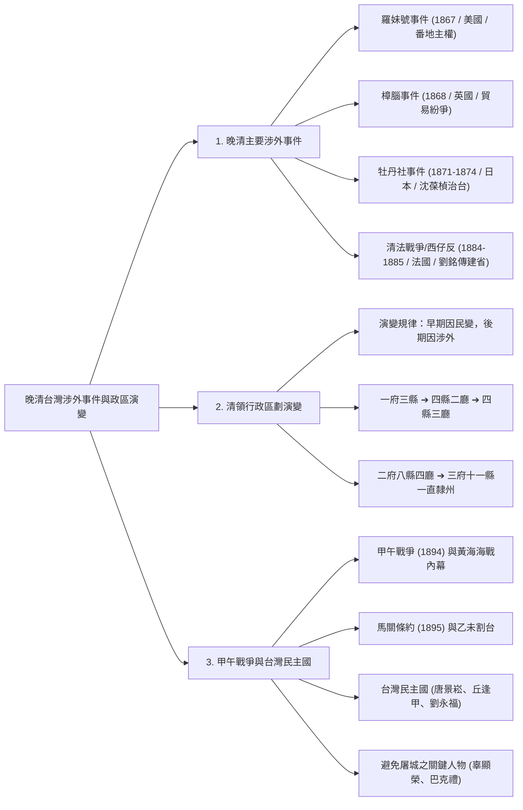

## 📖 課堂主題與核心摘要 (Class Overview)
本堂課為高中台灣史重點複習，核心圍繞於 **19世紀中後期晚清台灣的「涉外事件」**、**「行政區劃演變脈絡」** 以及 **「甲午戰爭與台灣民主國的興亡」**。課程詳細剖析了自1860年開港通商後，台灣如何從早期的「因民變而調整行政區」轉變為「因涉外事件而積極治台並改劃政區」；同時深入解構清法戰爭中的「西仔反」、甲午海戰內幕、馬關條約乙未割台，以及台灣民主國領導層的抗日與離台過程。本課關鍵目標在於建立「歷史事件—政區變革—官員治台」的一對一連結，並掌握乙未抗日爆發的國際政治背景與歷史細節。



---

## 💡 核心知識點與觀念詳解 (Key Concepts)

### 1. 晚清主要涉外事件及其歷史影響
自 \\(1860\\) 年英法聯軍簽訂《天津條約》開港通商（開放雞籠、淡水、安平、打狗四港，口訣：「極大安打」）後，台灣正式納入國際資本主義市場，隨之引發一系列重大涉外衝突：

* **羅妹號事件 (\\(1867\\) 年)**：美國商船羅妹號於恆春半島船難，船員登陸後遭原住民（排灣族）擊殺。美方派兵懲戒並與清廷交涉，清廷以「番地原住民非服化之民」推卸責任。美領事李仙得（Charles Le Gendre）隨後直接與琅𪹆十八社總頭目卓杞篤締結《南岬之盟》。此事件凸顯了清廷對台灣東部與原住民領域的管轄漏洞。
* **樟腦事件 (\\(1868\\) 年)**：英國商人在安平因樟腦專賣權與官府發生衝突，加上公文傳遞時間差引發軍事對抗，最終清廷被迫廢除樟腦專賣制度，允許外商自由採購。
* **牡丹社事件 (\\(1871-1874\\) 年)**：琉球漁民漂流至八瑤灣遭原住民殺害，日本藉口保護「日本藩屬琉球國民」於 \\(1874\\) 年出兵攻打牡丹社。事後清廷賠款，且在公文文書中承認日軍行為係「保民義舉」，間接導致琉球被日本吞併。此事件重創清廷，促使清政府轉為**積極治台**，派欽差大臣**沈葆楨**來台辦理海防。
* **清法戰爭／西仔反 (\\(1884-1885\\) 年)**：
  * **起因**：因越南宗主權問題，清朝與法國爆發戰爭。法軍在陸戰難以擊敗清軍，遂轉向中國沿海及台灣實施海上封鎖與進攻。
  * **台灣戰況**：清廷派**劉銘傳**來台督戰。劉銘傳運用自強運動經費建構防線。法軍假借「基隆採煤礦」為由發動進攻，劉銘傳於基隆**獅球嶺**設防守備。法軍隨後轉攻淡水，但因淡水港口與沼澤地形限制，法軍無法深入內陸。台灣民間稱法軍為「西仔」，故此役在台灣歷史上稱為**「西仔反」**。
  * **澎湖轉折與孤拔將軍之死**：法軍久攻淡水不下，轉而佔領澎湖。劉銘傳派兵追擊，法軍突宣告停戰議和。主因為法軍統帥**孤拔將軍（Admiral Courbet）** 感染台灣當地嚴重流行病（瘧疾/登革熱等高燒病毒），發病三日即告陣亡，法軍戰意全失。
  * **結果**：\\(1885\\) 年簽約後，越南成為法國殖民地；清廷深刻體認台灣海防重要性，於 \\(1885\\) 年正式宣布**台灣建省**，由劉銘傳擔任首任巡撫。

---

### 2. 清領時期台灣行政區劃演變脈絡
台灣行政區劃的調整存在非常明確的歷史規律：**「早期因應內部民變而增設，後期因應外部涉外事件而調整」**。

```mermaid
graph TD
  M1["1684 康熙：一府三縣<br/>(臺灣府、諸羅、臺灣、鳳山)"] -->|朱一貴事件 (1721)| M2["1723 雍正：四縣二廳<br/>(+彰化縣、淡水廳；+澎湖廳)"]
  M2 -->|吳沙開墾+蔡牽事件| M3["1812 嘉慶：四縣三廳<br/>(+噶瑪蘭廳；林爽文事件後諸羅改嘉義)"]
  M3 -->|牡丹社事件 (沈葆楨)| M4["1875 光緒：二府八縣四廳<br/>(+臺北府、恆春縣；廢番界設卑南廳)"]
  M4 -->|清法戰爭 (劉銘傳建省)| M5["1885 光緒：三府十一縣一直隸州四廳<br/>(+臺南府；+臺東直隸州)"]
```

#### 各階段詳細說明與歷史背景：
1. **一府三縣 (\\(1684\\) 年，康熙)**：施琅攻台後設立。
   * **一府**：臺灣府（位於今臺南）。
   * **三縣**：諸羅縣、臺灣縣、鳳山縣（口訣：「朱台鳳」）。其中「諸羅」意指承天府以北「諸多羅列」之意。
2. **四縣二廳 (\\(1723\\) 年，雍正)**：
   * **背景**：\\(1721\\) 年爆發**朱一貴事件**。
   * **變革**：將廣大的諸羅縣拆分，增設**彰化縣**與**淡水廳**（口訣：「彰淡」）。
   * **特別考點**：增設**澎湖廳**。原因在於朱一貴事件爆發時，多數清廷官員不戰而逃，直接跑回澎湖準備搭船逃回中國。雍正皇帝大怒，為防止官員日後逃亡並加強海防，正式設澎湖廳。
3. **四縣三廳 (\\(1812\\) 年，嘉慶)**：
   * **背景**：吳沙越界開發宜蘭，加上海盜**蔡牽**騷擾沿海，地方士紳請願就地合法與設官治理。
   * **變革**：增設**噶瑪蘭廳**（今宜蘭）。
   * **地名變更**：此前因 \\(1786\\) 年發生**林爽文事件**，諸羅地方居民協助朝廷平亂，清廷為褒揚「嘉許義民」，將**諸羅縣改名為嘉義縣**。
4. **二府八縣四廳 (\\(1875\\) 年，光緒)**：
   * **背景**：**牡丹社事件**後，**沈葆楨**來台辦理海防並廢除「南路/北路番界」。
   * **變革**：北台灣經濟崛起，增設**臺北府**；南部增設**恆春縣**；東部開山撫番，增設**卑南廳**。
5. **三府十一縣一直隸州四廳 (\\(1885-1887\\) 年，光緒)**：
   * **背景**：**清法戰爭**後，**劉銘傳**推動台灣建省。
   * **變革**：重劃行政區為三府（臺北府、臺灣府改為中部、增設**臺南府**）。
   * **特別考點**：將原卑南廳升格改設為**臺東直隸州**。

---

### 3. 甲午戰爭與台灣民主國的興亡 (\\(1894-1895\\) 年)

#### (1) 甲午戰爭與黃海海戰內幕 (\\(1894\\) 年)
* **導火線**：朝鮮半島爆發「東學黨之亂」，朝鮮內部兩派（親中派與親日開化黨/閔妃）分別向清朝與日本求援。中日雙方平定東學黨後，清軍按約撤兵，日軍卻持續增兵。
* **宣戰關鍵**：日軍開砲擊沉清朝談判運兵船，擊斃清廷談判大使。在國際外交慣例中，**直接殺害對方談判使節即等同於宣戰**。
* **黃海海戰慘敗原因**：
  * 清朝花費 \\(3000\\) 萬兩白銀打造的「北洋艦隊」（德製、五艘大艦、世界排名第三、配備近 \\(800\\) 門大砲）。
  * 日本海軍僅有 \\(40\\) 艘小型砲艇（世界排名第二十一）。
  * 海戰爆發時，北洋艦隊開砲後砲彈竟無法炸沉日艦。事後發現，因**慈禧太后過 \\(60\\) 歲大壽**，將購置彈藥的軍費「借用/挪用」去修築頤和園花園，導致北洋艦隊砲彈內部被填充大量**泥沙**。最終日本憑藉靈活戰術與實彈，將北洋艦隊全數擊沉。

#### (2) 馬關條約與乙未割台 (\\(1895\\) 年)
* \\(1895\\) 年（農曆乙未年），李鴻章與伊藤博文簽訂《馬關條約》，清廷割讓台灣、澎湖與遼東半島給日本。
* **三國干涉還遼與台灣的聯想**：俄、德、法三國因自身利益出面干涉，清廷最終以 \\(3000\\) 萬兩白銀贖回遼東半島。台灣士紳見狀，認為若尋求西方列強介入，亦有機會保留台灣。台灣士紳甚至提出願以「三萬擔樟腦」作為交換誘因要求英法干預，但遭列強拒絕。

#### (3) 台灣民主國的成立與潰敗
為抵抗日本接收，台灣士紳援引國際法宣告獨立，於 \\(1895\\) 年 \\(5\\) 月成立**「台灣民主國」**：
* **國號與立場**：年號「永清」，宣告「恭奉正朔」，名義上獨立，實質上仍奉清朝為宗主國。
* **核心領導人物與結果**：
  1. **唐景崧（總統）**：原台灣巡撫。日軍自宜蘭**澳底**登陸後，台灣武裝（大刀、鐮刀、竹竿）不敵日軍大砲機關槍。唐景崧僅抵抗 **\\(10\\) 天** 即化裝逃回中國，被戲稱為「十日總統」。
  2. **丘逢甲（副總統/國防部長）**：台中士紳（今逢甲大學、逢甲夜市即紀念此人）。戰局不利後亦迅速離台。
  3. **劉永福（大將軍）**：駐守台南。北軍潰敗後，劉永福宣稱絕不撤退，但日軍攻破台南城門後，劉永福與僕人分別**扮成「老太太與小孫子」**，於安平港搭乘德國商船逃往廈門（官方稱此逃亡行為為「內部內渡」）。

#### (4) 避免台北與台南屠城之關鍵人物
* **台北開城**：台北城潰兵騷擾百姓，富商**辜顯榮**（今中信集團辜家祖先）主動開啟台北城門引日軍入城維持秩序，避免了血洗台北。
* **台南和平入城**：長老教會傳教士**巴克禮（Thomas Barclay）** 受台南紳商所託，親自出城與日軍交涉談判，引日軍和平入城，成功保全台南市民性命。

---

### 📊 觀念與易混淆對比表

#### 【對比表一】：清領時期行政區劃關鍵指標與人物對照
| 行政區劃階段 | 歷史觸發事件 | 核心新增行政區 | 關鍵代表人物 / 辨識考點 |
| :--- | :--- | :--- | :--- |
| **一府三縣** (\\(1684\\)) | 施琅攻台，納入版圖 | 臺灣府、諸羅縣、臺灣縣、鳳山縣 | 康熙皇帝；「諸羅」意為諸多羅列 |
| **四縣二廳** (\\(1723\\)) | 朱一貴事件 (\\(1721\\)) | 增設**彰化縣**、**淡水廳**、**澎湖廳** | 雍正皇帝；設澎湖廳係防官員逃跑 |
| **四縣三廳** (\\(1812\\)) | 吳沙開墾、蔡牽事件、林爽文事件 | 增設**噶瑪蘭廳**；諸羅改名**嘉義縣** | 嘉義改名意為「嘉許義民」 |
| **二府八縣四廳** (\\(1875\\)) | 牡丹社事件 (\\(1874\\)) | 增設**臺北府**、恆春縣、**卑南廳** | **沈葆楨**（廢除番界、積極治台） |
| **三府十一縣一直隸州** (\\(1885\\)) | 清法戰爭 (\\(1884\\)) | 增設臺南府、**臺東直隸州** | **劉銘傳**（台灣建省、自強運動） |

#### 【對比表二】：晚清涉外事件與台灣民主國人物對照
| 事件 / 人物 | 主要涉案國家 / 身份 | 歷史核心影響與典故 |
| :--- | :--- | :--- |
| **羅妹號事件** | 美國 | 引起番地主權爭議；李仙得與卓杞篤簽訂《南岬之盟》 |
| **清法戰爭 (西仔反)** | 法國 | 獅球嶺與淡水之役；孤拔將軍病逝；直接促成台灣建省 (\\(1885\\)) |
| **唐景崧** | 台灣民主國總統 | 原台灣巡撫；僅抵抗 \\(10\\) 天即離台，俗稱「十日總統」 |
| **劉永福** | 台灣民主國大將軍 | 駐守台南；敗退時扮成「老太太」搭乘德國商船離台 |
| **辜顯榮** | 台北富商 | 開台北城門迎日軍入城維安（今中信辜家祖先） |
| **巴克禮** | 長老教會傳教士 | 代表台南紳商與日軍談判，促成台南和平入城 |

---

## ⚠️ 老師強調考點與易錯陷阱 (Exam Focus & Pitfalls)

1. **歷史地圖題型的關鍵速記指標（極高頻考點）**：
   * 題目地圖中若出現 **「卑南廳」** \\(\rightarrow\\) 必為**沈葆楨**治台時期（二府八縣四廳）。
   * 題目地圖中若出現 **「臺東直隸州」** \\(\rightarrow\\) 必為**劉銘傳**建省時期（三府十一縣一直隸州）。
   * 題目地圖中若出現 **「噶瑪蘭廳」** \\(\rightarrow\\) 必為**蔡牽事件/吳沙開墾**之後（四縣三廳）。
   * 題目地圖中若出現 **「澎湖廳」** \\(\rightarrow\\) 必為**朱一貴事件**之後（四縣二廳）。

2. **台灣民主國的性質陷阱（觀念易錯點）**：
   * **錯概念**：台灣民主國是現代意義追求徹底台獨的政權。
   * **正解**：台灣民主國年號「永清」，誓詞強調「恭奉正朔」，其獨立只是為了爭取國際列強干預的戰術手段，本質上仍以清朝為宗主國。

3. **行政區劃改劃的根本邏輯**：
   * **開港通商前（\\(1860\\) 前）**：改劃主要因為**「民變」**（朱一貴事件、林爽文事件）。
   * **開港通商後（\\(1860\\) 後）**：改劃主要因為**「涉外事件」**（牡丹社事件、清法戰爭）。

---

## 🔑 記憶口訣與解題技巧 (Mnemonics & Shortcuts)

* **開港四港口口訣**：
  \\[\text{極大安打} \implies \text{雞籠、淡水、安平、打狗}\\]
* **清初一府三縣口訣**：
  \\[\text{朱台鳳} \implies \text{諸羅縣、臺灣縣、鳳山縣}\\]
* **朱一貴事件後增設口訣**：
  \\[\text{四縣二廳張彈} \implies \text{彰化縣、淡水廳（加澎湖廳）}\\]
* **一對一解題關鍵字連連看**：
  * 「西仔反」 \\(\rightarrow\\) 法國（清法戰爭）
  * 「十日總統」 \\(\rightarrow\\) 唐景崧
  * 「老太太搭德商船」 \\(\rightarrow\\) 劉永福離台
  * 「嘉義縣由來」 \\(\rightarrow\\) 林爽文事件（嘉許義民）
  * 「開台北城門」 \\(\rightarrow\\) 辜顯榮

---

## 📝 課後作業與待辦事項 (Homework & Tasks)

* **課後作業**：無特定作業，請仔細複習歷史課本第 \\(59\\) 至 \\(61\\) 頁。
* **待辦事項**：第二次段考即將到了，請務必熟記本篇筆記中的「行政區劃演變時間軸」與「地圖指標關鍵字」，進行考前衝刺。

---

## 📚 專有名詞與重要公式/定義 (Glossary & Formulas)

* **極大安打**：\\(1860\\) 年英法聯軍後《天津條約》開港通商之台灣四大港口：雞籠、淡水、安平、打狗。
* **西仔反**：台灣民間對 \\(1884-1885\\) 年清法戰爭台灣戰場的俗稱（閩南語稱法國人為「西仔」）。
* **恭奉正朔**：\\(1895\\) 年台灣民主國成立時宣告的立場，表明雖然名義獨立抗日，但仍奉清朝皇帝與年號為正統宗主。
* **內部內渡**：晚清官員（如唐景崧、劉永福）在抗日失敗離台逃往中國時，官方文書中使用的美化修辭，宣稱為接獲朝廷公文召回而返航。
* **三國干涉還遼**：\\(1895\\) 年《馬關條約》簽訂後，俄國、德國、法國因自身地緣利益，強迫日本歸還遼東半島給清朝，清廷付出了 \\(3000\\) 萬兩白銀贖回。

---

## 🧠 課後自測題 (Quick Review Quiz)

### 題目一：地圖判讀題
若你在歷史考卷上看到一張清領時期的台灣行政區劃地圖，圖中東部出現了「卑南廳」，而北部設有「臺北府」，請問這張地圖最可能是哪一位官員治台時期的劃分？當時改劃的歷史觸發事件為何？

* **解題思維與答案**：
  * **解題思維**：看到「卑南廳」與「臺北府」同時存在，屬於「二府八縣四廳」體制。卑南廳是廢除番界後於東部設立的行政區。
  * **答案**：此為**沈葆楨**治台時期；觸發事件為 \\(1874\\) 年的**牡丹社事件**。

---

### 題目二：歷史觀念比較題
請問清領時期「諸羅縣」改名為「嘉義縣」，以及「臺東直隸州」的設立，分別是因為哪兩個歷史事件？

* **解題思維與答案**：
  * **解題思維**：諸羅改嘉義是為了褒揚協助平亂的義民；臺東直隸州則是建省後將卑南廳升格。
  * **答案**：諸羅改名嘉義縣是因為 **林爽文事件**；臺東直隸州的設立則是因為 **清法戰爭**（劉銘傳推動台灣建省）。

---

### 題目三：史實情境題
\\(1895\\) 年台灣民主國成立後，劉永福大將軍最終是如何離開台灣的？而台北城與台南城又分別是由誰出面交涉，才免於日軍的屠城危機？

* **解題思維與答案**：
  * **解題思維**：回想課堂老師講述的經典歷史細節與避難人物。
  * **答案**：
    1. 劉永福在台南城破後，喬裝打扮成「老太太」（僕人扮成小孫子），於安平港搭乘德國商船逃往廈門。
    2. 台北城由富商**辜顯榮**開城門引日軍入城維安；台南城則由長老教會傳教士**巴克禮**代表紳商出面談判和平入城。

💡 **課後複習小叮嚀**：考前請務必將此份筆記重點與課本地圖對照閱讀，特別注意「卑南廳」與「臺東直隸州」的地圖差異，祝段考順利拿高分！