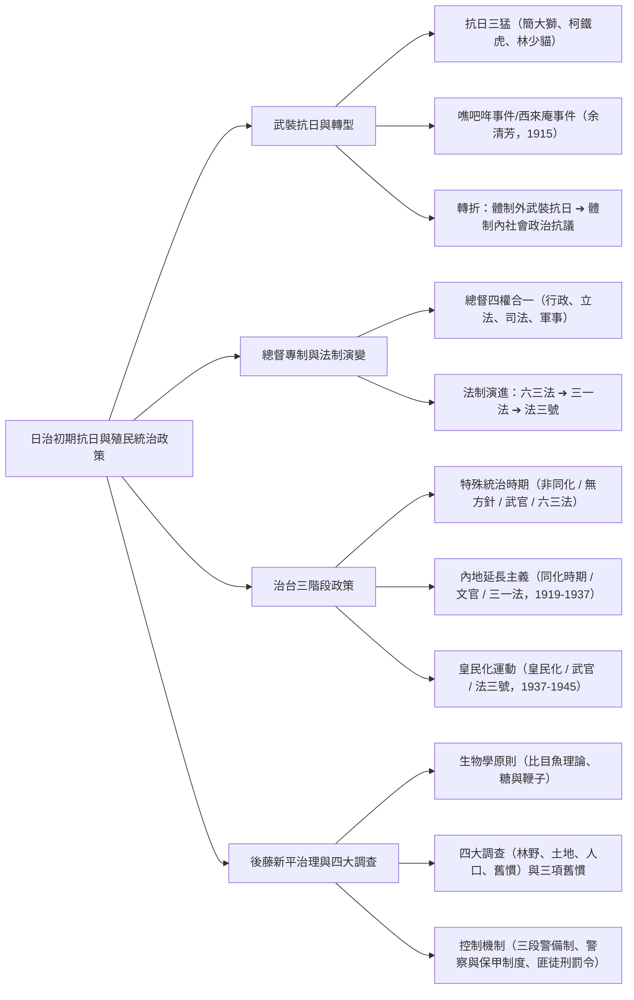
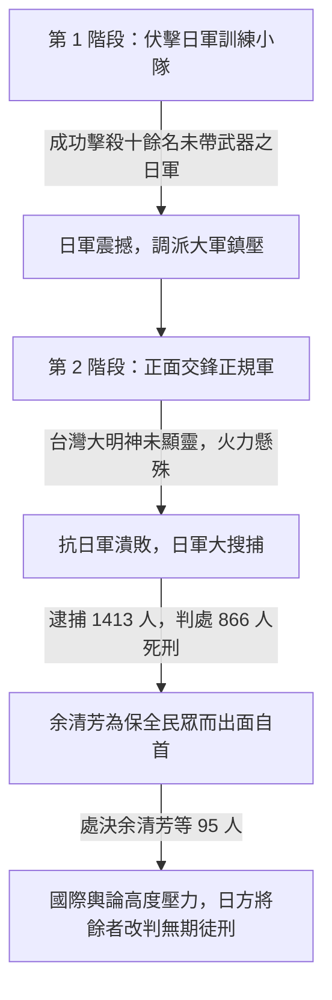
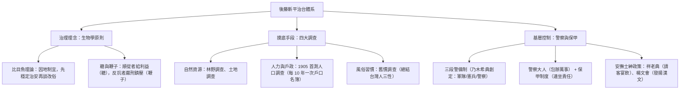

## 📖 課堂主題與核心摘要 (Class Overview)
本堂課深入剖析台灣日治時期的武裝抗日運動及其轉型，並詳細梳理日本殖民政府在台的統治政策與法制演化脈絡。課程首先講授「抗日三猛」與漢人最大規模的「噍吧哖事件（西來庵事件）」，說明體制外武裝抗日失敗後，台灣人轉向體制內合法社會抗爭的關鍵歷史轉折。接著重點解析總督府「四權合一」的獨裁體制、治台三階段政策（特殊統治、內地延長主義、皇民化運動）與法制演變（六三法、三一法、法三號），並深度剖析民政長官後藤新平如何運用「生物學原則」與「四大調查」建立全方位的殖民治理網絡。

---

## 💡 核心知識點與觀念詳解 (Key Concepts)

### 一、 日治初期武裝抗日運動與歷史轉折

#### 1. 抗日三猛（「貓科動物」口訣）
日治初期（1895–1902年間）各地武裝抗日勢力起伏，其中最著名的三位地方領袖被後世稱為「抗日三猛」：
- **簡大獅（北部／台北）**：活躍於北部山區抗日。
- **柯鐵虎（中部／雲林）**：以雲林大埔山區為據點，發起抗日行動。
- **林少貓（南部／屏東、高雄）**：活躍於鳳山、屏東一帶。後經日方懷柔招降，於高雄內門開墾跟田，但日警懷疑其密謀造反，最終遭圍捕槍斃。
  - **課堂補充故事與現代延伸**：課堂中提及，當年舉報林少貓密謀造反的人姓蘇，後來在現代政壇曾被拿來質疑是否為蘇貞昌祖父，形成藍綠陣營攻防議題（蘇陣營回應為無稽之談）。

#### 2. 噍吧哖事件（西來庵事件／余清芳事件，1915年）
- **歷史地位**：台灣漢人**最大規模**且**最後一次**體制外武裝抗日事件。
- **發生地點**：台南噍吧哖（今台南玉井），當地為平埔族大武嘠族（大湖龍人）之根據地，余清芳煽動平埔族原住民一同抗日。
- **領導人與宗教啟示**：余清芳本為西來庵廟公（廟宇管理者），宣稱夢見「台灣大明神」降臨賜予天命，宣稱加入抗日者未來可享「吃不完的米、用不完的錢、住不完的房子」，並稱神明會顯靈抵禦日軍槍砲。
- **事件經過流程圖**：

- **課堂經典細節與照片舉例**：
  - 日警抓到余清芳後視為特大功勞（攸關升官與加獎），派出所全體員警特別集體合照留念，並將照片洗成明信片發給每位警察，右上角還特別貼上警察個人的大頭照作為證明。
- **重大轉折影響**：
  - 1915 年後，漢人因付出的代價太過慘烈而**不再進行武裝抗日**。
  - 適逢日本本土進入「大正民主時期」，台灣人的抗爭路線正式由**體制外武裝抗日**轉型為**體制內合法政治社會運動**（上街抗議、請願、文化協會等）。

#### 3. 霧社事件（1930年）之性質釐清
- 課堂特別強調：1930 年原住民發起的霧社事件（莫那·魯道），其本質是**爭取山林資源與反抗日警壓迫**，並非基於近代漢人的「民族國家認同」或政治獨立訴求。

---

### 二、 總督專制權力與法制演變三部曲

日本雖於 1895 年已建立《大日本帝國憲法》之君主立憲體制，但並未將憲法保障完全延伸至台灣，而是將台灣視為「殖民地」，賦予台灣總督極大的專制獨裁權力。

#### 1. 總督的「四權合一」獨裁權力
台灣總督一人獨攬四大權力，權限甚至超越日本天皇在本土的憲政分權：
1. **行政權**：掌管台灣最高行政事務。
2. **立法權**：可自行頒布具法律效力的「律令」。
3. **司法權**：控制裁判與刑罰體系。
4. **軍事權（統帥權）**：指揮駐台陸海軍。

#### 2. 法制演變三部曲（《六三法》➔《三一法》➔《法三號》）
隨著治台政策演變，總督的立法權限受到逐步修正與限制：

| 法律名稱 | 頒布年份 | 適用治台時期 | 總督立法權限（律令）之變化與核心特徵 |
| :--- | :--- | :--- | :--- |
| **《六三法》** （律令第63號） | 1896年 | 特殊統治時期 | **總督享有獨立立法權**：總督得發布具法律效力之律令，並可發布緊急命令（如《匪徒刑罰令》），不受本土法律限制。 |
| **《三一法》** （律令第31號） | 1906年 | 內地延長主義過渡期 | **律令不得違背日本本土法律**：總督仍可制定律令，但其內容**不得牴觸適用於台灣之日本本土法律與敕令**。 |
| **《法三號》** （律令第3號） | 1921年 | 內地延長主義時期 | **原則適用日本法律，取消總督獨立立法權**：日本本土法律原則上全盤適用於台灣，總督僅能在特殊需要時發布補充性律令。 |

---

### 三、 日治時期三大治台政策階段深度對比

日治時期五十年（1895–1945）的治理策略可精準劃分為三個階段：

| 比較維度 | 第一階段：特殊統治時期 | 第二階段：內地延長主義時期 | 第三階段：皇民化運動時期 |
| :--- | :--- | :--- | :--- |
| **時間範圍** | 1895 – 1919 年 | 1919 – 1937 年 | 1937 – 1945 年 |
| **關鍵年代速記** | 領台初 – 19 年 | 19 年 – 37 年 | 37 年 – 45 年 |
| **總督背景派任** | **武官總督**（著重武力鎮壓治安） | **文官總督**（著重法治、教育與同化） | **武官總督**（因應二戰爆發全面動員） |
| **核心統治方針** | **非同化主義**（無方針主義） | **同化主義**（一視同仁、內地延長） | **皇民化**（塑造台灣人為忠君皇民） |
| **背景歷史事件** | 鎮壓武裝抗日、後藤新平建設 | 一戰後威爾遜提出「民族自決」 | 七七事變爆發、中日戰爭與二戰 |
| **主要適用法律** | 《六三法》 | 《三一法》 ➔ 《法三號》 | 《法三號》 |
| **台灣人抗爭形式** | 體制外武裝抗日（噍吧哖事件） | 體制內社會運動（議會設置請願等） | 配合軍需動員與南進基地化 |

---

### 四、 後藤新平的治理哲學與四大調查

第四任總督兒玉源太郎與民政長官**後藤新平**搭配期間，確立了日治初期關鍵的治理架構。

#### 1. 生物學原則與比目魚理論
- **生物學原則**：後藤新平本身為醫師出身，主張用生物學眼光看待台灣社會。
- **比目魚比喻**：一般魚類的眼睛長在兩側，比目魚的眼睛則長在同一側。若硬要把比目魚的眼睛改到兩側，魚就會死亡。統治台灣亦同，不可硬套日本本土法規，必須尊重台灣既有的風俗習慣與文化（「無方針主義」／先搞定治安，不急於同化）。
- **糖與鞭子**：對順從合作者給予經濟利益（糖）；對反抗者則施以嚴刑峻法（鞭子，如頒布《匪徒刑罰令》）。

#### 2. 四大調查（精準掌控台灣資源）
後藤新平為了向日本本土展現台灣能在 \\(15\\) 年內實現財政獨立，開展了大規模調查：
1. **林野調查**：釐清山林資源產權。
2. **土地調查**：精確丈量土地，建立地籍資料，增加地稅收入。
3. **人口調查**：1905 年實施首次「國勢調查」，規定每 \\(10\\) 年調查一次，建立詳細的戶口名簿。
   - **課堂生活實例**：戶口名簿詳細記錄鴉片吸食、纏足、疫苗接種、原住民身分乃至性病（如梅毒）等紀錄。若向戶政事務所申辦日治戶口名簿（費用約 \\(30\\) 元），能查出祖先是否為養子、住址歷史圖層等有趣家族細節。
4. **舊慣調查（台灣人「三大習性／三大陋習」）**：
   - 後藤新平總結台灣人有三大弱點：**貪錢（貪財）、怕死、愛面子**。
   - **應對之道**：
     - 貪錢 ➔ 給予商業好處或特權收買。
     - 怕死 ➔ 以武力與死刑威脅（刀架脖子）。
     - 愛面子 ➔ 當眾剝奪尊嚴（如當街打屁股處罰）。
   - **收買士紳階級手段**：
     - **祥老典**：召集地方老者與士紳宴飲招待，給予禮遇。
     - **楊文會**：「楊」即發揚，「文」指漢文文章，透過贊助漢文學術活動安撫傳統知識份子。

#### 3. 基層治安控制網絡
- **三段警備制**（第三任總督乃木希典提出）：將台灣分為危險區（軍隊鎮壓）、不穩區（憲兵維安）、安全區（警察治理）。
- **警察大人與保甲制度**：
  - **警察**：權力極大且包辦萬事（衛生、戶政、治安），民間尊稱為「大人」（課本比喻為觀世音菩薩）。
  - **保甲制度**：源自清代，日方加以嚴密化。以 \\(10\\) 戶為 \\(1\\) 假（設甲長），\\(10\\) 假（即 \\(100\\) 戶）為 \\(1\\) 保（設保正），實行**連坐責任制**，一人犯法全保受罰。

---

## ⚠️ 老師強調考點與易錯陷阱 (Exam Focus & Pitfalls)

### 必考重點（星號必背）
1. **1915 噍吧哖事件的歷史定位（極高頻考點）**：
   - 務必記住這是**漢人最後一次大規模武裝抗日**。
   - 之後台灣抗爭路線發生轉變：**體制外武裝抗日 ➔ 體制內合法政治社會運動**。
2. **法制三部曲演變順序與核心限制**：
   - 《六三法》（總督獨裁立法） ➔ 《三一法》（不得違背日本法） ➔ 《法三號》（原則適用日本法）。
3. **治台三階段口訣與年代數字**：
   - 關鍵年份 \\(1919\\)（一戰後/內地延長）與 \\(1937\\)（中日戰爭/皇民化）。
   - 總督背景轉換：武官 ➔ 文官 ➔ 武官。

### 常見觀念陷阱
1. **陷阱：誤以為霧社事件是漢人的民族主義抗日**：
   - 錯！1930 年霧社事件係原住民（賽德克族）反抗日警勞役壓迫與爭取森林資源，與漢人近代民族國家認同無關。
2. **陷阱：誤以為「內地延長主義」代表台灣人獲得與日本本土完全平等的權利**：
   - 錯！內地延長主義本質上是為了防止台灣受「民族自決」影響而獨立所採取的「同化政策」，實質上仍存在嚴重的種族歧視與權力不對等。
3. **陷阱：混淆三段警備制的區域分工**：
   - 危險區用**軍隊**；不穩區用**憲兵**；安全區才用**警察**。

---

## 🔑 記憶口訣與解題技巧 (Mnemonics & Shortcuts)

### 1. 核心口訣背誦包
- **抗日三猛「貓科動物」口訣**：
  - **獅・虎・貓**（北：簡大**獅**、中：柯鐵**虎**、南：林少**貓**）。
- **治台三階段總整理口訣（課堂神級口訣）**：
  > **「特殊內地皇民化，1937 到 45；武官文官又武官，63、31、法三號。」**
  - **第一句（階段與年代）**：特殊統治 ➔ 內地延長（\\(1919\\)） ➔ 皇民化（\\(1937 - 1945\\)）。
  - **第二句（總督與法律）**：武官總督 ➔ 文官總督 ➔ 武官總督；《六三法》 ➔ 《三一法》 ➔ 《法三號》。

### 2. 題目破題關鍵字判斷法
- 看到「**西來庵、廟公、台灣大明神、符籤、台南玉井、最後一次武裝抗日**」 ➔ 秒答：**噍吧哖事件（余清芳）**。
- 看到「**生物學原則、比目魚、糖與鞭子、四大調查**」 ➔ 秒答：**後藤新平**。
- 看到「**貪錢、怕死、愛面子**」 ➔ 秒答：**舊慣調查（台灣人三大習性）**。
- 看到「**十戶一甲、十甲一保、連坐法**」 ➔ 秒答：**保甲制度**。

---

## 📝 課後作業與待辦事項 (Homework & Tasks)

- **下次小考預告**：老師叮嚀 **11 月將進行單元小考**，請務必熟記本章日治初期法制演變與三階段對比表格。
- **課後待辦事項**：無特定書面作業，建議利用本筆記之對比表與口訣進行自我背誦測驗。

---

## 📚 專有名詞與重要公式/定義 (Glossary & Formulas)

* **抗日三猛**：指日治初期活躍於台灣北、中、南三地的武裝抗日領袖簡大獅、柯鐵虎與林少貓。
* **噍吧哖事件（西來庵事件）**：1915 年由余清芳領導，結合宗教迷信與平埔族發起的抗日事件，為漢人規模最大且最後一次武裝抗日。
* **六三法（律令第63號）**：1896 年頒布，賦予台灣總督得頒布具法律效力律令之專制大權。
* **三一法（律令第31號）**：1906 年頒布，規定總督頒布之律令不得違背適用於台灣之日本本土法律。
* **法三號（律令第3號）**：1921 年頒布，規定日本本土法律原則上直接適用於台灣，取消總督之獨立立法權。
* **生物學原則（比目魚理論）**：後藤新平提出之治理哲學，主張統治殖民地應順應當地舊慣風俗，不可強行套用日本本土體制。
* **四大調查**：日治初期後藤新平推動之林野調查、土地調查、人口調查（1905 首測）與舊慣調查。
* **保甲制度**：日治時期基層控制體系，以 \\(10\\) 戶為 \\(1\\) 假、\\(10\\) 假為 \\(1\\) 保，實行戶戶相連之連坐責任制。

---

## 🧠 課後自測題 (Quick Review Quiz)

### 題一：單選思考題
**題目**：日治時期某位民政長官曾提出：「治理台灣就像對待比目魚，不能用處理一般魚類的角度去改變牠眼睛的位置。」並總結台灣人有「貪錢、怕死、愛面子」三大習性。請問這位民政長官是誰？他所採取的治理原則稱作什麼？
- **解題思維與答案**：
  - **答案**：民政長官為**後藤新平**；治理原則稱為**「生物學原則」**（或無方針主義）。
  - **解析**：後藤新平主張順應台灣既有風俗舊慣（舊慣調查），採用「糖與鞭子」併用的策略進行實質控制與經濟建設。

### 題二：觀念比較題
**題目**：請簡述《六三法》、《三一法》至《法三號》的演變過程，對「台灣總督立法權限」產生了何種關鍵變化？
- **解題思維與答案**：
  - **解析**：
    1. 《六三法》時代：總督獨攬行政、立法、司法、軍事大權，可獨立頒布具法律效力的律令（獨裁極致）。
    2. 《三一法》時代：總督律令受限，**不得牴觸**適用於台灣的日本本土法律。
    3. 《法三號》時代：日本本土法律**原則上全盤適用於台灣**，總督基本上失去獨立立法權，僅具補充解釋權。

### 題三：歷史轉折辨析題
**題目**：為何歷史學家普遍將 1915 年的「噍吧哖事件」視為台灣日治時期抗日運動的重要分水嶺？
- **解題思維與答案**：
  - **解析**：噍吧哖事件係漢人最後一次大規模體制外武裝抗日，慘重傷亡讓台灣人意識到武力無法對抗現代化日軍；加上日本本土進入大正民主時期，此後台灣人的抗爭路線全面轉型為**體制內的合法政治與社會文化運動**。

---
💡 **學霸助教複習建議**：本章節的靈魂在於「**治台三階段表格**」與「**法制三部曲演變**」，考題常結合後藤新平的四大調查出題。建議複習時先默寫「`特殊內地皇民化，1937到45`」口訣，即可輕鬆秒殺大部分歷史選擇題！