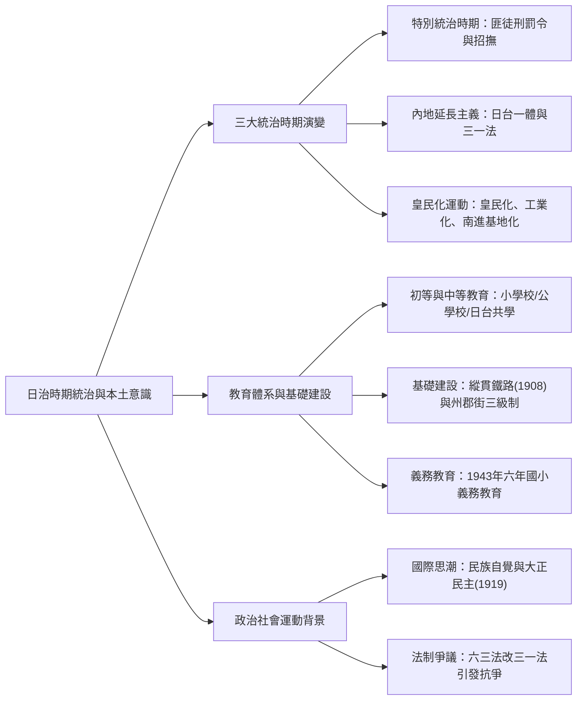
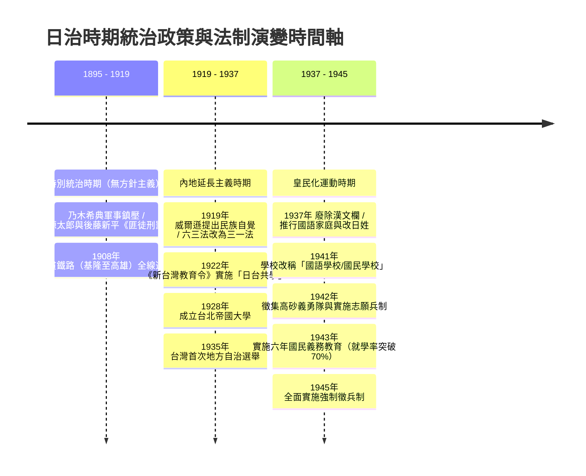
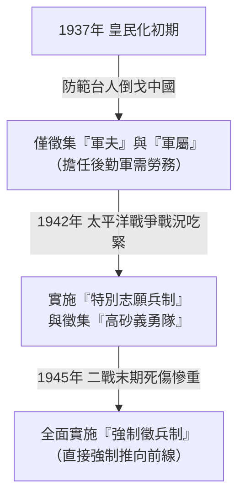

## 📖 課堂主題與核心摘要 (Class Overview)
本堂歷史課深入剖析日治時期台灣的三大統治階段演變，包含特別統治時期、內地延長主義與皇民化運動的歷史背景與核心政策。課程梳理了一戰後全球「民族自覺」思潮對日本同化政策（如「日台一體」、三一法）的催化，以及二戰期間日本走入極右派軍國主義後實施的皇民化、工業化與南進基地化策略。此外，課堂亦涵蓋日治時期的教育體系變遷（公學校、中學校到日台共學與國民義務教育）與基礎建設（縱貫鐵路與州郡街制），協助學生完整掌握日治台灣的法制、社會與文化全貌。

【🌳 本課大綱樹狀心智導圖 (Mindmap)】：

## 💡 核心知識點與觀念詳解 (Key Concepts)

### 一、 三大統治時期政策與國際背景演變

1. **特別統治時期（無方針主義）**
   - **法制與鎮壓**：兒玉源太郎與後藤新平主導時期，頒布《匪徒刑罰令》，將抗日人士全數定義為「匪徒」並移送法庭（共有 `$1,413$` 人受審）。相較於乃木希典時期的純粹軍事戰鬥，此時期已轉向「法治化」與行政系統的強勢鎮壓。
   - **懷柔招撫策略**：後藤新平採取「賞老點」與物質利益懷柔台灣地方領袖，甚至安排莫那魯道等原住民領袖造訪日本、接受招待，以收買人心。

2. **內地延長主義（1919–1937）**
   - **國際思潮背景**：第一次世界大戰結束後，德意志、奧匈、俄羅斯、鄂圖曼土耳其四大帝國瓦解。美國總統威爾遜提出「民族自覺」並倡導國聯（但美國國會因戰後經濟恐慌與孤立主義未加入）。
   - **同化政策（日台一體）**：日本為防範台灣受民族自覺影響而尋求獨立，提出「內地延長主義」，宣稱將日本本土的法律、領土與教育延長至台灣，稱台灣為「內地」。
   - **法律矛盾與政治反彈**：總督府雖宣稱「日台一體」，但實際上僅將《六三法》修改為《三一法》，總督仍掌握專斷立法權。林獻堂、蔣渭水、蔡培火等人批判此為「換湯不換藥」，進而引爆台灣文化協會、台灣議會設置請願運動等一系列政治社會運動。
   - **自治試辦**：`$1935$` 年舉辦台灣首次地方自治選舉，但因隨後爆發戰爭而終止。

3. **皇民化運動（1937–1945）**
   - **戰爭背景與軍國主義**：經濟大恐慌引發全球危機，日、德（希特勒）、意（墨索里尼）三大極右派勢力抬頭，信奉軍國主義與弱肉強食，企圖「以戰爭解決經濟問題」。
   - **三大核心方針**：
     - **皇民化**：文化精神改造與精神同化。
     - **工業化**：因應軍需，轉向軍事物資生產。
     - **南進基地化**：面對美國經濟制裁（禁運石油、鋼鐵），日本轟炸珍珠港並進攻東南亞奪取資源，將台灣視為南進戰略跳板。
   - **人力徵集演變**：
     - **初期（1937起）**：僅徵集「軍夫」與「軍屬」（後勤人員），不敢直接派台灣人至中國戰場，擔心「同文同種」引發倒戈。
     - **中期（1942起）**：太平洋戰爭爆發後人力吃緊，實施「陸軍特別志願兵」與徵集「高砂義勇隊」。
     - **後期（1945年）**：戰爭末期傷亡慘重，全面實施「強制徵兵制」。

---

### 二、 日治時期的教育與基礎建設

1. **基礎建設與行政區劃**
   - **全島交通一體化**：`$1908$` 年縱貫鐵路（基隆至高雄）全線通車，串聯西部位地。
   - **行政與治安網絡**：實施「州、郡、街（庄）」三級制（五州三廳），並結合警察網絡深入基層控制。

2. **教育制度變遷**
   - **早期差別教育（1922前）**：初等教育依身分分為「小學校」（日人）與「公學校」（台人）。中等教育方面，傳統「中學校」（如建中、台南一中）主要供日人就讀；台人多讀實業/技術學校（如師範學校、農試所、醫學校）培養基層技術人才。林獻堂等仕紳因而自籌創辦「台中學校」（今台中一中）爭取台人教育權。
   - **日台共學（1922《新台灣教育令》）**：因應內地延長主義，開放中等以上學校台人升學。
   - **高等教育**：`$1928$` 年成立台北帝國大學，主因係為了提供「灣生」（日籍在台子弟）升學，台籍學生極少。
   - **皇民化與普及教育**：`$1937$` 年廢除漢文；`$1941$` 年將小學校與公學校統一改稱為「國民學校」；`$1943$` 年實施「六年國民義務教育」，學齡兒童就學率突破 `$70\%$`。

---

### 課堂經典比喻與生活實例
- **【左右派的課堂比喻】**：老師以「課間下課」比喻左右派差異：
  - **右派（自由主義）**：主張極致自由與個人競爭。如老師宣布下課自由活動，大家各自為政；但當右派走向極端（極右派），便會主張弱肉強食與適者生存，甚至視戰爭為解決經濟危機的捷徑（將失業者徵召入伍、工廠改產軍火、靠掠奪賠款養活本國）。
  - **左派（社會主義）**：強調集體團結。如下課時要求全班留下來一起打掃環境，雖然犧牲了個人自由，但換取了集體的整體福祉。
- **【「國語家庭」的生存綁定】**：皇民化時期推行「國語（日語）家庭」與改日姓，老師特別強調這是將「文化改造」與「基本生存需求」強制捆綁。因為戰時物資實施嚴格配給制，只有獲得「國語家庭」認定的戶籍，才能獲分較多的糧食與民生物資。
- **【前總統李登輝的升學故事】**：老師藉由李登輝的求學經歷說明當時台人的教育困境。李登輝在公學校時期為了考第一名，常在晚上宿舍熄燈後躲在廁所苦讀。公學校日籍校長看重其才華，親自向中學校（傳統僅收日人）校長擔保「若他沒拿第一名我就辭職」，才破例錄取。李登輝後來於 `$1928$` 年成為台北帝國大學農業系的首批台籍學生（當時台帝大嚴格限制台人就讀政治人文學科）。

---

### 【⏱️ 時序時間軸 / 步驟流程圖】

#### 1. 日治時期台灣統治政策演變時間軸

#### 2. 日治時期台人軍事人力徵集演變流程圖

---

### 【📊 觀念與易混淆對比表】

#### 表一：三大統治時期核心特徵對比表
| 對比維度 | 特別統治時期（1895–1919） | 內地延長主義（1919–1937） | 皇民化運動（1937–1945） |
| :--- | :--- | :--- | :--- |
| **國際與時代背景** | 乙未割台、殖民初期鎮壓 | 一戰結束、民族自覺、大正民主 | 二戰爆發、軍國主義、經濟大恐慌 |
| **核心統治方針** | 特別統治（無方針主義）、警察政治 | 同化主義、日台一體 | 皇民化、工業化、南進基地化 |
| **關鍵法制與政策** | 《六三法》、《匪徒刑罰令》 | 《三一法》、《新台灣教育令》 | 廢漢文、正廳改善、寺廟整理 |
| **文化與宗教態度** | 尊重並調查舊慣（如保甲制） | 漸進同化、推廣日語 | 強制改日姓、拜神道教（神佛升天） |
| **軍事與人力徵調** | 鎮壓內部抗日力量 | 社會治安維護 | 徵集軍夫/軍屬 \\(\rightarrow\\) 志願兵 \\(\rightarrow\\) 強制徵兵 |

#### 表二：日治時期學制與學校類型對比表
| 學校類別 | 主要招生對象 | 學校名稱與代表 | 課程重點與設立目的 |
| :--- | :--- | :--- | :--- |
| **日人初等教育** | 日籍子弟（灣生） | **小學校** | 比照日本本土課程，資源豐富 |
| **台人初等教育** | 台灣漢籍子弟 | **公學校** | 國語（日語）學習為主，實施同化 |
| **原住民初等教育** | 原住民子弟 | **蕃人公學校 / 蕃童教育所** | 基礎日語與山地撫育管理 |
| **中等技術學校** | 台人為主（培養基層人才） | **實業學校、師範學校、醫學校** | 培養基層技術人力（如農、工、師資、醫療） |
| **傳統普通中學** | 日人為主（極少數台人） | **中學校**（如建中、台南一中） | 高級升學預備（台人多需赴日留學或讀台中學校） |
| **台人自辦中學** | 專為台灣子弟設立 | **台中學校**（今台中一中） | 林獻堂等台籍仕紳出資創辦，爭取教育權利 |

## ⚠️ 老師強調考點與易錯陷阱 (Exam Focus & Pitfalls)

- **《六三法》與《三一法》的實質差異（必考首選）**：
  - **陷阱**：題目常誤導「三一法實施後，總督便失去了立法權」。
  - **破解**：三一法雖然規定日本國內法律原則上適用於台灣，但總督仍擁有發布具有法律效力之「律令」的特別權限，本質上仍是獨裁統治，被林獻堂等人批為「換湯不換藥」。
- **關鍵年份 `$1919$` 年的歷史交會點**：
  - `$1919$` 年是多項重大事件的交集點，極易考綜合排序題：一戰結束國聯成立、威爾遜提出民族自覺、韓國爆發三一運動、中國爆發五四運動，以及台灣進入內地延長主義時期。
- **台人參戰人力徵集的時間點順序（極易混淆）**：
  - **陷阱**：誤以為高砂義勇隊或徵兵制在二戰一爆發（`$1937$` 年）就實施。
  - **正確脈絡**：`$1937$` 年僅徵集後勤的**軍夫/軍屬**；`$1942$` 年（太平洋戰爭）才開始實施**志願兵**與**高砂義勇隊**；`$1945$` 年（戰爭末期）才實施**強制徵兵**。
- **台北帝國大學（`$1928$` 年成立）的設立初衷與限制**：
  - **陷阱**：以為台北帝大是為了嘉惠台灣廣大青年而建。
  - **破解**：台北帝大主要是為了提供日人「灣生」升學，且嚴格限制台籍學生就讀政治、人文或法律系，台人多半僅能進入醫學或農學領域。
- **宗教政策中的「神佛升天」**：
  - 皇民化後期推行「寺廟整理」，強制收繳民間傳統信仰的神像並集中焚燒，官方稱此過程為「神佛升天」，意在全盤廢除台灣本土民間信仰，全面改拜神道教。

## 🔑 記憶口訣與解題技巧 (Mnemonics & Shortcuts)

- **解題關鍵字快速判斷法（三階段統治速判 SOP）**：
  - **若題幹出現**：「匪徒刑罰令」、「保甲制度」、「賞老點」、「乃木希典」、「兒玉源太郎/後藤新平」 \\(\rightarrow\\) **直接定位【特別統治時期】**。
  - **若題幹出現**：「日台一體」、「三一法」、「日台共學」、「大正民主」、「民族自覺」、「地方自治選舉」 \\(\rightarrow\\) **直接定位【內地延長主義】**。
  - **若題幹出現**：「廢漢文」、「國語家庭/改日姓」、「正廳改善/寺廟整理/神佛升天」、「南進基地」、「高砂義勇隊/志願兵/徵兵」 \\(\rightarrow\\) **直接定位【皇民化運動】**。
- **軍事人力徵集口訣**：
  - **「37 夫屬，42 志勇，45 徵兵」**（`$1937$` 年軍夫軍屬；`$1942$` 年志願兵與高砂義勇隊；`$1945$` 年強制徵兵）。

## 📝 課後作業與待辦事項 (Homework & Tasks)

- **課後複習**：重點閱讀講義第 `$70$` 至 `$72$` 頁內容，複習「台灣文化協會」、「台灣議會設置請願運動」與「台灣民眾黨」等團體之成立背景與訴求。
- **課後作業**：無特定指派作業，請自行完成課本對應章節之選擇題練習。

---

## 📚 專有名詞與重要公式/定義 (Glossary & Formulas)

* **《匪徒刑罰令》**：特別統治時期由兒玉源太郎總督頒布，將抗日人士定義為匪徒，運用刑法系統嚴加處決，確立日本在台的法治鎮壓體系。
* **內地延長主義**：`$1919$` 年起日本因應「民族自覺」思潮採取的同化政策，強調將日本本土（內地）法律、制度與教育延長至台灣，主張「日台一體」。
* **《三一法》**：`$1921$` 年取代《六三法》之法律，宣稱日本法律適用台灣，但總督仍保有補充律令權，實質上維持獨裁立法權。
* **皇民化運動**：`$1937$` 年二戰爆發後日本在台推行的全盤同化運動，包含「皇民化（文化同化）」、「工業化」與「南進基地化」三大方針。
* **國語家庭**：皇民化時期全家通曉日語且改用日式姓名的家庭，可獲得官方頒發之認定，並在戰時配給制中獲得較多民生物資。
* **寺廟整理（神佛升天）**：皇民化後期強行廢止台灣傳統寺廟、集中焚燒傳統神像的宗教控制運動，逼迫民眾改信日本神道教。
* **高砂義勇隊**：`$1942$` 年太平洋戰爭期間，日本利用台灣原住民適應熱帶叢林作戰之特長，招募組成的南洋戰場特別部隊。
* **《新台灣教育令》（1922）**：內地延長主義時期頒布之教育法規，取消名義上的差別教育，實施中等學校以上的「日台共學」。

## 🧠 課後自測題 (Quick Review Quiz)

**第一題：**
日本在 `$1919$` 年將台灣的統治方針轉變為「內地延長主義」，其最主要的國際外部背景為何？而台灣知識份子為何仍對此時期的《三一法》感到不滿？
> **解題思維與答案**：
> 1. **外部背景**：一戰結束後四大帝國瓦解，美國總統威爾遜提出「民族自覺」思潮，日本為防止台灣人萌生獨立意識，故推行同化政策以維護殖民統治。
> 2. **不滿原因**：雖然《三一法》宣稱日本法律延長至台灣，但總督依然保留了發布「特別律令」的專斷權力，實質上並未改變總督獨裁的本質，被稱為「換湯不換藥」。

**第二題：**
皇民化時期，日本政府如何巧妙地將「文化改造（如日語推廣、改日姓）」與「民眾的生存需求」互相結合？
> **解題思維與答案**：
> 日本政府利用二戰期間物資匱乏、實施嚴格「配給制」的時機，規定凡全家通曉日語並改用日式姓名的家庭可認定為「國語家庭」。國語家庭在物資配給時能獲得較高配額與優先照顧，從而誘使民眾為了生存而接受皇民化改造。

**第三題：**
請說明日治時期台人進入軍事體系服務的「三個階段演變」，並指出各階段的時間點與性質。
> **解題思維與答案**：
> 1. **第一階段（1937年起）**：徵集「軍夫與軍屬」，僅擔任後勤勞務與物資運送，防範台人倒戈。
> 2. **第二階段（1942年起）**：因太平洋戰爭爆發，實施「陸軍特別志願兵」與招募「高砂義勇隊」前往南洋參戰。
> 3. **第三階段（1945年）**：二戰末期日軍傷亡慘重，全面實施「強制徵兵制」，強制台人進入前線作戰。

---

💡 **溫馨提示**：如果需要將這份筆記產出為簡報、心智圖、單字卡或進一步生成考前測驗題，隨時告訴我，我可以為你進一步製作成各式學習工具！