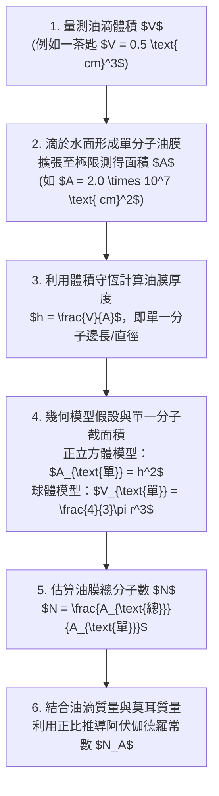

## 📖 課堂主題與核心摘要 (Class Overview)

本堂課為高中物理的核心基礎單元，主題涵蓋「數量級判斷」、「物理單位前綴」、「四種基本交互作用與微觀尺度」，以及「富蘭克林油膜實驗推算分子大小與阿伏伽德羅常數」。課堂中老師特別釐清了科學記號以 \\(\sqrt{10} \approx 3.16\\) 作為數量級進位臨界點的標準判準，並透過生活化的比喻（如皮秒雷射、卡路里與香蕉換算、行動電源庫侖數）介紹各項國際單位（SI）與能量換算。最後藉由富蘭克林油膜實驗的幾何模型拆解，引導學生掌握微觀尺度的數量級估算與最新 SI 單位（如利用普朗克常數定義公斤）的推導邏輯，為即將到來的第一次段考與學測複習奠定堅實基礎。

```mermaid
graph LR
  Root["數量級、物理單位與微觀世界"] --> A["數量級與單位前綴"]
  Root --> B["四種基本交互作用"]
  Root --> C["油膜實驗與微觀估算"]
  Root --> D["SI單位與物理常數定義"]
  
  A --> A1["數量級進位判準：$a > \sqrt{10} \approx 3.16$"]
  A --> A2["單位前綴 ($G, M, k, m, \mu, n, p, f, a$)"]
  A --> A3["能量單位對比 ($\text{J}, \text{cal}, \text{度}, \text{eV}, \text{mAh}$)"]
  
  B --> B1["強力：維護原子核穩定 ($10^{-15} \text{ m}$ / 飛米)")
  B --> B2["弱力：引發 $\beta$ 衰變與質中子變身 ($10^{-18} \text{ m}$ / 阿米)")
  
  C --> C1["形狀模型假定：正立方體 vs 球體"]
  C2["分子厚度估算：$h = \frac{V}{A}$"]
  C --> C3["莫耳分子數與阿伏伽德羅常數正比推算"]
  
  D --> D1["時間單位：秒擺 $T=2\pi\sqrt{\frac{L}{g}}$ 與銫原子鐘"]
  D --> D2["質量單位：普朗克常數 $h$ 反推公斤 ($\text{kg}$)"]
```

---

## 💡 核心知識點與觀念詳解 (Key Concepts)

### 1. 數量級判定原則與國際單位前綴 (Orders of Magnitude & Prefixes)

*   **數量級（Order of Magnitude）進位規準**：
    將任意物理量寫為科學記號 \\(N = a \times 10^b\\)（其中 \\(1 \le a < 10\\)）。由於對數尺度（Log scale）的中點為 \\(\sqrt{10} \approx 3.16\\)，故進位判斷標準如下：
    *   若 \\(a > \sqrt{10} \approx 3.16\\)，則數量級取 **\\(10^{b+1}\\)**（強制進位）。
    *   若 \\(a < \sqrt{10} \approx 3.16\\)，則數量級維持 **\\(10^b\\)**（保持原狀）。

    **【經典例題拆解與試算】**：
    *   **電子質量**：\\(m_e = 9.11 \times 10^{-31} \text{ kg} \implies 9.11 > 3.16 \implies \text{數量級為 } 10^{-30} \text{ kg}\\)
    *   **電子電量**：\\(e = 1.6 \times 10^{-19} \text{ C} \implies 1.6 < 3.16 \implies \text{數量級為 } 10^{-19} \text{ C}\\)
    *   **光速**：\\(c = 3.0 \times 10^8 \text{ m/s} \implies 3.0 < 3.16 \implies \text{數量級為 } 10^8 \text{ m/s}\\)
    *   **一光年距離**：\\(1 \text{ ly} = 9.46 \times 10^{15} \text{ m} \implies 9.46 > 3.16 \implies \text{數量級為 } 10^{16} \text{ m}\\)

*   **常見單位前綴與生活實例**：
    老師以醫美雷射作為生活比喻：
    *   **皮秒雷射（Pico-laser）**：作用時間為皮秒等級（\\(10^{-12} \text{ s}\\)），時間極短且脈衝能量極高，能精準震碎毛孔色素，打的時候會聞到臉部蛋白質燒焦味。
    *   **淨膚雷射**：作用時間為奈米等級（\\(10^{-9} \text{ s}\\)），能量較溫和，用於日常去角質與表皮保養。

*   **常見能量單位與換算總整理**：
    1.  **焦耳 (\\(\text{J}\\))**：SI 標準能量單位（\\(\text{N} \cdot \text{m} = \text{kg} \cdot \text{m}^2 \cdot \text{s}^{-2}\\)）。
    2.  **卡路里 (\\(\text{cal}\\))**：熱量單位。\\(1 \text{ cal} \approx 4.2 \text{ J}\\)；反之 \\(1 \text{ J} \approx 0.24 \text{ cal}\\)。
    3.  **電費單位「度」(\\(\text{kWh}\\))**：功功率與時間之積。
        \\[ 1 \text{ 度} = 1 \text{ kW} \times 1 \text{ h} = 1000 \text{ W} \times 3600 \text{ s} = 3.6 \times 10^6 \text{ J} \\]
    4.  **電子伏特 (\\(\text{eV}\\))**：微觀粒子（如電子、光子）專用能量單位。\\(1 \text{ eV} = 1.6 \times 10^{-19} \text{ J}\\)。
    5.  **電池電容量 (\\(\text{mAh}\\))**：注意！這**不是能量**，而是**電量（庫侖 \\(\text{C}\\)）**單位。
        \\[ 1 \text{ mAh} = 10^{-3} \text{ A} \times 3600 \text{ s} = 3.6 \text{ A} \cdot \text{s} = 3.6 \text{ C} \\]
        *課堂實例*：容量 \\(2300 \text{ mAh}\\) 的行動電源，其儲存的總電量為：
        \\[ Q = 2.3 \text{ A} \times 3600 \text{ s} = 8280 \text{ C} \approx 8.28 \times 10^3 \text{ C} \\]

---

### 2. 四種基本交互作用與微觀尺度對比 (Fundamental Interactions)

物理學中自然界四大基本作用力分別支配不同的尺度領域，課堂重點著重於原子核內部的「強力」與「弱力」：

*   **原子與原子核尺度**：
    *   原子整體直徑：約 \\(1 \text{ \AA} = 10^{-10} \text{ m}\\)。
    *   原子核直徑：約 \\(10^{-15} \text{ m} = 1 \text{ fm}\\)（飛米）。
*   **強力（Strong Interaction）**：
    *   **核心功能**：克服質子間強烈的電磁排斥力，將質子與中子緊緊束縛在原子核內。
    *   **作用範圍**：僅限於原子核內部尺度，約 **\\(10^{-15} \text{ m}\\)（飛米 \\(\text{fm}\\)）**。若原子序大於 83（如鈾等重元素），原子核過大導致強力無法全面籠罩時，原子核會丟出部分粒子引發 **\\(\alpha\\) 衰變**。
*   **弱力（Weak Interaction）**：
    *   **核心功能**：引發基本粒子的「變身」（如中子衰變成質子、電子與反微中子），為引發 **\\(\beta\\) 衰變**與太陽內部**核融合反應**的主因。
    *   **作用範圍**：極短，僅約 **\\(10^{-18} \text{ m}\\)（阿米 \\(\text{am}\\)）**。

#### 📊 觀念與易混淆對比表：基本交互作用對比

| 比較項目 | 強力 (Strong Force) | 弱力 (Weak Force) | 電磁力 (Electromagnetic) | 重力 (Gravity) |
| :--- | :--- | :--- | :--- | :--- |
| **主要功能** | 維持原子核穩定、束縛夸克與核子 | 引發粒子變身與放射性衰變 | 電子繞核運動、分子間作用力 | 支配宏觀天體運動與重力場 |
| **代表現象** | \\(\alpha\\) 衰變、原子核結合能 | \\(\beta\\) 衰變、太陽內部核融合 | 正負電相吸、摩擦力、正向力 | 蘋果落地、行星繞日 |
| **作用範圍** | \\(\approx 10^{-15} \text{ m}\\) (飛米 \\(\text{fm}\\)) | \\(\approx 10^{-18} \text{ m}\\) (阿米 \\(\text{am}\\)) | 無限遠 (\\(r^{-2}\\) 遞減) | 無限遠 (\\(r^{-2}\\) 遞減) |
| **相對強度** | \\(1\\) (最強) | \\(\approx 10^{-13}\\) | \\(\approx 10^{-2}\\) | \\(\approx 10^{-39}\\) (最弱) |

---

### 3. 經典油膜實驗：估算分子大小與阿伏伽德羅常數 (Oil Film Experiment)

富蘭克林（Benjamin Franklin）將一茶匙的油倒在湖面上，油滴鋪展成單分子厚度的薄膜，藉此可推算分子的幾何尺度與阿伏伽德羅常數。

#### ⏱️ 油膜實驗步驟與推導流程圖



#### 【經典學測例題步驟拆解】

**【已知條件】**：油滴體積 \\(V = 0.5 \text{ cm}^3\\)，擴張之油膜面積 \\(A = 2.0 \times 10^7 \text{ cm}^2\\)，油的密度 \\(\rho = 0.95 \text{ g/cm}^3\\)，油的莫耳質量為 \\(200 \text{ g/mol}\\)。假定油分子為緊密排列之正立方體。

1.  **推導單一分子厚度（邊長 \\(h\\)）**：
    由體積公式 \\(V = A \times h\\) 移項得：
    \\[ h = \frac{V}{A} = \frac{0.5 \text{ cm}^3}{2.0 \times 10^7 \text{ cm}^2} = 2.5 \times 10^{-8} \text{ cm} = 2.5 \times 10^{-10} \text{ m} = 0.25 \text{ nm} \\]
2.  **計算水面上鋪展之總分子數 \\(N\\)**：
    單一正立方體分子的頂面截面積 \\(A_{\text{單}} = h^2 = (2.5 \times 10^{-8} \text{ cm})^2 = 6.25 \times 10^{-16} \text{ cm}^2\\)。
    \\[ N = \frac{A_{\text{總}}}{A_{\text{單}}} = \frac{2.0 \times 10^7 \text{ cm}^2}{6.25 \times 10^{-16} \text{ cm}^2} = 3.2 \times 10^{22} \text{ 個} \\]
    *(註：依數量級進位規準，\\(3.2 > 3.16\\)，故數量級可估為 \\(10^{23}\\) 個)*。
3.  **反推一莫耳分子數（阿伏伽德羅常數 \\(N_A\\)）**：
    該滴油的總質量 \\(m = V \times \rho = 0.5 \text{ cm}^3 \times 0.95 \text{ g/cm}^3 = 0.475 \text{ g}\\)（若以一茶匙 \\(5 \text{ cm}^3\\) 計則為 \\(4.75 \text{ g}\\)）。
    依質量與分子數成正比：
    \\[ \frac{4.75 \text{ g}}{3.2 \times 10^{22} \text{ 個}} = \frac{200 \text{ g/mol}}{N_A} \implies N_A \approx 4.2 \times 10^{23} \text{ 個/mol} \\]

---

### 4. 國際單位制（SI）與基本物理常數推導 (SI Units & Constants)

*   **時間單位（秒，\\(\text{s}\\)）**：
    *   古代：定義為一平均太陽日的 \\(\frac{1}{86400}\\)。
    *   秒擺（Second Pendulum）：擺角極小時，單擺週期公式為 \\(T = 2\pi \sqrt{\frac{L}{g}}\\)。當擺長 \\(L = 1 \text{ m}\\)、\\(g \approx 9.8 \text{ m/s}^2 \approx \pi^2\\) 時，來回一次的週期 \\(T \approx 2 \text{ s}\\)（單趟為 1 秒）。
    *   現代定義：採用**銫-133（\\(\text{Cs}\\)）**原子鐘躍遷輻射頻率作為極高精準度的定義。
*   **長度單位（公尺，\\(\text{m}\\)）**：
    *   古代定義：經過巴黎從北極到赤道子午線距離的**千萬分之一（\\(\frac{1}{10,000,000}\\)）**。
    *   現代定義：以真空中的**光速 \\(c\\)** 定義。
*   **質量單位（公斤，\\(\text{kg}\\)）定義推導**：
    2019 年國際度量衡大會正式廢除「國際公斤原器」，改用**普朗克常數 \\(h\\)** 進行基本物理單位定義。
    
    **【普朗克常數單位推導公斤 SOP】**：
    *   已知能量焦耳 \\(\text{J} = \text{N} \cdot \text{m} = (\text{kg} \cdot \text{m} \cdot \text{s}^{-2}) \cdot \text{m} = \text{kg} \cdot \text{m}^2 \cdot \text{s}^{-2}\\)
    *   普朗克常數 \\(h\\) 的單位為 \\(\text{J} \cdot \text{s}\\)，帶入得：
        \\[ [h] = \text{kg} \cdot \text{m}^2 \cdot \text{s}^{-1} \\]
    *   移項求公斤（\\(\text{kg}\\)）的表示式：
        \\[ 1 \text{ kg} = \frac{h \cdot \text{s}}{\text{m}^2} = h \cdot \text{s} \cdot \text{m}^{-2} \\]

---

## ⚠️ 老師強調考點與易錯陷阱 (Exam Focus & Pitfalls)

1.  **數量級判定切勿使用四捨五入（五進位）**：
    *   *常見陷阱*：學生習慣看到 \\(4 \times 10^5\\) 就以為小於 5 不用進位。
    *   *觀念校正*：數量級是基於對數軸，臨界值是 **\\(\sqrt{10} \approx 3.16\\)**！因為 \\(4 > 3.16\\)，所以 \\(4 \times 10^5\\) 的數量級必須強制進位成 **\\(10^6\\)**！
2.  **公制單位 vs 國際單位名詞混淆**：
    *   「公厘/毫米」（\\(\text{mm}\\)）\\(= 10^{-3} \text{ m} = 0.1 \text{ cm}\\)（公制長度單位）。
    *   「厘米/厘米」（\\(\text{cm}\\)）\\(= 10^{-2} \text{ m} = 1 \text{ cm}\\)（國際常用單位）。
    *   考試看到「厘米」千萬不要誤算成 \\(10^{-3} \text{ m}\\)。
3.  **油膜實驗的模型幾何假定差異**：
    *   解題時務必看清題目是將油分子假定為**正立方體**（\\(\text{截面積 } = h^2\\)，\\(\text{體積 } = h^3\\)）還是**球體**（\\(\text{體積 } = \frac{4}{3}\pi r^3\\)）。假定不同，計算公式與係數即完全不同。
4.  **電池電量單位 \\(\text{mAh}\\) 的屬性陷阱**：
    *   \\(\text{mAh}\\) 是「**電量單位（庫侖 \\(\text{C}\\)）**」，絕非電功率（\\(\text{W}\\)）或能量（\\(\text{J}\\)）。選項中若問「該行動電源儲存了多少焦耳能量」，不可直接拿 \\(\text{mAh}\\) 的數值填入。

---

## 🔑 記憶口訣與解題技巧 (Mnemonics & Shortcuts)

*   **前綴負次方口訣（老師自創速記法）**：
    *   \\(10^{-3}\\) (m, 毫)：**三毫米**
    *   \\(10^{-6}\\) (\\(\mu\\), 微)：**微（喂）不飽**
    *   \\(10^{-9}\\) (n, 奈)：**Nano / Good night / 九**
    *   \\(10^{-12}\\) (p, 皮)：**皮卡丘放屁（皮等於 12，12隻皮卡丘）**
    *   \\(10^{-15}\\) (f, 飛)：**Femto / 廢米 / F五（15）**
    *   \\(10^{-18}\\) (a, 阿)：**Atto / 阿西巴 / 18**
*   **能量換算速解破題技巧**：
    *   **卡路里換焦耳**：**「一張卡片換 4.2 隻香蕉」**（\\(1 \text{ cal} \approx 4.2 \text{ J}\\)）。
    *   **電費換焦耳**：**「6636」**（\\(1 \text{ 度} = 3.6 \times 10^6 \text{ J}\\)）。
*   **數量級快速判定三步驟**：
    1. 寫成標準科學記號 \\(a \times 10^b\\)。
    2. 檢查 \\(a\\) 是否大於 \\(3.16\\)。
    3. 若大於 \\(3.16 \implies b+1\\)；若小於 \\(3.16 \implies\\) 維持 \\(b\\)。

---

## 📝 課後作業與待辦事項 (Homework & Tasks)

*   **課後講義練習**：
    *   完成講義第 10 頁與第 11 頁（富蘭克林油膜實驗經典題型：正立方體 vs 球體模型推算）。
    *   完成講義第 15 頁素養推導題（普朗克常數 \\(h\\) 與國際單位換算）。
*   **考前衝刺提醒**：
    *   距離第一次段考（10 月 6 日、7 日）僅剩**三個星期**，請務必精通前綴換算與基本交互作用之作用範圍。

---

## 📚 專有名詞與重要公式/定義 (Glossary & Formulas)

*   **數量級進位判準**：當 \\(N = a \times 10^b\\) (\\(1 \le a < 10\\))，若 \\(a > \sqrt{10} \approx 3.16\\)，則數量級為 \\(10^{b+1}\\)。
*   **單擺週期公式**：
    \\[ T = 2\pi \sqrt{\frac{L}{g}} \\]
*   **熱功當量換算**：
    \\[ 1 \text{ cal} \approx 4.2 \text{ J} \quad (1 \text{ J} \approx 0.24 \text{ cal}) \\]
*   **電能「度」定義**：
    \\[ 1 \text{ 度} = 1 \text{ kWh} = 3.6 \times 10^6 \text{ J} \\]
*   **電子伏特 (\\(\text{eV}\\))**：
    \\[ 1 \text{ eV} = 1.6 \times 10^{-19} \text{ J} \\]
*   **安培小時/毫安培小時 (\\(\text{mAh}\\))**：
    \\[ 1 \text{ mAh} = 3.6 \text{ C} \\]
*   **油膜單分子厚度公式**：
    \\[ h = \frac{V}{A} \\]
*   **普朗克常數與公斤關係**：
    \\[ 1 \text{ kg} = h \cdot \text{s} \cdot \text{m}^{-2} \\]

---

## 🧠 課後自測題 (Quick Review Quiz)

### 題一：數量級進位判斷
**題目**：已知氫原子的波爾半徑約為 \\(5.3 \times 10^{-11} \text{ m}\\)，請試求氫原子半徑與氫原子直徑的「數量級」分別為何？

*   **解題思維與答案**：
    1. 半徑 \\(r = 5.3 \times 10^{-11} \text{ m}\\)。因為 \\(5.3 > 3.16\\)，次方需加 1，故半徑數量級為 **\\(10^{-10} \text{ m}\\)**（即 \\(1 \text{ \AA}\\)）。
    2. 直徑 \\(d = 2r = 2 \times (5.3 \times 10^{-11}) = 1.06 \times 10^{-10} \text{ m}\\)。因為 \\(1.06 < 3.16\\)，次方不變，故直徑數量級亦為 **\\(10^{-10} \text{ m}\\)**。

---

### 題二：基本交互作用作用範圍與現象對應
**題目**：下列有關基本交互作用的敘述，何者正確？
(A) 強力可以引發 \\(\beta\\) 衰變，作用範圍約為 \\(10^{-18} \text{ m}\\)
(B) 弱力主要功能為克服質子間電磁排斥力以維持原子核穩定
(C) 太陽內部的核融合反應主要與弱力有關
(D) 原子核半徑大小與弱力的作用範圍相當

*   **解題思維與答案**：
    *   (A) 錯誤：引發 \\(\beta\\) 衰變的是弱力（範圍 \\(10^{-18} \text{ m}\\)）。
    *   (B) 錯誤：克服電磁排斥力維持原子核穩定的是強力。
    *   (C) **正確**：太陽核融合涉及質子與中子的轉變（變身），由弱力支配。
    *   (D) 錯誤：原子核半徑（約 \\(10^{-15} \text{ m}\\)）與強力的作用範圍相當。
    *   **答案：(C)**

---

### 題三：能量單位與電量單位綜合計算
**題目**：某同學使用的行動電源標示為 \\(10000 \text{ mAh}\\)，輸出電壓為 \\(5 \text{ V}\\)。試問：
(1) 該行動電源可釋放的總電量為多少庫侖（\\(\text{C}\\)）？
(2) 若將此電能完全轉換，約相當於多少焦耳（\\(\text{J}\\)）？（提示：能量 \\(W = Q \times V\\)）

*   **解題思維與答案**：
    1.  總電量：
        \\[ Q = 10000 \text{ mAh} = 10 \text{ Ah} = 10 \text{ A} \times 3600 \text{ s} = 36000 \text{ C} = 3.6 \times 10^4 \text{ C} \\]
    2.  總能量：
        \\[ W = Q \times V = 36000 \text{ C} \times 5 \text{ V} = 180000 \text{ J} = 1.8 \times 10^5 \text{ J} \\]
    *   **答案**：(1) \\(3.6 \times 10^4 \text{ C}\\)；(2) \\(1.8 \times 10^5 \text{ J}\\)

---

💡 這份筆記已將課堂中的觀念、口訣、公式推導與例題完整整理完畢！你可以隨時溫習這份筆記來衝刺 10 月初的第一次段考。祝你複習順利！