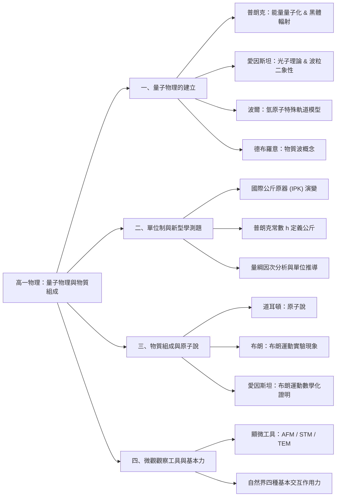
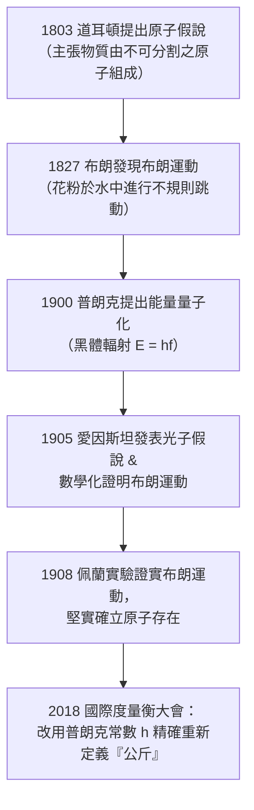

## 📖 課堂主題與核心摘要 (Class Overview)
本堂課為高中物理第十六頁「量子物理的開端」與第二十二頁「物質的組成與交互作用」之核心概念講解。課堂上半段聚焦於量子物理發展史中的四位關鍵科學家（普朗克、愛因斯坦、波爾、德布羅意），並說明「能量量子化」、「光子假說」與「波粒二象性」如何顛覆古典物理學，隨後結合新型學測長敘述素養題拆解普朗克常數與國際單位制（SI）公斤的量綱推導。課堂下半段則導入物質組成的發展脈絡，詳細解析道耳頓原子說、布朗運動的微觀物理機制與愛因斯坦的理論證明，最後介紹現代觀察原子結構的微觀顯微工具（AFM、STM、TEM）。

【🌳 本課大綱樹狀心智導圖 (Mindmap)】：

## 💡 核心知識點與觀念詳解 (Key Concepts)

### 1. 量子物理的開端與四位代表科學家
古典物理認為能量的變化是「連續性」的，但十九世紀末至二十世紀初的黑體輻射與氣體光譜實驗，揭開了能量「不連續性（量子化）」的序幕。老師特別以加熱金屬與加熱氣體兩類實驗，將四位關鍵科學家分為兩組對比：

- **加熱金屬實驗組（黑體輻射研究）**：
  - **普朗克（Max Planck, 1900）**：
    - 首位提出**能量量子化（Energy Quantization）**概念的科學家。
    - 提出振子能量與其振動頻率成正比：\\(E = h f\\)；若有 \\(n\\) 個振動粒子，能量為：
      \\[ E = n h f \quad (n \in \mathbb{N}) \\]
    - **古典連續 vs. 量子不連續比喻**：
      - *古典連續*：質量 \\(m = 1\text{ kg}\\) 的物體做自由落體，經 \\(t = 2\text{ s}\\)（設 \\(g = 10\text{ m/s}^2\\)），末速 \\(v = gt = 20\text{ m/s}\\)，動能 \\(E_k = \frac{1}{2} m v^2 = 200\text{ J}\\)。在此過程中，動能從 \\(0\text{ J}\\) 到 \\(200\text{ J}\\) 是連續變化的（包含 \\(20\text{ J}\\)、\\(30\text{ J}\\)、\\(40\text{ J}\\) 等任何實數值）。
      - *量子不連續*：在量子世界中，能量只允許特定的不連續數值存在（例如只有 \\(0\text{ J}\\)、\\(20\text{ J}\\)、\\(40\text{ J}\\)，中間的 \\(30\text{ J}\\) 絕不存在）。
      - *老師生活比喻*：能量就像去 7-Eleven 買「肉包」，只能買 1 顆、2 顆整數顆，買不到 1.5 顆或 2.5 顆。
  - **愛因斯坦（Albert Einstein, 1905）**：
    - 提出**光子假說（Photon Hypothesis）**，解釋黑體輻射出的光是以一顆顆如「肉包」般獨立的粒子包（光子）釋放能量。
    - 單一光子能量公式：
      \\[ E = h f \\]
      其中 \\(h\\) 為普朗克常數，\\(f\\) 為光子頻率。此理論完美解答了普朗克的疑惑，並確立光具有**波粒二象性（Wave-Particle Duality）**。

- **加熱氣體實驗組（氣體發光與軌道研究）**：
  - **波爾（Niels Bohr）**：將氫氣充入玻璃管加熱，觀察激發態原子回到基態發光的過程。為了建立原子不崩潰的安定模型，提出了**特殊定態軌道理論**。
  - **德布羅意（Louis de Broglie）**：提出**物質波（Matter Wave）**概念，解釋電子在特殊軌道繞核運動時具備波的特性。量子力學核心即在探討「波可以是粒子，粒子也可以是波」。

- **課堂延伸概念說明**：
  - **薛丁格的貓（Schrödinger's Cat）**：原為薛丁格提出用來反駁量子力學不確定性思想的思想實驗（把貓與毒藥封在盒子裡，未觀測前貓處於「半生半死」的疊加態）。愛因斯坦亦對不確定性抱持質疑，曾說出著名名言：「上帝不擲骰子」。
  - **量子糾纏（Quantum Entanglement）**：涉及化學中的「包利不相容原理」（同軌道電子自旋方向一上一下）。若將兩相耦電子的自旋鎖定並拉至無窮遠處，只要觀測其中一顆的自旋狀態，另一顆的狀態便瞬間確定。

### 2. 新型學測素養題型：公斤定義演變與量綱分析
課堂以講義第 20 頁的素養長敘述題為範例，拆解國際單位制（SI）的改革：
- **歷史背景**：自 1889 年起，公斤由「國際公斤原器（IPK）」定義。台灣工研院於 1995 年複製第 78 號原器。因金屬原器會隨時間吸附微塵使質量發生微小變化，2018 年國際度量衡大會正式改以**普朗克常數 \\(h\\)** 為基準改寫公斤定義。
- **單位受影響範圍**：公斤（\\(\text{kg}\\)）作為基本單位改變時，推導單位如力的單位牛頓（\\(\text{N}\\)）、壓力單位帕斯卡（\\(\text{Pa}\\)）、能量單位焦耳（\\(\text{J}\\)）、功率單位瓦特（\\(\text{W}\\)）、電量單位庫侖（\\(\text{C}\\)）、電位單位伏特（\\(\text{V}\\)）與磁場單位特斯拉（\\(\text{T}\\)）等皆會隨之改變；但長度（\\(\text{m}\\)）與時間（\\(\text{s}\\)）不受影響。
- **普朗克常數的因次導推（老師板書 SOP）**：
  普朗克常數 \\(h\\) 的單位為焦耳\\(\cdot\\)秒（\\(\text{J}\cdot\text{s}\\)），利用物理定義將導出單位逐步還原為基本單位：
  1. 由功的定義：\\(\text{J} = \text{N} \cdot \text{m}\\)
  2. 由牛頓第二運動定律 \\(F = ma\\)：\\(\text{N} = \text{kg} \cdot \text{m} / \text{s}^2\\)
  3. 帶入 \\(h\\) 的單位：
     \\[ [h] = \text{J} \cdot \text{s} = (\text{N} \cdot \text{m}) \cdot \text{s} = \left(\text{kg} \cdot \frac{\text{m}}{\text{s}^2} \cdot \text{m}\right) \cdot \text{s} = \text{kg} \cdot \frac{\text{m}^2}{\text{s}} \\]
  4. 移項求出公斤（\\(\text{kg}\\)）以 \\(h\\)、\\(\text{m}\\)、\\(\text{s}\\) 表示之數學式：
     \\[ \text{kg} = \frac{h \cdot \text{s}}{\text{m}^2} = h \cdot \text{s} \cdot \text{m}^{-2} \\]

### 3. 物質組成與布朗運動的歷史發展
- **道耳頓（John Dalton, 1803）**：首位提出「原子假說（Atomic Hypothesis）」，主張物質由不可再分割的原子（Atom）組成，奠定近代化學與物質結構的基礎。
- **布朗（Robert Brown, 1827）**：觀察懸浮於水中的花粉粒子，在顯微鏡下展現連續且不規則折線移動，稱為「布朗運動」。
- **愛因斯坦（Albert Einstein, 1905）**：將布朗運動進行嚴謹的數學化推導，指出花粉折線移動是由周圍無數看不見的水分子撞擊所致，成功證明了原子的真實存在。
- **佩蘭（Jean Baptiste Perrin, 1908）**：透過實驗驗證愛因斯坦的布朗運動理論，確立了原子的實體存在。

【⏱️ 物理學史與物理觀念演進流程圖】：

### 4. 布朗運動的微觀物理機制與顯微觀察工具
- **布朗運動軌跡分析**：
  - **觀察條件**：必須使用「顯微鏡」觀察，肉眼無法看見。
  - **直線運動段**：花粉受水分子撞擊後的合力方向，可做等速度運動或等加速度運動。
  - **轉折點產生原因**：花粉受到周圍水分子來自不同方向的**「受力不平衡（不平均撞擊）」**，導致瞬間轉向。
- **現代微觀觀察工具對比**：
  由於原子尺寸遠小於可見光波長，無法使用光學顯微鏡觀察，現代採用以下高階工具：

【📊 現代微觀顯微工具特性比較表】：
| 顯微工具名稱 | 全稱與縮寫 | 運作原理與機制 | 適用樣本與限制 |
| :--- | :--- | :--- | :--- |
| **AFM** | 原子力顯微鏡 (Atomic Force Microscope) | 利用探針與樣品表面原子間的微小作用力感測 | 適用於多數材料表面微觀探測 |
| **STM** | 掃描穿隧顯微鏡 (Scanning Tunneling Microscope) | 利用探針與樣品間的穿隧電流與庫侖力（\\(F = k\frac{q_1q_2}{r^2}\\)） | **僅適用於導電材料** |
| **TEM** | 穿透式電子顯微鏡 (Transmission Electron Microscope) | 利用高能電子束穿透極薄樣品進行成像 | 適用於生物病毒、極薄薄膜（標本製作難度高） |

---

## ⚠️ 老師強調考點與易錯陷阱 (Exam Focus & Pitfalls)

### 1. 必考熱門考點
- **大考新型素養題型（長敘述題）**：
  - 遇到文字又臭又長的素養題時，**前段背景敘述可快速瀏覽**，重點鎖定「單位變更影響範圍」與「公式量綱轉換」。
  - 考題常要求將導出單位（焦耳、牛頓）拆解為基本單位（\\(\text{kg}, \text{m}, \text{s}\\)）進行因次代換，務必熟練 \\(F = ma\\) 與 \\(W = F \cdot d\\) 的單位推導。
- **科學家與實驗成就對應（星號必背）**：
  - **奧斯特**：發現「電流磁效應（有電生磁）」。
  - **法拉第**：發現「電磁感應（磁生電）」，非 Friday！
  - **麥克斯威**：整理電磁學方程式並預測電磁波。
  - **普朗克**：提出量子論與能量量子化。

### 2. 學生常見易錯陷阱
- **陷阱一：誤以為布朗運動是花粉「活著」或「熱運動」造成的**
  - *錯觀念*：以為花粉因為生命現象或自身熱劇烈運動而跳動。
  - *正解*：布朗運動是**水分子隨機撞擊花粉**造成的受力不平衡，即使使用死掉的花粉粒進行實驗，布朗運動依然存在。
- **陷阱二：誤解「薛丁格的貓」是真實虐貓實驗**
  - *錯觀念*：以為科學家真的拿活貓與毒藥做實驗。
  - *正解*：「薛丁格的貓」是一個**思想實驗（Thought Experiment）**，原本是用來諷刺量子力學巨觀疊加態的荒謬性。
- **陷阱三：混淆 STM 與 TEM 的適用對象**
  - *錯觀念*：以為所有電子顯微鏡都可以看病毒或任何材料。
  - *正解*：STM 依賴導電特性，**僅限導電材料**；TEM 靠電子束穿透，可觀察**生物病毒標本**（但樣品必須切得極薄）。

---

## 🔑 記憶口訣與解題技巧 (Mnemonics & Shortcuts)

### 1. 普朗克常數因次推導三步破題 SOP
遇到求 \\(h\\) 的單位或用 \\(h\\) 表示基本單位時，請依據下列 SOP 拆解：
\\[\text{焦耳 (J)} \xrightarrow{W=Fd} \text{牛頓} \cdot \text{公尺 (N} \cdot \text{m)} \xrightarrow{F=ma} \left(\text{kg} \cdot \frac{\text{m}}{\text{s}^2}\right) \cdot \text{m}\\]
因此 \\(h\\) 的單位：
\\[ [h] = \text{J} \cdot \text{s} = \text{kg} \cdot \text{m}^2 \cdot \text{s}^{-1} \\]
反推公斤：
\\[ \text{kg} = h \cdot \text{s} \cdot \text{m}^{-2} \\]

### 2. 布朗運動轉折關鍵字判斷
- 題目問及「為何軌道會產生**轉折／偏折**？」\\(\rightarrow\\) 關鍵字立刻選**「撞擊力不平均／受力不平衡」**。
- 題目問及「直線運動段」\\(\rightarrow\\) 可為等速度或等加速度運動。

---

## 📝 課後作業與待辦事項 (Homework & Tasks)

1. **課後練習題**：
   - 完成講義第 20 頁「新型學測素養題」第 3 小題（自主練習）。
2. **預習與進度規劃**：
   - 下週一課堂將從講義第 24 頁「物質的交互作用與四種基本力」正式開始講授，請提前預習。
3. **班級行政事項**：
   - 請尚未繳交個人照片（彩印）或帶水瓶的同學儘速完成（照片彩印約 10 元，請勿直接繳交黑白模糊影本）。

---

## 📚 專有名詞與重要公式/定義 (Glossary & Formulas)

* **能量量子化 (Energy Quantization)**: 能量不為連續值，而必須為某一最小能量單元（量子）之整數倍。
* **普朗克公式**:
  \\[ E = n h f \quad (n = 1, 2, 3, \dots) \\]
  其中 \\(h \approx 6.63 \times 10^{-34} \text{ J}\cdot\text{s}\\) 為普朗克常數，\\(f\\) 為頻率。
* **光子能量公式 (Photon Energy)**:
  \\[ E = h f \\]
  愛因斯坦提出，單一光子所攜帶之能量與其頻率成正比。
* **布朗運動 (Brownian Motion)**: 懸浮在流體中的微小粒子受到周圍流體分子隨機熱運動碰撞，所產生的不規則折線移動現象。
* **掃描穿隧顯微鏡 (STM)**: 利用針尖與樣品之間的量子穿隧電流來測量表面原子結構之顯微儀器，限制為樣品須具備導電性。
* **自然界四大基本交互作用 (Four Fundamental Forces)**:
  1. 重力 (Gravitational Force)
  2. 電磁力 (Electromagnetic Force)
  3. 強核力 / 強合力 (Strong Nuclear Force)
  4. 弱核力 / 弱合力 (Weak Nuclear Force)

---

## 🧠 課後自測題 (Quick Review Quiz)

### 題一：量子觀念測驗
**問**：古典物理與量子物理在描述「能量」時，最核心的根本差異為何？請以課堂中老師舉的例子進行簡短說明。
> **解析/答案**：
> 古典物理認為能量是「連續的」（例如自由落體運動中，物體動能可以連續取 0 到 200 焦耳間的任何實數值）；而量子物理認為能量是「不連續的／量子化的」（例如只能取特定數值如 0、20、40 焦耳）。如同去便利商店買「肉包」，只能買 1 顆或 2 顆整數顆，無法購買 1.5 顆。

### 題二：單位因次推導題
**問**：已知力的單位為牛頓（\\(\text{N}\\)），壓力的單位為帕斯卡（\\(\text{Pa} = \text{N}/\text{m}^2\\)）。若國際公斤原器（IPK）的質量微小改變，請利用基本單位（\\(\text{kg}, \text{m}, \text{s}\\)）推導帕斯卡（\\(\text{Pa}\\)）的因次，並說明為何帕斯卡會受到影響。
> **解析/答案**：
> 因 \\(\text{N} = \text{kg} \cdot \text{m} \cdot \text{s}^{-2}\\)，故壓力的單位：
> \\[ \text{Pa} = \frac{\text{N}}{\text{m}^2} = \frac{\text{kg} \cdot \text{m} \cdot \text{s}^{-2}}{\text{m}^2} = \text{kg} \cdot \text{m}^{-1} \cdot \text{s}^{-2} \\]
> 由於帕斯卡導出的基本因次中包含公斤（\\(\text{kg}\\)），故當公斤標準重新定義或質量改變時，帕斯卡單位必定隨之受影響。

### 題三：實驗現象診斷題
**問**：小明在顯微鏡下觀察水中的花粉粒子，發現花粉做折線跳動，他宣稱：「這是因為花粉具有生命力且進行熱運動所致。」請問小明的說法是否正確？若不正確，請指出其錯誤並給出正確的物理機制。
> **解析/答案**：
> 不正確。布朗運動並非花粉自身的生命現象或熱運動，而是周圍無數看不見的水分子從各方向隨機碰撞花粉，當各方向碰撞力不平衡時，所導致的不規則移動現象。即使使用無生命死掉的花粉，該現象依然存在。