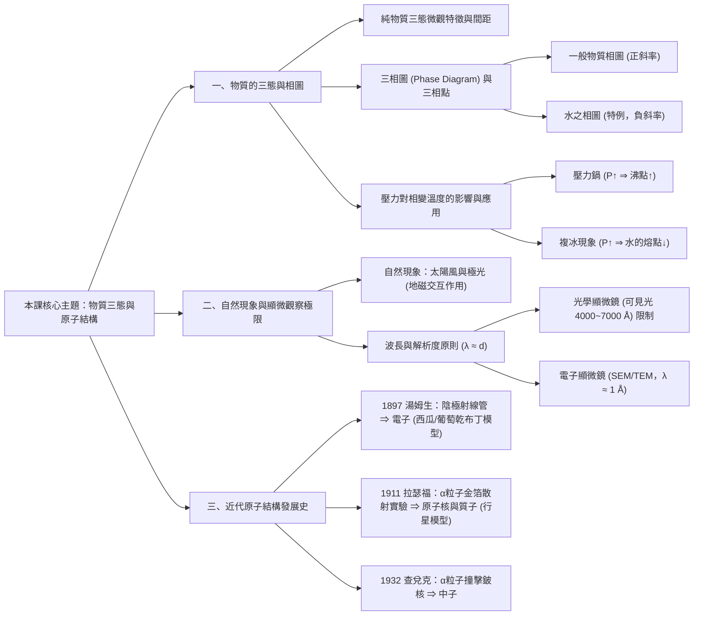
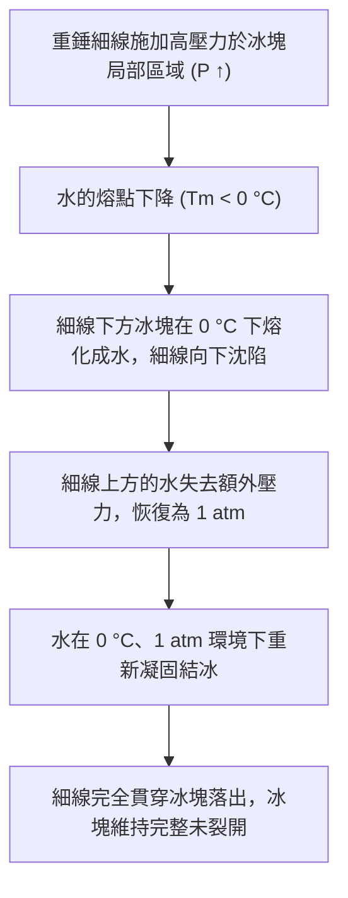
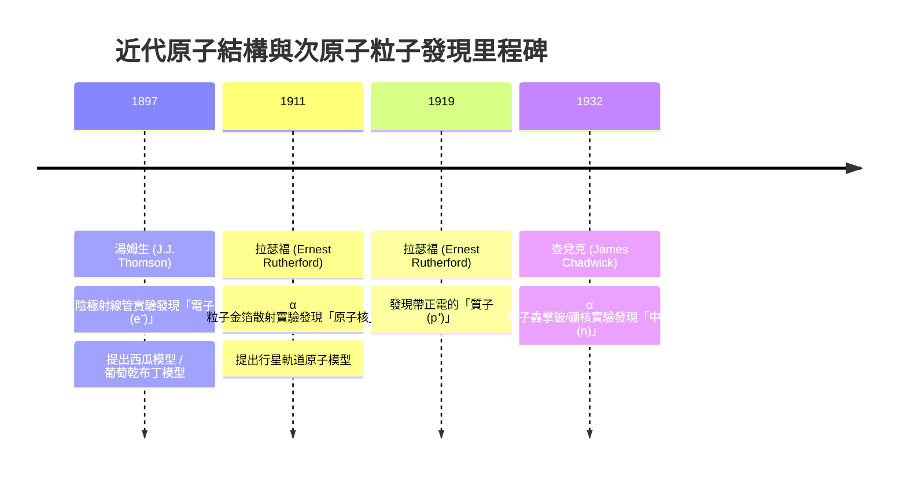

## 📖 課堂主題與核心摘要 (Class Overview)
本堂課主要圍繞高一物理「物質的三態變化」與「近代原子結構的發展史」兩大核心主題展開。課程首先說明溫度與壓力對物質三態的影響，剖析一般物質與水的三相圖特徵，並透過壓力鍋與冰塊複冰現象連結生活物理；隨後深入探討顯微觀察的波長極限，以及湯姆生、拉瑟福、查兌克三位科學家探索原子內部結構的經典實驗與重要發現。本節課的核心學習目標在於建立物質巨觀狀態（壓力和溫度）與微觀結構（原子、分子間距與原子核）的物理概念，並掌握拉瑟福金箔散射實驗推論出原子核存在的邏輯鏈。

【🌳 本課大綱樹狀心智導圖 (Mindmap)】：

## 💡 核心知識點與觀念詳解 (Key Concepts)

### 1. 物質的三態變化與分子微觀觀點
* **純物質與混合物區別**：本課討論的「固態（Solid, s）」、「液態（Liquid, l）」與「氣態（Gas, g）」均以**純物質**為對象。純物質在固定壓力下具有確定的熔點與沸點，而混合物則無固定相變溫度。水溶液之化學式標示為 \\(\text{aq}\\)（aqueous）。
* **微觀分子間距與束縛力**：
  * **固態**：分子間距最小，分子間束縛力最強，分子在固定位置作小幅度的**週期性震盪**（非完全靜止不動）。
  * **液態**：分子間距變大，具流動性，分子間仍具有一定程度的束縛力。
  * **氣態**：分子間距極大，束縛力極弱，可自由運動。
* **相變名稱與熱量**：
  * 固態 \\(\rightarrow\\) 液態：吸熱，熔化（熔點 \\(T_m\\)）；反向為凝固（放熱）。
  * 液態 \\(\rightarrow\\) 氣態：吸熱，汽化（沸點 \\(T_b\\)）；反向為凝結（放熱）。

### 2. 壓力（\\(P\\)）與溫度（\\(T\\)）對相圖的影響
* **三相圖（Phase Diagram）與三相點（Triple Point）**：
  * 以壓力 \\(P\\) 為縱軸、溫度 \\(T\\) 為橫軸劃分的三態區域圖。
  * **三相點**：固、液、氣三態動態平衡共存的特定壓力與溫度條件點。
* **一般物質 vs. 水的相圖差異**：
  * **一般物質**：固液共存線斜率為正（斜向右上）。當壓力增加時，熔點升高。
  * **水（特例）**：固液共存線斜率為負（斜向左上，因冰密度小於水）。當壓力增加時，**熔點降低**；而壓力增加時，**沸點升高**。

* **課堂經典實例分析**：
  * **生活實例 1：壓力鍋（快鍋）**
    * 原理：密閉容器內加熱使氣壓升高（\\(P > 1\text{ atm}\\)），水的沸點提高（\\(T_b > 100^\circ\text{C}\\)），食物能在高溫水蒸氣環境下迅速軟爛，縮短烹飪時間。
  * **生活實例 2：複冰現象（Regelation）**
    * 實驗設計：在 \\(0^\circ\text{C}、1\text{ atm}\\) 環境下，將兩端掛有重錘的細金屬線跨掛在方正冰塊上。
    * 物理過程拆解：
      1. 細線下方接觸面承受重錘壓力，壓力增大（\\(P \uparrow\\)）。
      2. 水的熔點下降（\\(T_m < 0^\circ\text{C}\\)），冰塊在 \\(0^\circ\text{C}\\) 環境下熔化成液態水。
      3. 細線下降切入水層中，線上方水層壓力恢復為 \\(1\text{ atm}\\)。
      4. 在 \\(1\text{ atm}、0^\circ\text{C}\\) 下，熔化成的水重新凝固結冰。
      5. 如此周而復始，細線最終貫穿冰塊落出，但冰塊依然完好未被切斷。

【⏱️ 複冰現象機制步驟流程圖】：

### 3. 自然現象與顯微觀察的物理原理
* **極光（Aurora）的形成機制**：
  * 太陽釋放帶電高能離子流（**太陽風**），吹向地球。
  * 帶電粒子受到**地磁場**（兩極磁場最強）引導，聚集於南北兩極高空。
  * 帶電粒子與高層大氣分子碰撞交互作用，激發大氣分子發出絢麗光芒。
* **波動波長與顯微解析度原則（\\(\lambda \approx d\\)）**：
  * 物理規律：欲觀察物體之微觀結構，所選用的波或光子，其**波長（\\(\lambda\\)）必須與物體尺寸（\\(d\\)）相當**。
  * 原子的尺寸：約為 \\(1\text{ \AA} = 10^{-10}\text{ m} = 0.1\text{ nm}\\)。
  * 可見光波長：約 \\(3800\text{ \AA} \sim 7800\text{ \AA}\\)（或 \\(4000\text{ \AA} \sim 7000\text{ \AA}\\)），遠大於原子尺度。
  * 結論：**光學顯微鏡（使用可見光）絕不可能觀察到原子或病毒**。必須使用波長極短的**電子顯微鏡**（如掃描電子顯微鏡 SEM、穿透電子顯微鏡 TEM）或 X 光波段（\\(\lambda \approx 1\text{ \AA}\\)）方能觀察。

### 4. 近代原子結構發展史與三粒子發現
* **原子與原子核的尺度數量級**：
  * **原子整體直徑**：約 \\(10^{-10}\text{ m} = 1\text{ \AA}\\)。
  * **原子核直徑**：約 \\(10^{-15} \sim 10^{-14}\text{ m}\\)（僅為原子的十萬分之一）。
  * 空間概念：若將原子比喻為大型體育場，原子核僅如場中央的一粒小硬幣，原子內部極度空曠。

* **拉瑟福 \\(\alpha\\) 粒子金箔散射實驗（1911）細節**：
  * **實驗裝置**：鉛盒包裹的放射性物質發射帶正電的 \\(\alpha\\) 粒子（即氦原子核 \\(\text{He}^{2+}\\)），轟擊極薄的金箔，四周環繞硫化鋅（\\(\text{ZnS}\\)）螢光屏以記錄散射角度。
  * **實驗現象**：
    1. **絕大多數（約 \\(95\%\\) 以上）** \\(\alpha\\) 粒子直接穿透金箔，幾乎不偏折。
    2. **極少數（約 \\(5\%\\)，甚至萬分之一）** \\(\alpha\\) 粒子產生大角度偏折，甚至高達 \\(180^\circ\\) 大反彈。
  * **實驗推論**：
    * 絕大多數穿透 \\(\rightarrow\\) 原子內部空間**極為空曠**。
    * 大角度反彈 \\(\rightarrow\\) 原子的**質量與所有正電荷集中在極小的區域**（稱為**原子核**），且正電的 \\(\alpha\\) 粒子與帶正電的原子核產生強烈的靜電力排斥：
      \\[ F_e = k \frac{q_1 q_2}{r^2} \\]

【⏱️ 近代原子結構發展時序時間軸】：

【📊 觀念與易混淆對比表】：

**表一：相圖與相變特性對比**
| 比較項目 | 一般物質相圖 | 水（\\(\text{H}_2\text{O}\\)）相圖 |
| :--- | :--- | :--- |
| **固液共存線斜率** | 正斜率（斜向右上） | 負斜率（斜向左上） |
| **壓力增加（\\(P \uparrow\\)）對熔點影響** | 熔點升高（\\(T_m \uparrow\\)） | **熔點降低（\\(T_m \downarrow\\)）** |
| **壓力增加（\\(P \uparrow\\)）對沸點影響** | 沸點升高（\\(T_b \uparrow\\)） | 沸點升高（\\(T_b \uparrow\\)） |
| **生活應用代表** | 一般結晶塑形、鑄造壓力 | **壓力鍋烹調、冰塊複冰現象、滑冰** |

**表二：近代三種次原子粒子發現對比**
| 粒子名稱 | 英文代號 | 發現者與年份 | 實驗方法 | 帶電荷性 | 發現者獲獎領域 |
| :--- | :--- | :--- | :--- | :--- | :--- |
| **電子 (Electron)** | \\(e^-\\) | 湯姆生 (\\(1897\\)) | 陰極射線管實驗 | 帶負電 (\\(-e\\)) | **諾貝爾物理學獎** |
| **質子 (Proton)** | \\(p^+\\) | 拉瑟福 (\\(1919\\)) | \\(\alpha\\) 粒子撞擊氮核 | 帶正電 (\\(+e\\)) | **諾貝爾化學獎** (\\(1908\\)) |
| **中子 (Neutron)** | \\(n\\) | 查兌克 (\\(1932\\)) | \\(\alpha\\) 粒子轟擊鈹核 | 不帶電 (\\(0\\)) | **諾貝爾物理學獎** |

*註：三位科學家均曾任職於著名的英國劍橋大學**卡文迪許實驗室（Cavendish Laboratory）**。*

**表三：湯姆生與拉瑟福原子模型對比**
| 模型名稱 | 提出者 | 正電荷分布形態 | 電子分布形態 | 實驗依據 | 缺陷 / 被淘汰原因 |
| :--- | :--- | :--- | :--- | :--- | :--- |
| **西瓜模型** *(葡萄乾布丁模型)* | 湯姆生 | 均勻分布於整個原子球體（如西瓜果肉/布丁） | 鑲嵌於正電荷球體中（如西瓜子/葡萄乾） | 陰極射線管發現電子 | 無法解釋 \\(\alpha\\) 粒子的**大角度散射**現象 |
| **行星模型** | 拉瑟福 | 集中於中心極小區域（**原子核**） | 環繞原子核外圍運動（如行星繞日） | \\(\alpha\\) 粒子金箔散射實驗 | 根據古典電磁學，加速運轉的電子會發射電磁波失去能量撞擊核（後由波爾修正） |

---

## ⚠️ 老師強調考點與易錯陷阱 (Exam Focus & Pitfalls)

1. **固態分子的動態觀念陷阱**：
   * ❌ **易錯觀念**：固態物體內部的原子或分子是完全「靜止不動」的。
   * ⭕ **正確觀念**：固態分子並未靜止！它們是在固定平衡位置附近進行高頻率的**週期性震盪**（Vibration）。
2. **三態適用前提**：
   * 課堂所討論的固、液、氣三態相圖與固定熔沸點，嚴格限定於**純物質**。混合物（如石油、牛奶）並無固定的熔點與沸點。
3. **拉瑟福諾貝爾獎類別考題陷阱**：
   * 老師特別提醒：拉瑟福雖然發現原子核與質子，奠定近代物理學基礎，但他獲頒的是**諾貝爾化學獎**（因其在放射性物質化學與元素衰變的研究），而非物理學獎！
4. **顯微鏡觀察限制的物理本質**：
   * 考試常問：「能否使用生物教室的光學顯微鏡觀察病毒或原子？」
   * 答案為**否**！因為可見光波長（\\(4000 \sim 7000\text{ \AA}\\)）遠大於原子（\\(1\text{ \AA}\\)），光的波長無法感知比自己小的物體細節。觀察原子必須使用電子波長相當於 \\(1\text{ \AA}\\) 的**電子顯微鏡**。
5. **金箔散射實驗的現象與推論邏輯**：
   * 大多數 \\(\alpha\\) 粒子直接穿透 \\(\Rightarrow\\) 推論：原子內部空間**極為空曠**。
   * 極少數 \\(\alpha\\) 粒子大角度反彈 \\(\Rightarrow\\) 推論：原子具有**集中幾乎全部質量且帶正電的極小原子核**。

---

## 🔑 記憶口訣與解題技巧 (Mnemonics & Shortcuts)

1. **次原子粒子英文名稱字尾規律**：
   * 物理學中微觀粒子的英文多以 `-on` 結尾：
     * 電子：\\(\text{Electron}\\)
     * 質子：\\(\text{Proton}\\)
     * 中子：\\(\text{Neutron}\\)
     * 光子：\\(\text{Photon}\\)
2. **顯微解析度極限判斷 SOP**：
   * 步驟一：確定欲觀察物體的尺寸 \\(d\\)（如原子 \\(d \approx 1\text{ \AA}\\)）。
   * 步驟二：檢查觀察光源/探針的波長 \\(\lambda\\)。
   * 步驟三：若 \\(\lambda \approx d\\)，則可清晰解析；若 \\(\lambda \gg d\\)，則必定產生繞射而無法觀察。
3. **歷史事件年代對照記憶法**：
   * 老師課堂妙喻：1894年甲午戰爭，1895年簽訂馬關條約割臺（口訣「一把死/狗屎」）；而在1897年西方湯姆生即已發現電子、開啟微觀物理學研究，以此提醒同學珍惜現代學習環境與科技成果。
4. **複冰現象快速判斷速解**：
   * 對水施加壓力 \\(P \uparrow \rightarrow\\) 熔點 \\(T_m \downarrow \rightarrow\\) 冰在 \\(0^\circ\text{C}\\) 下熔化；壓力解除 \\(P \downarrow \rightarrow\\) 熔點恢復 \\(0^\circ\text{C} \rightarrow\\) 水重新凝固結冰。

---

## 📝 課後作業與待辦事項 (Homework & Tasks)

* **課堂已完成**：講義第 \\(25\\) 頁第 \\(1\\) 題（觀念題解構）。
* **自主複習事項**：
  1. 完成講義第 \\(25\\) 頁下方的「類題」。
  2. 熟讀講義第 \\(27\sim 28\\) 頁「原子結構與金箔散射實驗」圖表細節。
* **課後作業指派**：本堂課無特別指派書面作業，請自主複習上述頁數。

---

## 📚 專有名詞與重要公式/定義 (Glossary & Formulas)

* **三相點 (Triple Point)**：物質的固態、液態與氣態達到熱力學動態平衡並同時共存的特定壓力與溫度狀態。
* **熔點與沸點 (\\(T_m, T_b\\))**：在一大氣壓（\\(1\text{ atm}\\)）下，物質由固態轉變為液態的溫度稱為熔點；由液態轉變為汽態的溫度稱為沸點。
* **複冰現象 (Regelation)**：冰塊在受壓時熔點降低而熔化成水，當壓力釋放後，水因熔點回升而重新凝固結冰的物理現象。
* **太陽風 (Solar Wind)**：太陽日冕層向外傳播的高能帶電粒子流（主要為質子與電子）。
* **埃 (\\(\text{\AA}\\))**：長度單位，常用於描述原子尺度。
  \\[ 1\text{ \AA} = 10^{-10}\text{ m} = 0.1\text{ nm} \\]
* **原子與原子核尺度**：
  * 原子直徑：
    \\[ d_{\text{atom}} \approx 1\text{ \AA} = 10^{-10}\text{ m} \\]
  * 原子核直徑：
    \\[ d_{\text{nucleus}} \approx 10^{-15} \sim 10^{-14}\text{ m} \\]
* **庫侖靜電力公式 (Coulomb's Law)**：金箔散射實驗中 \\(\alpha\\) 粒子與原子核間的排斥力公式。
  \\[ F_e = k \frac{q_1 q_2}{r^2} \\]
  （其中 \\(q_1 = +2e\\) 為 \\(\alpha\\) 粒子電荷，\\(q_2 = +Ze\\) 為金原子核電荷，\\(r\\) 為兩者距離）

---

## 🧠 課後自測題 (Quick Review Quiz)

### 問題一：複冰現象觀念題
**題目**：若在一大氣壓（\\(1\text{ atm}\\)）、\\(-10^\circ\text{C}\\) 的極地環境中，重複進行課堂上展示的「懸掛重物細線跨越冰塊」實驗，請問細線是否仍然能夠順利切穿冰塊並完成複冰？為什麼？
* **簡答與解題思維**：
  * **極難切穿（無法順利發生）**。
  * **解析**：增加壓力雖然能使水的熔點降低，但一般的重錘壓力僅能使水的熔點由 \\(0^\circ\text{C}\\) 降低 \\(1\sim 2^\circ\text{C}\\) 左右。在 \\(-10^\circ\text{C}\\) 的環境中，除非施加極度龐大的壓力，否則冰塊無法下降至 \\(-10^\circ\text{C}\\) 以下而熔化，因此複冰現象無法順利發生。

### 問題二：拉瑟福金箔散射實驗推論題
**題目**：在拉瑟福的金箔散射實驗中，若將入射的 \\(\alpha\\) 粒子（帶正電）改為高能的中子束（不帶電）轟擊金箔，請預測螢光屏上的散射現象將會發生何種變化？
* **簡答與解題思維**：
  * **幾乎所有中子都會直接直線穿透，不會產生大角度庫侖偏折**。
  * **解析**：\\(\alpha\\) 粒子產生大角度散射的原因，是帶正電的 \\(\alpha\\) 粒子與帶正電的金原子核之間存在強烈的庫侖靜電排斥力（\\(F_e = k \frac{q_1 q_2}{r^2}\\)）。中子不帶電（\\(q = 0\\)），不會受到原子核的正電靜電力排斥，故除了極罕見直接物理碰撞原子核之外，不會發生大角度電性散射現象。