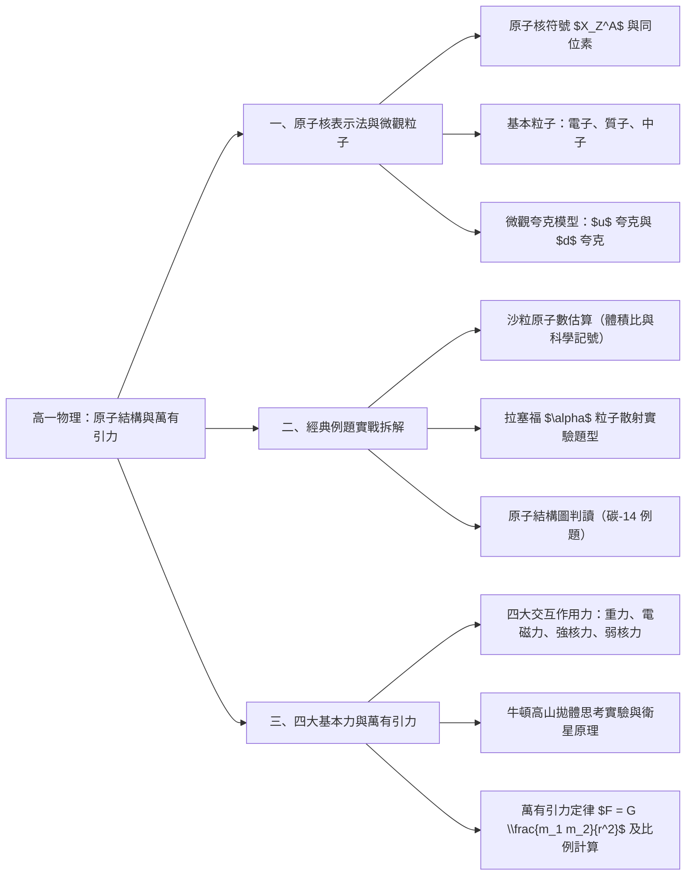
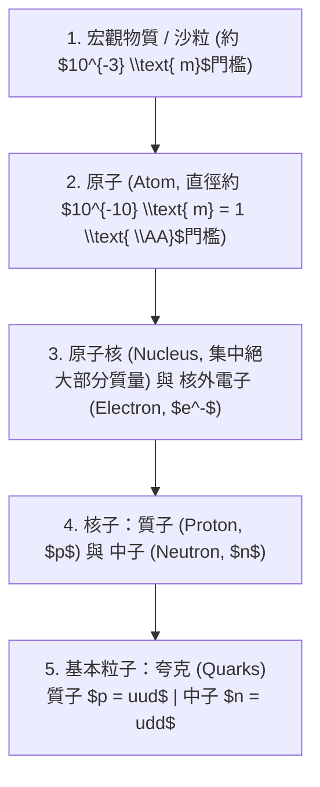

## 📖 課堂主題與核心摘要 (Class Overview)

本堂課為高一物理關鍵單元，核心圍繞於**「原子核的表示方式與微觀結構」**以及**「物質間的基本交互作用力——萬有引力」**兩大主軸。課堂首先建立原子序、質量數、同位素與夸克（上/下夸克）的微觀組成遞階，並透過墾丁白沙原子數估算、拉塞福 \\(\alpha\\) 粒子散射實驗與原子結構圖判讀等三道經典學測範例進行實戰拆解；後半段則引入自然界四大基本交互作用力，重點導出牛頓萬有引力定律，說明均勻球體質點化假設、牛頓高山拋體與人造衛星軌道原理。學習目標在於掌握微觀粒子電量與質量計算、熟悉學測常考觀念題型，以及靈活運用萬有引力距離平方反比公式進行比例推理。

---

## 💡 核心知識點與觀念詳解 (Key Concepts)

### 1. 原子核的表示方式與內部結構
在化學與物理學中，原子核的結構通常以標記符號 \\(X_Z^A\\) 或 \\(_Z^A X\\) 表示：
- **元素符號（\\(X\\)）**：代表該元素的化學符號（如 \\(\text{H}, \text{Li}, \text{C}, \text{Al}\\)）。
- **原子序（\\(Z\\)，Atomic Number）**：位於左下角。
  - **核心定義**：\\(Z\\) **永遠等於質子數**（\\(\text{Proton number}\\)）。
  - 當原子處於**中性狀態**時，質子數等於核外電子數（\\(\text{Electron number}\\)）。若形成離子（得失電子），則電子數改變，但 \\(Z\\) 仍保持不变。
- **質量數（\\(A\\)，Mass Number）**：位於左上角。
  - **核心觀念**：質量數是一個**個數（代數點數）**，代表核內「質子數 + 中子數」的總合，**並不等於原子的實際總質量（Total Mass）**。
  - 計算公式：
    \\[ A = Z + N \implies N = A - Z \\]
    （其中 \\(N\\) 為中子數 \\(\text{Neutron number}\\)）。

> **【經典課堂例題】鋰原子 \\(_3^7\text{Li}\\) 的結構拆解**：
> - 原子序 \\(Z = 3 \implies\\) 含有 \\(3\\) 個質子；在中性狀態下含有 \\(3\\) 個電子。
> - 質量數 \\(A = 7 \implies\\) 中子數 \\(N = A - Z = 7 - 3 = 4\\) 個中子。

### 2. 同位素（Isotopes）與微觀夸克結構
- **同位素定義**：具有**相同的質子數（\\(Z\\) 相同）**，但**中子數不同（\\(A\\) 不同）**的同元素原子。
  - **生活與課堂實例（氫的同位素）**：
    1. **氕（\\(\text{H}\\)）**：\\(_1^1\text{H}\\)，含有 \\(1\\) 個質子、\\(0\\) 個中子、\\(1\\) 個電子。
    2. **氘（\\(\text{D}\\)）**：\\(_1^2\text{H}\\)，含有 \\(1\\) 個質子、\\(1\\) 個中子、\\(1\\) 個電子。
    3. **氚（\\(\text{T}\\)）**：\\(_1^3\text{H}\\)，含有 \\(1\\) 個質子、\\(2\\) 個中子、\\(1\\) 個電子。

- **夸克模型（Quark Model）**：
  - 質子與中子並非不可再分的最基本粒子。1960 年代科學家利用強子對撞機（如瑞法邊境的歐洲核子研究組織 LHC，利用帶電粒子進行高速環繞碰撞）發現了夸克。
  - 高中物理聚焦於兩種最常見的夸克：
    1. **上夸克（Up quark, \\(u\\)）**：帶電量能量值為 \\(+\frac{2}{3}e\\)。
    2. **下夸克（Down quark, \\(d\\)）**：帶電量能量值為 \\(-\frac{1}{3}e\\)。
  - **質子與中子的夸克組成推導**：
    - **質子（Proton, \\(p\\)）**：由 \\(2\\) 個上夸克與 \\(1\\) 個下夸克組成（\\(uud\\)）。
      \\[\text{總電量} = \left(+\frac{2}{3}e\right) + \left(+\frac{2}{3}e\right) + \left(-\frac{1}{3}e\right) = +1e\\]
    - **中子（Neutron, \\(n\\)）**：由 \\(1\\) 個上夸克與 \\(2\\) 個下夸克組成（\\(udd\\)）。
      \\[\text{總電量} = \left(+\frac{2}{3}e\right) + \left(-\frac{1}{3}e\right) + \left(-\frac{1}{3}e\right) = 0\\]

【⏱️ 物質結構階層拆解流程圖】：

---

### 3. 課堂經典例題步驟拆解

#### 【例題一：墾丁白沙的原子數量級估算（講義第 30 頁）】
- **題目情境**：沙粒直徑約 \\(d_{\text{沙}} = 0.5\text{ mm}\\)，若原子可視為球體堆疊組成沙粒，且原子直徑約為 \\(d_{\text{原子}} = 1\text{ \AA} = 10^{-10}\text{ m}\\)，求一粒沙包含多少個原子？
- **物理概念拆解**：
  - 球體體積公式為 \\(V = \frac{4}{3}\pi r^3\\)。體積與邊長（或直徑）的三次方成正比：\\(V \propto d^3\\)。
  - 沙粒中的原子數 \\(N = \frac{V_{\text{沙}}}{V_{\text{原子}}} = \frac{\frac{4}{3}\pi (r_{\text{沙}})^3}{\frac{4}{3}\pi (r_{\text{原子}})^3} = \left(\frac{d_{\text{沙}}}{d_{\text{原子}}}\right)^3\\)。
- **單位換算與計算過程**：
  1. 沙粒直徑 \\(d_{\text{沙}} = 0.5\text{ mm} = 0.5 \times 10^{-3}\text{ m} = 5 \times 10^{-4}\text{ m}\\)。
  2. 原子直徑 \\(d_{\text{原子}} = 1\text{ \AA} = 10^{-10}\text{ m}\\)。
  3. 直徑比例：
     \\[\frac{d_{\text{沙}}}{d_{\text{原子}}} = \frac{0.5 \times 10^{-3}}{10^{-10}} = 0.5 \times 10^7 = 5 \times 10^6\\]
  4. 體積比（原子個數）：
     \\[N = \left(0.5 \times 10^7\right)^3 = (0.5)^3 \times \left(10^7\right)^3 = 0.125 \times 10^{21} = 1.25 \times 10^{20} \text{ 個}\\]
- **結論**：一粒沙子大約含有 \\(10^{20}\\) 個原子。

---

#### 【例題二：拉塞福 \\(\alpha\\) 粒子散射實驗判讀（講義第 31 頁）】
- **觀念解析**：
  - 拉塞福以帶 \\(2\\) 個正電的 \\(\alpha\\) 粒子（氦核 \\(_2^4\text{He}^{2+}\\)）轟擊金箔。
  - **實驗結果**：絕大多數 \\(\alpha\\) 粒子直線穿過或僅發生微小偏轉，但極少數發生**大角度散射**（甚至近 \\(180^\circ\\) 反彈）。
  - **核心原因**：原子內部大部分為真空，質量與正電荷集中於極小的「原子核」。當帶正電的 \\(\alpha\\) 粒子極度靠近帶正電的原子核時，強烈的**靜電排斥力**導致大角度偏折。
  - **選項澄清**：\\(\alpha\\) 粒子與電子間雖有靜電引力，但因電子質量極小，無法使動量極大的 \\(\alpha\\) 粒子產生大角度偏折。

---

#### 【例題三：原子結構示意圖判讀（講義第 32 頁）】
- **題目解析**：某元素 \\(X\\) 的圖示中包含橘色電子 \\(6\\) 個、綠色質子 \\(6\\) 個、粉紅色中子 \\(8\\) 個。
- **計算推理**：
  - 原子序 \\(Z = \text{質子數} = 6\\)。
  - 質量數 \\(A = \text{質子數} + \text{中子數} = 6 + 8 = 14\\)。
  - 該原子表示為 \\(_6^{14}X\\)（碳-14），對應選項 (B)。

---

### 4. 自然界四大基本交互作用力與萬有引力

自然界所有的作用力皆可歸納為以下四種基本交互作用：

【📊 自然界四大基本交互作用力對比表】：

| 交互作用力種類 | 主要作用對象與功能 | 相對強度 | 作用距離範圍 | 課堂直觀比喻與說明 |
| :--- | :--- | :--- | :--- | :--- |
| **強核力（強合力）** | 作用於夸克/核子之間；**強固原子核** | 最強 (\\(1\\)) | 短程（約 \\(10^{-15}\text{ m}\\)，原子核尺度） | 將帶同性正電的質子強行緊束於核內 |
| **電磁力** | 作用於帶電粒子之間；包含靜電力與磁力 | 次強 (\\(10^{-2}\\)) | 長程（無限遠，隨距離平方成反比） | 原子核吸引核外電子、分子間作用力 |
| **弱核力（弱合力）** | 作用於基本粒子；**弱化原子核**，引發衰變 | 較弱 (\\(10^{-13}\\)) | 極短程（約 \\(10^{-18}\text{ m}\\)） | 與核衰變（如 \\(\beta\\) 衰變）及太陽核融合相關 |
| **萬有引力（重力）** | 作用於所有具質量的物體之間 | 最弱 (\\(10^{-38}\\)) | 長程（無限遠，隨距離平方成反比） | 主導天體運行、天體間吸引力 |

#### 牛頓萬有引力定律（Law of Universal Gravitation）
1667 年牛頓提出萬有引力定律。
- **均勻球體質點化假設**：高一物理討論理想均勻球體時，可將整顆球體的質量簡化集中於**球心**（質點）。
- **數學公式**：
  \\[ F = G \frac{m_1 m_2}{r^2} \\]
  - \\(F\\)：兩物體間的萬有引力（互為作用力與反作用力，大小相等、方向相反）。
  - \\(m_1, m_2\\)：兩物體的質量。
  - \\(r\\)：兩球體的**球心距離**（非表面距離）。
  - \\(G\\)：萬有引力常數（由卡文迪許 Cavendish 透過扭秤實驗測得，\\(G \approx 6.67 \times 10^{-11} \text{ N}\cdot\text{m}^2/\text{kg}^2\\)）。

- **生活實例與思考實驗**：
  1. **牛頓高山拋體思考實驗（人造衛星原理）**：在山頂向水平方向拋出物體，速度越快，落地點越遠；當拋射速度達到臨界值時，物體下落的曲率剛好等於地表的彎曲率，物體便不再落回地面，而繞著地球做圓周運動（成為人造衛星）。現代長程飛彈、洲際導彈與人造衛星均源於此物理脈絡。
  2. **兩人間的萬有引力為何感知不到？**：因 \\(G\\) 值極小（\\(10^{-11}\\) 數量級），兩名普通成年人（如 \\(60\text{ kg}\\) 與 \\(50\text{ kg}\\)，相距 \\(1\text{ m}\\)）之間的萬有引力僅約 \\(2 \times 10^{-7}\text{ N}\\)，遠小於鞋底與地面的靜摩擦力，因此萬有引力只有在**天體或巨大星球之間**才有顯著物理效應。

---

#### 【例題四：萬有引力比例變化計算（講義第 38 頁）】
- **題目情境**：兩質量皆為 \\(m\\) 的球體，球心相距 \\(1\text{ m}\\) 時，引力為 \\(F\\)。若改為質量 \\(4m\\) 與 \\(2m\\)、球心相距 \\(2\text{ m}\\) 時，引力變為多少？
- **計算推導**：
  - 原始狀態：
    \\[ F = G \frac{m \cdot m}{1^2} = G m^2 \\]
  - 改變後狀態：
    \\[ F' = G \frac{(4m)(2m)}{2^2} = G \frac{8 m^2}{4} = 2 \cdot \left(G m^2\right) = 2F \\]
- **結論**：新的萬有引力為 \\(2F\\)。

---

## ⚠️ 老師強調考點與易錯陷阱 (Exam Focus & Pitfalls)

1. **質量數（\\(A\\)）與總質量的概念混淆**：
   - ⚠️ **易錯點**：學生常誤以為「質量數 \\(A\\) 就是原子的總質量」。
   - 必考修正：質量數 \\(A\\) 僅是「質子數 + 中子數」的**總個數（整數）**，並非質量的物理量度（\\(\text{Total Mass}\\)）。

2. **原子序（\\(Z\\)）與電子數的適用條件**：
   - ⚠️ **易錯點**：看到原子序就直接代入等於電子數。
   - 必考修正：\\(Z = \text{質子數}\\) 是**永遠成立**的；只有在**中性原子**時 \\(Z\\) 才等於電子數。若題幹出現離子（如 \\(\text{Na}^+\\) 或 \\(\text{Cl}^-\\)），電子數必須加減電荷量。

3. **拉塞福散射實驗的大角度偏折主因**：
   - ⚠️ **易錯點**：誤以為大角度散射是因為與核外電子碰撞。
   - 必考修正：電子質量極小，無法擋住高能量的 \\(\alpha\\) 粒子；大角度反彈 \\(180^\circ\\) 的主因是**帶正電的 \\(\alpha\\) 粒子與帶正電且質量集中的原子核產生靜電排斥力**。

4. **萬有引力公式中距離 \\(r\\) 的定義**：
   - ⚠️ **易錯點**：計算時誤用「地表距離」或「球體表面間距」。
   - 必考修正：均勻球體的萬有引力公式中，\\(r\\) 必須是**兩球心的距離**。

---

## 🔑 記憶口訣與解題技巧 (Mnemonics & Shortcuts)

### 1. 核心觀念記憶口訣
- **四大基本力理解口訣**：
  > **「強核力強固原子核，弱核力弱化引衰變；電磁力同性相斥異性吸，萬有引力天體運轉最微弱。」**

### 2. 破題 key 關鍵與解題 SOP

- **原子核符號拆解 SOP**：
  1. 看**左下角 \\(Z\\)** \\(\to\\) 直接確定**質子數**。
  2. 看**左上角 \\(A\\)** \\(\to\\) 計算中子數 \\(N = A - Z\\)。
  3. 檢查**電中性/離子態** \\(\to\\) 計算電子數（中性則等於 \\(Z\\)；帶 \\(+k\\) 電荷則電子數為 \\(Z - k\\)）。

- **萬有引力比例題型速解 SOP**：
  1. 先寫出標準公式形式 \\(F = G \frac{m_1 m_2}{r^2}\\)。
  2. 將質量變化的倍數乘在分子，距離變化的倍數乘在分母並**平方**。
  3. 提取整體係數倍率：
     \\[\text{新引力倍率} = \frac{\text{質量倍數}_1 \times \text{質量倍數}_2}{(\text{距離倍數})^2}\\]
     *例題驗證*：\\(\frac{4 \times 2}{2^2} = \frac{8}{4} = 2 \implies 2F\\)。

---

## 📝 課後作業與待辦事項 (Homework & Tasks)

- **物理課業交代**：
  - 本堂無額外紙筆作業（無特定物理作業）。
  - 請預習講義第 38 頁「重力場與重力加速度」及「電磁力與庫侖定律」。

- **課堂行政待辦事項（老師強調）**：
  - 🔔 **國文作業繳交**：請同學將「國文作業」（**兩本皆要繳交**）拿出來，由各排最後一位同學負責收齊上繳檢查。

---

## 📚 專有名詞與重要公式/定義 (Glossary & Formulas)

* **原子序（\\(Z\\)，Atomic Number）**：原子核內的質子總數，決定元素的化學性質。
* **質量數（\\(A\\)，Mass Number）**：原子核內質子數與中子數的總和，即 \\(A = Z + N\\)。
* **同位素（Isotope）**：質子數相同（同元素）但中子數不同之核種，如氕（\\(_1^1\text{H}\\)）、氘（\\(_1^2\text{H}\\)）、氚（\\(_1^3\text{H}\\)）。
* **夸克（Quark）**：構成強子（質子與中子）的基本粒子。上夸克 \\(u\\) 帶電 \\(+\frac{2}{3}e\\)，下夸克 \\(d\\) 帶電 \\(-\frac{1}{3}e\\)。
* **質子夸克組成公式**：
  \\[ p = uud \implies \text{電量 } Q = \left(+\frac{2}{3}e\right) + \left(+\frac{2}{3}e\right) + \left(-\frac{1}{3}e\right) = +1e \\]
* **中子夸克組成公式**：
  \\[ n = udd \implies \text{電量 } Q = \left(+\frac{2}{3}e\right) + \left(-\frac{1}{3}e\right) + \left(-\frac{1}{3}e\right) = 0 \\]
* **球體體積公式**：
  \\[ V = \frac{4}{3}\pi r^3 \\]
* **牛頓萬有引力定律**：
  \\[ F = G \frac{m_1 m_2}{r^2} \\]
  其中 \\(G \approx 6.67 \times 10^{-11} \text{ N}\cdot\text{m}^2/\text{kg}^2\\) 為萬有引力常數。

---

## 🧠 課後自測題 (Quick Review Quiz)

### 題一：夸克電量與核子結構
**題目**：若某未知微觀粒子由 \\(1\\) 個上夸克 \\(u\\) 與 \\(2\\) 個下夸克 \\(d\\) 組成，請計算其總電量，並說明該粒子為何種核子？

> **簡要解題思維與解答**：
> - 上夸克電量為 \\(+\frac{2}{3}e\\)，下夸克電量為 \\(-\frac{1}{3}e\\)。
> - 總電量計算：
>   \\[Q = \left(+\frac{2}{3}e\right) + 2 \times \left(-\frac{1}{3}e\right) = 0\\]
> - 電量為 \\(0\\)，故該粒子為**中子（Neutron）**。

---

### 題二：萬有引力距離與質量比例推理
**題目**：兩均勻球體原本相距 \\(R\\)，彼此間的萬有引力為 \\(F\\)。若將兩球體的質量皆變為原本的 \\(3\\) 倍，且球心距離拉長為原本的 \\(3\\) 倍，則兩球體間的新萬有引力變為多少？

> **簡要解題思維與解答**：
> - 利用萬有引力公式 \\(F = G \frac{m_1 m_2}{r^2}\\)。
> - 質量倍數：\\(m_1' = 3m_1\\)，\\(m_2' = 3m_2\\)。
> - 距離倍數：\\(r' = 3r\\)。
> - 代入新公式：
>   \\[F' = G \frac{(3m_1)(3m_2)}{(3r)^2} = G \frac{9 m_1 m_2}{9 r^2} = 1 \cdot F = F\\]
> - 答：萬有引力維持不變（**仍為 \\(F\\)**）。

---

🎯 **下一步建議**：這份筆記已完整歸納課堂的核心觀念、公式推導與例題。您可以隨時複習重點表格與易錯陷阱，若需要進一步針對萬有引力進行更多歷屆考題練習或製作單詞卡，隨時告訴我！