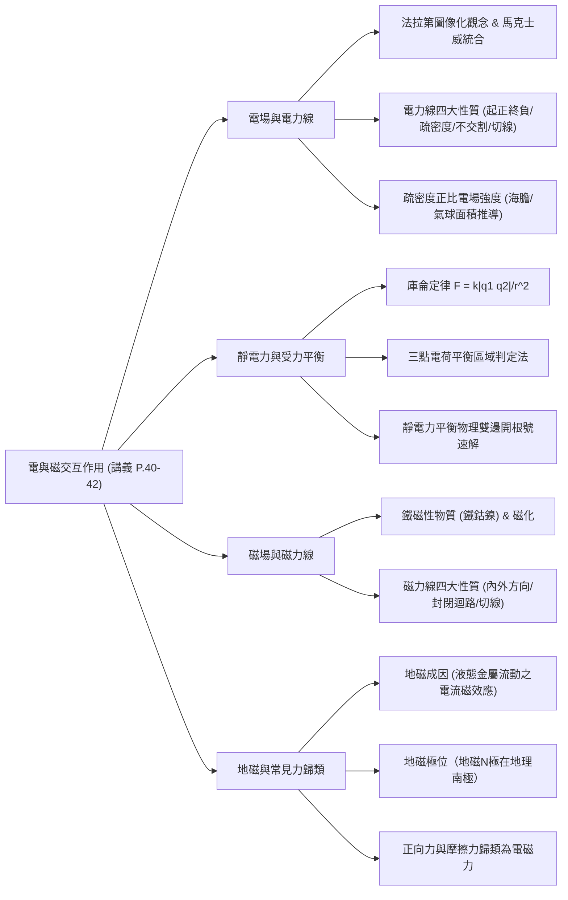
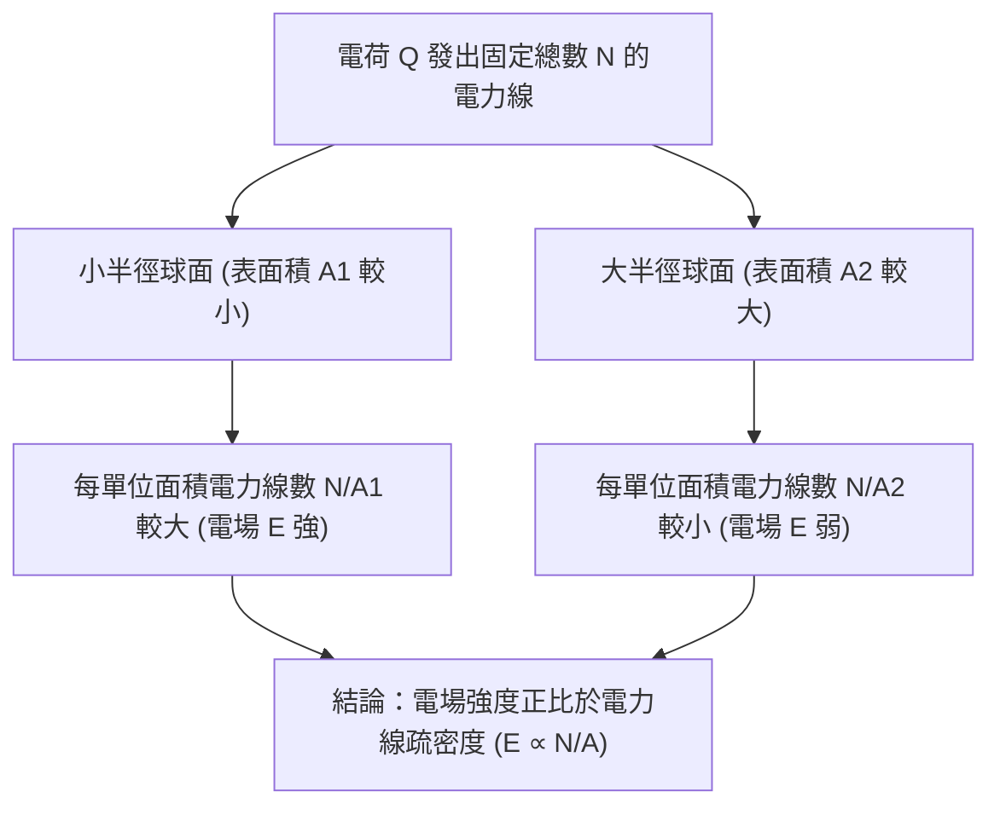

## 📖 課堂主題與核心摘要 (Class Overview)

本堂課為高中物理「靜電與磁場」單元（講義第 40 至 42 頁），核心圍繞於**電場、電力線、庫侖定律應用與磁場、地磁觀念**。課堂首先介紹法拉第如何透過圖像化的「電力線」與「磁力線」來描述場的強弱與方向，並深入解構電場疏密度的幾何推導；接著透過經典的「三點電荷受力平衡」學測改題，示範靜電力區域判定與物理雙邊開根號的速解技巧；最後延伸至磁場性質、鐵磁性物質、地磁成因與磁針指向判斷，並強調正向力與摩擦力在微觀上均歸類為電磁力。

---

## 💡 核心知識點與觀念詳解 (Key Concepts)

### 觀念一：電場（Electric Field）與電力線（Electric Field Lines）

1. **歷史脈絡與「場」的定義**：
   - **法拉第（Michael Faraday）**：雖僅有國小程度數學，但發明了**電力線**與**磁力線**，將抽象的電場與磁場圖像化。
   - **馬克士威（James Clerk Maxwell）**：將法拉第的電場與磁場理論進行完美的數學統合（電磁學大一統）。
   - **「場」（Field）**：電荷或磁極之間傳遞交互作用力的**媒介/介質**。

2. **電力線四大核心性質**：
   - **起於正，終於負**：正電荷向外發出電力線，負電荷向內吸收/收回電力線。正負電荷一對擺放時稱為「電雙極」（Electric Dipole）。
   - **疏密程度正比於電場強度**：電力線越密集處，電場強度 \\(E\\) 越大。
   - **收縮互斥不交割**：電力線沿長度方向有收縮張力，側邊互相排斥，絕不相交，亦不會形成閉合迴路（不繞圈）。
   - **切線方向即電場方向**：電力線上任一點的切線方向，即該點的電場方向。

3. **【課堂經典比喻】電場疏密度的幾何推導（每單位面積電力線數）**：
   - **疑問**：為什麼是「疏密度」代表電場大小，而不是「電力線總條數」？
   - **海膽與氣球比喻**：
     - 想像座標中心放一顆生長著固定數量刺（如 1000 根刺）的海膽（象徵正電荷 \\(Q\\) 發出的固定電力線總數）。
     - 若用半徑較小的橘色氣球（小球，表面積小）與半徑較大的綠色氣球（大球，表面積大）將其包覆，穿過兩氣球的刺總數相同。
     - 但**每平方公尺被穿過的刺數量**，必然是**橘色氣球（小球）比綠色氣球（大球）多**！
   - **數學意義**：
     - 電場強度大小定義為「每單位面積通過的電力線條數」：
       \\[ E \propto \frac{N}{A} = \frac{N}{4\pi r^2} \\]
     - 由此可完美理解：距離點電荷越近（\\(r\\) 小），表面積 \\(A\\) 小，電力線越密集，電場 \\(E\\) 越大；距離越遠（\\(r\\) 大），表面積大，電力線稀疏，電場 \\(E\\) 越小（與距離平方成反比）。
     - 電荷發出的電力線總條數與帶電量成一次方正比（\\(N \propto Q\\)）。

---

### 觀念二：庫侖靜電定律與受力平衡經典題 (P.41)

1. **庫侖靜電定律（Coulomb's Law）**：
   - 兩點電荷間的靜電力大小公式為：
     \\[ F = k \frac{|q_1 q_2|}{r^2} \\]
     其中 \\(k = 9 \times 10^9 \text{ N}\cdot\text{m}^2/\text{C}^2\\)。
   - **注意**：計算時電荷正負號不帶入公式，僅代表「同性相斥、異性相吸」，作用力方向須另行判定。

2. **經典考題（學測改題拆解）**：
   - **題目**：直線上固定兩點電荷，於 \\(x = 5a\\) 處有帶電量 \\(+4Q\\)，於 \\(x = 9a\\) 處有帶電量 \\(-Q\\)。若放置第三個點電荷 \\(+Q\\)，欲使其所受靜電力合力為 0，應放在何處？
   - **步驟一：區域平衡判定**：
     - **中間區（\\(5a < x < 9a\\)）**：\\(+4Q\\) 對其排斥向右，\\(-Q\\) 對其吸引向右，兩力同向，合力不可能為 0（不合）。
     - **左側區（\\(x < 5a\\)）**：離大電量 \\(+4Q\\) 太近，向左排斥力極大；離小電量 \\(-Q\\) 遠，向右吸引力小，無法平衡（不合）。
     - **右側區（\\(x > 9a\\)）**：離小電量 \\(-Q\\) 近、離大電量 \\(+4Q\\) 遠，排斥力與吸引力大小可相等且方向相反，**平衡點必定位於此區**！
   - **步驟二：列式與物理速解**：
     - 設該點電荷 \\(+Q\\) 位於 \\(-Q\\) 右側距離 \\(x\\) 處（即座標為 \\(9a + x\\)）：
       \\[ k \frac{(4Q)(Q)}{(4a + x)^2} = k \frac{(Q)(Q)}{x^2} \\]
     - 約分同除以 \\(k Q^2\\)：
       \\[ \frac{4}{(4a + x)^2} = \frac{1}{x^2} \\]
     - **物理速解法（雙邊開根號）**：
       因為已預先經由物理邏輯確定位置在右側（\\(x > 0\\)），免去繁複的解二次方程式，直接雙邊開根號：
       \\[ \frac{2}{4a + x} = \frac{1}{x} \implies 2x = 4a + x \implies x = 4a \\]
     - **最終答案**：位置落在 \\(x = 9a + 4a = 13a\\) 處。

---

### 觀念三：磁場（Magnetic Field）與磁力線（Magnetic Field Lines） (P.42)

1. **鐵磁性物質與磁化**：
   - **鐵磁性物質**：主要包含**鐵（Fe）、鈷（Co）、鎳（Ni）**及其合金，能被磁鐵強烈吸引。
   - **磁化（Magnetization）**：原本內部混亂無序的磁疇，在外加磁場作用下轉變為整齊排列，使物質展現磁性的過程。

2. **磁極與磁力線性質**：
   - **磁極（Poles）**：磁體磁性最強的兩端（N 極與 S 極）。目前自然界**尚未發現單磁極**，故磁力線必為連續的**封閉迴路**。
   - **磁力線方向**：
     - **磁鐵外部**：由 N 極發出，經外部空間指向 S 極。
     - **磁鐵內部**：由 S 極指向 N 極，形成完整閉合迴路。
   - **磁針 N 極指向**：磁力線上任意點的**切線方向**，即為置於該點之**小磁針 N 極所指的方向**。

---

### 觀念四：地球磁場（地磁）與基本交互作用歸類

1. **地球磁場成因與結構**：
   - **成因**：地核內部高溫高壓，存在大量熔融的**流動液態金屬（鐵、鎳）**，流動過程產生電流，透過「電流磁效應」建立全球性地磁。
   - **磁極分佈**：
     - 可假想為地球中心置有一條形磁鐵，其磁軸與地球自轉軸呈約 \\(11^\circ\\) 夾角。
     - **地磁 N 極（Magnetic North Pole）位於地理南極附近**。
     - **地磁 S 極（Magnetic South Pole）位於地理北極附近**。
     - 因此北半球指北針的 N 極會指向地理北方（被地理北方附近的「地磁 S 極」吸引）。

2. **巨觀接觸力的微觀歸類**：
   - 老師特別強調：課本定義之**正向力（Normal Force）**與**摩擦力（Friction Force）**，在微觀物理機制上均屬於**電磁力**（分子間靜電力與凡德瓦力之展現）。

---

### 📊 觀念與易混淆對比表

| 比較項目 | 電力線 (Electric Field Lines) | 磁力線 (Magnetic Field Lines) |
| :--- | :--- | :--- |
| **發明科學家** | 法拉第（Faraday） | 法拉第（Faraday） |
| **起點與終點** | 起於正電荷，終於負電荷 | 無起點與終點（**封閉迴路**） |
| **內部與外部方向** | 無內部/外部之分（非閉合迴路） | 外部：\\(\text{N} \rightarrow \text{S}\\)；內部：\\(\text{S} \rightarrow \text{N}\\) |
| **是否存在單極** | 有（可單獨存在正電荷或負電荷） | 無（至今未發現單磁極） |
| **疏密程度意義** | 正比於電場強度大 (\\(E\\)) | 正比於磁場強度大小 (\\(B\\)) |
| **切線方向物理意義** | 該點之電場方向（\\(\neq\\) 帶電粒子運動軌跡） | 該點之磁場方向（即**小磁針 N 極指向**） |

---

## ⚠️ 老師強調考點與易錯陷阱 (Exam Focus & Pitfalls)

1. **【考點一】電力線切線方向 \\(\neq\\) 粒子運動軌跡**：
   - **常見錯誤**：學生常以為將電子釋放在電力線上，電子會順著電力線的軌跡運動。
   - **正解**：電力線切線僅代表該點受到的「電場力方向」（即加速度方向），粒子的實際運動軌跡還與「初速度」及「後續受力變化」有關，絕不等於電力線本身！

2. **【考點二】磁力線內外部方向倒置陷阱**：
   - 題目常考「磁鐵內部」的磁力線方向，學生習慣直覺選 \\(\text{N} \rightarrow \text{S}\\) 而犯錯。務必記住：**內部是由 S 極指向 N 極**。

3. **【考點三】地理極與地磁極的對應關係**：
   - 地理北極附近是**地磁 S 極**；地理南極附近是**地磁 N 極**。切勿將地理北極誤認為地磁 N 極。

4. **【考點四】正向力與摩擦力的力學歸類**：
   - 多重選擇題常考常見力的分類，請務必將「正向力」與「摩擦力」勾選為**電磁力**（基本交互作用四種力之一）。

---

## 🔑 記憶口訣與解題技巧 (Mnemonics & Shortcuts)

### 1. 點電荷靜電力平衡「三區判定 SOP」：
- **同性電荷**：平衡點必落在兩電荷**中間區域**。
- **異性電荷**：平衡點必落在兩電荷**外側區域**，且**偏向帶電量較小的一側**（因為電量小需靠較近的距離 \\(r\\) 來補足力的大小）。

### 2. 靜電力平衡「物理雙邊開根號」速解法：
- 於列式 \\(\frac{Q_1}{(d+x)^2} = \frac{Q_2}{x^2}\\) 後，經由物理邏輯先確定 \\(x\\) 的區域範圍與正負號，即可**直接雙邊開根號**（\\(\frac{\sqrt{Q_1}}{d+x} = \frac{\sqrt{Q_2}}{x}\\)），直接交叉相乘求解，免去展開一元二次方程式的繁瑣計算。

### 3. 磁力線與磁針指向口訣：
- **「切線即 N 極，外出 N 入 S，內由 S 到 N」**。

---

## 📝 課後作業與待辦事項 (Homework & Tasks)

1. **物理課堂作業**：
   - 預習與練習講義 **第 45 頁** 後續範例題目。
   - 完成今日發放之物理練習考卷，於**連假後（星期二）**上課繳交。

2. **學藝與各科小老師待辦事項**：
   - 因適逢教師節前夕，請國文、英文、數學及學藝幹事（負責歷/地/公）於上課時代表全班向各科任老師表達感謝與祝福。

3. **行政與刷卡紀錄提醒**：
   - 提醒全班同學自主至校務系統查詢 9/1 至 9/23 之學生證刷卡紀錄，若有異常缺漏需及時至學務處生輔組更正，以免影響出缺勤權益。

---

## 📚 專有名詞與重要公式/定義 (Glossary & Formulas)

* **電場强度（Electric Field Strength, \\(E\\)）**：描述空間中電場強弱的物理量，單位面積通過的電力線條數正比於電場強度（\\(E \propto \frac{N}{A}\\)）。
* **庫侖定律公式（Coulomb's Law）**：
  \\[ F = k \frac{|q_1 q_2|}{r^2} \\]
  描述兩點電荷間之靜電力大小，與電量乘積成正比，與距離平方成反比。
* **電雙極（Electric Dipole）**：一對等量異號電荷相距微小距離組成的系統。
* **鐵磁性物質（Ferromagnetic Materials）**：含鐵（Fe）、鈷（Co）、鎳（Ni）等能被強烈磁化的物質。
* **磁化（Magnetization）**：磁性物質內部磁疇經外磁場作用導正為同向之過程。
* **地磁軸夾角**：地球磁軸與自轉軸之間約存在 **\\(11^\circ\\)** 之交角。

---

## 🧠 課後自測題 (Quick Review Quiz)

### 題一：電場與電力線觀念
**問題**：下列關於電力線與電場的敘述，何者正確？
(A) 電力線必定為封閉的曲線
(B) 若將一靜止帶負電粒子釋放於電力線上，粒子必定沿著電力線的軌跡運動
(C) 電力線越密集的地方，該處的電場強度越大
(D) 正電荷會向內吸收電力線

**解析與答案**：
* **答案**：**(C)**
* **解析**：(A) 電力線起於正電荷終於負電荷，非封閉曲線；(B) 切線方向為受力方向，粒子運動軌跡受初速與慣性影響，不一定等於電力線；(D) 正電荷向外發出電力線，負電荷才是吸收電力線。

---

### 題二：庫侖定律計算
**問題**：兩靜止點電荷相距 \\(r\\) 時，相互作用之庫侖靜電力為 \\(F\\)。若將兩電荷的帶電量均變為原來的 3 倍，且將兩者間的距離縮短為原來的 \\(\frac{1}{2}\\)，則兩電荷間的靜電力將變為多少？

**解析與答案**：
* **答案**：\\(36 F\\)
* **解析**：根據庫侖定律 \\(F = k \frac{|q_1 q_2|}{r^2}\\)，新靜電力：
  \\[ F' = k \frac{|(3q_1)(3q_2)|}{(\frac{1}{2}r)^2} = k \frac{9 |q_1 q_2|}{\frac{1}{4} r^2} = 36 \times \left(k \frac{|q_1 q_2|}{r^2}\right) = 36 F \\]

---

### 題三：地磁與磁力線方向
**問題**：若將一可自由轉動的小磁針置於地赤道上空，不考慮其他外加磁場，則磁針的 N 極主要會指向何方？磁鐵內部的磁力線方向為何？

**解析與答案**：
* **答案**：小磁針 N 極指向地理北方；磁鐵內部磁力線方向為由 S 極指向 N 極。
* **解析**：地球地理北方附近為地磁 S 極，故磁針 N 極會受吸引而指向地理北方。磁力線在外部由 N 指向 S，在內部則由 S 指向 N 以形成封閉迴路。

---
💡 **課後複習建議**：請結合這份筆記與講義 P.40-42 頁之圖表對照複習，並務必親自動手計算一遍三點電荷受力平衡題型，確保徹底掌握「物理雙邊開根號」之區域判斷原理！