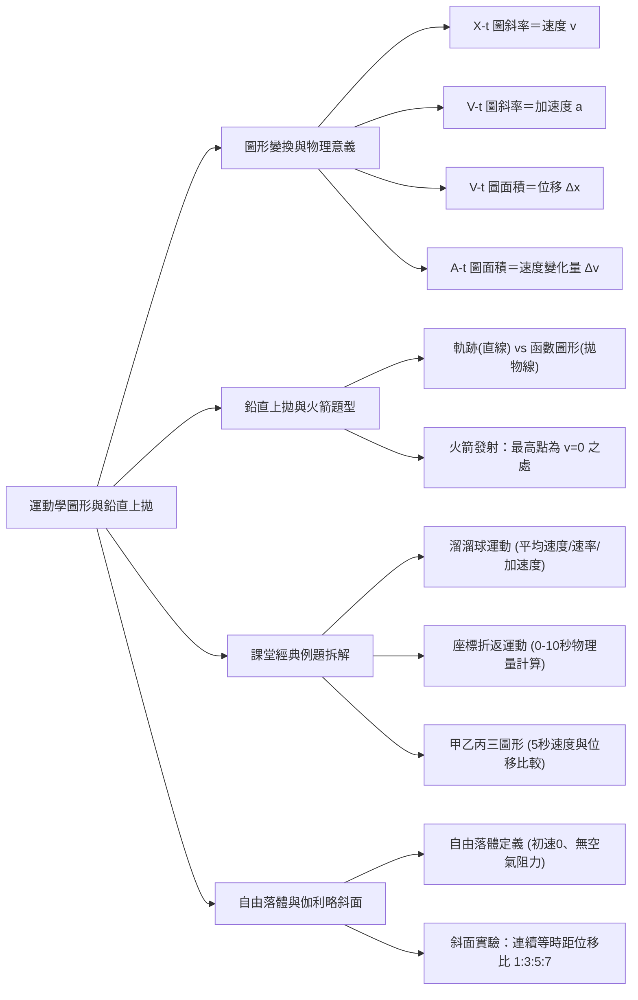
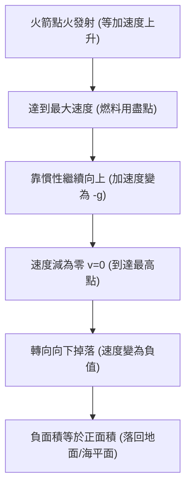

## 📖 課堂主題與核心摘要 (Class Overview)

本堂課為高中物理運動學單元的精彩複習與進階深入，重點探討運動學三大圖形（\\(X-t\\)、\\(V-t\\)、\\(A-t\\)）之間的切換技巧與物理意義。課堂中詳細剖析了鉛直上拋運動、火箭發射等經典 VT 圖考題，並透過溜溜球與折返運動例題釐清「位移與路徑長」、「平均速度與平均速率」及「平均加速度」的向量方向陷阱。最後，課堂帶領同學們深入伽利略斜面實驗的物理歷史脈絡，利用 VT 圖導出連續等時距內位移成等差數列的關鍵推導。

---

## 💡 核心知識點與觀念詳解 (Key Concepts)

### 1. 運動學三大圖形（\\(X-t\\)、\\(V-t\\)、\\(A-t\\)）的切換與物理意義

*   **斜率的物理意義**：
    *   \\(X-t\\) 圖（位置-時間圖）：圖形上一點的斜率代表該時刻的**瞬時速度 \\(v\\)**。
    *   \\(V-t\\) 圖（速度-時間圖）：圖形上一點的斜率代表該時刻的**瞬時加速度 \\(a\\)**。
*   **面積的物理意義**：
    *   \\(V-t\\) 圖下方的圖形面積：代表物體在該時間段內的**位移 \\(\Delta x\\)**（在時間軸上方面積為正，代表向正方向運動；下方為負，代表向負方向運動）。
    *   \\(A-t\\) 圖（加速度-時間圖）下方的圖形面積：代表物體在該時間段內的**速度變化量 \\(\Delta v\\)**。

---

### 2. 鉛直上拋運動與火箭發射 VT 圖解析

*   **【觀念釐清】運動軌跡 vs 函數圖形**：
    *   鉛直上拋物體的**實際運動軌跡**是一條「鉛直直線」（原路上升、原路下降）。
    *   鉛直上拋物體的**位置與時間關係（\\(X-t\\) 圖）**才是一條向下開口的「拋物線」（二次時間函數 \\(x(t) = v_0 t - \frac{1}{2}gt^2\\)）。切勿看影就開槍，誤將 \\(X-t\\) 圖的拋物線當成實際運動軌跡。
*   **速度與加速度的動態變化**：
    *   若設向上為正，初速 \\(v_0 = +30\text{ m/s}\\)，重力加速度 \\(g = 10\text{ m/s}^2\\)（即 \\(a = -10\text{ m/s}^2\\)）：
        *   \\(t = 0\text{ s}\\)：\\(v = +30\text{ m/s}\\)
        *   \\(t = 1\text{ s}\\)：\\(v = +20\text{ m/s}\\)
        *   \\(t = 2\text{ s}\\)：\\(v = +10\text{ m/s}\\)
        *   \\(t = 3\text{ s}\\)：\\(v = 0\text{ m/s}\\)（**到達最高點**）
        *   \\(t = 4\text{ s}\\)：\\(v = -10\text{ m/s}\\)
        *   \\(t = 5\text{ s}\\)：\\(v = -20\text{ m/s}\\)
        *   \\(t = 6\text{ s}\\)：\\(v = -30\text{ m/s}\\)（落回原出發點）
*   **【經典例題】火箭發射的 \\(V-t\\) 圖判讀**：
    *   **速度最大的點**：並非最高點，而是**燃料用盡的點**（此時火箭加速結束，隨後靠慣性繼續向上做鉛直上拋運動）。
    *   **最高點**：發生的時刻是 **\\(v = 0\\) 的點**（速度由正轉負的交點，此時正向累積面積最大）。
    *   **落回海平面的時刻**：當 \\(V-t\\) 圖中「時間軸上方的正面積（上升最大高度）」等於「時間軸下方的負面積（下降高度）」時，即代表火箭回發射點/海平面。

---

### 3. 課堂經典例題拆解

#### 經典例題一：溜溜球運動（講義 p.67 第 1 題）
*   **題目描述**：小聲將溜溜球以 \\(1\text{ m/s}\\) 的速率鉛直向下丟出，\\(2\\) 秒後以相同的速率相反方向回到手中。已知溜溜球的最低點離出發點為 \\(0.5\text{ m}\\) (\\(50\text{ cm}\\))。
*   **解題拆解**：
    1.  **\\(2\\) 秒內的平均速度**：
        \\[\bar{v} = \frac{\text{位移 }\Delta x}{\text{時間 }\Delta t} = \frac{0\text{ m}}{2\text{ s}} = 0\text{ m/s}\\]
        （因為溜溜球回到原出發點，總位移為 \\(0\\)）。
    2.  **\\(2\\) 秒內的平均速率**：
        \\[\text{平均速率} = \frac{\text{路徑長 }L}{\text{時間 }\Delta t} = \frac{0.5\text{ m} + 0.5\text{ m}}{2\text{ s}} = 0.5\text{ m/s}\\]
    3.  **\\(2\\) 秒內的平均加速度**：
        令向上為正、向下為負。初速 \\(v_i = -1\text{ m/s}\\)（向下），末速 \\(v_f = +1\text{ m/s}\\)（向上）。
        \\[\bar{a} = \frac{\Delta v}{\Delta t} = \frac{v_f - v_i}{\Delta t} = \frac{(+1) - (-1)}{2} = \frac{2}{2} = 1\text{ m/s}^2 \quad (\text{方向向上})\\]

#### 經典例題二：直線座標折返運動（講義 p.67 類題）
*   **題目描述**：靜止物體自原點 \\(O\\) (\\(x=0\\)) 出發，向右移動到 \\(P\\) 點折返，再經過原點 \\(O\\) 移動到 \\(Q\\) 點。已知 \\(t=10\text{ s}\\) 時物體位於 \\(Q\\) 點 (\\(x=-3\text{ cm}\\))，且此時瞬時速度 \\(v_Q = -15\text{ cm/s}\\)。
*   **解題拆解**：
    1.  **\\(0 \sim 10\\) 秒的位移**：
        \\[\Delta x = x_{10} - x_0 = (-3) - 0 = -3\text{ cm}\\]
    2.  **\\(0 \sim 10\\) 秒的平均速度**：
        \\[\bar{v} = \frac{\Delta x}{\Delta t} = \frac{-3\text{ cm}}{10\text{ s}} = -0.3\text{ cm/s}\\]
    3.  **\\(0 \sim 10\\) 秒的平均加速度**：
        末速度 \\(v_{10} = -15\text{ cm/s}\\)，初速度 \\(v_0 = 0\text{ cm/s}\\)。
        \\[\bar{a} = \frac{v_{10} - v_0}{\Delta t} = \frac{-15 - 0}{10} = -1.5\text{ cm/s}^2\\]

#### 經典例題三：三物體圖形比較（講義 p.68 範例三）
*   **題目描述**：甲、乙、丙三物體皆由靜止同地、同時出發。甲給定 \\(X-t\\) 圖（\\(0\sim 5\text{ s}\\) 為通過原點斜率為 \\(1\\) 的直線）；乙給定 \\(V-t\\) 圖（\\(0\sim 4\text{ s}\\) 等加速至 \\(2\text{ m/s}\\)，\\(4\sim 5\text{ s}\\) 保持 \\(2\text{ m/s}\\)）；丙給定 \\(A-t\\) 圖（加速度恆為 \\(0.2\text{ m/s}^2\\)）。
*   **解題拆解**：
    1.  **\\(t = 5\text{ s}\\) 時的速度比較**：
        *   \\(v_甲 = \text{斜率} = \frac{5 - 0}{5 - 0} = 1\text{ m/s}\\)
        *   \\(v_乙 = 2\text{ m/s}\\)
        *   \\(v_丙 = \text{初速} + \Delta v = 0 + (0.2 \times 5) = 1\text{ m/s}\\)
        *   **結論**：\\(v_乙 > v_甲 = v_丙\\)
    2.  **\\(0 \sim 5\text{ s}\\) 內的位移比較**：
        *   \\(\Delta x_甲 = 5 - 0 = 5\text{ m}\\)
        *   \\(\Delta x_乙 = \text{梯形面積} = \frac{(1 + 5) \times 2}{2} = 6\text{ m}\\)
        *   \Delta x_丙 = \frac{1}{2} a t^2 = \frac{1}{2} \times 0.2 \times 5^2 = 2.5\text{ m} （亦可用三角形面積計算）
        *   **結論**：\\(\Delta x_乙 > \Delta x_甲 > \Delta x_丙\\)

---

### 4. 伽利略斜面實驗與自由落體導推

*   **自由落體的物理定義**：
    1.  初速等於零（\\(v_0 = 0\\)）。
    2.  全程**不考慮空氣阻力**。
    *   公式簡化：\\(v = gt\\)，落下距離 \\(h = \frac{1}{2}gt^2\\)。
*   **伽利略斜面實驗（緩慢版自由落體）**：
    *   **設計動機**：自由落體下落極快（例如從 \\(10\text{ m}\\) 高處落下僅需約 \\(1.41\\) 秒，古代無精密電子計時器，無法精確測量），因此伽利略設計「斜面」來減緩運動速度，使其成為「緩慢版的自由落體」。
    *   **實驗過程**：在斜面上設置節拍器與鈴鐺，調整鈴鐺位置使得物體滾下時撞擊鈴鐺的「時間間隔皆相等（例如每隔 1 秒）」。
    *   **重要發現**：連續相同時間間隔內的位移比滿足：
        \\[\Delta x_1 : \Delta x_2 : \Delta x_3 : \Delta x_4 : \dots = 1 : 3 : 5 : 7 : \dots\\]
    *   **VT 圖證明**：從 \\(V-t\\) 圖可看出，每隔相同的 \\(\Delta t\\)，各時間區段下的面積剛好分割為 \\(1\\) 塊、 \\(3\\) 塊、 \\(5\\) 塊、 \\(7\\) 塊相同的基本三角形。由此證明物體在斜面上做**等加速度運動**。

---

### 📊 觀念與易混淆對比表

| 比較項目 | 平均速度 (\\(\bar{v}\\)) | 平均速率 |
| :--- | :--- | :--- |
| **定義** | 位移除以總時間 (\\(\Delta x / \Delta t\\)) | 路徑長除以總時間 (\\(L / \Delta t\\)) |
| **物理量性質** | 向量（具方向性，可正可負可為零） | 純量（僅有大小，恆為非負數） |
| **折返時的特徵** | 若回到出發點，位移為 \\(0\\)，平均速度必為 \\(0\\) | 路徑長持續累積，平均速率必大於 \\(0\\) |

| 比較項目 | 運動軌跡 (Motion Path) | 函數圖形 (\\(X-t\\) Graph) |
| :--- | :--- | :--- |
| **代表意義** | 物體在空間中實際運動移動的幾何路線 | 物體的位置座標隨時間變化的函數關係圖 |
| **鉛直上拋範例** | 鉛直直線（往上再原路往下） | 下開拋物線 (\\(x = v_0 t - \frac{1}{2}gt^2\\)) |

| 比較項目 | 火箭發射 \\(V-t\\) 圖：最大速度點 | 火箭發射 \\(V-t\\) 圖：最高點 |
| :--- | :--- | :--- |
| **物理特徵** | 燃料剛好用盡的時刻 (\\(a\\) 轉變為 \\(-g\\)) | 速度減為零的時刻 (\\(v = 0\\)) |
| **運動狀態** | 正向加速度結束，準備開始做鉛直上拋 | 物體達到最高位置，準備轉向向下掉落 |

---

## ⚠️ 老師強調考點與易錯陷阱 (Exam Focus & Pitfalls)

1.  **\\(V-t\\) 圖最高點判定陷阱**：
    *   星號必背：在火箭發射或鉛直上拋的 \\(V-t\\) 圖中，**最高點絕對不是速度最大的點**！最高點對應的是 **\\(v = 0\\) 的時刻**（正向面積累積至最大值之處）。
2.  **加速度與速度的向量正負號**：
    *   計算 \\(\bar{a} = \frac{v_f - v_i}{\Delta t}\\) 時，必須先設定正方向。若去程向下（\\(-1\text{ m/s}\\)）、回程向上（\\(+1\text{ m/s}\\)），則速度變化量為 \\((+1) - (-1) = +2\text{ m/s}\\)，絕對不能直接算成 \\(1 - 1 = 0\\)。
3.  **自由落體公式中 \\(h\\) 的物理意義**：
    *   在公式 \\(h = \frac{1}{2}gt^2\\) 中，\\(h\\) 代表物體**落下的距離**（Displacement/Distance fallen），而非離地高度。
4.  **看圖勿「看影就開槍」**：
    *   切勿把位置-時間關係圖（\\(X-t\\) 圖）的幾何形狀當成物體的實際運動軌跡。

---

## 🔑 記憶口訣與解題技巧 (Mnemonics & Shortcuts)

*   **圖形轉換切換 SOP**：
    *   **微分/求斜率方向**：\\(x(t) \xrightarrow{\text{斜率}} v(t) \xrightarrow{\text{斜率}} a(t)\\)
    *   **積分/求面積方向**：\\(a(t) \xrightarrow{\text{面積}} \Delta v \xrightarrow{\text{面積}} \Delta x\\)
*   **初速為零等加速度運動——連續等時距速解律**：
    *   若物體由靜止出發（\\(v_0 = 0\\)）做等加速度運動，在連續相等的單位時間 \\(\Delta t\\) 內：
        *   **各時段位移比**：\\(\Delta x_1 : \Delta x_2 : \Delta x_3 : \dots = 1 : 3 : 5 : 7 : 9 : \dots\\) （奇數等差數列）
        *   **總累積位移比**：\\(x_1 : x_2 : x_3 : \dots = 1 : 4 : 9 : 16 : 25 : \dots\\) （時間的平方比，\\(x \propto t^2\\)）

---

## 📝 課後作業與待辦事項 (Homework & Tasks)

*   **講義作業**：完成講義 p.67 至 p.74 所有練習題（包含歷屆學測題與北區模考試題）。
*   **解答核對**：可掃描講義 p.69 的 QR Code 核對詳細解題步驟。
*   **預習章節**：預習化學/物理跨科單元「盧瑟福（拉塞福）原子模型」（此為高中新增核心觀念，國中未詳述）。
*   **生活提醒**：近期氣溫轉冷、流感及 A 型流感流行，課堂叮嚀出入公共場所請戴好口罩，照顧好身體。

---

## 📚 專有名詞與重要公式/定義 (Glossary & Formulas)

*   **平均速度 (Average Velocity)**：物體在某段時間內的總位移與總時間的比值。
    \\[\bar{v} = \frac{\Delta x}{\Delta t} = \frac{x_f - x_i}{t_f - t_i}\\]
*   **平均速率 (Average Speed)**：物體在某段時間內所走過的總路徑長與總時間的比值。
    \\[\text{平均速率} = \frac{L}{\Delta t}\\]
*   **平均加速度 (Average Acceleration)**：物體在某段時間內的速度變化量與總時間的比值。
    \\[\bar{a} = \frac{\Delta v}{\Delta t} = \frac{v_f - v_i}{t_f - t_i}\\]
*   **等加速度運動三大公式**：
    \\[v = v_0 + at\\]
    \\[\Delta x = v_0 t + \frac{1}{2} a t^2\\]
    \\[v^2 = v_0^2 + 2a \Delta x\\]
*   **自由落體公式 (\\(v_0 = 0, a = g\\))**：
    \\[v = gt\\]
    \\[h = \frac{1}{2} g t^2\\]
    \\[v^2 = 2gh\\]
*   **伽利略斜面實驗 (Galileo's Incline Experiment)**：利用傾斜平面減緩重力加速度效果，藉由等時距撞擊鈴鐺導出位移奇數比 \\(1:3:5:7\\)，成功證實自由落體為等加速度運動。

---

## 🧠 課後自測題 (Quick Review Quiz)

### 題目一：火箭發射 \\(V-t\\) 圖判讀
**問**：一火箭由地面點火鉛直發射，其 \\(V-t\\) 圖在前 \\(10\\) 秒內為上升直線，於 \\(t = 10\text{ s}\\) 時達到最大速度 \\(100\text{ m/s}\\)，隨後燃料用盡，圖形呈斜率為 \\(-10\text{ m/s}^2\\) 的直線下降。請回答：(1) 火箭於第幾秒達到最高點？ (2) 火箭到達的最大高度為多少？

*   **解題思維與答案**：
    1.  燃料用盡後，火箭加速度為 \\(-10\text{ m/s}^2\\)。速度由 \\(100\text{ m/s}\\) 減至 \\(0\text{ m/s}\\) 所需時間為 \\(\Delta t = \frac{100}{10} = 10\text{ s}\\)。故最高點發生於 \\(t = 10 + 10 = 20\text{ s}\\) 時。
    2.  最大高度即為 \\(0 \sim 20\text{ s}\\) 的 \\(V-t\\) 圖三角形面積：
        \\[H_{\max} = \frac{20 \times 100}{2} = 1000\text{ m}\\]

---

### 題目二：平均加速度向量算術
**問**：一棒球以 \\(30\text{ m/s}\\) 水平向左飛向打擊區，經打擊後以 \\(40\text{ m/s}\\) 水平向右飛回。若球與球棒接觸時間為 \\(0.05\text{ s}\\)，則棒球在接觸期間的平均加速度大小與方向為何？

*   **解題思維與答案**：
    設向右為正方向。初速 \\(v_i = -30\text{ m/s}\\)，末速 \\(v_f = +40\text{ m/s}\\)。
    \\[\bar{a} = \frac{v_f - v_i}{\Delta t} = \frac{(+40) - (-30)}{0.05} = \frac{70}{0.05} = 1400\text{ m/s}^2\\]
    答案：平均加速度大小為 \\(1400\text{ m/s}^2\\)，方向向右。

---

### 題目三：等時距位移比例應用
**問**：一小球自光滑斜面頂端由靜止釋放，做等加速度直線運動。若小球在第 \\(1\\) 秒內的位移為 \\(2\text{ m}\\)，則小球在第 \\(3\\) 秒「單獨這一秒內」的位移為多少公尺？

*   **解題思維與答案**：
    初速為零的等加速度運動，連續各等時間間隔（每 \\(1\\) 秒）內的位移比為 \\(1 : 3 : 5 : 7 \dots\\)。
    第 \\(1\\) 秒內位移為 \\(2\text{ m}\\)（對應比例 \\(1\\)），則第 \\(3\\) 秒內位移對應比例 \\(5\\)：
    \\[\Delta x_3 = 2\text{ m} \times 5 = 10\text{ m}\\]
    答案：第 \\(3\\) 秒內的位移為 \\(10\text{ m}\\)。