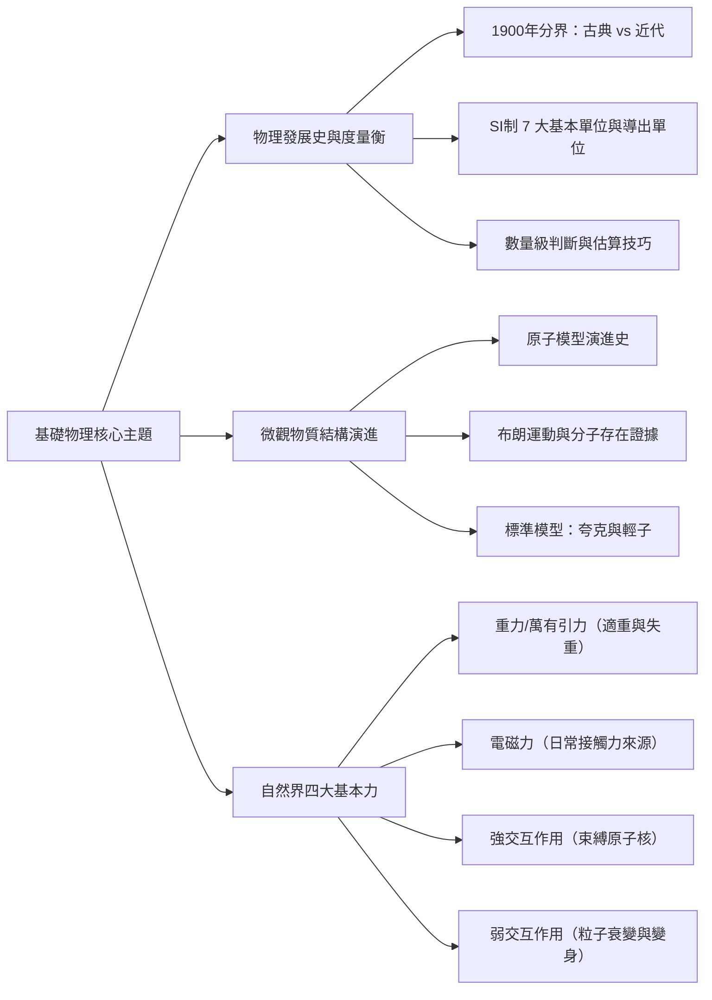
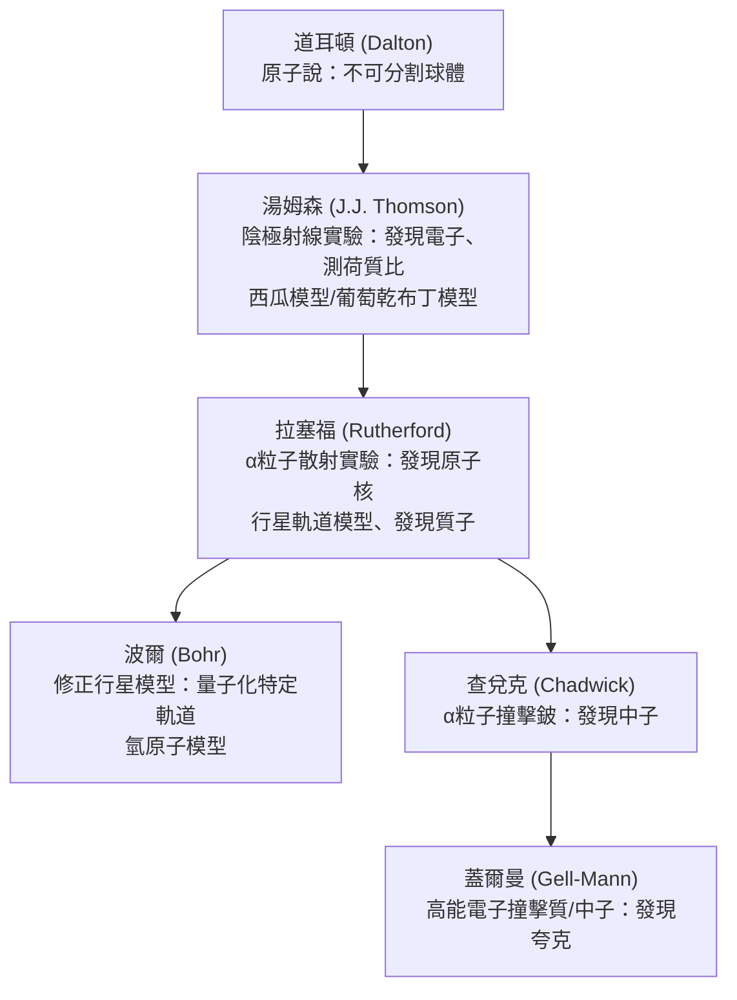

## 📖 課堂主題與核心摘要 (Class Overview)
本堂課為高一基礎物理核心課程，圍繞物理學發展脈絡、國際度量衡標準、微觀粒子結構演進與宏觀四大基本交互作用展開。課程首先以 1900 年為分界點區分古典物理與近代物理（量子論與相對論），接著詳細解析國際單位制（SI 單位）7 個基本物理量與導出單位的定義演進（包含以普朗克常數定義公斤）。隨後透過原子結構探索史（從道耳頓至蓋爾曼夸克模型），說明物質微觀結構與「夸克與輕子」的基本粒子分類；最後深入研討自然界四大基本交互作用，並徹底釐清「適重與失重」的常見考題迷思，協助學生建立完整的高一物理學習筆記。

## 💡 核心知識點與觀念詳解 (Key Concepts)

### 一、 物理學發展史與三大分界（古典物理 vs 近代物理）
1. **時間分界點（1900 年）**：
   - **古典物理學（1900 年以前）**：包含牛頓力學、古典電磁學（馬克士威）、熱力學與古典光學。
   - **近代物理學（1900 年以後）**：以 1900 年為界，衍生出兩大理論支柱：
     - **普朗克的量子論（Quantum Theory）**：提出能量具備「最小單位」，即能量非連續性（像積木堆疊），打破古典物理中能量為連續性的觀念。
     - **愛因斯坦的相對論（Relativity）**：提出光傳播不需要「以太」介質，並建立狹義與廣義相對論（學測高頻考點）。

2. **生活比喻（美沙冬替代療法與能量/衰變階梯）**：
   老師在課堂中以「毒品戒斷的美沙冬（Methadone）療法」比喻物理學中的能量階梯與衰變過程：一級毒品（如海洛因）作用極快且退藥迅速，導致強烈依賴循環；而二級毒品美沙冬能拉長作用時間並降低依賴性，如同透過階梯式（非連續）的劑量控制，協助人體逐步達到穩態。

---

### 二、 SI 國際單位制（7 大基本物理量與定義演進）
國際單位制（SI 單位）由 7 個不可再拆解的基本物理量構成，其餘物理量皆為「導出量」。

1. **7 大基本物理量及其定義標準**：
   - **時間（秒，\\(\text{s}\\)）**：以「銫-133（\\(\text{Cs-133}\\)）原子」基態超精細能階躍遷的輻射週期跳動次數定義。
   - **長度（公尺，\\(\text{m}\\)）**：以「真空中的光速 \\(c\\)」定義（早期曾以巴黎至北極子午線長度的千萬分之一為標準）。
   - **質量（公斤，\\(\text{kg}\\)）**：最新定義採用「普朗克常數 \\(h\\)」進行定義（為歷史上最後一個由人造實物「公斤原器」改為自然常數定義的物理量）。
   - **電流（安培，\\(\text{A}\\)）**：透過「基本電荷量 \\(e\\)」進行定義。
   - **溫度（克爾文，\\(\text{K}\\)）**：透過「波茲曼常數 \\(k_B\\)」進行定義。
   - **光度（燭光，\\(\text{cd}\\)）**：以特定頻率之「綠光」（人眼與大氣穿透最敏感波長）發光強度定義。
   - **物質量（莫耳，\\(\text{mol}\\)）**：透過「亞佛加厥常數 \\(N_A\\)」進行定義。

2. **導出單位的推導 SOP**：
   - **步驟 1**：寫出該物理量的基本定義或經典公式。
   - **步驟 2**：將公式中各物理量代入基本 SI 單位符號。
   - **步驟 3**：化簡整理為 \\(7\\) 大基本單位的乘冪組合。
   - **範例 1：動能（\\(E_k\\)）的導出單位**
     \\[ E_k = \frac{1}{2} m v^2 \implies \text{kg} \cdot \left(\frac{\text{m}}{\text{s}}\right)^2 = \text{kg} \cdot \text{m}^2 \cdot \text{s}^{-2} \\]
   - **範例 2：力矩（\\(L\\)）的導出單位**
     \\[ L = r \times F = r \times (m a) \implies \text{m} \cdot \left(\text{kg} \cdot \frac{\text{m}}{\text{s}^2}\right) = \text{kg} \cdot \text{m}^2 \cdot \text{s}^{-2} \\]

---

### 三、 數量級估算與經典物理例題步驟拆解

1. **數量級（Order of Magnitude）判斷規則**：
   將數值表示為科學記號 \\(a \times 10^n\\)（其中 \\(1 \le a < 10\\)），比較 \\(a\\) 與基準值 \\(\sqrt{10} \approx 3.162\\)：
   - 若 \\(a \ge \sqrt{10} \approx 3.162\\)，則數量級向上進一位，記為 \\(10^{n+1}\\)。
   - 若 \\(a < \sqrt{10} \approx 3.162\\)，則保留原次方，數量級記為 \\(10^n\\)。

2. **【經典例題一】：原子數量級估算（沙粒中的原子數）**
   - **題目條件**：假設細沙顆粒為邊長 \\(0.1 \text{ mm}\\) 的正立方體，內部原子亦視為邊長 \\(2 \text{ \AA}\\)（埃，\\(1 \text{ \AA} = 10^{-10} \text{ m}\\)）的正立方體，求一粒細沙內約含多少個原子？
   - **步驟拆解**：
     1. 沙粒體積 \\(V_{\text{沙}} = (0.1 \text{ mm})^3 = (10^{-4} \text{ m})^3 = 10^{-12} \text{ m}^3\\)。
     2. 原子體積 \\(V_{\text{原子}} = (2 \text{ \AA})^3 = (2 \times 10^{-10} \text{ m})^3 = 8 \times 10^{-30} \text{ m}^3\\)。
     3. 計算原子數量 \\(N\\)：
        \\[ N = \frac{V_{\text{沙}}}{V_{\text{原子}}} = \frac{10^{-12}}{8 \times 10^{-30}} = 0.125 \times 10^{18} = 1.25 \times 10^{17} \\]
     4. 判定數量級：因為 \\(1.25 < \sqrt{10} \approx 3.162\\)，故保留原次方，答案為 \\(10^{17}\\)。

3. **【經典例題二】：原子核密度計算與質量數無關性**
   - **題目條件**：已知原子核半徑公式為 \\(R = 1.3 \times 10^{-15} \times A^{1/3} \text{ m}\\)（\\(A\\) 為質量數），質子與中子平均質量約為 \\(1.6 \times 10^{-27} \text{ kg}\\)，求原子核密度的數量級。
   - **步驟拆解**：
     1. 原子核總質量 \\(m = A \times (1.6 \times 10^{-27} \text{ kg})\\)。
     2. 原子核球體體積 \\(V = \frac{4}{3} \pi R^3 = \frac{4}{3} \pi (1.3 \times 10^{-15} \text{ m})^3 \times A\\)。
     3. 計算密度 \\(\rho\\)：
        \\[ \rho = \frac{m}{V} = \frac{A \times (1.6 \times 10^{-27})}{\frac{4}{3} \pi (1.3 \times 10^{-15})^3 \times A} = \frac{1.6 \times 10^{-27}}{\frac{4}{3} \pi (2.197 \times 10^{-45})} \approx 1.74 \times 10^{17} \text{ kg/m}^3 \\]
     4. **關鍵結論**：質量數 \\(A\\) 在分子與分母相互消去，說明**所有元素的原子核密度幾乎皆為定值**！因 \\(1.74 < \sqrt{10}\\)，密度數量級為 \\(10^{17} \text{ kg/m}^3\\)。

---

### 四、 原子結構探索史（時序與實驗演進）

1. **布朗運動（Brownian Motion）的物理意義**：
   - 英國植物學家布朗觀察水中花粉作無規則折線運動。
   - 愛因斯坦提出數學理論說明：花粉的折線運動是由於周圍無數水分子進行不均勻碰撞所致。
   - **重要意義**：布朗運動是支持「分子與原子真實存在」的最直接實驗證據。
   - **運動顯著條件**：懸浮顆粒體積越小、質量越小、環境溫度越高，碰撞不均勻性越顯著，布朗運動越明顯。

---

### 五、 標準模型與基本粒子分類（夸克與輕子）

1. **基本粒子定義**：目前科學界認定「無法再被分割」的最微觀粒子。
2. **基本粒子兩大家族**：
   - **夸克家族（Quarks）**：共 6 種。高中階段重點為：
     - **上夸克（\\(u\\)）**：帶電荷 \\(+\frac{2}{3} e\\)。
     - **下夸克（\\(d\\)）**：帶電荷 \\(-\frac{1}{3} e\\)。
   - **輕子家族（Leptons）**：共 6 種。代表粒子為**電子（Electron，帶 \\(-1e\\)）**與微中子。電子存在於原子核外，屬於基本粒子。

3. **複合粒子（強子/核子）的夸克組成**：
   - **質子（Proton）**：由 **2 個上夸克與 1 個下夸克（\\(uud\\)）** 組成。
     \\[ \text{電荷量} = \left(+\frac{2}{3}e\right) + \left(+\frac{2}{3}e\right) + \left(-\frac{1}{3}e\right) = +1e \\]
   - **中子（Neutron）**：由 **1 個上夸克與 2 個下夸克（\\(udd\\)）** 組成。
     \\[ \text{電荷量} = \left(+\frac{2}{3}e\right) + \left(-\frac{1}{3}e\right) + \left(-\frac{1}{3}e\right) = 0 \\]

---

### 六、 自然界四大基本交互作用與比較表

1. **萬有引力（重力）與適重/失重觀念**：
   - **重力（Gravity）**：物體與地球間的萬有引力 \\(F_g = G \frac{M m}{r^2}\\)。
   - **重量 / 適重（Apparent Weight）**：體重計所測得的數值，本質為地板向上支撐物體的**正向力（\\(N\\)）**。
   - **赤道 vs 北極的體重差異**：赤道上的物體隨地球自轉進行圓周運動，部分引力被分去作為向心力（\\(F_{\text{向}} = m a_c\\)），因此赤道的適重（體重計讀數，如 300 kg 重變 299 kg 重）比北極略小（約少 \\(1/300\\)）。
   - **失重狀態迷思**：太空人在軌道上飄浮是處於「失重狀態」，指的是正向力 \\(N = 0\\)（**失去適重/重量**），但萬有引力依然存在（**並非失去重力**），該引力完全充當太空船繞地運行的向心力。

2. **四大基本交互作用比較表**：

| 交互作用名稱 | 相對強度 | 作用範圍（尺度） | 傳遞粒子 / 作用機制 | 巨觀現象與生活實例 |
| :--- | :--- | :--- | :--- | :--- |
| **強交互作用（強力）** | \\(1\\)（最強） | 極短（\\(\approx 10^{-15} \text{ m}\\)，原子核尺度） | 膠子 | 克服質子間庫侖排斥力，將質子與中子緊密束縛於原子核內；拉不住時引發 \\(\alpha\\) 衰變。 |
| **電磁力** | \\(10^{-2}\\) | 無窮遠 | 光子 | 電子與原子核的吸引力、化學鍵、摩擦力、正向力、張力等日常接觸力。 |
| **弱交互作用（弱力）** | \\(10^{-13}\\) | 超短（\\(\approx 10^{-18} \text{ m}\\)，夸克尺度） | \\(W^\pm, Z^0\\) 玻色子 | 負責粒子的「變身」與「衰變」；如 \\(\beta\\) 衰變（中子變質子 \\(n \to p + e^- + \bar{\nu}_e\\)）、太陽核融合第一步。 |
| **萬有引力（重力）** | \\(10^{-38}\\)（最弱） | 無窮遠 | 重力子（預測） | 天體運行、自由落體、潮汐現象。 |

## ⚠️ 老師強調考點與易錯陷阱 (Exam Focus & Pitfalls)

1. **【考點一】湯姆森實驗的測量標的**：
   - **易錯陷阱**：題目常誘騙學生「湯姆森經由陰極射線實驗測得電子的質量與電量」。
   - **正確觀念**：湯姆森僅測得電子的**荷質比（\\(\frac{e}{m}\\)）**；電子的基本電荷量 \\(e\\) 是由密立坎的油滴實驗測得，兩者結合後才計算出電子質量 \\(m_e\\)。

2. **【考點二】基本粒子的判定**：
   - **易錯陷阱**：認為質子、中子是基本粒子。
   - **正確觀念**：質子與中子由夸克（\\(u, d\\)）組成，故**非基本粒子**！基本粒子僅包含**夸克**與**輕子（如電子）**。

3. **【考點三】失重狀態的定義**：
   - **易錯陷阱**：認為失重狀態就是「沒有重力作用」。
   - **正確觀念**：失重是指正向力 \\(N = 0\\)（失去重量/適重），太空人依然受地球萬有引力作用，該引力全數作為繞地運行的向心力。

4. **【考點四】數量級判斷進位標準**：
   - **易錯陷阱**：誤以為科學記號 \\(a \times 10^n\\) 當 \\(a > 5\\) 時才進位。
   - **正確觀念**：物理學數量級進位比較基準為 \\(\sqrt{10} \approx 3.162\\)。若 \\(a \ge 3.162\\)，次方必須 \\(+1\\)。

5. **【考點五】弱力 vs 強力的區分關鍵**：
   - **易錯陷阱**：看到「衰變」或「核反應」就一律選強力。
   - **正確觀念**：束縛原子核不崩解的是「強力」；凡是涉及**\\(\beta\\) 衰變**（夸克種類改變、中子變質子）或**太陽核融合第一步**，必為「弱力」。

## 🔑 記憶口訣與解題技巧 (Mnemonics & Shortcuts)

1. **質子與中子夸克組成記憶口訣**：
   - **質子（Proton）**：「質」字有兩撇劃 \\(\rightarrow\\) **兩上一下（\\(uud\\)）**。
   - **中子（Neutron）**：與質子相反 \\(\rightarrow\\) **一上兩下（\\(udd\\)）**。

2. **導出單位拆解解題 SOP**：
   \\[ \text{公式寫出} \longrightarrow \text{代入基本單位} \longrightarrow \text{乘冪化簡} \\]
   遇到選擇題詢問何者非 SI 基本單位時，記得 7 大基本單位「**秒 (s)、公尺 (m)、公斤 (kg)、安培 (A)、克爾文 (K)、燭光 (cd)、莫耳 (mol)**」，其餘如庫侖（\\(\text{C} = \text{A} \cdot \text{s}\\)）、焦耳（\\(\text{J} = \text{kg} \cdot \text{m}^2/\text{s}^2\\)）、牛頓（\\(\text{N} = \text{kg} \cdot \text{m}/\text{s}^2\\)）皆為導出單位。

3. **四大基本力快速判斷破題關鍵字**：
   - 看到「原子核不崩解、拉住質子」 \\(\rightarrow\\) 關鍵字選 **強交互作用（強力）**。
   - 看到「\\(\beta\\) 衰變、中子變質子、太陽核融合第一步、粒子變身」 \\(\rightarrow\\) 關鍵字選 **弱交互作用（弱力）**。
   - 看到「摩擦力、正向力、化學鍵、彈力、張力」 \\(\rightarrow\\) 關鍵字選 **電磁力**。
   - 看到「天體運行、萬有引力、潮汐、自由落體」 \\(\rightarrow\\) 關鍵字選 **萬有引力**。

## 📝 課後作業與待辦事項 (Homework & Tasks)
- **課後練習題**：完成講義第 1 章「物理學史與基本交互作用」單元綜合練習題（第 12 題至第 28 題）。
- **重點複習**：熟記 7 大 SI 基本單位及其定義常數，並熟練夸克組成與數量級判斷 \\(\sqrt{10}\\) 進位規則。
- **預習章節**：預習第 2 章「物體的運動與牛頓運動定律」。

---

## 📚 專有名詞與重要公式/定義 (Glossary & Formulas)

* **古典物理與近代物理分界 (1900年)**: 以 1900 年為界，1900 年前為古典物理，1900 年後以普朗克的量子論與愛因斯坦的相對論為核心進入近代物理。
* **SI 國際單位制 7 大基本單位**: 秒 (\\(\text{s}\\))、公尺 (\\(\text{m}\\))、公斤 (\\(\text{kg}\\))、安培 (\\(\text{A}\\))、克爾文 (\\(\text{K}\\))、燭光 (\\(\text{cd}\\))、莫耳 (\\(\text{mol}\\))。
* **數量級基準 (\\(\sqrt{10} \approx 3.162\\))**: 科學記號 \\(a \times 10^n\\) 中，當 \\(a \ge \sqrt{10}\\) 時數量級為 \\(10^{n+1}\\)，當 \\(a < \sqrt{10}\\) 時數量級為 \\(10^n\\)。
* **布朗運動 (Brownian Motion)**: 水中懸浮花粉顆粒因受水分子不均勻碰撞而作的無規則折線運動，為分子真實存在的直接證據。
* **荷質比 (\\(\frac{e}{m}\\))**: 粒子的電荷量與質量之比值，湯姆森經由陰極射線實驗測得電子的荷質比。
* **基本粒子 (Fundamental Particles)**: 無法再被分割的最微觀粒子，現階段僅包含 **夸克（Quarks）** 與 **輕子（Leptons，如電子）**。
* **質子與中子夸克結構**: 質子為 \\(uud\\)（帶 \\(+1e\\)），中子為 \\(udd\\)（帶 \\(0\\)）。
* **強交互作用 (Strong Interaction)**: 作用範圍約 \\(10^{-15} \text{ m}\\)，強度最強，負責束縛原子核內的質子與中子。
* **弱交互作用 (Weak Interaction)**: 作用範圍約 \\(10^{-18} \text{ m}\\)，負責粒子的變身與衰變（如 \\(\beta\\) 衰變與太陽核融合第一步）。
* **適重與失重 (Apparent Weight & Weightlessness)**: 適重為體重計顯示的正向支持力 \\(N\\)；失重為 \\(N = 0\\) 的狀態，此時萬有引力依然存在，完全充當向心力。
* **原子核密度公式**: 
  \\[ \rho_{\text{核}} = \frac{m}{V} \approx 1.74 \times 10^{17} \text{ kg/m}^3 \\]
  所有元素的原子核密度皆為定值，與質量數 \\(A\\) 無關。

## 🧠 課後自測題 (Quick Review Quiz)

### 問題一：基本單位與導出單位判斷
**題目**：下列何者「不是」SI 國際單位制中的基本單位？
(A) 莫耳 (\\(\text{mol}\\))  
(B) 安培 (\\(\text{A}\\))  
(C) 庫侖 (\\(\text{C}\\))  
(D) 克爾文 (\\(\text{K}\\))  

**【解題思維與答案】**  
- **思維**：SI 制 7 大基本單位為 \\(\text{s, m, kg, A, K, cd, mol}\\)。庫侖（\\(\text{C}\\)）為電荷量單位，定義為安培乘以秒（\\(\text{1 C} = 1 \text{ A} \cdot \text{s}\\)），屬於「導出單位」。  
- **答案**：**(C)**

---

### 問題二：原子結構與夸克數量計算
**題目**：一個中性的氦原子核（包含 \\(2\\) 個質子與 \\(2\\) 個中子），總共包含幾個上夸克（\\(u\\)）與幾個下夸克（\\(d\\)）？

**【解題思維與答案】**  
- **思維**：
  1. 1 個質子包含 \\(2\\) 個上夸克與 \\(1\\) 個下夸克（\\(uud\\)）。
  2. 1 個中子包含 \\(1\\) 個上夸克與 \\(2\\) 個下夸克（\\(udd\\)）。
  3. 總上夸克數 \\(u = 2 \times 2 + 2 \times 1 = 6\\) 個。
  4. 總下夸克數 \\(d = 2 \times 1 + 2 \times 2 = 6\\) 個。  
- **答案**：包含 **6 個上夸克** 與 **6 個下夸克**。

---

### 問題三：基本交互作用觀念釐清
**題目**：太陽內部發生的核融合反應第一步（兩質子碰撞結合生成氘核，並釋放正電子與微中子），主要由下列哪一種基本交互作用所支配？
(A) 萬有引力  
(B) 電磁力  
(C) 強交互作用  
(D) 弱交互作用  

**【解題思維與答案】**  
- **思維**：太陽核融合第一步涉及質子轉變為中子（包含正電子與微中子的釋放，本質為夸克種類的改變與變身反應），凡涉及粒子種類改變與微中子釋放者，支配的作用力必為「弱交互作用」。  
- **答案**：**(D)**

💡 考前建議重點關注「四大作用力判斷關鍵字」與「夸克組成算式」，這份筆記架構非常適合搭配講義題目進行自我測驗！如果有任何觀念需要補充或製作練習試題，隨時告訴我。