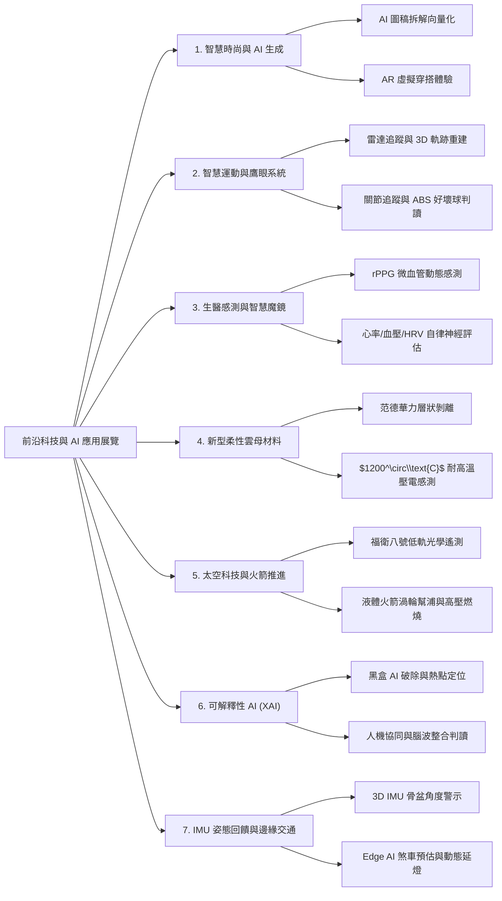
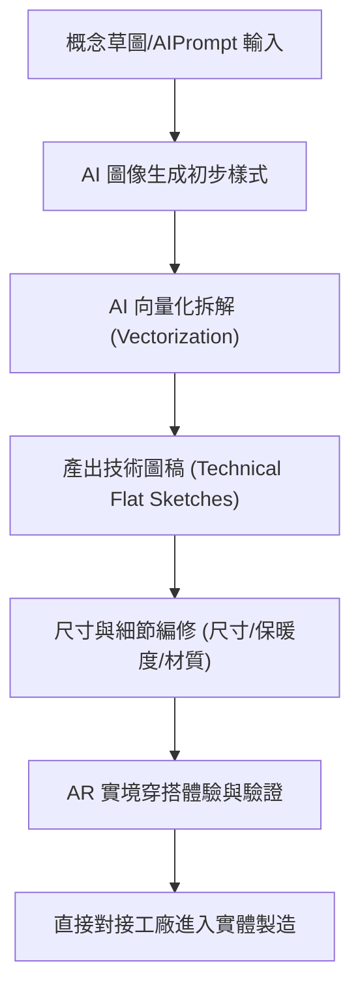
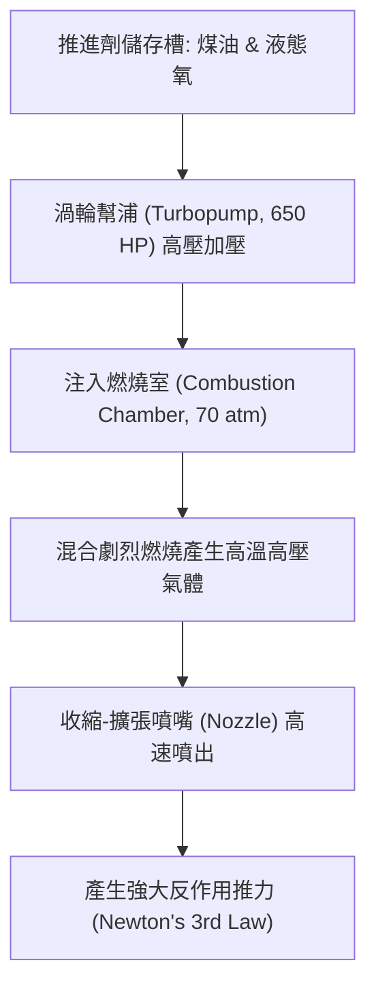

## 📖 課堂主題與核心摘要 (Class Overview)
本堂課為前沿科技與 AI 智慧應用展覽之深度導覽筆記，核心內容涵蓋現代資訊科技、生醫工程、航太技術與智慧運動科學之跨領域前沿成果。課程重點剖析包括 **AI 向量生成與 AR 試穿**、**運動數據鷹眼追蹤**、**非接觸式生理量測（智慧魔鏡）**、**柔性雲母耐高溫基板**、**太空衛星與液體火箭推進原理**、**可解釋性 AI（XAI）防偽驗證**，以及**邊緣運算智慧交通控制**。學習目標在於理解前沿技術如何解決傳統產業痛點，並掌握物理、材料、資訊與工程跨領域應用的核心理論與實務運作流程。

---

## 💡 核心知識點與觀念詳解 (Key Concepts)

### 1. AI 智慧服裝設計與技術拆解 (AI Fashion Design & AR Try-on)
* **核心觀念與痛點解決**：傳統服裝設計需經歷「手稿草圖 \\(\rightarrow\\) 初步打樣 \\(\rightarrow\\) 修改樣衣 \\(\rightarrow\\) 二次打樣」等繁複工序，耗費巨大的人力與時間成本。
* **技術突破**：本系統利用 Generative AI 將概念圖像自動拆解並向量化（Vectorization）生成專業的技術圖稿（Technical Flat Sketches）。設計師可精確調整尺寸與版型，並透過 AR 擴充實境技術進行虛擬試穿（Virtual Try-on），將想法直觀呈現於人體上，大幅降低生產前期的溝通與試錯成本。

### 2. 國家運動數據平台與棒球鷹眼系統 (Baseball Hawk-Eye & Sports Analytics)
* **核心觀念**：整合球場雷達系統與多角度高速攝影機，將球員運動過程轉化為結構化三維數據。
* **物理與資訊演算法**：
  * **軌跡重建**：對投球進壘點、進壘軌跡及擊球初速/飛向進行 3D 空間座標建模。
  * **關鍵運動參數**：即時量測球速、轉速（Spin Rate）、垂直位移（Vertical Break）與水平位移（Horizontal Break）。
  * **骨架姿勢追蹤**：追蹤投手與打者的身體關節節點，即時分析揮棒軌跡與投球機制，並支援 ABS（Automatic Ball-Strike System，自動好壞球挑戰系統）。

### 3. 非接觸式智慧魔鏡與 rPPG 生醫感測 (rPPG Smart Mirror)
* **生醫光學原理**：利用 **rPPG (Remote Photoplethysmography，遠距光學體積描記術)** 與 RGB/紅外線攝影鏡頭，捕捉皮下微血管隨心臟搏動產生的微弱顏色變化。
* **檢測項目與臨床意義**：可在 50 秒內非接觸式量測心率、呼吸率、血壓與血氧濃度（\\(SpO_2\\)）。進一步分析心率變異度（HRV，Heart Rate Variability），以評估自律神經交感與副交感神經的平衡狀態（壓力與睡眠品質），並預估心房顫動與心臟衰竭風險（已通過 FDA 認證）。

### 4. 柔性雲母基板元件與壓電感測器 (Flexible Mica Substrate & Piezoelectric Sensors)
* **材料結構與物理特性**：天然雲母晶體內部層與層之間靠微弱的**范德華力（van der Waals force）**結合。透過雙面膠或機械剝離（Exfoliation）可將原本厚度約 \\(200\,\mu\text{m}\\) 的剛性雲母層層撕離，製成厚度極薄、具備柔軟可彎曲性的陶質薄膜。
* **極限耐熱對比**：傳統可彎曲高分子基板（如 PET, PI）耐熱極限僅 \\(100^\circ\text{C} \sim 250^\circ\text{C}\\)；人工雲母陶瓷基板耐熱高達 \\(1200^\circ\text{C}\\)，熱傳導與散熱表現優異。
* **壓電效應應用實例**：在雲母基板上濺鍍生長氧化鋅（\\(\text{ZnO}\\)）薄膜。當基板受到彎曲或壓力時，晶體結構產生電極化而輸出壓電訊號。展覽實例將其製成握球感測手套，透過每根手指不同的彎曲角度與壓電訊號變化，精確判讀棒球投手握持直球、指叉球或滑球的姿態是否標準。

### 5. 太空科技：福衛八號與液體火箭推進原理 (Formosat-8 & Liquid Rocket Propulsion)
* **福衛八號光學遙測衛星**：
  * 部署於低地球軌道（LEO），目標由 6 顆衛星組成星系，將台灣地表重訪週期由 6 天縮短至每天。
  * 光學超解析度達 \\(1\text{ m}\\) 等級（地表車輛與建築清晰可辨），常用於颱風土石流、堰塞湖與防災決策。
  * **熱控系統**：包覆多層鍍金絕熱膜（MLI），對抗軌道環境下 \\(-100^\circ\text{C} \sim 70^\circ\text{C}\\) 的極端日照溫差；內部配備反應輪與致動器，執行入軌後的消轉（De-tumbling）與姿態控制。
* **液體燃料火箭引擎推進原理**：
  * 推進劑組合：煤油（Kerosene，燃料） + 液態氧（\\(\text{LOX}\\)，氧化劑）。
  * **高壓渦輪幫浦 (Turbopump)**：由渦輪機帶動，輸出功率高達 \\(650\text{ HP}\\)（相當於 5-6 輛家用轎車馬力），將推進劑注入高達 \\(70\text{ atm}\\)（70 倍標準大氣壓）的高壓燃燒室。
  * **動量守恆與牛頓第三運動定律**：燃料高溫燃燒後由噴嘴高速噴出，依據動量守恆定律產生龐大的反作用推力：
    \\[F = \dot{m} v_e + (P_e - P_a) A_e\\]

### 6. 可解釋性 AI 防偽驗證系統 (Explainable AI - XAI Deepfake Detection)
* **黑盒 AI 之痛點**：傳統 Deepfake 檢測模型僅輸出 binary 分數（如「真」或「假」），缺乏推理過程，導致執法與司法調查無法完全採信。
* **XAI 核心機制**：XAI 技術能標記出圖像或影片中具體的人工造假痕跡（合成臉部邊界、光影異常區域），生成視覺化診斷報告。並導入**人機協同（Human-in-the-Loop）**，結合專家腦波（EEG）判讀經驗訓練 AI，大幅提升防詐欺與指證的公信力。

### 7. IMU 骨盆控制回饋與邊緣智慧交通 (IMU Pelvic Control & Edge AI Traffic)
* **IMU 姿態回饋**：將 3D 慣性測量單元（IMU）貼附於骨盆，精確量測前傾/後傾、左右傾斜與旋轉角度。當運動員或復健患者姿勢偏差超過預設門檻（如 \\(\pm 10^\circ\\)）時即時發出警報修正動作。
* **Edge AI 智慧交通**：在路口攝影機端直接執行影像辨識演算法（邊緣運算），降低雲端傳輸延遲。能精確預估黃燈車輛的煞車距離，並在行人穿越路口時即時開關照明與動態延遲燈號。

---

### ⏱️ 時序流程圖 (Process Workflows)

#### 1. AI 服裝生成與技術拆解生產流程

#### 2. 液體火箭引擎推進運作流程

---

### 📊 觀念與易混淆對比表 (Comparison Tables)

#### 表一：傳統服裝設計 vs. AI 向量技術拆解系統
| 對比維度 | 傳統服裝設計與製造 | AI 向量技術拆解系統 |
| :--- | :--- | :--- |
| **開發流程** | 手繪草圖 \\(\rightarrow\\) 多次實體打樣修改 | AI 圖像生成 \\(\rightarrow\\) 向量技術圖 \\(\rightarrow\\) AR 試穿 |
| **打樣成本** | 需耗費大量布料、人工與時間成本 | 前期零布料消耗，數位化精準修正 |
| **溝通模式** | 憑抽象圖稿與打樣師口頭溝通，易出錯 | 輸出標準向向量技術稿，精確對接生產端 |
| **開發週期** | 數週至數個月 | 數小時至數天 |

#### 表二：傳統高分子基板 vs. 柔性雲母陶瓷基板
| 特性項目 | 傳統高分子基板 (PET / PI) | 柔性雲母陶瓷基板 (Mica) |
| :--- | :--- | :--- |
| **材料屬性** | 有機高分子聚合物 | 天然/人工無機陶瓷層狀晶體 |
| **耐高溫極限** | 約 \\(100^\circ\text{C} \sim 250^\circ\text{C}\\)（易熔融變形） | 高達 \\(1200^\circ\text{C}\\)（高熱穩定性） |
| **機械特性** | 高可彎曲性 | 可透過范德華力層狀剝離達柔性彎曲 |
| **光學與導電製程**| 製程溫度受限，薄膜品質較差 | 支援高溫鍍膜（如 \\(\text{ITO}\\) 導電膜、\\(\text{ZnO}\\) 壓電膜） |
| **主要應用** | 一般可撓式顯示器、軟性電路板 | 高溫感測器、極限環境元件、運動壓電感測 |

#### 表三：傳統黑盒 AI vs. 可解釋性 AI (XAI) Deepfake 檢測
| 評估維度 | 傳統黑盒 AI (Black-box AI) | 可解釋性 AI (XAI) 防偽系統 |
| :--- | :--- | :--- |
| **輸出結果** | 僅給出判斷信心度（如：偽造機率 95%） | 輸出完整診斷報告並視覺化偽造區域 |
| **信任度與公信力** | 低，使用者無法得知判斷依據 | 高，具備可歸因性與司法證據力 |
| **模型修正** | 難以定位模型特徵抓取的偏誤 | 可明確知道模型關注的偽造特徵並優化 |
| **應用場景** | 一般娛樂或初步篩選 | 司法調查局、事實查核中心、金融防詐 |

---

## ⚠️ 老師強調考點與易錯陷阱 (Exam Focus & Pitfalls)

* **★ 考點 1（材料物理）**：雲母（Mica）基板能達到「柔性」的關鍵在於其晶體層間為微弱的**范德華力（van der Waals force）**，可透過層狀剝離（Exfoliation）使厚度減至微米級從而具備彎曲度；其最大優勢為耐高溫達 **\\(1200^\circ\text{C}\\)**，切勿與一般耐溫低於 \\(250^\circ\text{C}\\) 的高分子塑料（PET/PI）混淆！
* **★ 考點 2（航太動力）**：火箭推進的核心原理是**動量守恆**與**牛頓第三運動定律（反作用力）**。火箭在太空中即使沒有空氣也能推進，是因為推力來自於推進劑燃燒後向後高速噴出的氣體品質反作用力，而非「推擠大氣」。
* **★ 考點 3（生醫光學）**：rPPG 技術原理是利用攝像頭偵測**皮下微血管**的微弱顏色動態變化，屬於「非接觸式」光學測量，量測時需保持受試者頭部穩定避免運動產生的訊號雜訊。
* **陷阱題叮嚀**：
  * **黑盒 AI 的局限**：模型高準確率不等於具備可信度，黑盒 AI 無法提供判斷依據；XAI 的核心價值在於提供「可歸因之歸因特徵（Attribution Features）」。
  * **衛星熱控**：福衛八號外表的金黃色薄膜為「多層絕熱膜（MLI）」，其作用是熱絕緣與反射太陽輻射，防止極端溫差（\\(-100^\circ\text{C} \sim 70^\circ\text{C}\\)）破壞內部電子元件，而非裝飾或太陽能板。

---

## 🔑 記憶口訣與解題技巧 (Mnemonics & Shortcuts)

### 前沿科技觀念對比記憶速記表
* **雲母基板**：口訣「**范德華力層層剝，千二高溫陶柔薄**」（范德華力剝離、耐溫 \\(1200^\circ\text{C}\\)、陶瓷柔性薄膜）。
* **火箭推進**：口訣「**內部高壓靠幫浦，燃燒噴氣靠反推**」（\\(650\text{ HP}\\) 渦輪幫浦、\\(70\text{ atm}\\) 高壓室、牛頓第三定律）。
* **XAI 驗證**：口訣「**拒絕黑盒只給分，熱圖圈錯才真證**」（產出診斷熱圖與特徵說明，拒絕純分數輸出）。

---

## 📝 課後作業與待辦事項 (Homework & Tasks)

* **課後複習**：重點複習本展覽筆記中「柔性雲母壓電原理」與「液體火箭推進力學」，並熟記物理參數。
* **專題思考**：思考可解釋性 AI (XAI) 如何應用於醫療影像診斷或金融信用審查場景。
* **無特定作業**：請自主複習展覽展示之各項前沿科技原理與跨領域整合案例。

---

## 📚 專有名詞與重要公式/定義 (Glossary & Formulas)

* **rPPG (Remote Photoplethysmography，遠距光學體積描記術)**：利用光學鏡頭非接觸式偵測皮膚表面因心臟搏動導致微血管血容積變化的生醫感測技術。
* **Vectorization (向量化)**：將點陣圖或生成式圖像轉化為具備數學點線面的向幾何圖形，便於服裝版型編輯與 CAD 系統對接。
* **van der Waals force (范德華力)**：分子或層狀晶體間的作用力，強度遠弱於共價鍵與離子鍵，為雲母可層狀剝離之物理基礎。
* **HRV (Heart Rate Variability，心率變異度)**：連續心跳間期微小時間變化的波動程度，用以評估自律神經系統（交感與副交感神經）的活性與壓力指數。
* **MLI (Multi-Layer Insulation，多層絕熱膜)**：由多層高反射性金屬化薄膜組成的太空熱控材料，用以防止輻射傳熱。
* **Turbopump (渦輪幫浦)**：由高壓氣體帶動渦輪，進而驅動幫浦將大量推進劑加壓注入火箭燃燒室的高功率機械裝置。
* **牛頓第三運動定律（火箭推力基本公式）**：
  \\[F = \dot{m} v_e + (P_e - P_a) A_e\\]
  其中 \\(\dot{m}\\) 為推進劑質量噴射率，\\(v_e\\) 為噴氣相對於噴嘴的出口速度，\\(P_e\\) 與 \\(P_a\\) 分別為出口氣壓與環境氣壓。
* **壓電效應公式（Piezoelectric Effect）**：
  \\[D = d \cdot \sigma + \varepsilon^T \cdot E\\]
  其中 \\(D\\) 為電位移，\\(\sigma\\) 為施加之機械應力，\\(d\\) 為壓電常數。

---

## 🧠 課後自測題 (Quick Review Quiz)

**Q1：傳統高分子軟性基板（如 PET/PI）在應用於極端環境感測器時遇到了什麼瓶頸？雲母（Mica）基板是如何突破此限制的？**
> **簡答思維**：傳統高分子基板耐熱溫度低（約 \\(100^\circ\text{C} \sim 250^\circ\text{C}\\)），高溫下易融化變形。雲母基板為陶瓷層狀結構，透過范德華力剝離成薄膜後具備柔軟度，且耐熱溫度高達 \\(1200^\circ\text{C}\\)，能於高溫環境下長成 ITO 導電膜或 ZnO 壓電薄膜進行精準感測。

**Q2：可解釋性 AI（XAI）防偽系統與傳統 AI Deepfake 檢測工具的主要差異為何？為什麼這對司法調查或事實查核至關重要？**
> **簡答思維**：傳統黑盒 AI 僅輸出「真/假」概率分數，無法提供推論依據；XAI 系統能自動標記造假區域（如假臉縫合痕跡、邊界異常），並生成診斷報告。在司法與新聞查核中，必須有明確且具備歸因性的證據鏈，XAI 提供的透明化歸因報告才能作為可信的採證依據。

**Q3：福衛八號衛星在太空低地球軌道運行時，為什麼需要包覆金黃色多層絕熱膜（MLI）？其主要熱控機制為何？**
> **簡答思維**：軌道環境無空氣對流且日照與陰影區溫差極大（\\(-100^\circ\text{C} \sim 70^\circ\text{C}\\)）。多層絕熱膜（MLI）透過高反射薄膜阻止熱輻射穿透，達成熱絕緣並反射太陽光，確保衛星內部精密光學儀器與電子元件維持在安全的運作溫度範圍內。