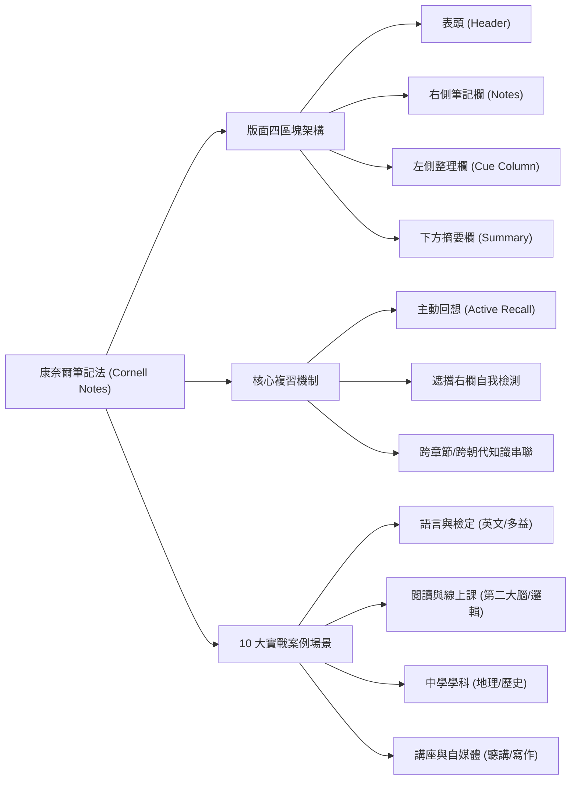
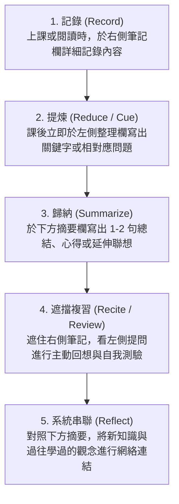

## 📖 課堂主題與核心摘要 (Class Overview)

本堂課以高效學習法中的經典工具——**「康奈爾筆記法」（Cornell Note-taking System）**為核心主題 [1, 2]。課堂中詳細剖析了康奈爾筆記法的版面分割原則與核心運作機制，強調透過「左欄提問/關鍵字」搭配「右欄知識解答」來實現**主動回想（Active Recall）**與高效遮擋複習 [1-3]。此外，講師與老師展示了涵蓋語言考試、書籍閱讀、學科複習（歷史、地理、生物科技）及職場講座等 10 大實戰應用案例，幫助學生打造最適合自己的無價知識庫 [4-8]。

---

## 💡 核心知識點與觀念詳解 (Key Concepts)

### 一、 康奈爾筆記法版面切割（三線分四區）

康奈爾筆記法透過在筆記頁面繪製 3 條線，將版面精準切割為 4 個功能獨立的區塊 [1, 2]：

1. **表頭 (Header)**：位於頁面最上方，記錄**筆記主題**、**學習素材名稱**（如科目名、書名、YouTube 頻道、Podcast 或網路文章）、**日期**與**頁碼** [1, 2]。
2. **筆記欄 / 記錄欄 (Note-taking Column, 佔右側較大區域)**：用於上課或閱讀時，盡量完整記錄所聽所聞、詳細內容、主幹觀點與例證 [1, 2]。
3. **整理欄 / 檢索欄 (Cue Column, 佔左側較小區域)**：課後提煉右欄內容，記錄相對應的**關鍵字**、**重點**或**提問問題** [1, 2]。
4. **摘要欄 / 總結欄 (Summary Column, 佔頁面底部橫條區域)**：歸納整頁重點、寫下個人反思、心得、延伸聯想或進行跨單元的知識匯整 [2, 3]。

---

### 二、 核心運作機制：提問與遮擋複習 (Active Recall)

康奈爾筆記法的威力在於課後的**重組與主動提取** [1, 9]：
* **問題化整理**：若將左欄設計為針對右欄知識點的「提問」，右欄即為「解答」 [1]。
* **遮擋複習法**：複習時用手或紙**遮住右側筆記欄**，僅看左欄的提問嘗試口頭或心算回答 [2, 3]。回答完後再查看右欄與下方摘要欄，驗證自己的理解程度與知識關聯 [3]。
* **卡片盒與串聯閱讀**：下方摘要欄可跨領域連結，例如在讀歷史某一朝代科舉制度時，於摘要欄列出其他朝代的科舉制度進行對比，建構系統化知識網絡 [3, 9]。

---

### 三、 筆記製作與複習 SOP 流程圖

---

### 四、 左側整理欄取向對比表

| 對比維度 | 關鍵字/重點提煉型 | 問題化導向型 (推薦衝刺用) |
| :--- | :--- | :--- |
| **主要作法** | 提取右欄文章或課堂筆記的關鍵詞與核心條列 [1] | 針對右欄知識點反推並設計出對應的考題/提問 [1] |
| **適用目標** | 快速掌控資料全貌、建立索引 [1] | 課後深度複習、考前衝刺與自我測驗 [1, 3] |
| **複習機制** | 順閱關鍵字帶出整體印象 [1, 10] | **遮擋右欄解答**，進行主動回想 (Active Recall) [2, 3] |
| **學習心智模式** | 被動吸收與重點標記 [1] | 強迫大腦進行主動提取與概念輸出 [2, 3] |

---

### 五、 課堂展示之 10 大實戰應用案例

老師與影片展示了 10 個不同學科與情境的康奈爾筆記應用實例 [5-8, 10, 11]：

1. **英文線上課程筆記**：右欄記對話盲點與精妙句型；左欄提煉生字與片語；底欄記錄特殊文法與句型區辨 [5]。
2. **多益 (TOEIC) 考試錯題本**：右欄抄寫錯題與正確解析；左欄整理高頻考點生字；底欄點出常見搭配詞陷阱（如「降低利率」應用 `$ \text{cut interest rates} $` 而非 `$ \text{decrease} $`）[5, 10]。
3. **瀏覽網站簡報文章**：右欄擷取簡報技巧段落；左欄梳理核心優勢重點；底欄連結實際工作/課堂簡報經驗 [10, 11]。
4. **閱讀書籍《打造第二大腦》**：右欄用自己的話轉述「漸進式摘要法」；左欄摘要步驟與結構；底欄記錄作者提醒（筆記無需一次完美，有需要再精煉）[11]。
5. **線上課程《邏輯表達力》**：右欄記錄邏輯表達基本功；左欄設計提問自主回想；底欄規劃單元作業與實際生活應用場景 [6, 11]。
6. **觀看 YouTube 知識影片（如小船文案課）**：右欄記錄文案寫作步驟；左欄條列關鍵要點；底欄無想法可暫時留白 [6]。
7. **國中地理科筆記（河流作用）**：右欄記錄侵蝕、搬運、堆積地形；左欄列關鍵字；底欄用**樹狀圖**進行整體河流作用總整理 [6, 7]。
8. **高中歷史科筆記（中古歐洲）**：右欄記錄日耳曼民族、哥德人建國、封建制度與宗教；左欄標記關鍵字；頂欄或底欄總結中古歐洲社會特徵 [7]。
9. **大學生閱讀筆記（科技報導）**：右欄記錄白血球、瘧疾、疫苗與保護力；左欄標註專有名詞索引；底欄補充延伸英文單字 [7, 8]。
10. **實體講座聽講筆記（傾聽力講座）**：右欄快記演講內容；左欄整理重點詞彙；底欄擬定課後可採取的具體行動方針 [8]。

---

## ⚠️ 老師強調考點與易錯陷阱 (Exam Focus & Pitfalls)

* **★ 考點一：最適合自己的筆記才是「無價」的**
  老師特別提及北一女學霸將精美的台大醫科筆記賣了 `$4000$` 元的案例 [4]。老師叮嚀：別人的筆記再漂亮也終究是別人的心血，盲目追求多色筆（紅、綠、橘色切換）標記反而耗費大量時間 [4]。**做出適合自己理解邏輯的筆記才是無價且最有效的** [4]。
* **★ 考點二：當天不及時提煉關鍵字，後續複習事倍功半**
  若上課僅在右欄（A欄）做記錄，課後沒有及時在左欄（B欄）抓出關鍵字或設計問題，未來複習時就必須重新閱讀大段文字，非常浪費時間 [2, 4]。
* **⚠️ 易錯陷阱：多益與英文搭配詞用法**
  在英文寫作與檢定中，常犯直譯錯誤。例如「降低利率」，學生習慣聯想 `$ \text{decrease} $` 或 `$ \text{lower} $`，但英文標準地道用法應使用動詞 `$ \text{cut} $`（即 `$ \text{cut interest rates} $`）[10]。

---

## 🔑 記憶口訣與解題技巧 (Mnemonics & Shortcuts)

### 💡 康奈爾筆記法速記口訣
> **「三線切四區，左問右答下總結；遮右答左強回想，跨科串聯建系統。」**

### 🛠️ 考前衝刺破題 SOP
1. **衝刺第 1 步**：拿出康奈爾筆記，拿遮紙**蓋住右側筆記欄** [2, 3]。
2. **衝刺第 2 步**：看左側「整理欄」的問題，在腦中進行快速檢測 [2, 3]。
3. **衝刺第 3 步**：若卡關，立即移開遮紙查看右側解答與下方摘要，重點補強弱點 [3]。

---

## 📝 課後作業與待辦事項 (Homework & Tasks)

1. **上課軟體準備**：請同學先打開 Google Chrome 瀏覽器（若無法開啟，可使用 Microsoft Edge 的 Copilot 協助運作）[10]。
2. **課後自主搜尋**：請上網搜尋「康奈爾筆記 Melody」（或 Mody），觀看示範影片並熟悉實際排版細節 [8]。
3. **實作練習**：請選擇本週任一學科（如歷史、地理或英文），試著繪製「三線四區」並完成一份康奈爾複習筆記 [1, 5, 7]。

---

## 📚 專有名詞與重要公式/定義 (Glossary & Formulas)

* **康奈爾筆記法 (Cornell Note-taking System)**：由 Walter Pauk 教授提出，透過分割為表頭、筆記欄、整理欄與摘要欄四區，促進高效學習與複習的筆記系統 [1, 2]。
* **主動回想 (Active Recall)**：透過主動提取記憶（如遮擋解答思考問題）而非被動重讀，以極大幅度強化大腦神經連結的學習科學機制 [2, 3]。
* **漸進式摘要法 (Progressive Summarization)**：源自《打造第二大腦》，指不強求一次把筆記做完美，而是在每次重新調用資料時逐步精煉重點的筆記策略 [11]。
* **搭配詞替換公式**：
  \\[ \text{降低利率} \implies \text{Incorrect: } \text{decrease/lower interest rates} \quad \longrightarrow \quad \text{Correct: } \text{cut interest rates} \\] [10]

---

## 🧠 課後自測題 (Quick Review Quiz)

**第一題（觀念題）：**
康奈爾筆記法中，左側「整理欄」與右側「筆記欄」在複習時的核心互動機制是什麼？如何操作才能達到最佳記憶效果？

> **解題思維/答案提示：**
> 核心機制為「主動回想」與「遮擋複習」[2, 3]。複習時應遮住右側筆記欄，僅看左側整理欄列出的「問題」或「關鍵字」，嘗試口頭或書面回答出右側的解答內容，最後再對照右欄與下方摘要確認正確性 [2, 3]。

**第二題（應用題）：**
如果在準備英文多益（TOEIC）或國文/歷史等考科時，下方「摘要欄」除了寫課文總結之外，還可以發揮什麼跨單元的學習功能？

> **解題思維/答案提示：**
> 摘要欄可用於知識串聯與跨單元對比 [3, 9]。例如歷史科可將不同朝代的相同制度（如科舉制）集中在摘要欄進行匯整；英文科則可整理特殊句型、文法陷阱或易混淆搭配詞（如 `$ \text{cut interest rates} $`）[3, 9, 10]。

---

💡 **下一步建議**：這份筆記已完整歸納課堂中關於「康奈爾筆記法」的架構與 10 大實戰範例！您希望我接著為您將這套筆記法繪製成一張精美的**心智圖 (Mind Map)**，或是設計一份**課後練習快閃卡 (Flashcards)** 來幫助您進行遮擋複習呢？