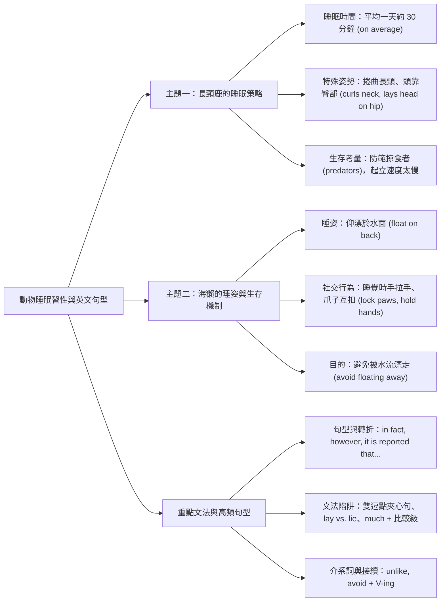
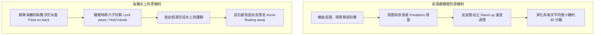

## 📖 課堂主題與核心摘要 (Class Overview)
本堂英文課主要講解自然界動物的特殊睡眠習性（以長頸鹿與海獺為主）及相關課文高頻句型與文法。課堂由熊的冬眠與金魚閉眼睡覺引出主題，深入分析長頸鹿因掠食者威脅而極短的睡眠時間與頭靠臀部的姿勢，以及海獺仰漂水面、手拉手避免漂走等生存策略。核心學習目標在於掌握高中文法重點，包括雙逗點插入句的主謂一致判斷、動詞 `lay` 的用法與三態變化、比較級修飾副詞（`much`）及 `avoid + V-ing` 等常考句型。

---

## 💡 核心知識點與觀念詳解 (Key Concepts)

### 1. 長頸鹿（Giraffes）的睡眠習性與句型解析
* **睡眠時間與數據補充**：
  長頸鹿的睡眠時間極短，平均一天僅約 30 分鐘（`sleep only 30 minutes a day on average`）。課堂上老師特別強調 `on average`（平均而言）與 `in fact` / `as a matter of fact`（事實上）的語境運用——前句提及「睡得很少」，後句透過 `in fact` 引出具體事實與客觀數據進行補充說明。
* **特殊睡姿（Sleeping Position）**：
  長頸鹿睡覺時會彎曲牠長長的脖子，將頭靠在臀部上（`curls its long neck and lays head on hip`）。
  * **動詞細節**：此處的 `lay` 為「放置（put）」之意，第三人稱單數現在式為 `lays`，過去式為 `laid`。
* **生存考量與掠食者威脅**：
  由於周遭經常有掠食者（`predators`，如獅子、豹）環伺，長頸鹿若從趴著且頭靠臀部的姿勢站立起來（`stand up from this position`）動作過慢，極易遭攻擊，因此牠們絕不會長時間深睡（`never sleep for too long`）。

### 2. 海獺（Sea Otters）的可愛睡姿與防護機制
* **仰漂水面與安全選擇**：
  海獺雖然可以在陸地上休息，但在水中安全得多（`much safer in the water`）。牠們睡覺時會背部朝下、仰臥飄浮於水面上（`float on their backs`）。
* **手拉手與爪子相扣（Hold hands / Lock paws）**：
  群聚的海獺在睡覺時會彼此緊緊抓牢、將小爪子鎖在一起（`lock their little paws together and hold on to each other`）。
* **目的與動詞用法**：
  海獺握手的主要目的是為了「避免漂走」（`to avoid floating away`）。老師特別叮嚀：動詞 `avoid` 後面一定要接動名詞 `$V\text{-ing}$`！

### 3. 課堂實例與生動比喻
* **開頭引言範例**：課堂開頭提到熊會冬眠（`Bears hibernate`）、金魚睡覺時不閉眼（`Goldfish sleep without closing their eyes`），用以引導學生思考其他動物多樣化的睡眠方式。
* **生活動作比喻**：老師以「在講桌上擺書」（`I lay some books on the podium`）來比喻長頸鹿將頭「放置（`lay`）」在臀部上的動作，幫助同學直觀區分 `lay` 的動詞含義。

### ⏱️ 長頸鹿與海獺生存睡姿步驟流程圖

### 📊 觀念與易混淆對比表

| 比較項目 | 核心觀念 / 片語 | 語法結構與用法說明 | 課堂例題 / 實例 |
| :--- | :--- | :--- | :--- |
| **動詞放置與躺臥** | `lay` vs. `lie` | `lay`（放置/擺）：現在式 `lay`, 過去式 `laid`（及物動詞，後需接受詞） `lie`（躺/臥）：現在式 `lie`, 過去式 `lay`（不及物動詞） | 長頸鹿將頭靠在臀部：`lays head on hip` 老師桌上擺書：`I lay books on the podium` |
| **介系詞「不像/不同」** | `unlike` vs. `different from` | `unlike + N`：介系詞，置於句首表示「不像……」 `different from + N`：形容詞片語，用於連繫動詞後 | `Unlike most mammals...` `= Different from those mammals...` |
| **轉折與補充說明** | `in fact` vs. `however` | `in fact` / `as a matter of fact`：事實上（補充說明前句細節） `however`：然而（語意強烈對比轉折） | 前句講睡得少，後句用 `In fact` 引出僅 30 分鐘 長頸鹿想休息，`However` 有掠食者在旁 |
| **比較級修飾** | `much + 比較級` | 比較級形容詞前可用 `much`, `a lot`, `far`, `a little` 修飾；**嚴禁使用 `very`** | 海獺在水中安全得多：`much safer in the water` |

---

## ⚠️ 老師強調考點與易錯陷阱 (Exam Focus & Pitfalls)
* **【必考雙逗點夾心句（Appositive / Parenthetical Clause）】**：
  老師強烈強調大考極愛出雙逗點分割句。例如：
  `Groups of sea otters, [one of the world's most cute animals], have the cutest sleeping position.`
  *陷阱*：學生常看到第一個逗點後的單數名詞或關代，就誤以為動詞要用單數 `has`；事實上主詞是第二個逗點前的 `Groups`（複數），主要動詞必須搭配 `have`！
* **【`lay` 的動詞型態與時態判斷】**：
  `lay` 當作「放置」時，原形動詞為 `lay`（現在式單數加 `-s` 變成 `lays`），過去式為 `laid`。切勿與「躺」的現在式 `lie`（過去式為 `lay`）搞混。
* **【`avoid` 後接 \\(V\text{-ing}\\)】**：
  `avoid` 屬後接動名詞的高頻動詞（如 `to avoid floating away`）。考試若寫成 `to avoid to float away` 為常見嚴重錯誤。
* **【修飾比較級的副詞】**：
  `safer` 為比較級，前面只能用 `much`, `a lot`, `far`, `even` 修飾，寫成 `very safer` 是經典文法陷阱。

---

## 🔑 記憶口訣與解題技巧 (Mnemonics & Shortcuts)
* **【長句破解三步驟 SOP】**：
  1. **找雙逗點**：看到句子出現 `, ...... ,`，先拿鉛筆畫括號括起來不看。
  2. **定位主詞**：劃記第一個逗點前面的名詞（Subject）。
  3. **抓主要動詞**：直接跳到第二個逗點後面找主要動詞（Verb），確保主謂單複數一致。
* **【`lay` 與 `lie` 記憶口訣】**：
  「擺放放頭用 `lay`（等於 `put`），過去變成 `laid`；自己躺下用 `lie`，過去變成 `lay`。」
* **【比較級修飾速記】**：
  「`very` 只能修原級，`much` / `a lot` 專修比較級！」

---

## 📝 課後作業與待辦事項 (Homework & Tasks)
* **課後複習**：回家務必研讀並複習「粉紅女孩」講義相關單元內容。
* **下次小考**：明天的英文小考範圍調整為**第四、五、六單元**（包含單字與課文重點觀念），請各位同學做好預習與準備。

---

## 📚 專有名詞與重要公式/定義 (Glossary & Formulas)
* **Mammal**: 哺乳類動物（名詞）。
* **Predator**: 掠食者、食肉動物（名詞）。
* **On average**: 平均而言（片語），例：`sleep 30 minutes a day on average`。
* **In fact / As a matter of fact**: 事實上、實際上（轉折片語），用於強化或精確補充說明前文資訊。
* **It is reported that...**: 據報導指出……（引述客觀資訊之句型）。
* **Unlike / Different from**: 不像…… / 與……不同（介系詞片語）。
* **Avoid + \\(V\text{-ing}\\)**: 避免做某事。例：\\(\text{avoid} + \text{floating away}\\)。
* **\\(Much / A\ lot + \text{Comparative}\\)**: 修飾比較級（如：\\(much + \text{safer}\\)），表示程度遠勝於前者。

---

## 🧠 課後自測題 (Quick Review Quiz)

1. **[文法結構題]** 請問在句子 "Sea otters, one of the most famous marine mammals, ______ (have/has) a unique sleeping position." 中，正確的動詞填空為何？原因為何？
   * **簡答與解題思維**：答案為 `have`。運用雙逗點夾心句 SOP，將 `, one of the most famous marine mammals,` 括起來忽略，主要主詞為複數名詞 `Sea otters`，故動詞需選用複數型態 `have`。

2. **[動詞用法題]** 海獺睡覺時會緊扣爪子以防漂走，請將括號內的動詞改為正確型態：
   "To avoid ______ (float) away, sea otters lock their paws together."
   * **簡答與解題思維**：答案為 `floating`。因為動詞 `avoid` 後方接續動作時，規定必須使用動名詞格式（\\(\text{avoid} + V\text{-ing}\\)）。

3. **[句型翻譯與片語題]** 「據報導指出，長頸鹿平均一天只睡 30 分鐘。」請用課堂所學片語補全句子：
   "______ ______ ______ that giraffes sleep only 30 minutes a day ______ ______."
   * **簡答與解題思維**：答案分別填入 `It is reported` 與 `on average`。完整句子為 "It is reported that giraffes sleep only 30 minutes a day on average."。

---
💡 這份筆記已完整歸納課堂的核心觀念、文法陷阱與考試重點！需要我為你生成這堂課的單字卡或隨堂測驗練習嗎？