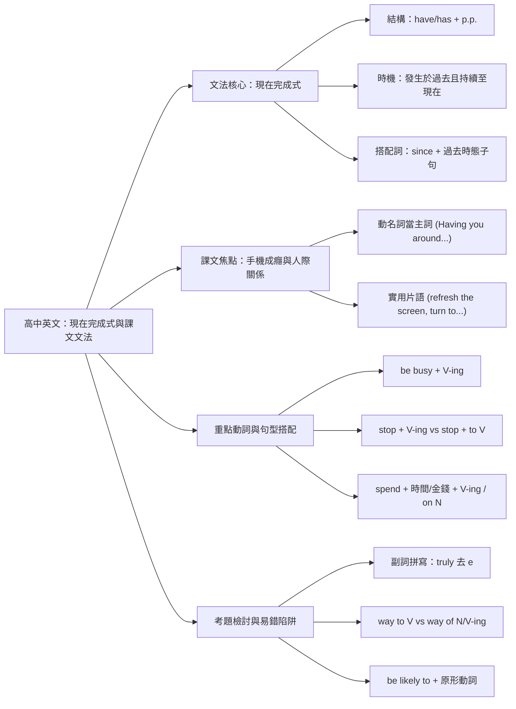
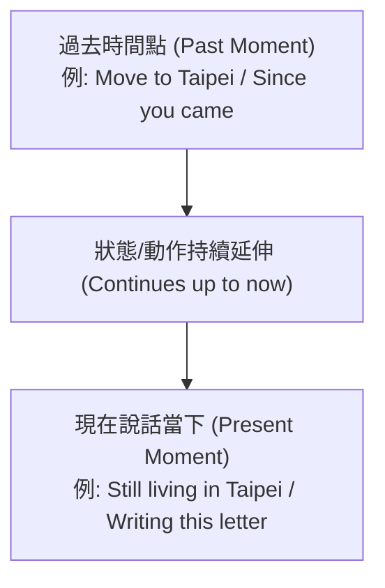

## 📖 課堂主題與核心摘要 (Class Overview)

本堂課為高中英文課堂，核心主題圍繞於「現在完成式（Present Perfect Tense）」的文法推導與時態邏輯，並結合「致智慧型手機的一封告白信（手機成癮與人際關係）」課文進行重點文法與例題拆解。老師詳細說明了現在完成式的結構 `$S + \text{have/has} + p.p.$` 與使用時機，並延伸講解動名詞當主詞、`inspire`、`busy`、`stop`、`spend` 等高頻考點動詞之搭配用法。課堂中同時進行了隨堂測驗解答對對與錯題檢討，協助學生精準掌握題型陷阱。本課學習目標為靈活運用現在完成式於句型寫作，並能精確判斷介系詞與動詞接續型態。

---

## 💡 核心知識點與觀念詳解 (Key Concepts)

### 一、 現在完成式（Present Perfect Tense）觀念推導與時脈

1. **結構與公式**：
   - 肯認句公式：\\[ S + \text{have} / \text{has} + p.p. \\]
   - 否定句公式：\\[ S + \text{have} / \text{has} + \text{not} + p.p. \\]

2. **核心時間軸邏輯與物理語意**：
   - **定義**：當一個動作發生在過去（Happened in the past），但該動作或狀態**一直持續延伸到說話的現在當下**（Continues up to now），必須使用現在完成式。
   - **課堂經典例題與比喻**：
     - **老師舉例**：「\\(I\ moved\ to\ Taipei\ when\ I\ was\ 40.\\)」（40歲搬到台北，這是過去單點動作）；「\\(I\ have\ been\ living\ in\ Taipei\ since\ then.\\)」（自從40歲搬到台北後，一直住到現在，動作持續至今）。
     - **課文句型**：「\\(Everything\ has\ been\ totally\ different\ since\ you\ came\ into\ my\ life.\\)」（自從你進入我的生活，一切都變得不一樣了。從「你來」的過去時間點，狀態持續至今）。

3. **時序演變流程圖**：

---

### 二、 動名詞當主詞（V-ing as Subject）之語法規範

1. **核心規則**：一般動詞不能直接作為句子的主詞。若要表達「某個動作/事件」作為主詞，必須改為動名詞（\\(V\text{-ing}\\)）或不定詞（\\(to + V\\)），且**一律視為單數主詞**，搭配單數動詞。
2. **課堂經典比喻與例句**：
   - **老師比喻**：「跳舞很好玩，你不能說 \\(Dance\ is\ fun\\)，要說 \\(Dancing\ is\ fun\\)；早起是好事，要說 \\(Getting\ up\ early\ is\ good\\)。」
   - **課文精選句**：「\\(Having\ you\ around\ breaks\ my\ heart.\\)」與「\\(Having\ you\ around\ is\ really\ hurting\ my\ relationships.\\)」（有你在身邊這件事，傷了我的心/傷害了我的人際關係）。主詞為單一事件「\\(Having\ you\ around\\)」，故動詞用單數 \\(breaks\\) 或 \\(is\\)。

---

### 三、 重點動詞句型與接續型態（Verb Patterns & Collocations）

1. **`inspire`（激勵/啟發）平行結構**：
   - 句型：\\[ S + \text{inspire} + O + \text{to } V \\]
   - 課堂考點：\\(\text{inspire me } \mathbf{to\ connect} \text{ with others and } \mathbf{to\ communicate} \text{ better}\\)（老師強調：對等連接詞 `and` 後方的 `to` 可省略或保留，但兩者必須保持動詞型態平行）。

2. **`be busy`（忙於做某事）**：
   - 句型：\\[ S + \text{be busy} + V\text{-ing} \\]
   - 課堂例句：\\(I\ am\ too\ busy\ paying\ attention\ to\ you.\\)（我太忙於把注意力放在你身上）。

3. **`stop`（停止）之動作判斷**：
   - 句型：\\[ S + \text{stop} + V\text{-ing} \quad \text{vs} \quad S + \text{stop} + \text{to } V \\]
   - 課堂測驗題：\\(stop\ looking\ at\ your\ book\\)（停止看書）、\\(stop\ talking\\)（停止說話），皆指停止正發生的動作。

4. **`spend`（花費時間/金錢）**：
   - 句型：\\[ S_{\text{person}} + \text{spend} + \text{time / money} + \left( V\text{-ing} \ \mid \ \text{on } N \right) \\]
   - 課堂範例：\\(spend\ less\ time\ interacting\ with\ friends\\)（花較少時間與朋友互動）；\\(spend\ 500\ dollars\ on\ game\ cards\\)（花500元買遊戲卡）。

5. **`way`（方法）的接續限制**：
   - 結構：\\(a\ way + \text{to } V\text{ (原形)}\\) 或 \\(a\ way + \text{of } N / V\text{-ing}\\)。
   - 課堂錯題分析：若後方接名詞 \\(addiction\\)（成癮），介系詞必須使用 \\(of\\)（如 \\(a\ way\ of\ addiction\\)）。

---

### 四、 觀念與易混淆對比表 (Comparison Table)

| 觀念 / 文法項目 | 結構與公式 | 語意與用法差異 | 課堂經典例句 |
| :--- | :--- | :--- | :--- |
| **現在完成式 vs. 簡單過去式** | \\(S + \text{have/has} + p.p.\\)   vs. \\(S + V_{\text{past}}\\) | **完成式**強調「過去動作持續影響至**現在**」；**過去式**僅表示「過去特定時間點的事實，**與現在無關**」。 | \\(I\ moved\ to\ Taipei\ when\ I\ was\ 40.\\) (過去式) \\(I\ have\ lived\ here\ since\ then.\\) (完成式) |
| **`stop + V-ing` vs. `stop + to V`** | \\(V\text{-ing}\\) (動名詞受詞)   vs. \\(to\ V\\) (目的副詞) | `stop + V-ing` 為「**停止**手邊正在做的事」；`stop + to V` 為「**停下來去**做另一件事」。 | \\(stop\ talking\\) (閉嘴/別再講話) \\(stop\ to\ talk\\) (停下腳步開始聊天) |
| **`a way to V` vs. `a way of N`** | \\(to + \text{原形動詞}\\)   vs. \\(of + \text{名詞/動名詞}\\) | 兩者均表示「…的方法」，但介系詞 \\(of\\) 後必接名詞或動名詞，\\(to\\) 後接原形動詞。 | \\(a\ way\ to\ sleep\\) \\(a\ way\ of\ sleeping / a\ way\ of\ addiction\\) |
| **`spend` 花費動詞** | 主詞限定為「**人**」 | 主詞必為人，可花費時間或金錢，動詞一律接 \\(V\text{-ing}\\)，名詞接 \\(on\\)。 | \\(I\ spend\ time\ with\ my\ friends.\\) |

---

## ⚠️ 老師強調考點與易錯陷阱 (Exam Focus & Pitfalls)

1. **`since` 介系詞/連接詞的時態搭配陷阱（必考星號重點）**：
   - **常錯陷阱**：學生常把 `since` 引導的子句錯寫成完成式，或把主句錯寫成簡單現在式。
   - **正確公式**：
     \\[ \text{主句 (現在完成式 } S + \text{have/has} + p.p.) + \mathbf{since} + \text{子句 (過去式 } S + V_{\text{past}}) \\]
   - **驗證例句**：\\(Everything\ \mathbf{has\ been}\ totally\ different\ \mathbf{since}\ you\ \mathbf{came}\ into\ my\ life.\\)

2. **副詞 `truly` 拼寫陷阱**：
   - **常錯陷阱**：形容詞 `true` 轉副詞時，學生常直覺寫成 `truely`（多寫了 e）。
   - **正確觀念**：去 `e` 再加 `ly`，正確拼法為 **`truly`**（如 \\(You\ are\ truly\ nice.\\)）。

3. **`be busy` 與 `be afraid` 之形容詞結構**：
   - `busy` 為形容詞，前面必須有 B 動詞（如 \\(They\ are\ so\ busy\\)），後接動詞**必須使用 \\(V\text{-ing}\\)**（如 \\(busy\ paying\ attention\ to\ you\\)）。
   - `afraid` 亦為形容詞，不可漏掉 B 動詞（要寫 \\(I\ am\ afraid\\)，不可寫成 \\(I\ afraid\\)）。

4. **"Game over" 正確英文語法**：
   - 口語常說 "Game over"，但在正式文法測驗中，`over` 為形容詞，前面必須加上 B 動詞，寫為：\\(The\ game\ \mathbf{is}\ over.\\) 或 \\(It\ \mathbf{is}\ over.\\)。

5. **`be likely to` 的動詞型態**：
   - 句型為 \\(S + \text{be likely to} + V\text{ (原形)}\\)，如 \\(Their\ brains\ are\ likely\ to\ get\ worse.\\)。

---

## 🔑 記憶口訣與解題技巧 (Mnemonics & Shortcuts)

1. **副詞 `truly` 拆解聯想口訣**：
   - **老師口訣**：「夢想樹（Tree）」——要實現夢想或真理，要把希望卡掛在樹（Tree）上。把樹中間的 `e` 拿掉變成 `True`；變副詞時去掉結尾 `e` 加 `ly` 就變成 **`truly`**！

2. **`spend` 動詞破題三步驟 SOP**：
   - **第一步（檢查主詞）**：確認主詞是否為「**人**」（只有人能同時花錢與時間）。
   - **第二步（檢查受詞）**：後接「時間」或「金錢」。
   - **第三步（檢查介系詞/動詞）**：接動作直接選 **\\(V\text{-ing}\\)**，接物品選 **\\(on + N\\)**。

3. **關鍵字速解判斷法**：
   - **看到 `since`** ➔ 子句找「過去式動詞（\\(V_{\text{past}}\\)）」，主句找「現在完成式（\\(\text{have/has} + p.p.\\)）」。
   - **看到 `busy`** ➔ 後方空格毫不猶豫直接選 **\\(V\text{-ing}\\)**。
   - **看到動名詞（`Having / Dancing`）置於句首** ➔ 後方主要動詞必選**單數動詞**（\\(is / has / V\text{-s}\\)）。

---

## 📝 課後作業與待辦事項 (Homework & Tasks)

- **【作業檢查】**：
  - 第一課習作（形座/習作本）需填寫完成，並統一繳交給英文小老師進行登記。
- **【隨堂卷整理】**：
  - 本日發還並檢討完畢之第二課與第三課雙面隨堂練習卷（單元測驗卷）請妥善收納，課後隨時進行複習抽考。
- **【明日小考預告】**：
  - 明日英文課將進行**雜誌單元小考**，請同學提前預習與複習雜誌 **第 4 至 5 單元**（或第 4 至 6 單元）之重點單字與文章。

---

## 📚 專有名詞與重要公式/定義 (Glossary & Formulas)

* **現在完成式公式 (Present Perfect Tense)**:
  \\[ S + \text{have} / \text{has} + p.p. \\]
  用於表示從過去某一時間點開始發生，並一直持續延伸至說話當下的動作或狀態。

* **`since` 自從句型 (Since Clause Structure)**:
  \\[ S + \text{have/has} + p.p. + \mathbf{since} + S + V_{\text{past}} \\]
  \\(since\\) 引導過去明確時間點或過去式子句，主句搭配現在完成式。

* **花費動詞句型 (Spend Formula)**:
  \\[ S_{\text{person}} + \text{spend} + \text{time/money} + \left( V\text{-ing} \ \mid \ \text{on } N \right) \\]
  主詞限定為人，表示花費時間或金錢於某事/某物上。

* **`lay into the night` / `late into the night`**: [片語] 熬夜做某事、搞到深夜（例：\\(study\ late\ into\ the\ night\\)）。
* **`refresh the screen`**: [片語] 重新整理螢幕、刷動畫面。
* **`just in case`**: [片語] 以防萬一、以備不時之需。
* **`turn to sb. for sth.`**: [片語] 向某人尋求（協助/資訊）（例：\\(turn\ to\ you\ for\ Instagram\ updates\\)）。
* **`be disappointed with sb./sth.`**: [片語] 對某人或某事感到失望。
* **`inspire sb. to V`**: [句型] 激勵/啟發某人去做某事。

---

## 🧠 課後自測題 (Quick Review Quiz)

1. **單選填空題**：
   \\(Everything\ \underline{\quad (1) \quad}\ \text{totally different since you}\ \underline{\quad (2) \quad}\ \text{into my life.}\\)
   (A) was ; come
   (B) has been ; came
   (C) is ; have come
   (D) had been ; came
   - **答案與解析**：答案為 **(B)**。句中含有 \\(since\\)（自從），引導過去發生的事件，故 (2) 填過去式 \\(came\\)；主句表示該事件對現在造成的持續影響，故 (1) 須使用現在完成式 \\(has\ been\\)。

2. **改錯題**：
   請找出並改正下句中的兩處文法錯誤：
   「\\(Having\ a\ smartphone\ around\ \mathbf{are}\ hurting\ my\ study,\ and\ I\ am\ too\ busy\ \mathbf{to\ play}\ games\ all\ day.\\)」
   - **答案與解析**：
     1. 第一處錯誤：\\(Having\ a\ smartphone\ around\\) 為**動名詞短語當主詞**，視為單數，應將 \\(are\\) 改為 **\\(is\\)**。
     2. 第二處錯誤：\\(be\ busy\\) 後接動作應使用動名詞，應將 \\(to\ play\\) 改為 **\\(playing\\)**。
     - **正確句子**：\\(Having\ a\ smartphone\ around\ \mathbf{is}\ hurting\ my\ study,\ and\ I\ am\ too\ busy\ \mathbf{playing}\ games\ all\ day.\\)

3. **觀念思考題**：
   請說明 `stop talking` 與 `stop to talk` 在語義上有何本質上的不同？
   - **答案與解析**：
     - `stop talking`：\\(talking\\) 為 \\(stop\\) 的動名詞受詞，代表「**停止正在進行的說話動作**」（閉嘴/不要講話）。
     - `stop to talk`：\\(to\ talk\\) 為表目的之不定詞，代表「**停下手中正在做的事，以便開始去說話**」。