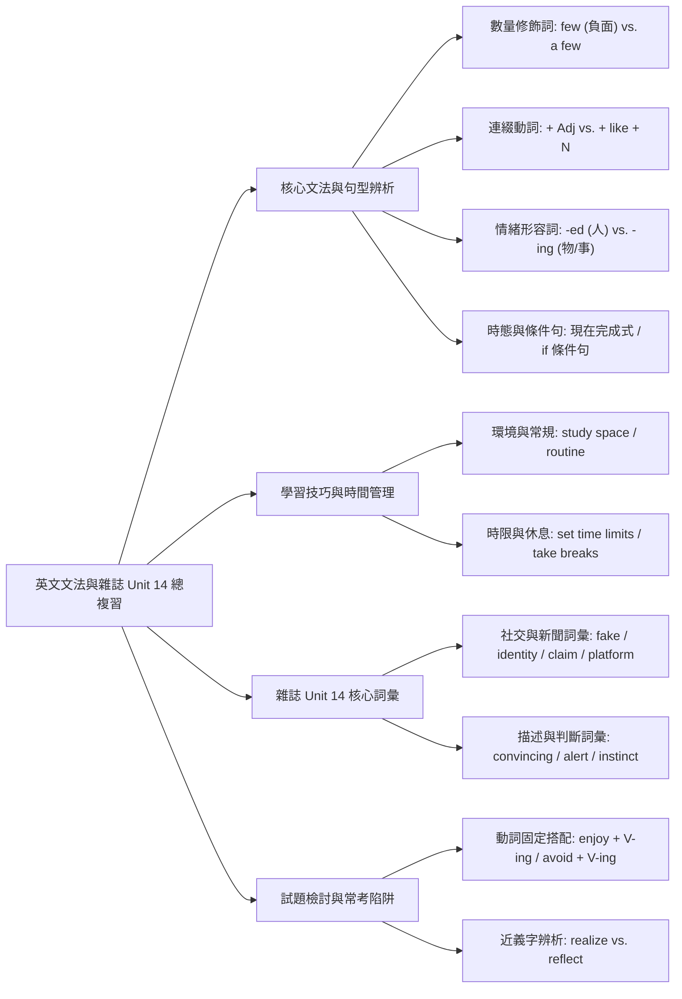
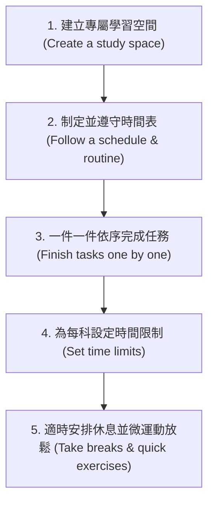

## 📖 課堂主題與核心摘要 (Class Overview)
本堂課為高中英文綜合複習與實戰課，重點涵蓋基礎文法辨析、高效學習與時間管理英文文章解構、習作考卷錯題檢討，以及外刊雜誌第 14 單元的重點核心單字與句型延伸。課堂中老師特別針對學生易混淆的形容詞用法（如 few/a few、修飾人事物的 -ed/-ing）、連綴動詞後接形容詞或名詞的句型規範、動詞搭配詞（如 enjoy/avoid + V-ing）進行深入拆解。學習目標旨在幫助學生掌握段考與大考常考的文法陷阱、提升文章邏輯填空判斷力，並建立精準的英文解題 SOP。

---

## 💡 核心知識點與觀念詳解 (Key Concepts)

### 1. 數量修飾詞與連綴動詞重點解析
- **`few` 與 `a few` 的語意差異**：
  - `$few$`：表示「幾乎沒有」，隱含**負面批判或不好的語意**。
    - 課堂例題：*I have few friends.*（表示我不太擅長與人交際、人際關係不好，帶有負面情感，撰寫文章時切勿濫用）。
  - `$a\ few$`：表示「有一些」，屬於正面客觀描述。
- **連綴動詞 / 感官動詞句型**：
  - 常用連綴動詞：`feel`（摸/感覺起來）、`look`（看起來）、`smell`（聞起來）、`taste`（嘗起來）、`sound`（聽起來）。
  - **句型一（直接接形容詞）**：\\(\text{Subject} + \text{Feel / Look / Sound} + \text{Adj}\\)
    - 課堂範例：*where you feel comfortable* / *It sounds nice.*
  - **句型二（接名詞需加 like）**：\\(\text{Subject} + \text{Feel / Look / Sound} + \text{like} + \text{N}\\)
    - 課堂範例：*It sounds like a good idea.*

### 2. 情緒形容詞（-ed vs. -ing）與祈使句主詞判斷
- **分詞形容詞主詞歸納**：
  - 修飾**人**（感到...）：使用 `-ed` 結尾（如 *embarrassed*, *interested*）。
  - 修飾**物/事情**（令人...）：使用 `-ing` 結尾（如 *embarrassing*, *interesting*）。
- **祈使句的隱藏主詞陷阱**：
  - 祈使句由原形動詞開頭（如 *Don't stand up.* 或 *Stand up.*），其省略的隱含主詞為 **`you`（人）**。因此在祈使句情境中選擇修飾人的情緒形容詞時，需搭配 `-ed` 型態；若主詞為虛主詞 `it`，則需選 `-ing`。

### 3. 文章閱讀與邏輯銜接片語
課堂針對學習空間與時間管理的閱讀文章，解析了關鍵轉折與介系詞用法：
- `speaking of` / `when it comes to` + \\(\text{N / V-ing}\\)（一提到...）
- `after all`（畢竟）/ `of course`（當然）
- `at the most` + 數字（最多...，例：*At the most three students can attend.*）
- `follow a schedule`（遵守時間表）/ `have a routine`（養成固定常規）
- `set time limits`（設定時間限制，避免單科讀太久）

【⏱️ 課堂高效學習與時間管理 SOP 流程圖】：

### 4. 外刊雜誌第 14 單元核心單字與句型延伸
- **`term` (n.)**：專門術語。常用搭配：`explain this term to me`（向我解釋這個術語）。
- **`develop` (v.)**：發展、培養。常用搭配：`develop feelings for someone`（對某人產生感情）。
- **`threat` (n.)**：威脅。常用搭配：`a threat to our health`（對我們健康的威脅）。
- **`request` (v./n.)**：正式要求（比口語的 `ask` 更正式）。範例：*The man requested a glass of water.*
- **`private` (adj.) / `privacy` (n.)**：私人的 / 隱私。範例：*This message is private and should stay secret.*
- **`fake` (adj.)**：假的、偽造的。課堂舉例：*wear a fake beard*（戴假鬍子）。
- **`identity` (n.) / `identify` (v.)**：身分 / 指認、識別。常用搭配：*identity card (ID card)* / *identify the robber*（到警局指認強盜）。
- **`recently` (adv.)**：最近。常用於**現在完成式**（\\(\text{have / has} + \text{p.p.}\\)）。範例：*My uncle recently started a small business.*
- **`avoid` (v.)**：避免。固定後接動名詞：\\(\text{avoid} + \text{V-ing}\\)。範例：*avoid seeing someone* / *avoid the barking dog*。
- **`claim` (v.)**：宣稱（在缺乏證據的情況下聲稱）。範例：*The stranger claimed to know my brother.*
- **`convincing` (adj.)**：具說服力的。範例：*Your words are very convincing.*
- **`alert` (adj.)**：保持警覺。常用搭配：`stay alert` / `be alert`。
- **`instinct` (n.)**：直覺。常用搭配：`trust your instinct`（相信你的直覺）。

【📊 課堂觀念與易混淆對比表】：

| 觀念 / 詞彙組合 | 核心定義與用法差異 | 課堂經典例題 / 判斷關鍵 |
| :--- | :--- | :--- |
| **`few` vs. `a few`** | `few` 表示幾乎沒有（帶負面情緒）；`a few` 表示有一些（正面客觀）。 | *I have few friends.*（負面描述，代表交友不順利）。 |
| **`look/sound + Adj` vs. `+ like + N`** | 後接形容詞直接加；若後接名詞，前面必須加上介系詞 `like`。 | *It sounds nice.* (Adj) *It sounds like a good idea.* (N) |
| **`request` vs. `ask`** | `request` 為正式書面/公務用語；`ask` 為日常口語用語。 | 正式場合或文章題目中優先選 `request`。 |
| **`realize` vs. `reflect`** | `realize` 表示意識到、理解到；`reflect` 表示反映、反省（常接介系詞）。 | 理解事物的重點或重要性，應選 `realize the importance`。 |
| **`-ed` vs. `-ing` (情緒形容詞)** | `-ed` 修飾「人」的感受；`-ing` 修飾「事物」給人的感覺。 | 祈使句預設主詞為 `you`，故填形容詞時須選 `-ed`（如 *embarrassed*）。 |

---

## ⚠️ 老師強調考點與易錯陷阱 (Exam Focus & Pitfalls)

1. **`enjoy` 與 `avoid` 的後接動詞陷阱（必考星號）**：
   - 看到 `enjoy` 或 `avoid`，後面動詞**只能接 \\(\text{V-ing}\\)**，切勿誤選不定詞 `to V`。
2. **介系詞語意選擇陷阱（`with` vs. `for`）**：
   - 課堂檢討例題：*帶者一碗麵進入...* 應使用 **`with a bowl of noodles`**。若誤選 `for`，會變成「為了/給一碗麵」，語意不通（牛排或麵條不是人，不會為它服務）。
3. **`realize` 與 `reflect` 的語意混淆**：
   - 段考考題常考「理解到某事的重要性」，答案為 **`realize`**。`reflect` 意為「反省、反射」，通常需要搭配介系詞（如 `reflect on`），不可混淆。
4. **情緒形容詞的被動與主體判斷**：
   - 習作第 11 題：若句子主詞為 `it`，形容詞請選 `embarrassing`；若主詞為人或祈使句對象，請選 `embarrassed`。

---

## 🔑 記憶口訣與解題技巧 (Mnemonics & Shortcuts)

- **連綴動詞秒殺口訣**：
  > 「直接形容詞，名詞前加 like。」
- **情緒形容詞人事判斷法**：
  > 「人受罪選 `-ed`，物搞事選 `-ing`；祈使句隱含主詞是 `you`，秒選 `-ed`！」
- **動詞搭配 V-ing 記憶包**：
  > `enjoy`（享受）、`avoid`（避免），後接動作一律加 `-ing`！
- **`few` 的情感色彩判斷**：
  > 沒有 `a` 的 `few`，代表「少到好可憐/真糟糕」（負面意思）。

---

## 📝 課後作業與待辦事項 (Homework & Tasks)

1. **錯題訂正與登記**：
   - 本次習作與考卷有錯題者，請將錯題**訂正 3 次**，並找小老師登記成績。
2. **明日考試預習**：
   - 明天將進行**雜誌第 11 單元（主題：Animal Behavior 動物行為）**的單字與課卷測驗，請提前複習。
3. **隨身攜帶必備講義**：
   - 克漏字講義（第 1、2、3 份）與 All-in-One 練習冊請務必放在書包隨身攜帶，課堂將隨時進行抽查與練習。

---

## 📚 專有名詞與重要公式/定義 (Glossary & Formulas)

* **`term`**: [名詞] 專門術語、詞彙。例：*explain this term to me*（向我解釋這個術語）。
* **`develop`**: [動詞] 發展、培養。例：*develop feelings for sb*（對某人產生感情）。
* **`threat`**: [名詞] 威脅。例：*a threat to our health*（對健康的威脅）。
* **`request`**: [動詞/名詞] 正式要求。例：*request a glass of water*。
* **`private / privacy`**: [形容詞/名詞] 私人的 / 隱私。例：*private message* / *respect one's privacy*。
* **`fake`**: [形容詞] 假的、偽造的。例：*a fake beard*（假鬍子）。
* **`identity / identify`**: [名詞/動詞] 身分 / 指認、辨識。例：*identity card* / *identify the suspect*。
* **`recently`**: [副詞] 最近（常用於現在完成式 \\(\text{have/has} + \text{p.p.}\\)）。
* **`avoid`**: [動詞] 避免（後接 \\(\text{V-ing}\\)）。例：*avoid making mistakes*。
* **`claim`**: [動詞] 宣稱（無確鑿證據下聲稱）。例：*claim to know the truth*。
* **`platform`**: [名詞] 平台。例：*social media platforms*（社群媒體平台）。
* **`convincing`**: [形容詞] 具說服力的。例：*a convincing argument*。
* **`alert`**: [形容詞] 保持警覺的。用法：*stay alert* / *be alert*。
* **`instinct`**: [名詞] 直覺。用法：*trust your instinct*（相信你的直覺）。

---

## 🧠 課後自測題 (Quick Review Quiz)

**第一題（連綴動詞與介系詞）**
> 請判斷以下兩句何者正確，並說明原因：
> (A) *The plan sounds a good idea.*
> (B) *The plan sounds like a good idea.*
- **解析與答案**：答案為 **(B)**。因為 `a good idea` 為名詞片語，連綴動詞 `sound` 後接名詞時，中間必須加上介系詞 `like`。

**第二題（動詞固定搭配與時態）**
> 填空題：*My uncle has ______ (recently / recent) started a new business, and he always avoids ______ (to make / making) hasty decisions.*
- **解析與答案**：依次填入 **`recently`** 與 **`making`**。完成式助動詞 `has` 與動詞 `started` 中間應修飾副詞 `recently`；動詞 `avoid` 後面固定接動名詞 `V-ing`。

**第三題（情緒形容詞與祈使句）**
> 請問在句子 *"Don't be ______ (embarrassed / embarrassing) when speaking English in public!"* 中，應該填入哪一個字？
- **解析與答案**：答案為 **`embarrassed`**。本句為祈使句，省略的主詞為 `you`（人），修飾人的感受需使用 `-ed` 結尾的形容詞。

---
💡 **課後複習小建議**：建議同學先將雜誌第 14 單元的 12 個核心單字隨堂默寫一遍，並搭配上列的「記憶口訣」對照習作錯題，能大幅提升考前衝刺效率！有任何疑問隨時可以找助教討論喔！